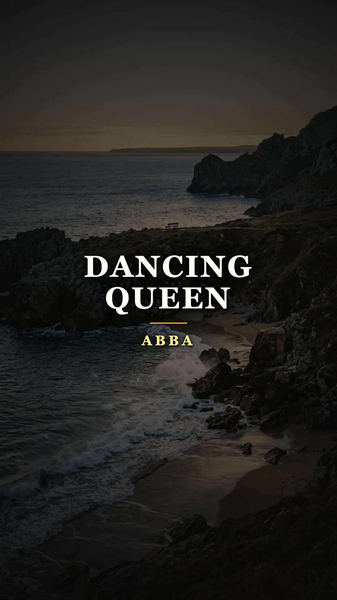
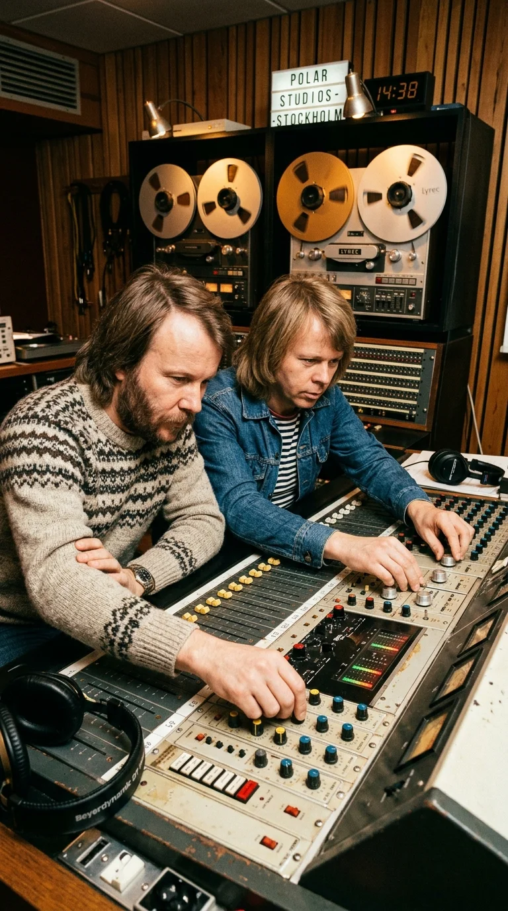
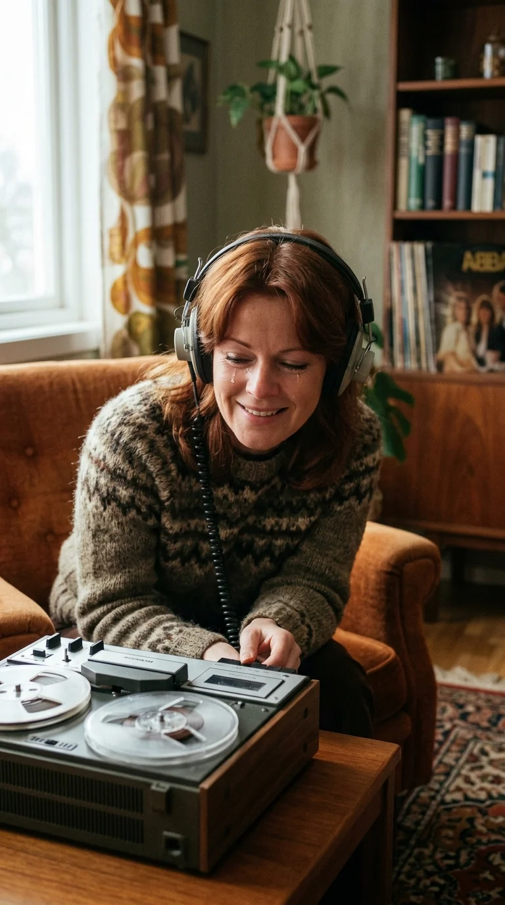
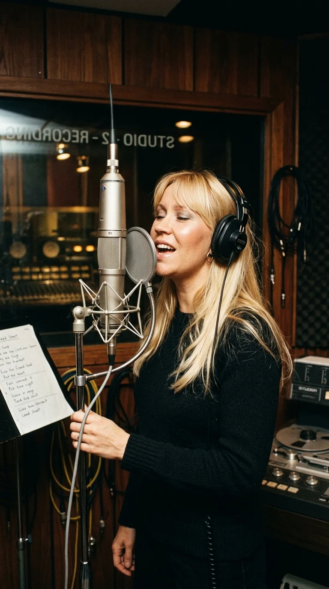
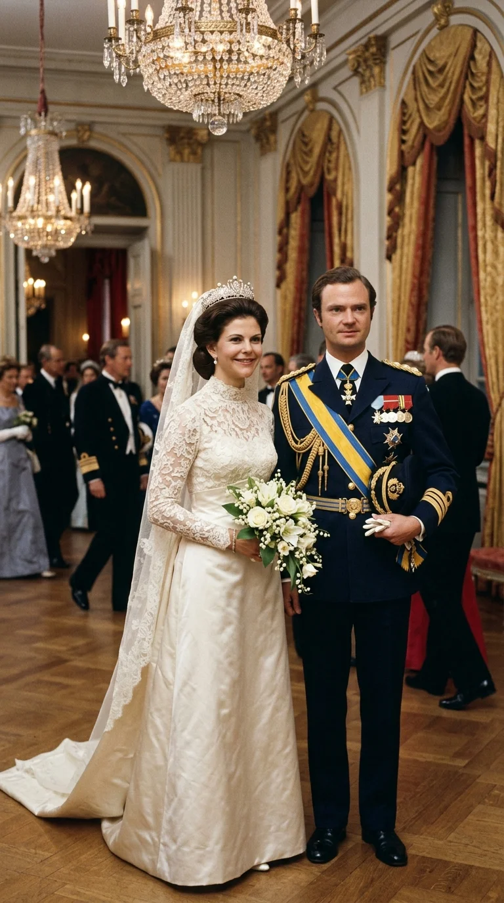
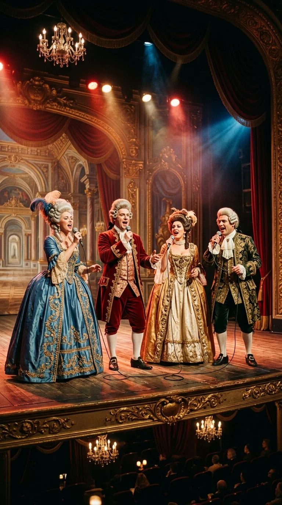
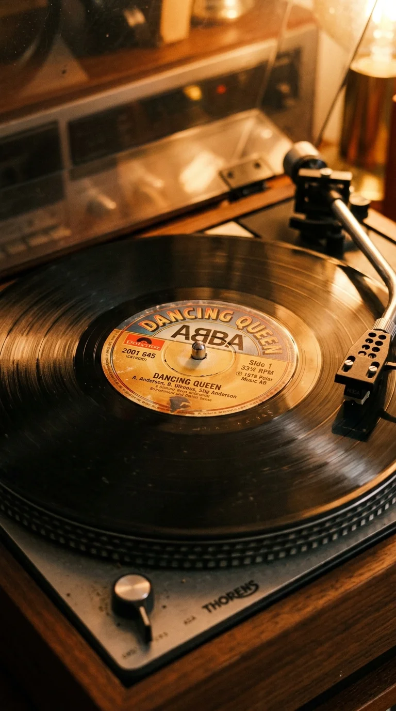
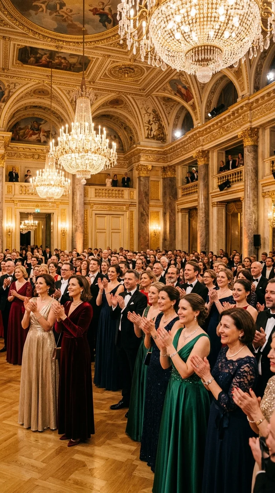

# Dancing Queen: El llanto que coronó a las reinas del baile

*ABBA: El cuarteto sueco que transformó la euforia bailable en una elegía inmortal a la juventud y la libertad.*

---

### Prólogo: El misterio de la euforia con lágrimas

Existe un tipo muy particular de alquimia musical que sólo un puñado de creadores en la historia ha logrado descifrar: la capacidad de fabricar una euforia desbordante que, al mismo tiempo, estruja el pecho con una punzada de melancolía inconsolable.

En la superficie, es una invitación irresistible a la pista de baile. El glissando inicial de un piano de cola se desliza como una cascada de chispas doradas, el bajo marca un pulso elástico y sensual, y dos voces femeninas luminosas proclaman que cualquiera puede ser la reina de la noche:

> *«You can dance, you can jive*  
> *Having the time of your life*  
> *See that girl, watch that scene*  
> *Dig in the dancing queen...»*

Pero quien escuche con atención descubrirá que detrás del confeti no hay una fiesta frívola. Hay una celebración agridulce de la juventud fugaz, una elegía a esos diecisiete años que duran un parpadeo antes de que el peso del mundo caiga sobre los hombros.

Cuando Benny Andersson terminó de mezclar la primera maqueta instrumental en el verano de 1975 y llevó la cinta magnética a casa, no pensaba en cifras de ventas ni en conquistar las listas de Norteamérica. Se sentó en la cocina junto a su prometida, Anni-Frid Lyngstad, y pulsó la tecla de reproducción. Lo que ocurrió en los cuatro minutos siguientes no fue un festejo, sino un instante de silencio sobrecogedor que culminó en un llanto incontrolable.

*Glen Studio, 1975: Benny Andersson y Björn Ulvaeus al piano buscando el pulso rítmico que revolucionaría el pop.*

---

### Acto I: En busca del pulso de Miami en la niebla sueca

Hacia mediados de 1975, el cuarteto sueco ABBA se encontraba en una encrucijada crítica. Tras haber ganado el Festival de Eurovisión en 1974 con *"Waterloo"*, la prensa musical británica y estadounidense los había etiquetado con desdén como un producto efímero: otra extravagancia escandinava condenada a extinguirse en un par de temporadas.

Benny Andersson y Björn Ulvaeus estaban obsesionados con desmentir ese prejuicio. No querían ser una banda de un solo éxito; aspiraban a la perfección arquitectónica del pop, ese territorio sagrado donde habitaban Brian Wilson, The Beatles y Phil Spector.

En agosto de 1975, en el retiro campestre de **Glen Studio**, en Stocksund —a las afueras de Estocolmo—, Benny y Björn se encerraron con el baterista Ola Brunkert y el bajista Rutger Gunnarsson. Ambos compositores habían quedado hipnotizados por un sonido nuevo que cruzaba el Atlántico desde las costas de Florida: el clásico bailable de George McCrae, *"Rock Your Baby"* (1974), producido por KC and the Sunshine Band.

Ulvaeus y Andersson querían capturar ese ritmo relajado, sincopado y elástico, pero filtrándolo a través de la sensibilidad armónica europea. Durante semanas, la pieza llevó el título provisional de **«Boogaloo»**. Trabajaron el tempo con una minuciosidad enfermiza: aceleraban medio compás, retrasaban el ataque de la caja, buscando un balance milimétrico entre la energía del funk y la calidez del pop melódico.

Cuando los instrumentos de base quedaron registrados en la cinta Ampex, Benny supo que algo extraordinario acababa de ocurrir entre aquellas cuatro paredes de madera.

---

### Acto II: La revelación en la cocina de Lidingö

Esa misma tarde, Benny Andersson guardó un casete de prueba en el bolsillo de su abrigo y condujo de regreso a la isla de Lidingö, donde compartía su vida con Anni-Frid «Frida» Lyngstad.

Frida estaba preparando la cena cuando Benny entró en la cocina con los ojos encendidos. Sin decir una sola palabra de introducción, colocó la cinta en la pletina doméstica y subió el volumen.

> *«Benny llegó a casa con la cinta de la pista instrumental y la puso en el reproductor»*, recordaría Frida años más tarde en una entrevista histórica. *«Era tan abrumadoramente hermosa que comencé a llorar de inmediato. Había algo en esos acordes, una pureza tan desgarradora y perfecta, que supe en ese instante exacto que estábamos ante la canción más grande que jamás crearíamos»*.

*Lidingö, 1975: Anni-Frid Lyngstad conmovida hasta las lágrimas al escuchar por primera vez la melodía en la cocina de su hogar.*

Pocos días después, cuando **Agnetha Fältskog** acudió al estudio para escuchar el material sobre el que tendrían que cantar, experimentó la misma conmoción física. A menudo resulta imposible para los artistas predecir cuál de sus canciones conectará con el público; la historia de la música está repleta de descartes que se convirtieron en himnos y sencillos promocionados que se hundieron en el olvido. Pero con aquella maqueta no hubo duda alguna.

> *«Es muy difícil saber de antemano qué va a ser un éxito»*, confesaría Agnetha. *«La mayoría de las veces trabajas a ciegas. Pero cuando escuchamos por primera vez la base de 'Dancing Queen', todos en la sala nos miramos en silencio. Supimos desde el primer segundo que era una obra maestra absoluta»*.

---

### Acto III: El muro de cristal de Michael Tretow

En septiembre de 1975, las sesiones vocales se trasladaron a los míticos **Metronome Studios** de Estocolmo. Fue allí donde intervino el quinto miembro invisible de ABBA: el virtuoso ingeniero de sonido **Michael B. Tretow**.

Tretow estaba fascinado por las técnicas de producción de Phil Spector, pero en Suecia no disponía del presupuesto faraónico para contratar a treinta músicos tocando simultáneamente en una misma sala. En su lugar, Michael ideó un truco acústico artesanal que se convertiría en la firma sónica inconfundible de ABBA.

*Metronome Studios: Agnetha Fältskog frente al micrófono entrelazando su voz en una muralla armónica tridimensional.*

Para las voces principales de Agnetha y Frida, Tretow utilizó una técnica personalizada de sobregrabación (*ADT / tape detuning*):
1. Grababa una primera toma con las dos cantantes compartiendo el mismo micrófono, cantando al unísono con una precisión milimétrica.
2. Luego les hacía grabar una segunda y tercera toma idéntica sobre la pista anterior.
3. Al reproducir las cintas simultáneamente, Tretow alteraba la velocidad del motor de uno de los magnetófonos en una fracción microscópica de tono (micro-detuning).

El resultado era un fenómeno acústico deslumbrante: las voces de Agnetha (soprano cristalina) y Frida (mezzosoprano cálida y terrenal) se fundían en un coro celestial de amplitud tridimensional, donde era imposible distinguir dónde terminaba una y comenzaba la otra. No sonaban como dos mujeres en una cabina; sonaban como un ejército de ángeles entonando una plegaria a la alegría de vivir.

A eso se sumó el teclado de Benny: en lugar de mantener acordes sostenidos de acompañamiento, Andersson introdujo complejas figuras contrapuntísticas al piano, inspiradas en las fugas barrocas de Johann Sebastian Bach, que dialogaban permanentemente con las líneas vocales.

La letra, afinada por el mánager Stig Anderson junto a Björn, terminó de fijar el mito: no era un himno para las divas inalcanzables de las revistas de moda, sino un tributo a la muchacha común y corriente de diecisiete años que, al caer la noche del viernes, se olvida de la fábrica, del desamor y de la rutina, y se transforma en la soberana absoluta de la pista bajo las luces de la bola de espejos.

---

### Acto IV: La coronación en la Ópera Real

Aunque la grabación quedó terminada a finales de 1975, Stig Anderson y el grupo tomaron una decisión insólita: guardaron la cinta en la caja fuerte durante casi nueve meses. Sabían que tenían en sus manos la joya de la corona de su próximo álbum, *Arrival*, y se negaron a precipitar su lanzamiento.

El destino les reservaba un escenario de debut que ningún publicista del mundo del pop habría podido soñar.

En la primavera de 1976, Suecia vivía un fervor nacional sin precedentes. El joven monarca **Carlos XVI Gustavo** —quien había ascendido al trono en 1973 a los veintisiete años— anunció su compromiso matrimonial con la alemana **Silvia Sommerlath**, a quien había conocido durante los Juegos Olímpicos de Múnich de 1972. Era la primera boda de un rey sueco en funciones desde 1797, y el pueblo estaba cautivado por la futura reina plebeya.

*Estocolmo, junio de 1976: El Rey Carlos XVI Gustavo y Silvia Sommerlath en las celebraciones previas a su enlace de Estado.*

La víspera del enlace real, el **18 de junio de 1976**, se celebró una solemne gala televisada de Estado en la histórica **Ópera Real de Estocolmo** (*Kungliga Operan*). Ante la presencia de la realeza europea, diplomáticos, jefes de gobierno y la alta aristocracia escandinava, los organizadores invitaron a los artistas más representativos de la cultura sueca.

Cuando le llegó el turno a ABBA, el cuarteto no apareció con las botas de plataforma futuristas ni los monos de licra brillantes de sus vídeos musicales. En un golpe de genialidad estética y teatral, subieron al escenario vestidos con **trajes de corte barroco del siglo XVIII**, con casacas de terciopelo, encajes bordados, sombreros con plumas y pelucas blancas empolvadas, rindiendo tributo a Gustavo III, el monarca que había fundado la Ópera Nacional en 1773.

*18 de junio de 1976: ABBA interpretando el estreno mundial en la Ópera Real con atuendos dieciochescos ante la futura reina.*

Frente al palco de honor donde sonreía la futura reina Silvia, Agnetha y Frida dieron un paso al frente y comenzaron a entonar por primera vez ante el mundo los versos de *"Dancing Queen"*.

Aunque la canción había sido escrita meses antes pensando en una adolescente anónima en una discoteca de barrio, en aquel teatro dorado el tema cobró una dimensión poética legendaria. Silvia Sommerlath, visiblemente emocionada, presenció cómo cuatro músicos de extracción obrera le dedicaban el estreno mundial del himno bailable más perfecto jamás concebido. La televisión estatal sueca transmitió la ceremonia a millones de hogares, sellando el nacimiento del mito.

---

### Acto V: El asalto a la cima del mundo

El sencillo comercial fue lanzado oficialmente en agosto de 1976 por el sello **Polar Music** bajo la referencia **POS 1225**. La respuesta internacional fue una marea imparable que arrasó las emisoras de radio de los cinco continentes.

En cuestión de semanas, *"Dancing Queen"* trepó al **número uno en catorce países simultáneamente**:
* En el Reino Unido dominó el *UK Singles Chart* durante seis semanas consecutivas en el otoño de 1976, vendiendo más de un millón de copias.
* Encabezó las listas en Australia, Alemania, Países Bajos, Bélgica, Irlanda, Nueva Zelanda, Noruega, Sudáfrica y México.

Pero el verdadero milagro industrial estaba por ocurrir al otro lado del océano Atlántico.

El mercado discográfico de Estados Unidos siempre había sido una fortaleza hostil para los artistas europeos de pop cantado en inglés. Las radios estadounidenses consideraban a ABBA demasiado europeo, demasiado melódico o demasiado refinado para el gusto de las listas de rock y R&B. Sin embargo, la sofisticación rítmica de *"Dancing Queen"* derribó todas las barreras.

El **9 de abril de 1977**, la balada disco de cuatro suecos alcanzó el **número uno absoluto en el Billboard Hot 100**, desplazando a *"Rich Girl"* de Daryl Hall & John Oates. Sería el único número uno en el mercado estadounidense en toda la trayectoria de ABBA, consolidando su estatus como fenómeno global inapelable.

*La catarsis colectiva: El destello de las pistas de baile de todo el mundo donde millones de almas se coronaron reinas de la noche.*

---

### Epílogo: La eternidad bajo la luz de las arañas de cristal

Han transcurrido cinco décadas desde aquella tarde en que Frida Lyngstad lloró sobre la mesa de su cocina en Lidingö. En ese medio siglo, la música disco nació, fue repudiada por las modas, y renació convertida en un clásico intocable de la cultura contemporánea.

*"Dancing Queen"* ha trascendido todas las categorías sociológicas y generacionales. Ha sonado en bodas humildes, en clubes clandestinos donde generaciones enteras encontraron un refugio de libertad y afirmación, y en los salones más encumbrados de la realeza mundial.

En 2008, durante una gala privada en el Castillo de Windsor, la orquesta de salón comenzó a interpretar los acordes de la pieza de ABBA. Ante la sorpresa de los dignatarios presentes, la **Reina Isabel II** del Reino Unido se levantó de su mesa y se dirigió a la pista de baile con una sonrisa cómplice. Cuando uno de sus acompañantes le preguntó por qué era su canción favorita, la monarca respondió con una sobriedad entrañable: *«Siempre intento bailar cuando suena esta canción, porque soy la Reina y me gusta bailar»*.

*El eco eterno: La suntuosidad de un salón iluminado donde la música de ABBA trasciende las épocas y la fugacidad del tiempo.*

Esa es la verdadera magia de la obra maestra de Benny, Björn, Agnetha y Frida. En un mundo desgarrado por las incertidumbres, las pérdidas y el paso implacable de los años, *"Dancing Queen"* ofrece cuatro minutos de redención pura. Nos recuerda que no importa la edad, las heridas o el cansancio acumulado: cuando la música adecuada llena el aire, por un breve instante infinito, todos tenemos diecisiete años y somos los dueños absolutos de la noche.

---

### 📚 Fuentes y Archivo Documental

1. **Palm, Carl Magnus.** *Bright Lights, Dark Shadows: The Real Story of ABBA*. Londres: Omnibus Press, 2001 (Edición revisada, 2014). (La biografía definitiva del cuarteto sueco, con acceso exhaustivo a las bitácoras de grabación de Metronome y Glen Studios).
2. **Andersson, Benny; Ulvaeus, Björn; Fältskog, Agnetha & Lyngstad, Anni-Frid.** *ABBA: The Official Photo Book*. Estocolmo: Max Ström Publishing, 2014. (Testimonios oficiales sobre la composición de *Arrival*, el llanto de Frida y la gala de la Ópera Real de 1976).
3. **Tretow, Michael B.** Entrevistas de archivo para el documental de la BBC *The Joy of ABBA* (2013) y notas de producción discográfica sobre las técnicas de doblaje analógico y cinta micro-detuning.
4. **Billboard Magazine.** Ediciones históricas de marzo, abril y mayo de 1977. Seguimiento semanal del ascenso de *"Dancing Queen"* al N.º 1 del *Billboard Hot 100*.
5. **Sveriges Television (SVT).** Archivo audiovisual oficial de la gala previa al matrimonio del Rey Carlos XVI Gustavo y la Reina Silvia en la Real Ópera de Estocolmo (18 de junio de 1976).
6. **The Recording Academy.** *Grammy Hall of Fame Inductees*. Entrada oficial de *"Dancing Queen"* (Polar Music / Atlantic Records, 1976), exaltada en 2015 por su trascendencia histórica y cualidad estética permanente.
