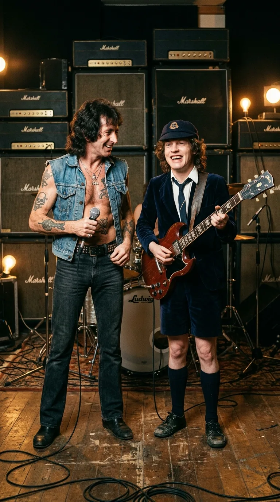
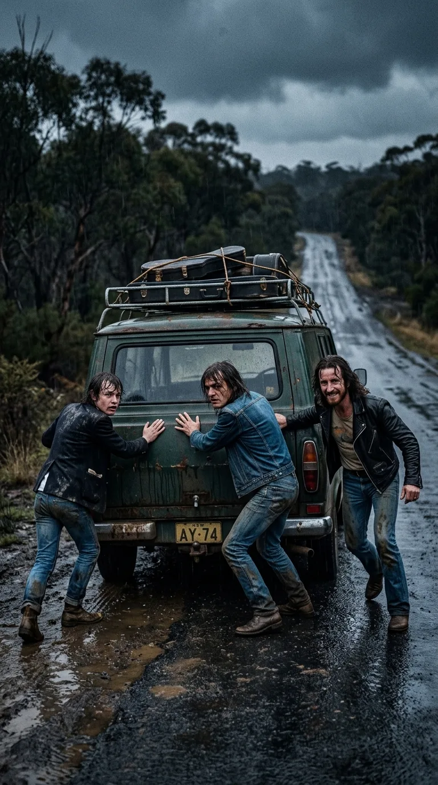
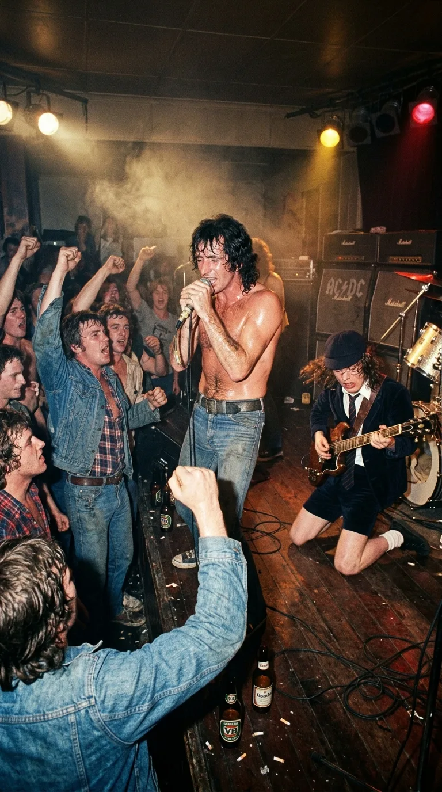
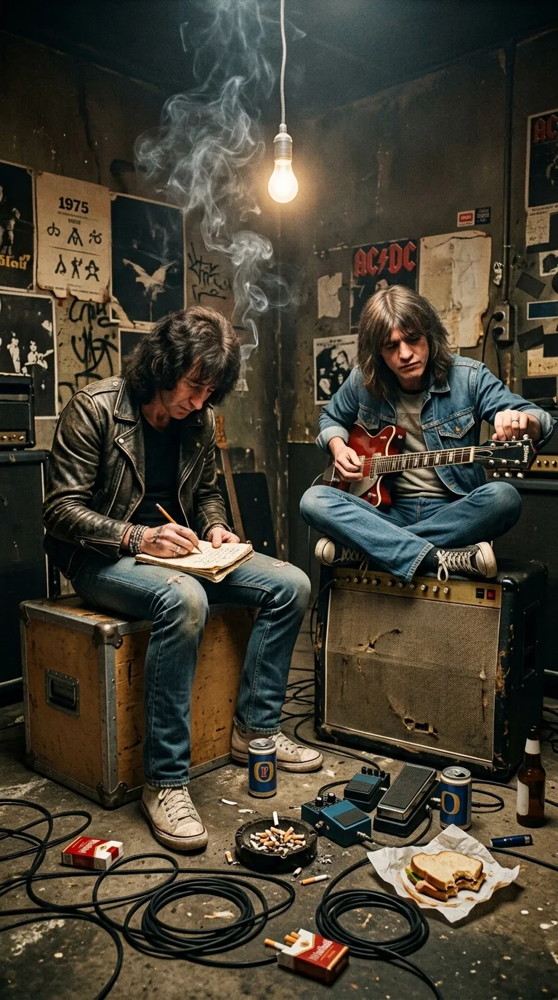
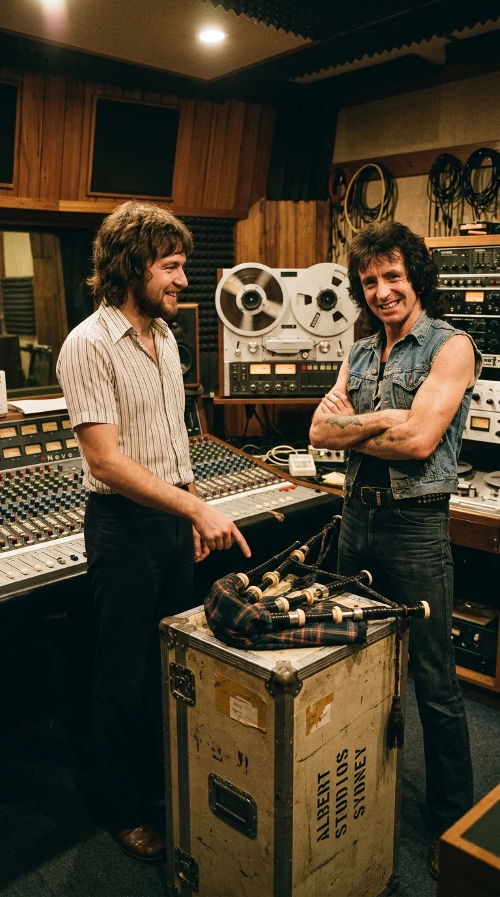
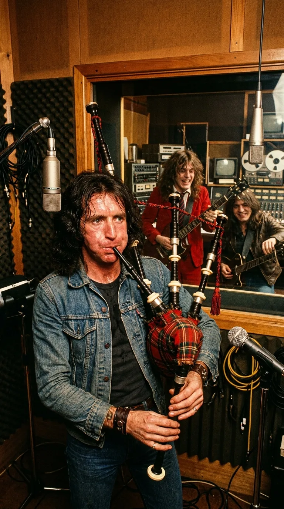
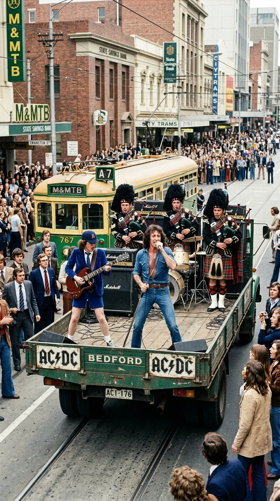
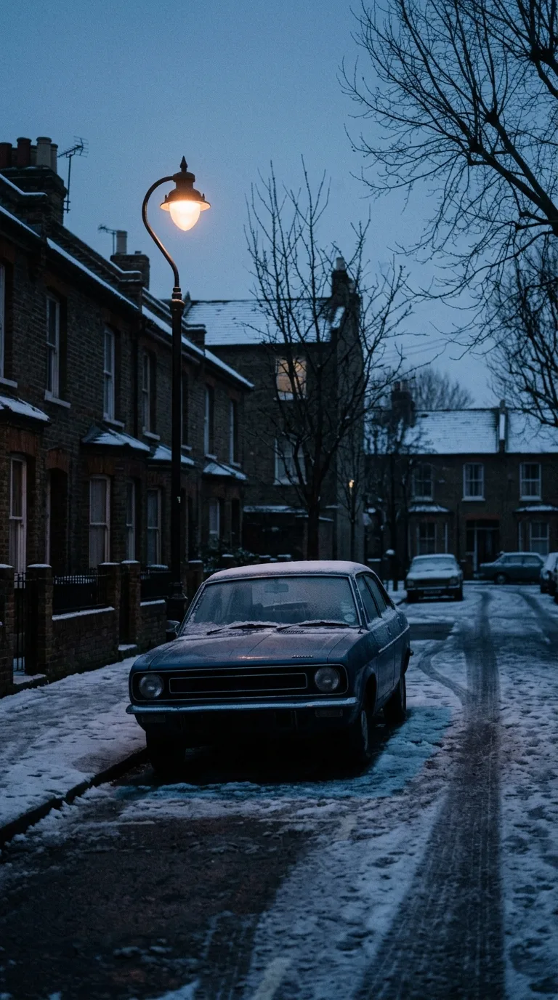
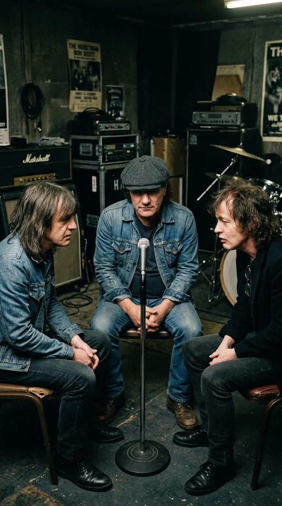

# The Anthem They Vowed Never to Sing Again: The Truth Behind «It's a Long Way to the Top»

*1975: Bon Scott and Angus Young in the Sydney studios, forging the raw and rebellious sound of AC/DC.*

### Prologue: The Mud Before the Thunder

> *«Getting robbed, getting stoned, getting beat up, broken boned... Getting had, getting took... I tell you, folks, it's harder than it looks.»*

In the mid-1970s, long before the one-ton bronze bells, the gunpowder cannons, and the multi-million-dollar stadium tours spanning five continents, **AC/DC** was merely a handful of young Scottish immigrants with calloused hands, empty pockets, and the indomitable tenacity of the transplanted British working class navigating the Australian asphalt.

There was no glamour in their beginnings. There was real hunger, endless highways stretching between Melbourne, Adelaide, and Sydney, and a battered van where **Angus Young**, **Malcolm Young**, and **Bon Scott** slept curled up over the wooden cases of their Marshall amplifiers. When they stepped onto the low stages of suburban pubs and workers' clubs, a docile audience did not await them: they played before dockworkers, drunken sailors, and local gangs who hurled beer mugs and bottles if the rhythm faltered for a single measure. More than one dawn ended with bruised knuckles, sore ribs, and frantic escapes through back alleys with the box-office cash hidden inside their boots.

*Australian highways, 1974: Pushing the broken-down van through the rain during the harsh days before stardom.*

Out of that open-air crucible, out of a fraternity forged through blows and an obstinacy proof against failure, **«It's a Long Way to the Top (If You Wanna Rock 'n' Roll)»** was born. That track—recorded for the group's second Australian album, *T.N.T.* (December 1975)—not only defined the band's DNA; it concealed within its grooves an audacious white lie in the studio, an unruly instrument that forced electric guitars to alter their tuning, and an oath of honor that the group has never broken.

---

### Milestone I: The War Dispatch of Australian Bars

In the second half of 1975, after recruiting **Ronald Belford "Bon" Scott**—a Scot born in Forfar and raised between Kirriemuir, Melbourne, and Fremantle who worked as the band's occasional driver before stepping up to the microphone—AC/DC shut themselves inside the legendary **Albert Studios** on King Street in downtown Sydney.

*Victoria, 1975: A shirtless Bon and Angus on his knees unleashing the storm inside the turbulent working-class pubs.*

Waiting at the mixing console was the most influential production duo in Australian rock: **Harry Vanda** and **George Young**—older brother to Malcolm and Angus, and a former member of *The Easybeats*. George knew the trade better than anyone: he knew that a great rock band is not manufactured with polished studio artifices, but by capturing the sweat and the rhythmic pulse the group unleashed every night before a live crowd.

While Malcolm Young—wielding his inseparable 1963 **Gretsch Jet Firebird** guitar—bassist Mark Evans, and drummer Phil Rudd cemented a hypnotic, dry pulse in B-flat, Bon Scott opened his notebook resting upon a flight case.

*Sydney, 1975: Bon Scott perched on a road case, penning the verses that mirrored his own raw wounds.*

What Bon had jotted down in pencil was neither a fantasy of rock stardom nor an anthem of youthful arrogance. It was a first-person journalistic chronicle of the hardships of the road:

> *«Hotel rooms and motorways, / You get yourneath the wheel... / Gettin' robbed, gettin' stoned, / Gettin' beat up, broken-boned... / If you think it's easy to play a one-night stand, try playing in a rock and roll band»*.

Every line bore a name and a face from his recent memory: unscrupulous promoters who vanished with the takings, flophouse motels where people broke in to steal their clothes while they played, and hand-to-hand brawls to defend their instruments. As Angus Young would recall years later: *«People thought Bon was exaggerating to sound tough. There wasn't a single word of fiction: everything he sang in that song had happened to us the week before»*.

---

### Milestone II: Bon Scott's Scottish Bluff

The rhythmic structure functioned with the precision of a diesel engine, but Harry Vanda and George Young felt the song lacked a timbre capable of cutting right through radio broadcasts. They needed an instrument that could converse on equal terms with the incendiary solos of Angus's **Gibson SG**.

In the middle of the session at Albert Studios, George Young remembered that Bon had played in his youth in Perth with a traditional Scottish pipe band—the **Mount Hawthorn Pipe Band**, in which his father, Chick Scott, served. George leaned out from the control room and threw out the idea:

—*"Hey, Bon... you were in a Scottish pipe band, right? Why don't we bring in a real set of bagpipes to battle head-to-head with Angus's guitar?"*

*Albert Studios: Producer George Young challenges Bon Scott to feature a traditional Scottish bagpipe.*

Bon Scott flashed his trademark crooked smile and replied without missing a beat:

—*"Sure, no problem. I've got it covered."*

There was, however, one detail neither George nor his brothers knew: in the *Mount Hawthorn Pipe Band*, **Bon Scott had exclusively been a snare drummer**. He knew the Highland marches and the martial bearing of the pipers by heart, but he had never had to coordinate pulmonary pressure on a leather bag with three drones and the fingering of the chanter.

Too proud to confess the misunderstanding—and determined not to let a brilliant idea slip away—Bon kept silent while **Malcolm Young** headed out of the studio toward the *Allan's Music* instrument shop to purchase a traditional **Great Highland bagpipe**.

---

### Milestone III: Subduing the Wind and Re-Tuning Rock and Roll

Anyone who has tried to make a Scottish bagpipe sound knows it tolerates no half-measures: it demands a fierce, steady column of air under the left arm to keep the drones from drowning out in an out-of-tune shriek.

Bon locked himself away alone with the newly purchased instrument. Through sheer lung power, street-earned ear, and fierce determination, he managed to tame the chanter until he coaxed out a vibrant, proud, and warrior-like pentatonic melody. When he stepped back into the Albert Studios recording room, his cheeks flushed and the veins in his neck strained to the limit, he laid down the melody that would define the track.

*Albert Studios, 1975: Bon Scott taming the bagpipes at the top of his lungs, forcing the guitars to readjust their tuning.*

It was then that Vanda and George Young ran into an insurmountable acoustic barrier. The chanter of a traditional Scottish bagpipe is a fixed-pitch instrument: its natural scale settles around **B-flat (B♭)**, yet at a frequency slightly higher than standard concert pitch (**A = 440 Hz**).

Rather than discarding the bagpipe or attempting to artificially manipulate tape speed, the producers made a historic decision: **it was Angus and Malcolm's electric guitars that had to modify their tuning to submit to the exact pitch of the bagpipe's drone**. The result—that call-and-response duel where Angus's overdriven Gibson SG chases and answers every phrase of Bon's bagpipes—was immortalized as one of the boldest moments in rock history.

*(As a twist of destiny, playing that instrument live proved an even greater ordeal: after barely a handful of concerts where Bon dropped the bagpipe onto the stage floor at the end of his solo, the instrument ended up smashed amidst the tumult of a gig, causing the band to stop playing it live long before the decade was out).*

---

### Milestone IV: A Bedford Truck on Swanston Street

On **February 23, 1976**, to promote the single on the celebrated **ABC** Australian public television music program ***Countdown***, director **Paul Drane** proposed a staging as austere as it was unforgettable: renting a flatbed **Bedford** truck and filming the band playing live as the vehicle crawled slowly down **Swanston Street**, Melbourne's main artery, in broad daylight.

*Melbourne, February 1976: AC/DC atop a Bedford truck on Swanston Street alongside the pipers of the Rats of Tobruk.*

Because Bon could not sing and blow the bagpipes simultaneously with ease throughout the entire route, the ABC production crew hired three veteran pipers from the historic military band **Rats of Tobruk Memorial Pipes & Drums**: **Kevin Conlon**, **Alan Holmes**, and **Les Kenfield**.

The 16-millimeter cameras captured an unrepeatable moment of cultural collision. As the truck moved at a pedestrian pace with an electric generator roaring in the back, Bon sang in a denim vest with his microphone cord wrapped around his fist, Angus contorted in his velvet schoolboy uniform, and the three Scottish veterans marched impassively in traditional kilts and feather bonnets. On the sidewalks of Melbourne, tie-wearing office workers, housewives, and laborers stared in astonishment at the electric procession, while dozens of youngsters sprinted behind the truck's rear bumper. In four minutes of celluloid, AC/DC's gritty, street-level working-class aesthetic was sealed forever.

---

### Milestone V: The London Winter and the Pact of Silence

The following years proved those verses about the long road to the top right. With albums like *Dirty Deeds Done Dirt Cheap*, *Let There Be Rock*, *Powerage*, and the career-defining *Highway to Hell* (1979), AC/DC finally conquered the European and American markets. The summit was within touching distance.

Yet in the early hours of **February 19, 1980**, following a freezing night in London, **Bon Scott** passed away at the age of thirty-three inside a parked Renault 5 automobile on Overhill Road in the district of Dulwich.

*London, February 19, 1980: The lonely winter street where Bon Scott's voice was extinguished forever.*

The tragedy nearly brought the band to an end. Only the explicit encouragement of Bon's parents—Chick and Isa Scott, who assured the Young brothers that their son would never have forgiven them for giving up—spurred them on. Weeks later they recruited Newcastle vocalist **Brian Johnson**, a singer of working-class roots and abrasive voice with whom they traveled to the Bahamas to record *Back in Black* (1980) as a requiem of mourning and electricity in honor of their fallen friend.

However, when preparing the repertoire for that new era, the Young brothers and Brian Johnson made an unnegotiable ethical determination: **«It's a Long Way to the Top» was permanently retired from AC/DC's stage setlists**.

*London, 1980: Malcolm, Angus, and Brian Johnson sealing the oath of honor never to play the song live again.*

As Brian Johnson himself would explain in his memoirs and interviews:

> *«There are songs that belong to a man's soul. "It's a Long Way to the Top" was Bon's signature song; it was his life, his lyrics, and his story. To try and sing it would have been an unforgivable disrespect—both to his memory and to the fans»*.

---

### Epilogue: The Immortal Echo Before the Storm

Since that fateful winter of 1980, **AC/DC has never performed the song live again**. Neither the pleas of millions of concertgoers over forty-five years nor anniversary tours have ever persuaded Brian Johnson or Angus Young to break that vow of brotherhood.

*The solitary microphone and the bagpipe in twilight: an unalterable tribute to a brother who never stopped singing.*

The tribute, however, found an unexpected channel in the hands of their spiritual heirs. For decades, another of the planet's biggest bands—**Metallica**—has maintained a sacred liturgy at every one of their stadium concerts around the world: minutes before the lights go out and Ennio Morricone's *«The Ecstasy of Gold»* plays, the venue's PA system blasts the original 1975 recording of *«It's a Long Way to the Top»* at full volume.

Thus, while tens of thousands of voices chant in the twilight that duel between Angus's guitar and the bagpipes Bon Scott learned to blow out of pure Scottish pride, the prophecy fulfills itself night after night: the road to the top is hard, lonely, and ruthless, but the loyalty between trench-mate brothers lasts for all eternity.

---

### 📚 Sources and Archival Records

1. **AC/DC Biographies and Documentary History**:
   * **Engleheart, Murray & Durieux, Arnaud** (2006): *AC/DC: Maximum Rock & Roll: The Ultimate Story of the World's Greatest Rock-and-Roll Band*. HarperCollins Publishers (Detailed chronicle of the *T.N.T.* sessions at Albert Studios, Bon Scott's tenure as a snare drummer in the *Mount Hawthorn Pipe Band*, Malcolm Young's purchase of the bagpipe, and the instrument's subsequent destruction live).
   * **Wall, Mick** (2012): *AC/DC: Hell Ain't a Bad Place to Be*. St. Martin's Press (Testimonies on life on the road in Australia between 1974 and 1975 and the impact of Bon Scott's passing in February 1980).
   * **Fink, Jesse** (2013): *The Youngs: The Brothers Who Built AC/DC*. Ebury Press / St. Martin's Griffin (Analysis of Harry Vanda and George Young's production at Albert Studios and the B-flat tuning adjustments alongside the bagpipe drone).
   * **Walker, Clinton** (1994): *Highway to Hell: The Life and Times of AC/DC Legend Bon Scott*. Verse Chorus Press (Reference biography on Ronald Belford Scott's youth in Scotland and Western Australia).
2. **Memoirs and Direct Testimonies**:
   * **Johnson, Brian** (2022): *The Lives of Brian: A Memoir*. Dey Street Books / Penguin (Direct statements regarding his entry into AC/DC in 1980 and the ethical decision to retire *«It's a Long Way to the Top»* from the live setlist out of respect for Bon Scott).
3. **Audiovisual and Discographic Records**:
   * **Albert Productions** (December 1975): Technical credits for the album *T.N.T.* (LP APLP-016, recorded at Albert Studios, Sydney; produced by Harry Vanda and George Young).
   * **Australian Broadcasting Corporation (ABC) / National Film and Sound Archive of Australia (NFSA)** (February 23, 1976): *Countdown — 16mm shooting on Swanston Street, Melbourne*, directed by Paul Drane featuring Kevin Conlon, Alan Holmes, and Les Kenfield (*Rats of Tobruk Memorial Pipes & Drums*).