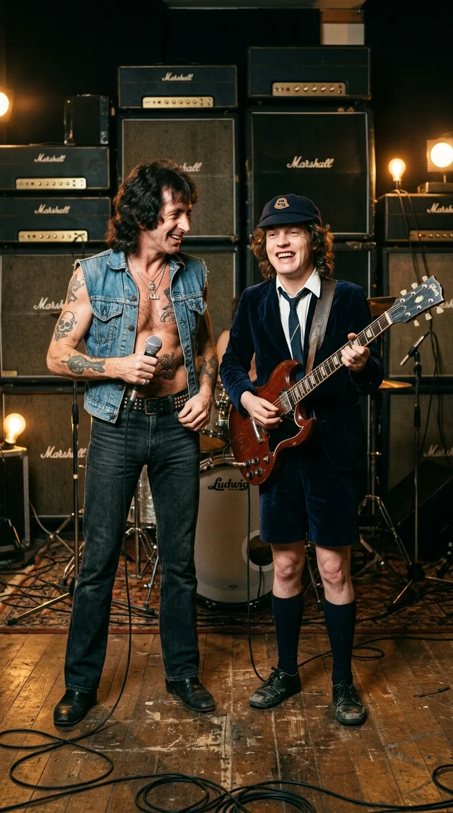
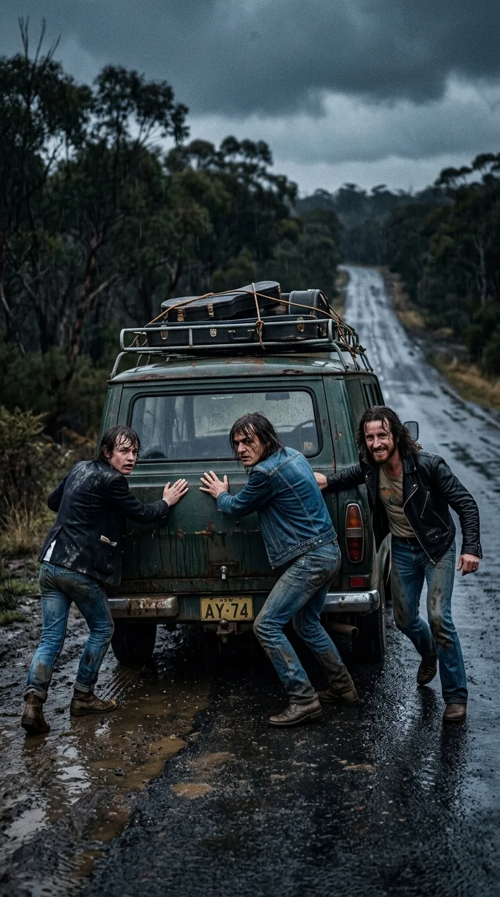
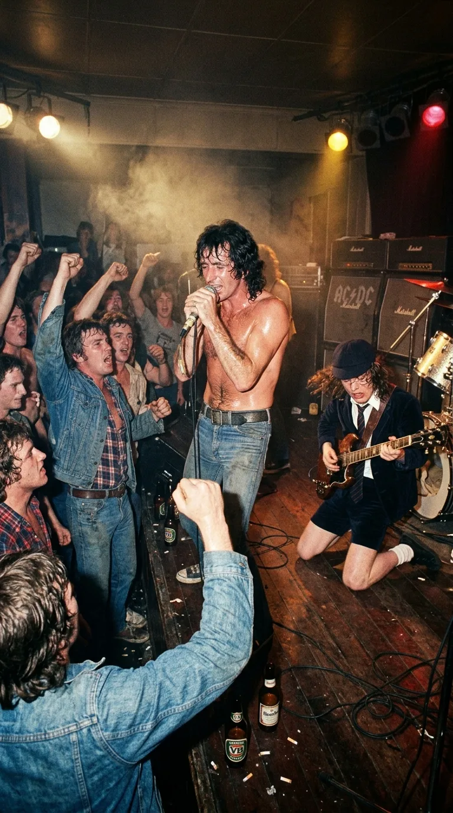
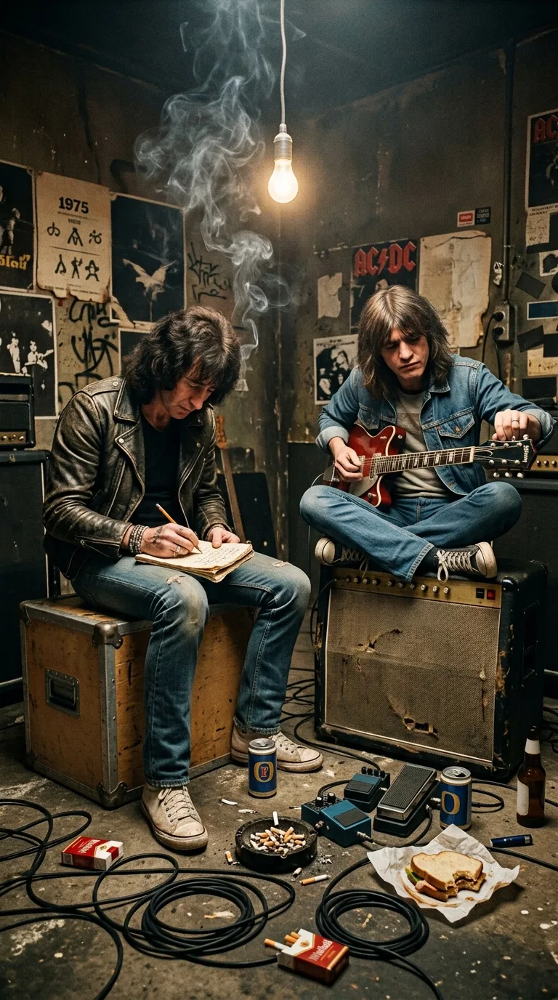
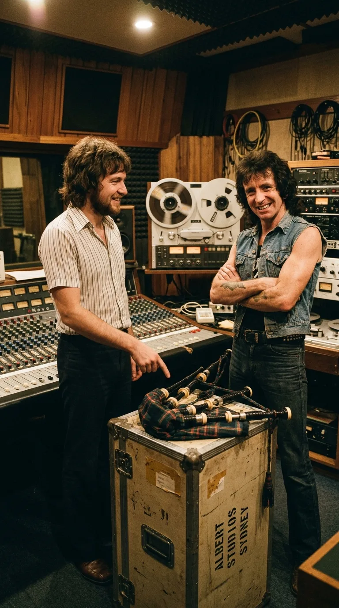
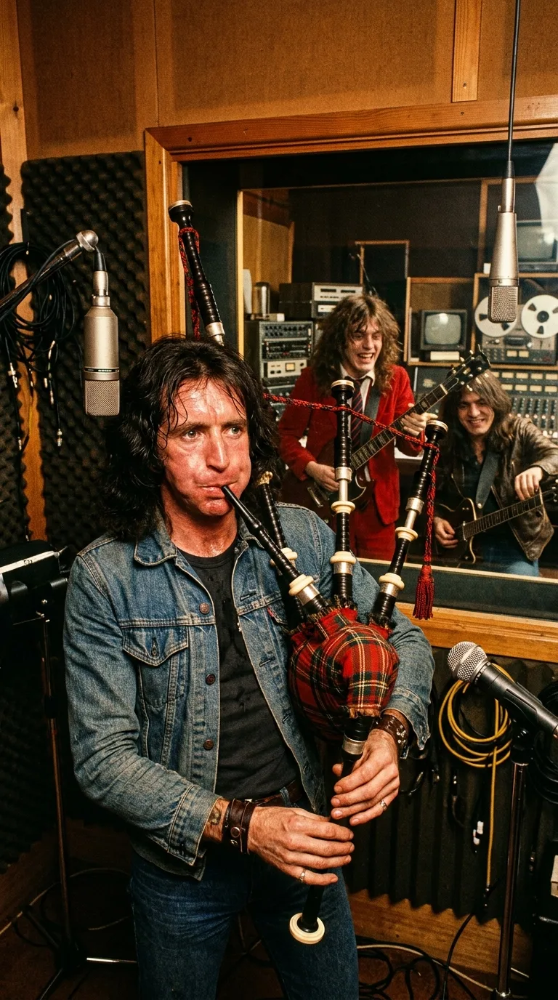
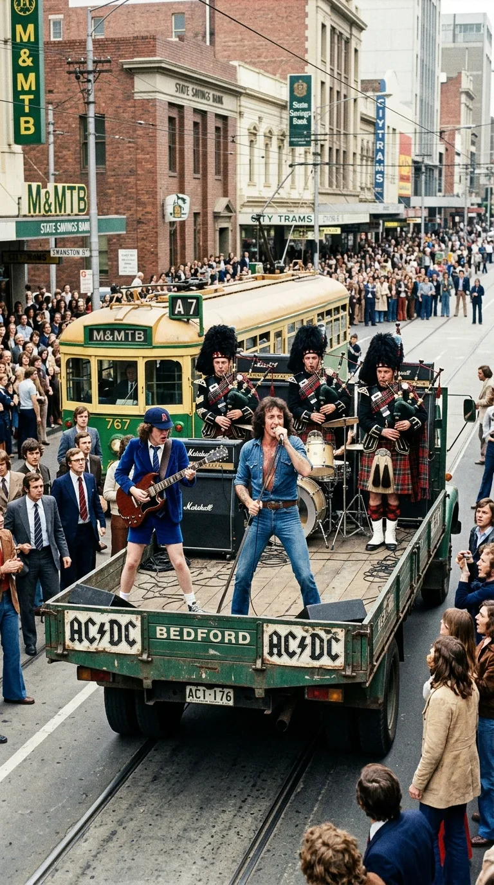
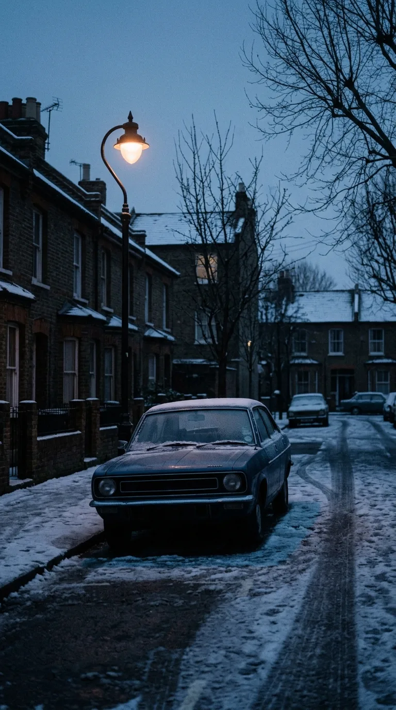
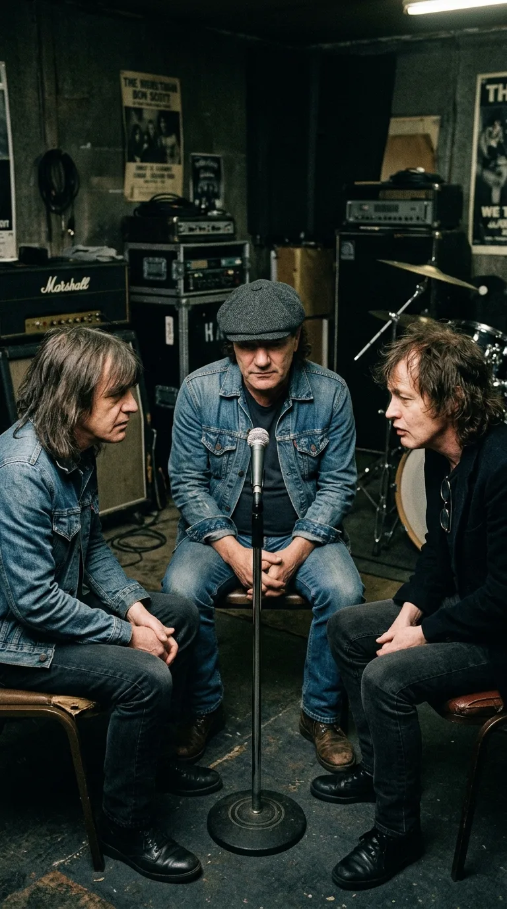

# El Himno que Juraron No Cantar Jamás: La Verdad Detrás de «It's a Long Way to the Top»

*1975: Bon Scott y Angus Young en los estudios de Sídney, forjando el sonido crudo y rebelde de AC/DC.*

### Prólogo: El barro antes del trueno

> *«Getting robbed, getting stoned, getting beat up, broken boned... Getting had, getting took... I tell you, folks, it's harder than it looks.»*

A mediados de los años setenta, mucho antes de las campanas de bronce de una tonelada, los cañones de pólvora y las giras multimillonarias por estadios de los cinco continentes, **AC/DC** era apenas un puñado de jóvenes inmigrantes escoceses con las manos encallecidas, los bolsillos vacíos y la tenacidad indomable de la clase obrera británica trasplantada al asfalto australiano.

No había glamour en sus comienzos. Había hambre real, carreteras interminables entre Melbourne, Adelaida y Sídney, y una furgoneta destartalada donde **Angus Young**, **Malcolm Young** y **Bon Scott** dormían encogidos sobre los estuches de madera de sus amplificadores Marshall. Cuando subían a las tarimas bajas de los pubs suburbanos y clubes de trabajadores (*workers' clubs*), no los esperaba una audiencia dócil: tocaban frente a estibadores, marineros ebrios y pandillas locales que arrojaban jarras y botellas de cerveza si el ritmo flaqueaba un solo compás. Más de una madrugada terminó con nudillos rotos, costillas magulladas y huidas precipitadas por callejones traseros con el dinero de la taquilla escondido en las botas.

*Carreteras australianas, 1974: Empujando la furgoneta averiada bajo la lluvia, en los duros días antes del estrellato.*

De esa intemperie, de esa fraternidad forjada a golpes y de una terquedad a prueba de fracasos nació **«It's a Long Way to the Top (If You Wanna Rock 'n' Roll)»**. Aquel tema —registrado para el segundo álbum australiano del grupo, *T.N.T.* (diciembre de 1975)— no solo definió el ADN de la banda: escondió en sus surcos una audaz mentira piadosa en el estudio, un instrumento indomable que obligó a las guitarras eléctricas a cambiar su afinación y un juramento de honor que el grupo jamás ha quebrantado.

---

### Acto I: El parte de guerra de los bares australianos

En la segunda mitad de 1975, tras reclutar a **Ronald Belford «Bon» Scott** —un escocés nacido en Forfar y criado entre Kirriemuir, Melbourne y Fremantle que trabajaba como chofer ocasional de la banda antes de tomar el micrófono—, AC/DC se encerró en los legendarios **Albert Studios** de King Street, en el centro de Sídney.

*Victoria, 1975: Bon Scott sin camiseta y Angus de rodillas desatando la tormenta en los turbulentos pubs obreros.*

En la consola de control los aguardaba la dupla de productores más influyente del rock australiano: **Harry Vanda** y **George Young** —hermano mayor de Malcolm y Angus, y exmiembro de *The Easybeats*—. George conocía mejor que nadie el oficio: sabía que una gran banda de rock no se fabrica con artificios de salón, sino capturando el sudor y el latido rítmico que el grupo desplegaba cada noche frente al público.

Mientras Malcolm Young —con su inseparable guitarra **Gretsch Jet Firebird** de 1963—, el bajista Mark Evans y el baterista Phil Rudd cimentaban un pulso hipnótico y seco en Si bemol, Bon Scott abrió su libreta de apuntes sobre un baúl de transporte.

*Sídney, 1975: Bon Scott sobre un baúl de carretera escribiendo los versos que retrataban sus propias heridas.*

Lo que Bon había escrito con lápiz no era una fantasía de estrellas de rock ni un himno de arrogancia juvenil. Era una crónica periodística en primera persona de las penurias de la carretera:

> *«Hotel rooms and motorways, / You get yourneath the wheel... / Gettin' robbed, gettin' stoned, / Gettin' beat up, broken-boned... / Si crees que es fácil hacer un concierto de una noche, intenta tocar en una banda de rock and roll»*.

Cada línea tenía nombre y apellido en su memoria reciente: promotores sin escrúpulos que desaparecían con la recaudación, moteles de mala muerte donde entraban a robarles la ropa mientras tocaban y peleas cuerpo a cuerpo para defender sus instrumentos. Como recordaría años después Angus Young: *«La gente creía que Bon exageraba para sonar rudo. No había una sola palabra de ficción: todo lo que cantaba en esa canción nos había ocurrido la semana anterior»*.

---

### Acto II: El farol escocés de Bon Scott

La estructura rítmica funcionaba con la precisión de un motor diésel, pero Harry Vanda y George Young sentían que a la canción le faltaba un timbre capaz de partir en dos las emisiones de radio. Necesitaban un instrumento que dialogara de igual a igual con los solos incendiarios de la **Gibson SG** de Angus.

En mitad de la sesión en Albert Studios, George Young recordó que Bon había participado durante su adolescencia en Perth en una banda tradicional escocesa —la **Mount Hawthorn Pipe Band**, donde militaba su padre, Chick Scott—. George se asomó desde la sala de control y lanzó la idea:

—*«Oye, Bon... tú estuviste en una banda de gaitas escocesas, ¿verdad? ¿Por qué no metemos una gaita de verdad batiéndose a duelo con la guitarra de Angus?»*

*Albert Studios: El productor George Young desafía a Bon Scott a incluir una gaita escocesa tradicional.*

Bon Scott esbozó su característica sonrisa ladeada y respondió sin titubear:

—*«Claro, sin problema. Yo me encargo»*.

Existía, sin embargo, un detalle que ni George ni sus hermanos conocían: en la *Mount Hawthorn Pipe Band*, **Bon Scott había sido únicamente tamborilero de redoblante (*snare drummer*)**. Conocía de memoria las marchas de las Tierras Altas y el porte marcial de los gaiteros, pero jamás había tenido que coordinar la presión pulmonar del odre de cuero con los tres bordones (*drones*) y la digitación del puntero (*chanter*).

Demasiado orgulloso para confesar el malentendido —y decidido a no dejar escapar una idea genial—, Bon guardó silencio mientras **Malcolm Young** salía del estudio rumbo a la tienda de instrumentos *Allan's Music* para comprar una gaita escocesa tradicional (*Great Highland bagpipe*).

---

### Acto III: Doblegar al viento y re-afinar el rock and roll

Quien ha intentado hacer sonar una gaita escocesa sabe que no admite medias tintas: exige una columna de aire feroz y constante bajo el brazo izquierdo para evitar que los bordones se ahoguen en un chillido desafinado.

Bon se encerró a solas con el instrumento recién comprado. A fuerza de pulmón, oído callejero y una determinación feroz, logró domar el puntero hasta arrancar una frase pentatónica vibrante, orgullosa y guerrera. Cuando entró a la sala de grabación de Albert Studios, con las mejillas encendidas y las venas del cuello tensadas al límite, registró la melodía que definiría la canción.

*Albert Studios, 1975: Bon Scott domando la gaita a pleno pulmón, obligando a las guitarras a reajustar su afinación.*

Fue entonces cuando Vanda y George Young se toparon con una barrera acústica inapelable. El puntero de una gaita escocesa tradicional es un instrumento de afinación fija: su escala natural se sitúa en torno al **Si bemol (B♭)**, pero con una frecuencia ligeramente superior al temperamento estándar de concierto (**La = 440 Hz**).

En lugar de descartar la gaita o intentar manipular artificialmente la velocidad de la cinta, los productores tomaron una decisión histórica: **fueron las guitarras eléctricas de Angus y Malcolm las que tuvieron que modificar su afinación para someterse al tono exacto del bordón de la gaita**. El resultado —aquel duelo de llamada y respuesta (*call-and-response*) donde la Gibson SG saturada de Angus persigue y contesta cada frase de la gaita de Bon— quedó inmortalizado como uno de los momentos más audaces de la historia del rock.

*(Como apostilla del destino, tocar aquel instrumento en directo resultó ser una odisea aún mayor: tras apenas un puñado de conciertos donde Bon dejaba la gaita en el suelo del escenario al terminar su solo, el instrumento acabó destrozado en medio del tumulto de un recital, por lo que la banda dejó de interpretarla en vivo mucho antes de que terminara la década).*

---

### Acto IV: Un camión Bedford en Swanston Street

El **23 de febrero de 1976**, para presentar el sencillo en el célebre programa musical ***Countdown*** de la televisión pública australiana (**ABC**), el director **Paul Drane** propuso una puesta en escena tan austera como inolvidable: alquilar un camión de plataforma abierta **Bedford** y filmar a la banda tocando en directo mientras el vehículo avanzaba lentamente por **Swanston Street**, la arteria principal de Melbourne, a plena luz del mediodía.

*Melbourne, febrero de 1976: AC/DC sobre un camión Bedford en Swanston Street junto a los gaiteros de Rats of Tobruk.*

Como Bon no podía cantar y soplar la gaita simultáneamente con soltura durante todo el recorrido, la producción de ABC contrató a tres gaiteros veteranos de la histórica banda militar **Rats of Tobruk Memorial Pipes & Drums**: **Kevin Conlon**, **Alan Holmes** y **Les Kenfield**.

Las cámaras de 16 milímetros capturaron un instante irrepetible de colisión cultural. Mientras el camión avanzaba a paso de peatón con un generador eléctrico rugiendo en la caja, Bon cantaba en chaleco vaquero con el cable del micrófono enrollado en el puño, Angus se contorsionaba con su uniforme escolar de terciopelo y los tres veteranos escoceses marchaban imperturbables con sus *kilts* tradicionales y gorros *feather bonnet*. En las aceras de Melbourne, oficinistas de corbata, amas de casa y obreros miraban atónitos aquella procesión eléctrica, mientras decenas de jóvenes corrían tras el parachoques trasero del camión. En cuatro minutos de celuloide quedó sellada para siempre la estética obrera y callejera de AC/DC.

---

### Acto V: El invierno de Londres y el pacto de silencio

Los años siguientes dieron la razón a aquellos versos sobre el largo camino hacia la cima. Con discos como *Dirty Deeds Done Dirt Cheap*, *Let There Be Rock*, *Powerage* y el consagratorio *Highway to Hell* (1979), AC/DC conquistó finalmente los mercados de Europa y Estados Unidos. La cima estaba al alcance de la mano.

Pero en la madrugada del **19 de febrero de 1980**, tras una noche helada en Londres, **Bon Scott** falleció a los treinta y tres años en el interior de un automóvil Renault 5 estacionado en Overhill Road, en el barrio de Dulwich.

*Londres, 19 de febrero de 1980: La solitaria calle invernal donde se apagó para siempre la voz de Bon Scott.*

La tragedia estuvo a punto de poner fin a la banda. Solo el aliento expreso de los padres de Bon —Chick e Isa Scott, quienes aseguraron a los hermanos Young que su hijo jamás les habría perdonado que se rindieran— los impulsó a continuar. Semanas más tarde reclutaron al vocalista de Newcastle **Brian Johnson**, un cantante de raíces obreras y voz abrasiva con quien viajaron a las Bahamas para grabar *Back in Black* (1980) como un réquiem de luto y electricidad en honor a su amigo caído.

Sin embargo, al preparar el repertorio de aquella nueva era, los hermanos Young y Brian Johnson tomaron una determinación ética innegociable: **«It's a Long Way to the Top» quedaba retirada para siempre de los escenarios de AC/DC**.

*Londres, 1980: Malcolm, Angus y Brian Johnson sellando el pacto de honor de no volver a cantar el tema en directo.*

Como explicaría el propio Brian Johnson en sus memorias y entrevistas:

> *«Hay canciones que pertenecen al alma de un hombre. "It's a Long Way to the Top" era la canción insignia de Bon; era su vida, su letra y su historia. Intentar cantarla habría sido una falta de respeto imperdonable, tanto para su memoria como para los seguidores»*.

---

### Epílogo: El eco inmortal antes de la tormenta

Desde aquel fatídico invierno de 1980, **AC/DC jamás ha vuelto a interpretar la canción en vivo**. Ni los ruegos de millones de espectadores a lo largo de cuarenta y cinco años ni las giras de aniversario han logrado que Brian Johnson o Angus Young rompan aquel voto de hermandad.

*El micrófono solitario y la gaita en penumbra: el tributo inalterable a un hermano que nunca dejó de cantar.*

El tributo, sin embargo, encontró un cauce inesperado en manos de sus herederos espirituales. Desde hace décadas, otra de las bandas más grandes del planeta —**Metallica**— adoptó una liturgia sagrada en cada uno de sus conciertos de estadio alrededor del mundo: minutos antes de que se apaguen las luces y suene *«The Ecstasy of Gold»* de Ennio Morricone, la megafonía del recinto hace retumbar a todo volumen la grabación original de 1975 de *«It's a Long Way to the Top»*.

Así, mientras decenas de miles de gargantas corean en la penumbra aquel duelo entre la guitarra de Angus y la gaita que Bon Scott aprendió a soplar por puro orgullo escocés, la profecía se cumple noche tras noche: el camino a la cima es duro, solitario y despiadado, pero la lealtad entre hermanos de trinchera dura para toda la eternidad.

---

### 📚 Fuentes y Archivo Documental

1. **Biografías e Historia Documental de AC/DC**:
   * **Engleheart, Murray & Durieux, Arnaud** (2006): *AC/DC: Maximum Rock & Roll: The Ultimate Story of the World's Greatest Rock-and-Roll Band*. HarperCollins Publishers (Crónica detallada de las sesiones de *T.N.T.* en Albert Studios, el paso de Bon Scott como tamborilero por la *Mount Hawthorn Pipe Band*, la compra de la gaita por Malcolm Young y la destrucción posterior del instrumento en directo).
   * **Wall, Mick** (2012): *AC/DC: Hell Ain't a Bad Place to Be*. St. Martin's Press (Testimonios sobre la vida en la carretera en Australia entre 1974 y 1975 y el impacto de la muerte de Bon Scott en febrero de 1980).
   * **Fink, Jesse** (2013): *The Youngs: The Brothers Who Built AC/DC*. Ebury Press / St. Martin's Griffin (Análisis de la producción de Harry Vanda y George Young en Albert Studios y la afinación en torno a Si bemol junto al bordón de la gaita).
   * **Walker, Clinton** (1994): *Highway to Hell: The Life and Times of AC/DC Legend Bon Scott*. Verse Chorus Press (Biografía de referencia sobre la juventud de Ronald Belford Scott en Escocia y Australia Occidental).
2. **Memorias y Testimonios Directos**:
   * **Johnson, Brian** (2022): *The Lives of Brian: A Memoir*. Dey Street Books / Penguin (Declaraciones directas sobre su ingreso a AC/DC en 1980 y la decisión ética de retirar *«It's a Long Way to the Top»* del repertorio en vivo por respeto a Bon Scott).
3. **Registros Audiovisuales y Discográficos**:
   * **Albert Productions** (Diciembre de 1975): Créditos técnicos del álbum *T.N.T.* (LP APLP-016, grabado en Albert Studios, Sídney; producido por Harry Vanda y George Young).
   * **Australian Broadcasting Corporation (ABC) / National Film and Sound Archive of Australia (NFSA)** (23 de febrero de 1976): *Countdown — Grabación en 16mm en Swanston Street, Melbourne*, dirigida por Paul Drane con la participación de Kevin Conlon, Alan Holmes y Les Kenfield (*Rats of Tobruk Memorial Pipes & Drums*).
