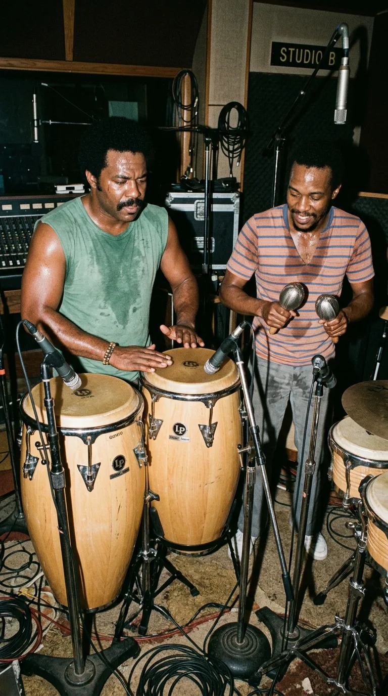

# El Hit que Odiaba su Propia Banda

*Toto: Los virtuosos de sesión de Los Ángeles que compusieron un himno inmortal sobre un continente que jamás habían pisado.*

---

### Prólogo: La geografía de la nostalgia inventada

> *«It's gonna take a lot to drag me away from you / There's nothing that a hundred men or more could ever do / I bless the rains down in Africa...»*

A comienzos de los años ochenta, ningún grupo de músicos en el planeta poseía un prestigio técnico más respetado que los integrantes de **Toto**. No eran novatos buscando un golpe de suerte: eran los legendarios músicos de sesión de Los Ángeles que tocaban en los discos de Steely Dan, Michael Jackson (*Thriller*), Boz Scaggs, Pink Floyd y Paul McCartney. Se enorgullecían de su pegada de rock virtuoso, sus solos de guitarra afilados y su sonido sofisticado y musculoso.

*1981: El panel del sintetizador analógico Yamaha CS-80 donde David Paich encontró la hipnótica sonoridad de marimba.*

Por eso, cuando en **1981** el tecladista y compositor **David Paich** les presentó una maqueta con ritmos de marimba electrónica y una letra romántica sobre bendecir las lluvias en un continente que jamás había visitado, la reacción interna de sus compañeros de banda rozó el bochorno. Su virtuoso guitarrista, **Steve Lukather**, juró que aquella canción era una tontería tan mayúscula que se pasearía desnudo por Hollywood Boulevard si alguna vez llegaba a tener éxito.

Pocas veces el destino se burló con tanta gracia del juicio de una banda: aquella canción que casi quedó fuera del disco para no «arruinar la reputación rockera» de Toto no solo se convirtió en el único número uno mundial de su carrera, sino en uno de los fenómenos más indestructibles y queridos de la cultura popular contemporánea.

---

### Acto I: Diez minutos frente al sintetizador y las historias de los misioneros

La semilla de **«Africa»** brotó a altas horas de una madrugada de **1981** en el estudio doméstico de **David Paich** en North Hollywood. Paich acababa de adquirir un nuevo sintetizador polifónico **Yamaha CS-80** (junto a un teclado digital **Yamaha GS1**).

Buscando timbres que simularan la calidez de una marimba y una kalimba africana, comenzó a probar una secuencia sincopada de acordes mayores. En menos de diez minutos, las estrofas y el gancho melódico del estribillo fluyeron de sus dedos como si alguien estuviera dictándole las notas desde otra dimensión.

*North Hollywood, 1981: David Paich componiendo a altas horas de la madrugada bajo el influjo de viejos recuerdos misioneros.*

Pero cuando llegó el momento de escribir los versos, Paich se topó con un dilema: ¿de qué hablaba aquella melodía? Como él mismo confesaría con honestidad años después, **jamás había estado en África**.

La inspiración procedía de dos recuerdos grabados a fuego en su memoria:
1. De niño, en su colegio católico de Sherman Oaks (*St. Francis de Sales*), los sacerdotes misioneros proyectaban diapositivas y narraban historias sobre su labor humanitaria en aldeas remotas de África Oriental, bendiciendo las cosechas y llevando agua a comunidades azotadas por la sequía.
2. De adulto, Paich se desvelaba frente al televisor mirando los documentales nocturnos de *National Geographic* y los llamamientos de UNICEF sobre las hambrunas en el Sahel, conmovido por la belleza agreste de la sabana y el dolor de sus gentes.

*La evocación lírica: El Kilimanjaro y la sabana africana como metáfora de un anhelo espiritual en medio de la soledad urbana.*

Paich utilizó aquel continente imaginado como una metáfora íntima: la historia de un hombre joven, solitario y consumido por la rutina de la civilización occidental, que se encuentra ante una encrucijada vital: continuar persiguiendo el éxito frío en los rascacielos o escapar hacia un amor puro, distante y espiritual capaz de devolverle el alma (*«I bless the rains down in Africa... Gonna take some time to do the things we never had»*).

---

### Acto II: La rebelión de Steve Lukather y el error del Olimpo

Al día siguiente, cuando Paich llevó la cinta de casete al ensayo general, el guitarrista **Steve Lukather** no dio crédito a lo que escuchaba. Acostumbrado a los potentes *riffs* de rock duro de temas como *«Hold the Line»*, la candidez lírica de Paich le pareció un suicidio comercial:

—*«Dave, ¿te has vuelto loco?»* —le increpó Lukather entre carcajadas—. *«¿Qué demonios significa eso de que "el Kilimanjaro se alza como el Olimpo sobre el Serengueti"? ¡El Monte Olimpo está en Grecia y el Kilimanjaro en Tanzania! ¡La letra es un disparate geográfico! ¡Si esta canción funciona en la radio, juro que salgo a correr en pelotas por Hollywood Boulevard!»*.

*Sunset Sound: Steve Lukather escéptico ante la letra de Paich, amenazando con desnudarse en Hollywood si la canción triunfaba.*

La tensión era mayúscula porque el grupo se jugaba la vida. Tras el relativo fracaso comercial de sus dos discos anteriores (*Hydra* en 1979 y *Turn Back* en 1981), la discográfica **Columbia Records** les había advertido que si su cuarto álbum de estudio, ***Toto IV*** (**1982**), no lograba un éxito masivo, rescindirían su contrato. La banda entera consideró seriamente archivar *«Africa»* en un cajón y dejarla fuera del disco.

---

### Acto III: El bucle de cinta tallado a mano por Jeff Porcaro

Solo una persona en la sala vio la luz dentro de aquella maqueta: el baterista y director espiritual de Toto, el legendario **Jeff Porcaro** (1954–1992).

Porcaro comprendió que la canción no debía sonar como un tema de pop convencional: necesitaba un pulso rítmico hipnótico, circular y casi tribal que atrapara al oyente en una especie de trance ritual. Para lograrlo, convocó a su gran amigo, el virtuoso percusionista **Lenny Castro**.

*Los Ángeles, 1981: Jeff Porcaro y Lenny Castro combinando congas, campanas y percusiones en busca de un pulso rítmico ritual.*

Durante horas, en los estudios **Sunset Sound** de Los Ángeles, Porcaro y Castro grabaron capas superpuestas de congas, maracas, campanas y percusiones manuales junto a la batería acústica. Pero Jeff no estaba satisfecho: sentía que si tocaban la pista completa de cuatro minutos, el cansancio humano provocaría pequeñas variaciones de tiempo que romperían la hipnosis.

Fue entonces cuando Porcaro realizó una de las hazañas de ingeniería analógica más admiradas de los años ochenta:
* Escucharon la cinta y seleccionaron **los dos mejores compases rítmicos** tocados por Jeff y Lenny.
* Con una cuchilla de afeitar y cinta de empalmar, Porcaro **cortó físicamente aquel trozo de cinta magnética de dos pulgadas**.
* Unió los extremos formando un **bucle cerrado (*tape loop*)** que suspendió en el aire haciéndolo rodar a través de varios pies de micrófono alrededor de la sala de grabación, haciéndolo girar durante horas para registrar una base rítmica perfecta y viva que no dependía de cajas de ritmos electrónicas.

*La hazaña de Porcaro: El bucle de cinta magnética suspendido entre soportes de micrófono para mantener la cadencia perfecta.*

Sobre aquel latido perpetuo, el cantante **Bobby Kimball** prestó sus agudos en el estribillo, David Paich cantó las estrofas con su voz grave y cálida, y Steve Lukather —a regañadientes— terminó sumando una sutil y elegante guitarra rítmica.

---

### Epílogo: El triunfo del mapa imaginario

Publicada como el último sencillo del álbum a finales de **1982**, **«Africa»** desató un terremoto mundial. El **5 de febrero de 1983**, la canción que Steve Lukather consideraba una tontería escaló hasta el **número 1 del *Billboard Hot 100*** en Estados Unidos, alcanzó el número 3 en el Reino Unido e impulsó a ***Toto IV*** a arrasar en la ceremonia de los Premios Grammy de 1983, cosechando **seis gramófonos dorados** (incluyendo el de Álbum del Año).

*1983: El triunfo colosal de Toto IV con seis premios Grammy y un número uno mundial que silenció toda duda en la banda.*

Con los años, el propio Lukather reconoció públicamente su error con una carcajada: *«Nunca me alegré tanto de estar equivocado en mi vida. Y por suerte para todos los vecinos de Hollywood, nadie vino a cobrarme la apuesta de correr desnudo»*.

Cuatro décadas después de aquella sesión de trasnoche, el secreto de *«Africa»* sigue intacto: no importa que sus coordenadas geográficas fueran inexactas ni que su autor jamás hubiera cruzado el océano. Porque la verdadera música no retrata los mapas de la tierra, sino los territorios del corazón donde el alma herida siempre sueña con encontrar la lluvia.

---

### 📚 Fuentes y Archivo Documental

1. **Testimonios de Composición y Grabación (1981–1982)**:
   * Lukather, Steve (2018). *The Gospel According to Luke*. Londres: Post Hill Press. Memorias oficiales de Steve Lukather relatando sus reticencias iniciales hacia la letra de *«Africa»*, las discusiones con David Paich y su promesa humorística sobre Hollywood Boulevard.
   * Paich, David. Entrevistas autobiográficas en *Songfacts*, *Billboard* y *Mix Magazine* detallando la composición nocturna en el Yamaha CS-80, el influjo de los misioneros católicos de su infancia y los documentales de UNICEF.
2. **Ingeniería Rítmica de Jeff Porcaro en Sunset Sound**:
   * Porcaro, Jeff. Entrevista histórica en *Modern Drummer* (1983) explicando la creación artesanal del bucle de cinta magnética (*tape loop*) de dos compases junto al percusionista **Lenny Castro** para lograr el pulso perpetuo de *«Africa»*.
3. **Catálogo Discográfico y Premios Grammy (1982–1983)**:
   * Toto (1982). Álbum ***Toto IV*** (Columbia Records, FC 37728) y sencillo *«Africa / We Made It»*.
   * **25.ª Entrega de los Premios Grammy (febrero de 1983)**: Seis premios obtenidos por *Toto IV*, consolidando el estatus de la banda en la historia de la música grabada.
