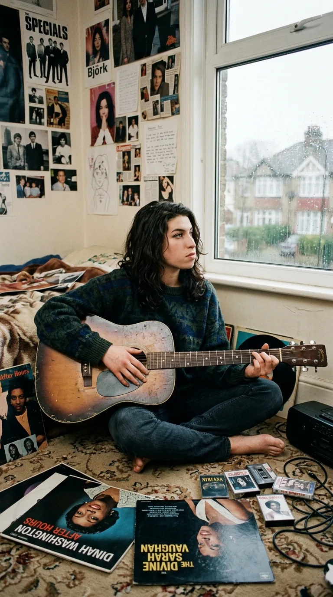
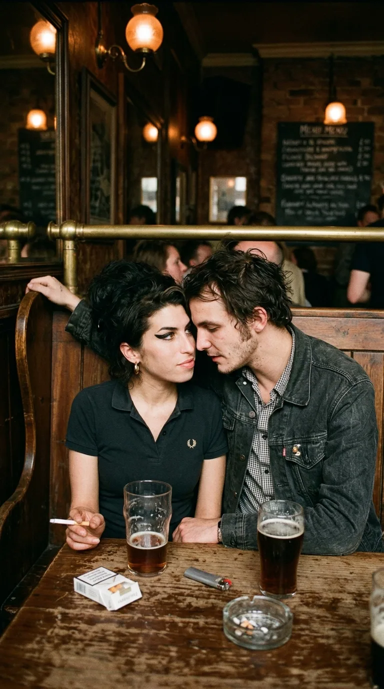
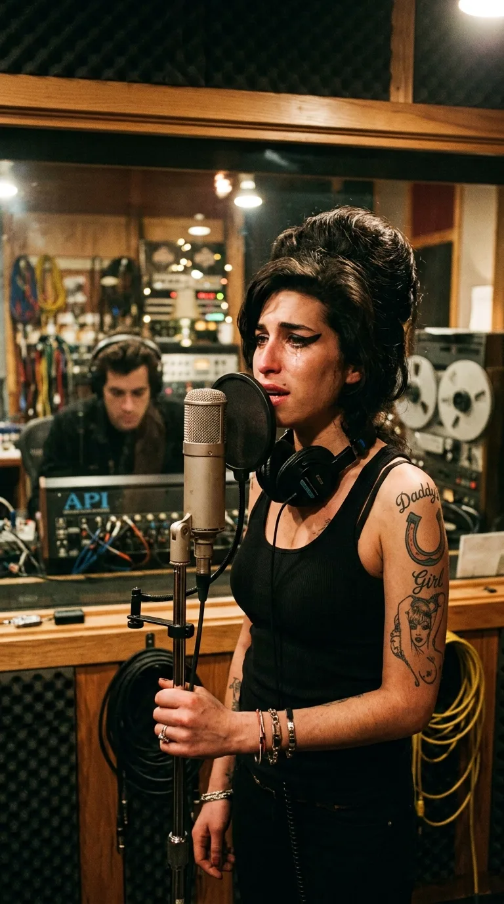
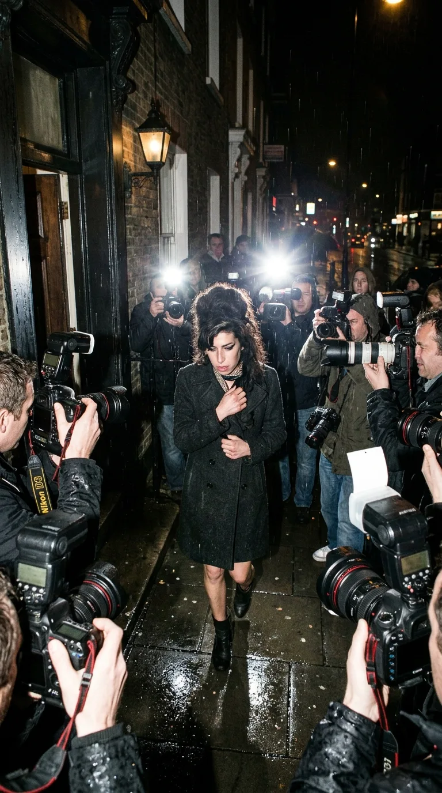
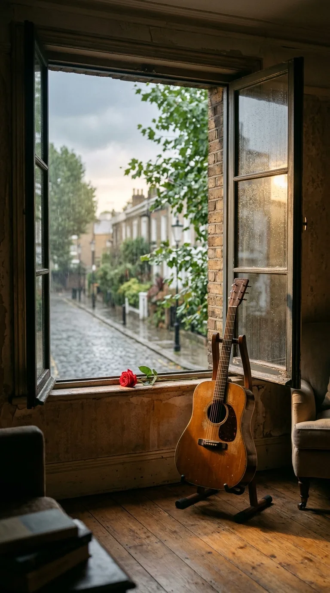

# El Cometa que Ardió en su Propio Fuego: La Herida y la Gloria Eterna de Amy Winehouse

> *«We only said goodbye with words...  
> I died a hundred times.  
> You go back to her, and I go back to black.»*

---

*Londres: La silueta inconfundible y la mirada melancólica de la artista que devolvió la verdad visceral al soul contemporáneo.*

A comienzos del siglo XXI, cuando la industria de la música global parecía definitivamente rendida ante la producción digital pulida, las coreografías prediseñadas y las voces corregidas al milímetro por software, una muchacha de diecinueve años nacida en los suburbios del norte de Londres se subió al escenario de un club de jazz, cerró los ojos y quebró el aire con una voz de contralto tan profunda, oscura y herida que los presentes creyeron estar ante una reencarnación de Billie Holiday o Sarah Vaughan.

Su nombre era **Amy Jade Winehouse**. No se parecía a nadie y no le interesaba encajar en los moldes de la celebridad moderna. Con su icónico peinado *beehive*, sus gruesos delineados felinos inspirados en los grupos femeninos de los años sesenta y sus brazos cubiertos de tatuajes marineros, Amy encarnó la paradoja más fascinante y desgarradora de la cultura popular contemporánea: un talento colosal bendecido por los dioses de la música, atrapado en el cuerpo de una mujer con una sensibilidad tan desbordante que la realidad cotidiana le resultaba insoportable.

Vivió rápido, amó con una desesperación devoradora y ardió como un relámpago en la noche. A quince años de su partida prematura a los veintisiete años, su historia no es la crónica morbosa de un declive anunciado, sino el testimonio sobrecogedor de una artista que prefirió sangrar la verdad en cada acorde antes que falsear una sola emoción.

---

## Acto I: La Niña que Respiraba Jazz en Southgate

Amy creció en Southgate, un suburbio tranquilo al norte de Londres, en el seno de una familia judía donde la música no era un adorno, sino el aire que se respiraba. Por el lado materno y paterno, sus tíos habían sido músicos de jazz profesionales, y su abuela Cynthia —una cantante de cabaret elegante y carismática— se convirtió en su gran referente afectivo y espiritual.

*Southgate, finales de los años 90: Una joven Amy refugiada en los acordes de su guitarra acústica antes del estallido de la fama.*

Cuando sus padres se separaron, Amy tenía solo nueve años. Aquella fractura doméstica marcó el inicio de una profunda soledad interior. A los catorce años tomó prestada la vieja guitarra acústica de su hermano Alex; aprendió a tocar acordes de jazz de forma completamente autodidacta y comenzó a escribir canciones en libretas escolares. No buscaba fama ni aplausos: la música era su trinchera emocional, el único diario íntimo donde sus angustias cobraban orden.

En 2003, con apenas diecinueve años, publicó su álbum debut, **«Frank»**. La prensa británica no podía creer lo que escuchaba: las composiciones rezumaban una madurez lírica mordaz, un fraseo elástico y una sofisticación armónica insólita para su edad. Amy fue nominada a los premios Mercury y la crítica la proclamó la salvadora del jazz británico. Sin embargo, ella se sentía insatisfecha. Consideraba que la discográfica había intervenido demasiado en la mezcla final y juró que su siguiente obra nacería estrictamente de sus entrañas.

---

## Acto II: El Huracán de Camden y la Herida de Blake

En 2005, Amy convirtió el barrio bohemio de **Camden Town** en su reino y su refugio. En los pasillos llenos de humo del pub *The Good Mixer*, conoció a **Blake Fielder-Civil**, un joven carismático y magnético que trabajaba en la producción de videos musicales. El flechazo fue instantáneo, arrollador y profundamente destructivo.

*Camden Town, 2005: El romance tempestuoso y destructivo que inspiró las páginas desgarradoras de «Back to Black».*

Blake le descubrió la crudeza de la noche londinense, pero también la arrastró a un torbellino de celos, dependencias y sustancias químicas de las que Amy no sabría escapar. Cuando la relación colapsó meses después y Blake decidió regresar con su antigua pareja, el mundo de Amy se derrumbó. No hubo terapia ni consuelo posible; sumida en una severa depresión y luchando contra la bulimia y el alcoholismo, Amy hizo lo único que sabía hacer para no ahogarse: sentarse a componer.

A finales de 2005 viajó a Nueva York para reunirse con el productor **Mark Ronson** en los modestos estudios de Brooklyn. Durante su primera tarde juntos, Ronson tocó al piano unos acordes lentos, solemnes y fúnebres, inspirados en el sonido de las Ronettes y las Shangri-Las. Los ojos de Amy se iluminaron entre lágrimas: *«Eso es exactamente lo que siento»*. En menos de tres horas, escribió de corrido la letra de **«Back to Black»**.

---

## Acto III: El Naufragio Convertido en Catedral

Lo que grabaron en aquellas sesiones de Nueva York y Londres con la banda de metales **The Dap-Kings** fue una obra maestra irrepetible. Lanzado en octubre de 2006, **«Back to Black»** no era un simple disco; era una catedral erigida sobre los escombros de un corazón roto. Cada pista (*«Love Is a Losing Game»*, *«Tears Dry on Their Own»*, *«You Know I'm No Good»*) destilaba una honestidad casi obscena.

*Brooklyn, 2006: Amy Winehouse frente al micrófono de cinta en los estudios de Mark Ronson dando vida a una obra irrepetible.*

El impacto fue descomunal. El álbum vendió más de dieciséis millones de copias, reinventó el sonido del pop británico y allanó el camino para artistas como Adele y Duffy. El 10 de febrero de 2008, la industria mundial se rindió a sus pies en la 50ª edición de los **Premios Grammy**. 

Debido a que el gobierno de EE. UU. le denegó la visa a tiempo por sus antecedentes de consumo, Amy no pudo viajar a Los Ángeles. La organización instaló una transmisión vía satélite desde los Riverside Studios en Londres. Aquella noche, Amy ofreció una actuación electrizante y **ganó cinco premios Grammy**, un récord absoluto para una artista británica. Cuando su gran héroe de la infancia, **Tony Bennett**, anunció su nombre como ganadora de Grabación del Año, Amy se llevó las manos a la boca, paralizada por la incredulidad, y abrazó a sus padres en medio de una ovación mundial.

Pero en la intimidad de los camerinos, lejos de los reflectores, la alegría duró apenas unos segundos. Mirando a su mejor amiga con una tristeza insondable, Amy susurró la frase que retrató su tragedia:  
*«Esto es tan aburrido sin drogas»*.

*Cartel oficial de la crónica: Ganó cinco Grammy en una noche, pero nadie pudo salvar su corazón.*

---

## Acto IV: La Cacería de los Tabloides y la Dignidad de Belgrado

A partir de 2008, la vida de Amy dejó de pertenecerle. Los tabloides británicos montaron guardia permanente frente a su casa de Camden Square. Docenas de fotógrafos acampaban día y noche, persiguiéndola hasta las farmacias, empujándola y cegándola con potentes flashes para capturar cualquier traspié, cualquier herida o cualquier lágrima que pudiera venderse a precio de oro al día siguiente.

*Londres, 2008: El asedio asfixiante de los flashes mediáticos frente a las puertas de su residencia en Camden Square.*

El público occidental consumía su música con devoción mientras contemplaba con morbo televisado su gradual autodestrucción. En medio de aquel asedio asfixiante, Amy intentó rehabilitarse en múltiples ocasiones. En marzo de 2011, vivió uno de los momentos más luminosos de su carrera al entrar a los legendarios estudios de **Abbey Road** para grabar el estándar *«Body and Soul»* a dúo con Tony Bennett. 

Aterrada de no estar a la altura de la leyenda viva, Amy estuvo a punto de abandonar la sesión por inseguridad. Bennett, con una infinita delicadeza paternal, la tranquilizó, le habló como a una igual y logró una toma vocal de una elegancia y dulzura conmovedoras. Sería la última canción que Amy Winehouse grabaría en un estudio profesional.

Tres meses después, en junio de 2011, sus representantes la obligaron a subir al escenario de un festival masivo en **Belgrado, Serbia**. Desorientada, agotada y visiblemente vulnerable, Amy miró al mar de miles de personas que la abucheaban. En lugar de fingir el espectáculo que le exigían, cruzó los brazos sobre el pecho, bajó el micrófono y se negó a cantar. En aquel gesto de rebeldía silenciosa había más dignidad artística que en mil conciertos complacientes: Amy se negaba a ser un mono de feria para una multitud desprovista de piedad.

---

## Epílogo: La Rosa Eterna de Camden Square

El **23 de julio de 2011**, el silencio cayó para siempre sobre la casa victoriana de Camden Square. Su corazón, exhausto tras años de batallas contra la bulimia y un letal consumo accidental de alcohol tras semanas de abstinencia, se detuvo mientras dormía. Tenía veintisiete años.

*El silencio de Camden: Una ventana abierta hacia la niebla matinal de Londres tras la partida prematura de una leyenda eterna.*

A las pocas horas, miles de admiradores anónimos llenaron las aceras de Camden de flores, notas manuscritas, botellas y púas de guitarra. El mundo entero comprendió de golpe el vacío insondable que dejaba su partida. No se había marchado una diva prefabricada, sino la última gran voz romántica del soul: una mujer que sentía con tanta fuerza que el mundo le quedaba demasiado estrecho.

Quince años después, el eco de sus campanas fúnebres en *«Back to Black»* sigue resonando en las emisoras de todo el planeta como un monumento inquebrantable a la verdad. Amy Winehouse nos demostró que la gloria no reside en los trofeos ni en los reflectores, sino en el coraje desgarrador de cantarle al mundo con el corazón en la mano, incluso cuando ese mismo corazón se está haciendo pedazos.

---

### 📚 Fuentes y Archivo Documental

1. **Winehouse, Mitch** (2012). *Amy, My Daughter*. HarperCollins Publishers. Testimonio directo sobre los primeros años en Southgate, la relación con Cynthia y los tratamientos médicos.
2. **Ronson, Mark** (2007-2015). Entrevistas y declaraciones de producción sobre las sesiones de grabación de *Back to Black* en Daptone Studios (Brooklyn) y Metropolis Studios (Londres). *Rolling Stone* y *Sound on Sound*.
3. **Bennett, Tony** (2012). *Life Is a Gift: The Zen of Bennett*. Harper. Relato detallado de la histórica sesión de grabación de *Body and Soul* en Abbey Road en marzo de 2011.
4. **Kapadia, Asif** (2015). *Amy* (Documental cinematográfico galardonado con el Premio Óscar). Archivo fílmico, correspondencia y testimonios hemerográficos sobre el acoso mediático en Camden y la presentación en Belgrado.
5. **The Recording Academy** (2008). Registros oficiales de la 50ª entrega anual de los Premios Grammy.

---

### 💬 Comunidad y Reflexión

¿Cuál de las canciones de Amy Winehouse sientes que capturó con mayor crudeza la belleza y el desgarro de su alma? Te leemos en los comentarios.
