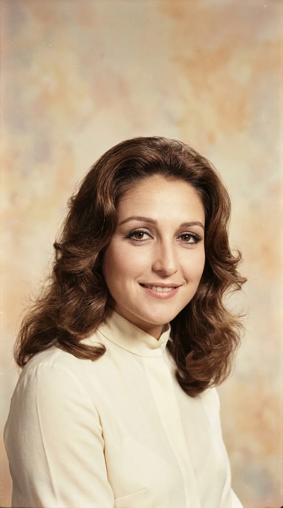
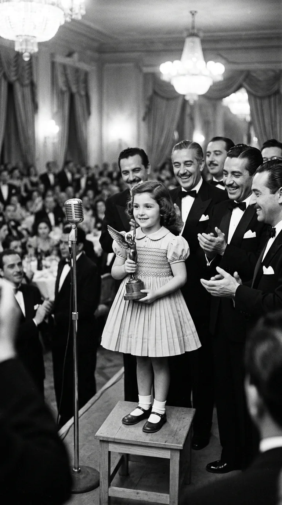
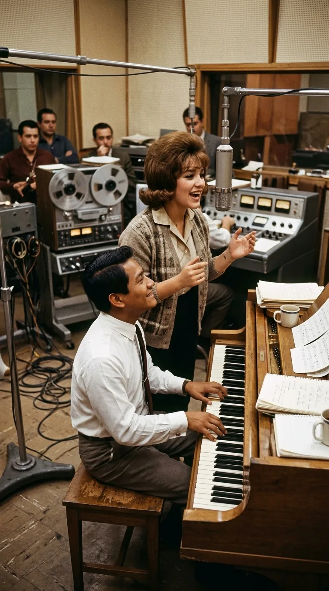
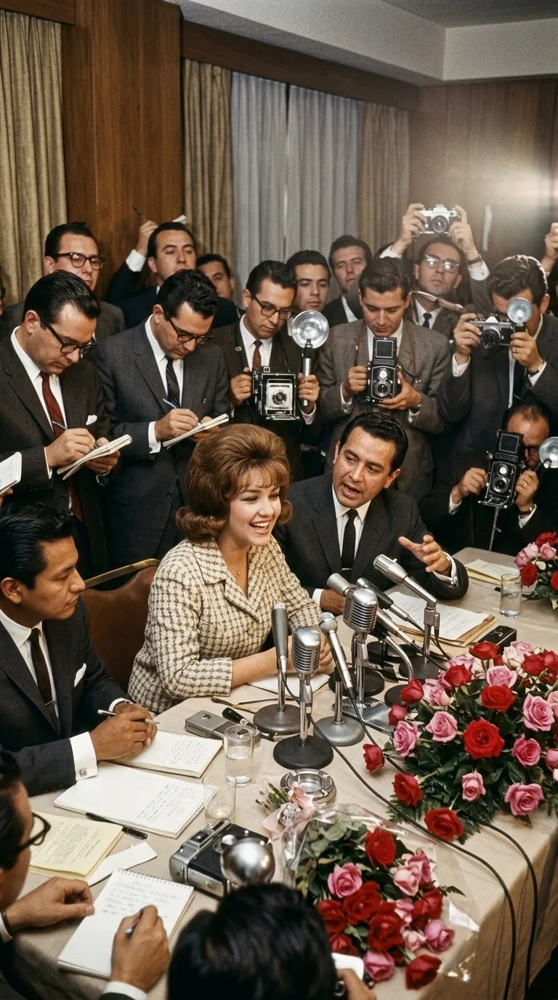
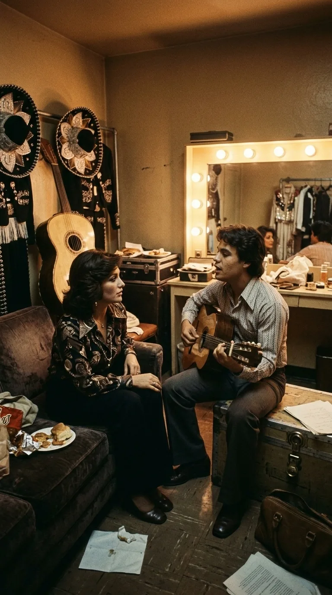
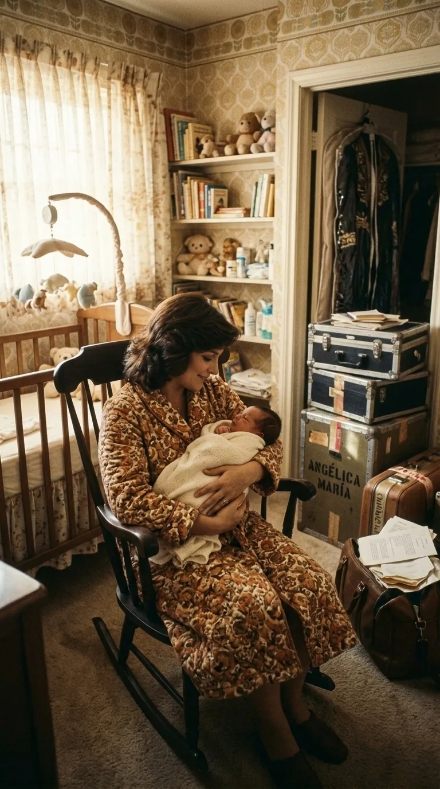
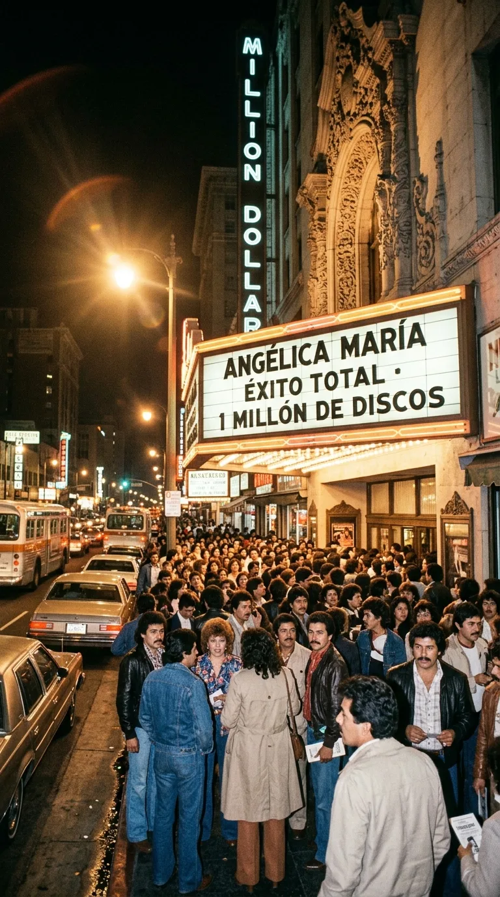
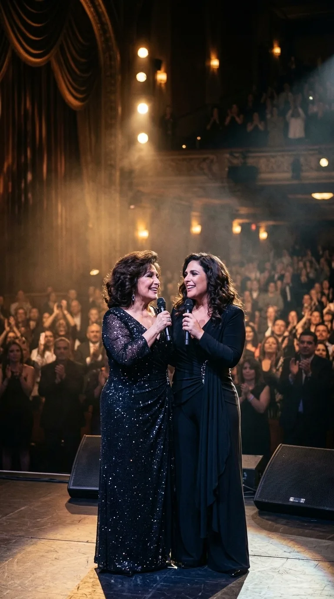
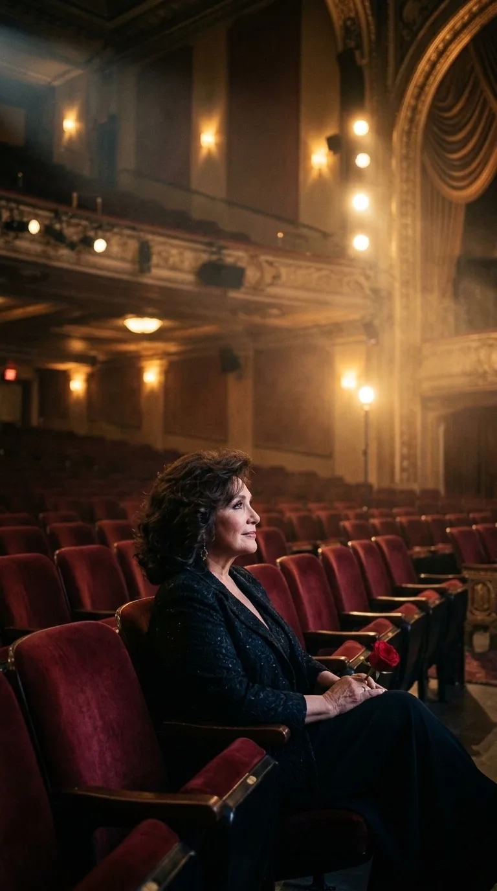

# La Novia Eterna de un País: Las Siete Vidas de Angélica María

**Por Catedrales de Leyenda**  
*Tiempo de lectura aproximado: 10 minutos*

---

*Angélica María: La Novia de México, figura entrañable que unió a generaciones enteras con la honestidad de su canto.*

---

### Prólogo: La Niña que Aprendió a Mirar

Hay artistas cuya gloria reside en haber construido una muralla entre su vida y el mundo; y hay otras, infinitamente más raras, cuyo milagro consistió en derribar toda distancia. Para varias generaciones de latinoamericanos, **Angélica María** no fue una estrella inalcanzable que descendía desde la pantalla para deslumbrar a la multitud: fue la muchacha de la puerta de al lado, la confidente de las tardes de radio, la voz que aprendió a llorar y a sonreír con la misma naturalidad con la que el sol entra por la ventana de una cocina familiar.

Su biografía es el mapa completo del espectáculo hispanoamericano durante la segunda mitad del siglo XX. Cruzó las épocas como quien atraviesa las habitaciones de su propia casa: desde el blanco y negro majestuoso del Cine de Oro hasta las revoluciones juveniles del rock and roll, los melodramas televisivos que paralizaron capitales enteras y la invención insospechada de la balada ranchera. Siete décadas de entrega incombustible sin haber traicionado jamás la pureza de su mirada original.

---

### Acto I: El Prodigio de la Infancia y la Bendición de los Titanes (1951)

Nacida en Nueva Orleans pero convertida en raíz viva de México desde sus primeros años, Angélica María Ortiz Sandoval creció en los foros de filmación como otros niños crecen en los patios de recreo. Hija de la productora teatral Angélica Ortiz, respiró el aroma del maquillaje, la pólvora de los reflectores y el polvo de los decorados antes de aprender a leer de corrido.

*1951: La pequeña Angélica María recibiendo el Premio Ariel a los seis años rodeada por los gigantes del Cine de Oro.*

En 1951, con apenas seis años, su actuación en *«Mi esposa y la otra»* desconcertó a los jurados de la Academia Mexicana de Artes y Ciencias Cinematográficas. Con una soltura que desarmaba a los intérpretes más veteranos, la pequeña Angélica subió a recoger el **Premio Ariel**, sostenida en brazos de los gigantes del celuloide nacional. Mientras leyendas como Pedro Infante y Marga López la contemplaban con asombro, aquella niña de ojos almendrados selló un pacto tácito con su pueblo: no actuaría para impresionar, sino para conmover.

---

### Acto II: La Herejía del Rock y el Piano de Manzanero (1962)

Al comenzar la década de 1960, el mundo cambiaba a un ritmo vertiginoso. El rock and roll comenzaba a sacudir las caderas de la juventud estadounidense y a cruzar la frontera sur. En México, sin embargo, el género parecía un coto vedado a las voces masculinas: Enrique Guzmán, César Costa y Los Teen Tops dominaban las listas con choperas de cuero y gomina.

*Discos Musart, 1962: Ensayando al piano junto a un joven Armando Manzanero para revolucionar el rock en español.*

Fue entonces cuando Guillermo Acosta, director artístico de Discos Musart, decidió poner a prueba a una Angélica María de diecisiete años. Para dirigir la sesión, convocó a un joven músico yucateco que sobrevivía en la capital como pianista y arreglista de alquiler: **Armando Manzanero**.

En un modesto estudio impregnado de café y partituras manuscritas, Manzanero adaptó el tema *«Steady Eddy»* al español bajo el título de *«Eddy, Eddy»*. El encuentro fue una chispa luminosa: Manzanero aceleró los compases al piano y Angélica arrojó una interpretación fresca, pícara y desbordante de dinamismo. En cuestión de semanas, el disco escaló a la cima del *hit parade*, consagrando a Angélica María como la **primera mujer solista en triunfar en el rock and roll en español** y abriendo las compuertas de una industria que nunca más volvería a ser exclusivamente de hombres.

---

### Acto III: La Coronación Inmortal (1966)

A mediados de los sesenta, la popularidad de Angélica desbordaba cualquier cálculo comercial. Sus películas llenaban las salas de barrio, sus canciones sonaban en todas las rocolas y su presencia en los escenarios teatrales convocaba a multitudes que la aguardaban durante horas bajo la lluvia.

*1966: La consagración pública en rueda de prensa donde la crónica popular la bautizó para siempre como «La Novia de México».*

Durante una multitudinaria rueda de prensa en 1966, el respetado cronista de espectáculos Octavio de Alba tomó el micrófono para hacer una observación que quedó esculpida en la memoria colectiva:

> *"Ya no podemos llamarte la novia de la juventud, Angélica... porque eres, desde hoy y para siempre, La Novia de México."*

El título, lejos de convertirse en una etiqueta publicitaria, fue un sacramento popular. No existía en el apelativo soberbia alguna; era la declaración de amor de un país entero que encontraba en su rostro la síntesis de sus mejores virtudes: la nobleza, la simpatía y una dignidad a prueba de modas pasajeras.

---

### Acto IV: La Ciudad que se Detuvo (1971)

En el otoño de 1971, Telesistema Mexicano (actual Televisa) estrenó una telenovela producida por Ernesto Alonso que transformaría para siempre la cultura televisiva de habla hispana: *«Muchacha italiana viene a casarse»*. 

Protagonizada por Angélica María en el papel de la inocente Paola Donatti junto al galán peruano Ricardo Blume, la producción generó una conmoción sin precedentes. De lunes a viernes, a las cinco de la tarde, las avenidas de Ciudad de México, Lima, Bogotá y Caracas experimentaban un silencio insólito: el tráfico desaparecía, los comercios adelantaban su cierre y las familias se congregaban en derredor de los receptores en blanco y negro.

*Otoño de 1971: Ciudades enteras paralizadas a las cinco de la tarde ante la transmisión de «Muchacha italiana viene a casarse».*

En el corazón de aquella fiebre latía una canción: **«¿A dónde va nuestro amor?»**, compuesta por Eduardo Magallanes con letra de Mario Molina Montes. La melodía, orquestada con una melancolía envolvente, trascendió la pantalla chica para convertirse en un clásico absoluto del cancionero latinoamericano. La pregunta que Angélica entonaba en el estribillo se convirtió en el espejo íntimo de millones de personas que se preguntaban, al mirarse a los ojos, si el amor verdadero tenía un destino o era solo un tren que partía en la niebla.

---

### Acto V: El Rescate de Juan Gabriel y el Nacimiento de la Balada Ranchera (1974)

Si la consagración televisiva parecía la cumbre, 1974 depararía el giro creativo más audaz y trascendente de su carrera musical. 

En un camerino de televisión, Angélica conoció a un muchacho tímido y humilde que acababa de salir de la prisión de Lecumberri tras ser víctima de una acusación injusta: **Alberto Aguilera Valadez**, un joven cantautor que buscaba desesperadamente abrirse camino bajo el nombre de **Juan Gabriel**.

*1974: El histórico abrazo con Juan Gabriel tras su salida de Lecumberri, fundando juntos la balada ranchera.*

Mientras los directores de las grandes casas discográficas dudaban de aquel muchacho provinciano, Angélica María escuchó en su guitarra una verdad desgarradora. Juan Gabriel le mostró las maquetas de varios temas inéditos, entre ellos *«Tú sigues siendo el mismo»*. 

Los ejecutivos le aconsejaron a Angélica no apartarse de su exitosa fórmula de balada pop orquestal. Ella hizo exactamente lo contrario: propuso fusionar la sensibilidad moderna de la balada con las trompetas, violines y guitarrones del mariachi tradicional. Aquel experimento parió formalmente la **balada ranchera**. El éxito fue colosal: el sencillo vendió más de un millón de copias en Estados Unidos, convirtiendo a Angélica en la primera artista hispana en alcanzar esa cifra y abriendo la senda dorada por la que años más tarde transitarían figuras como Rocío Dúrcal y Ana Gabriel.

---

### Acto VI: El Refugio de la Madre y la Conquista del Norte (1975–1980)

En 1975, en el punto más alto del frenesí internacional, la vida le entregó su mayor consagracion: el nacimiento de su hija, **Angélica Vale**. Lejos de abandonar los escenarios, Angélica María emprendió la titánica tarea de conciliar el rigor de las giras continentales con la devoción absoluta hacia su pequeña.

*1975: La plenitud de la maternidad y el nacimiento de Angélica Vale en la cúspide de su carrera internacional.*

A principios de los ochenta, su nombre llenaba las marquesinas del emblemático **Million Dollar Theatre** de Broadway, en Los Ángeles. Para la comunidad migrante que trabajaba de sol a sol en California, escuchar a Angélica María cantar en directo no era un mero pasatiempo; era un puente emocional directo con la patria lejana, un bálsamo de dignidad y nostalgia compartida.

*Million Dollar Theatre, Los Ángeles: La marquesina abarrotada por la comunidad hispana en busca de su voz y su patria.*

---

### Acto VII: La Antorcha Heredada (2010s)

A diferencia de tantas dinastías artísticas marcadas por la rivalidad o el resentimiento, la relación entre Angélica María y Angélica Vale se convirtió en una de las historias de complicidad más entrañables del espectáculo. 

*La complicidad dinástica: Madre e hija compartiendo el escenario con sonrisas y una devoción mutua inquebrantable.*

Verlas compartir el escenario en las últimas décadas, cantando juntas a dos voces mientras sus risas se entrelazan ante teatros repletos, ofreció una lección conmovedora: el verdadero legado artístico no se impone con contratos ni testamentos, sino que se transmite como una caricia en la penumbra.

---

### Epílogo: El Teatro en Penumbra

Cuando el último acorde de *«¿A dónde va nuestro amor?»* se extingue y el telón cae sobre las tablas, Angélica María permanece sentada en la primera fila de un teatro solitario, sosteniendo una rosa entre sus manos. A través de la penumbra dorada de los reflectores, contempla el escenario que pisó durante más de setenta años.

*La quietud en la primera fila: Una rosa entre las manos contemplando el teatro en penumbra tras siete décadas de entrega artística.*

No hay vanidad en su mirada; solo la serena gratitud de quien sabe que los títulos honoríficos pasan, pero el amor de un pueblo perdura para siempre. Angélica María sigue siendo, y será siempre, la novia fiel de una tierra que aprendió a soñar a través de sus canciones.

---

### 📚 Fuentes y Archivo Documental

1. **Ortiz, Angélica María** (2004). *Angélica María: La Novia de México. Memorias y vivencias*. Editorial Diana, México.
2. **Manzanero, Armando** (2005). *Con la música por dentro: Vivencias y canciones*. Ediciones B, México.
3. **Magallanes, Eduardo** (1995). *Querido Alberto: Biografía autorizada de Juan Gabriel*. Simon & Schuster, Nueva York.
4. **Cineteca Nacional de México** (1951). *Archivo hemerográfico y actas oficiales de la V Entrega del Premio Ariel (Mi esposa y la otra)*.
5. **Telesistema Mexicano / Noticieros Televisa** (1971–1972). *Registros de audiencia y archivo audiovisual de «Muchacha italiana viene a casarse»*.
6. **Billboard Magazine & Cash Box** (1974–1980). *Latin American Music Charts, Discos Musart & RCA Victor Sales Certifications*.
