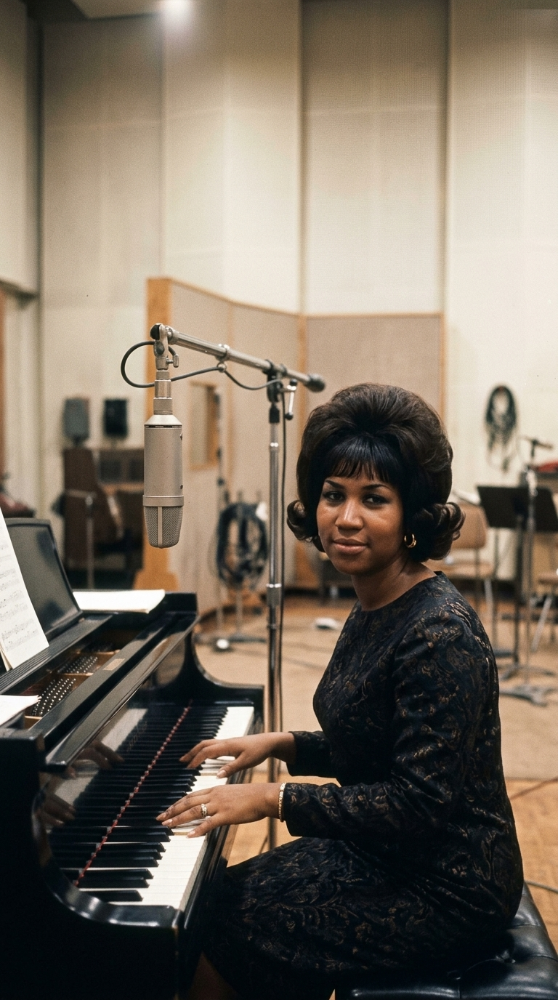
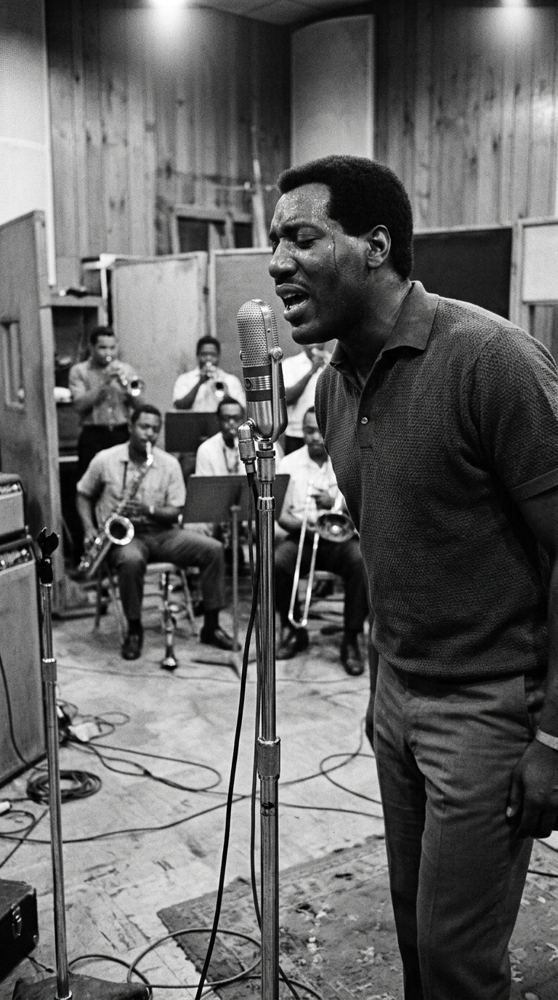
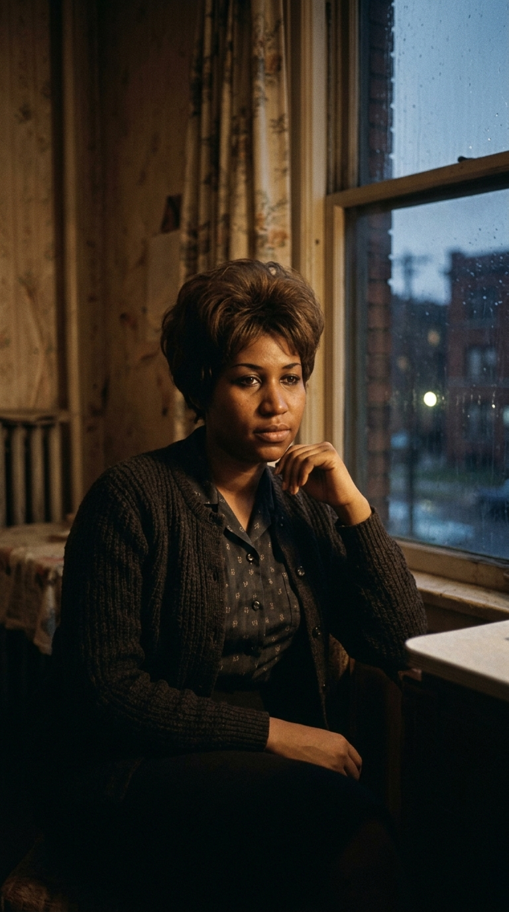
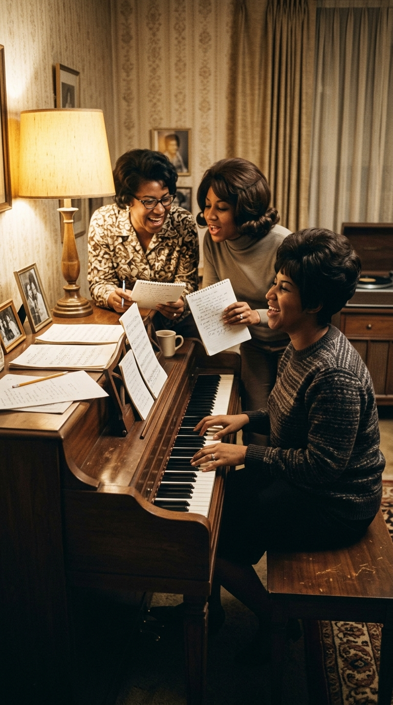
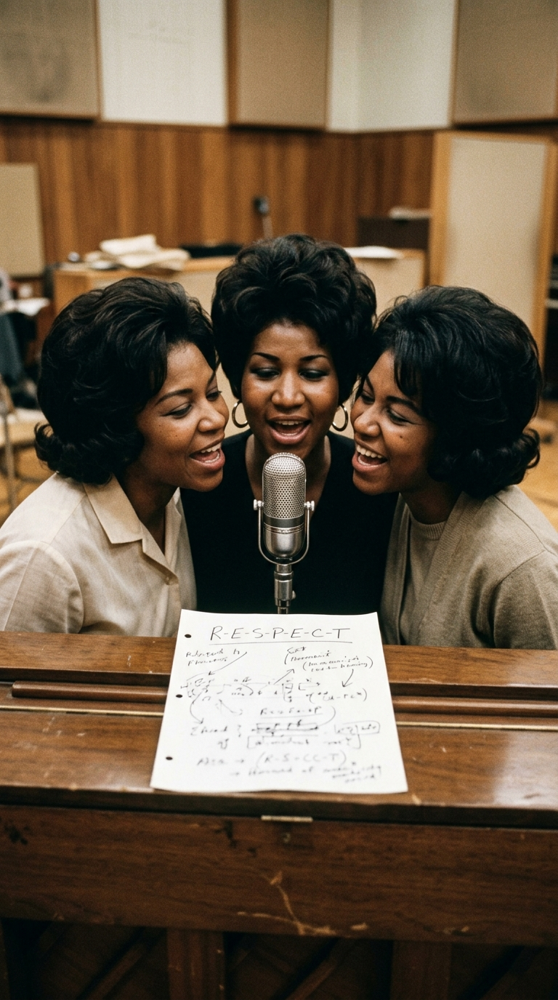
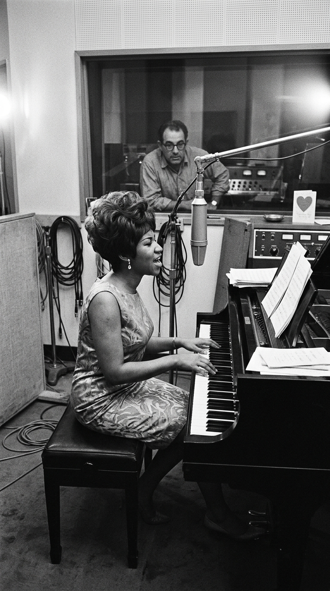
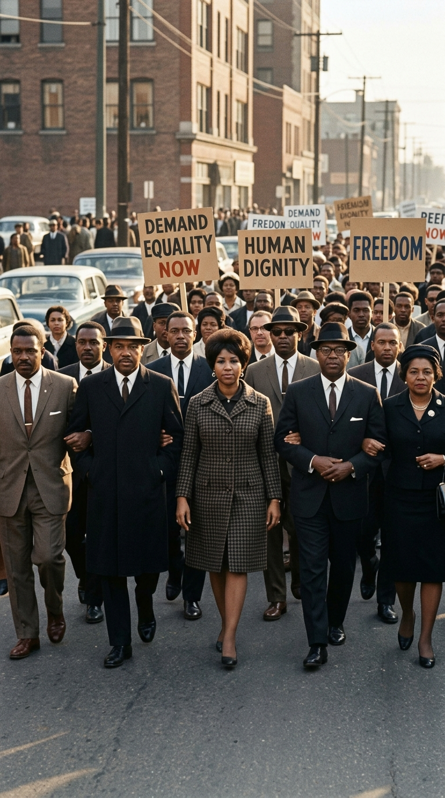
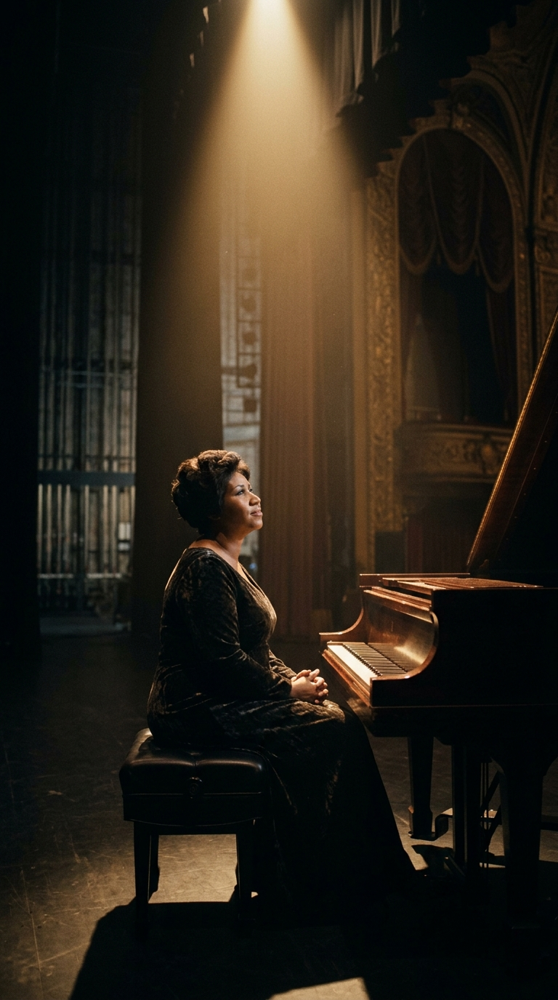

# El tema machista que Aretha Franklin le arrebató a Otis Redding para salvar su propia vida

## Prólogo: La confesión de Monterrey

El domingo **18 de junio de 1967**, una densa niebla marina cubría el recinto del **Monterey International Pop Festival** en California. Ante más de cincuenta mil jóvenes que inauguraban el legendario *Verano del Amor*, un torrente de energía pura subió al escenario: **Otis Redding**, vestido con un impecable traje brillante de color turquesa, respaldado por la máquina implacable de Booker T. & the M.G.'s y The Mar-Keys.

El público blanco del rock psicodélico, acostumbrado a los acordes ácidos de Jimi Hendrix y The Who, quedó paralizado ante la fuerza visceral del soul sureño. Sin embargo, antes de abordar el tema más esperado de la noche, Otis tomó el pedestal del micrófono con una sonrisa pícara y resignada, miró al cielo y soltó una frase que quedó grabada en la memoria viva de la música popular:

> *«Esta canción que sigue le pertenecía a un buen amigo mío... hasta que una chica se la llevó y me la quitó. Pero aún así la voy a cantar»*.

Aquella chica no era otra que **Aretha Franklin**. Y la canción, ***«Respect»***, no había sido simplemente regrabada: había sido conquistada, desarmada y refundada para siempre como el mayor manifiesto de dignidad y emancipación femenina de la historia moderna.

---

## Acto I: El ruego de Stax (Memphis, 1965)

Para comprender la magnitud de la revancha, es imprescindible regresar a **agosto de 1965** en los míticos estudios de **Stax Records**, ubicados en un viejo cine reformado en el 926 de East McLemore Avenue en Memphis, Tennessee. 

Otis Redding, que venía consolidándose como el titán del soul desgarrado, escribió *«Respect»* en apenas un día de inspiración. Pero el mensaje de aquella composición original era diametralmente opuesto al que el planeta cantaría después. Era el lamento patriarcal clásico de la época: un hombre exhausto que trabaja de sol a sol para llevar el sustento al hogar y que, a cambio de su dinero, le exige sumisión incondicional y pleitesía a su mujer:

> *«Haz lo que quieras mientras esté fuera / pero cuando llegue a casa, dame mi respeto... / Tu dinero es mi dinero, así que no te quejes»*.

El tema fue un éxito notable en las listas de R&B (alcanzó el puesto 4 en Billboard Black Singles y el 35 en el Hot 100), pero su horizonte estaba encasillado en la dinámica tradicional de la pareja sumisa. Otis cantaba desde la seguridad del proveedor que compra la paciencia ajena con dólares. Nadie imaginaba que, dos años más tarde, una joven de veinticuatro años transformaría cada una de aquellas palabras en una bomba incendiaria arrojada contra el machismo institucional.

---

## Acto II: El infierno conyugal de Detroit

A finales de **1966**, la vida personal de Aretha Franklin atravesaba su momento más oscuro. Hija predilecta del reverendo C.L. Franklin —una de las figuras religiosas y políticas más influyentes de la comunidad afroamericana—, Aretha poseía una voz monumental moldeada en el coro góspel de la Iglesia Baptista New Bethel de Detroit. 

Sin embargo, su carrera comercial con Columbia Records había quedado encallada en arreglos edulcorados de jazz y vodevil que asfixiaban su genialidad. Pero la verdadera tragedia no ocurría en los sellos discográficos, sino tras las puertas cerradas de su hogar.

Con apenas diecinueve años, Aretha se había casado en **1961** con **Ted White**, un promotor de turbios antecedentes que se convirtió de inmediato en su mánager. Durante seis años, White ejerció un control tiránico y destructivo sobre la artista. Los testimonios de músicos, productores y del propio biógrafo David Ritz confirman que los episodios de violencia doméstica eran frecuentes y despiadados: Aretha grababa y salía de gira escondiendo hematomas bajo capas de maquillaje, aterrorizada por los celos patológicos y la agresividad desmedida de su esposo.

Sometida a un régimen de humillación cotidiana, la cantante acumulaba en su garganta una rabia sorda, un anhelo desesperado de autonomía que necesitaba un detonante para quebrar el silencio.

---

## Acto III: La conspiración de las tres hermanas

A principios de **1967**, el visionario productor **Jerry Wexler** logró el traspaso del contrato de Aretha a **Atlantic Records**, prometiéndole lo que ningún ejecutivo blanco le había concedido antes: sentarla frente al piano para que fuera ella quien dirigiera los arreglos y dictara el pulso de su música.

En las semanas previas a ingresar al estudio, Aretha convocó a sus dos hermanas menores en su apartamento de Detroit: **Erma** (quien más tarde grabaría la versión original de *«Piece of My Heart»*) y **Carolyn Franklin**, una compositora prodigiosa de oído afilado.

Frente a un piano vertical en la sala de estar, Aretha comenzó a juguetear con la melodía de Otis Redding. Pero el enfoque no podía ser el mismo: ¿por qué una mujer debía suplicarle respeto a un hombre cuando ella misma trabajaba, aportaba su propio dinero y sostenía el hogar?

La alquimia entre las tres hermanas fue instantánea y revolucionaria:
1. **La inversión del poder económico**: Invirtieron los pronombres de la letra. Ahora era la mujer quien decía: *«Estoy a punto de darte todo mi dinero, y lo único que te pido a cambio es que me respetes cuando llegue a casa»*.
2. **El deletreo legendario**: A Carolyn se le ocurrió deletrear la palabra con cadencia militar y desafiante: **«R-E-S-P-E-C-T / Find out what it means to me»** (*Averigua lo que significa para mí*).
3. **El contracanto de la calle**: Crearon los célebres coros de llamada y respuesta: **«Sock it to me, sock it to me, sock it to me...»**, una frase proveniente del argot urbano que combinaba sensualidad descarada con una orden tajante de acción sin rodeos.
4. **La clave TCB**: Añadieron la sigla de la ética laboral afroamericana: **«Take care, TCB»** (*Taking Care of Business*, "ocupándonos de nuestros asuntos").

En aquella sala de Detroit, tres mujeres jóvenes acababan de escribir el guion de su propia revancha.

---

## Acto IV: San Valentín en Atlantic Studios (14 de febrero de 1967)

Tras una turbulenta sesión en Muscle Shoals (Alabama) interrumpida por una pelea a golpes entre Ted White y el trompetista de la sesión, Jerry Wexler decidió trasladar la grabación a los estudios de **Atlantic Records** en el 1841 de Broadway, **Nueva York**.

El martes **14 de febrero de 1967** —precisamente el día de San Valentín—, Aretha entró al estudio decidida a grabar el tema definitivo. En la cabina de control se encontraban el legendario ingeniero de sonido **Tom Dowd** y el arreglista **Arif Mardin**. En la sala, los mejores músicos de sesión del rhythm and blues: Tommy Cogbill en el bajo, Roger Hawkins en la batería, Spooner Oldham en los teclados y Jimmy Johnson en la guitarra rítmica.

Aretha se sentó al piano de cola. En una esquina de la sala, observando con rostro sombrío cada movimiento, estaba su marido y agresor, **Ted White**.

Cuando el ingeniero dio la orden de grabar, Aretha no cantó: rugió. Cada frase que salía de sus labios era un dardo envenenado disparado directamente hacia la esquina donde se encontraba White. Su ataque al teclado de marfil marcaba un compás furioso que obligó a la banda a acelerar el tempo original de Otis Redding.

Para culminar la obra, Jerry Wexler trajo al saxofonista tenor más fiero de la época: **King Curtis**. Con su instrumento dorado, Curtis improvisó un solo desgarrador de apenas ocho compases que sonaba como el desgarro de una tela de acero, empujando la pieza hacia una catarsis rítmica irrepetible.

En una sola toma maestra, el tema quedó registrado. Cuando la última nota se extinguió en los monitores, el estudio entero guardó silencio. Todos comprendieron que acababan de presenciar un acontecimiento histórico.

---

## Acto V: El vendaval de los Derechos Civiles y la libertad

Lanzada en abril de **1967**, ***«Respect»*** escaló como un relámpago hasta el **puesto número uno del Billboard Hot 100**, donde permaneció indiscutible durante dos semanas consecutivas, otorgándole a Aretha sus dos primeros premios Grammy (Mejor Grabación de R&B y Mejor Interpretación Vocal Femenina de R&B).

Pero el impacto de la canción trascendió por completo los límites de la industria discográfica:
* **El himno de la comunidad negra**: En un **1967** sacudido por las revueltas raciales de Detroit y Newark, la voz de Aretha resonaba en los transistores de cada barrio afroamericano. Ya no se pedía la integración con timidez: se exigía *respeto* con la cabeza erguida frente a la brutalidad policial y la segregación.
* **El brazo musical de Martin Luther King Jr.**: Aretha, que desde los dieciséis años había viajado con su padre acompañando al Dr. King en sus mítines por el Sur, donó fondos constantes al movimiento y cantó *«Respect»* en concentraciones multitudinarias como estandarte sonoro de la lucha noviolenta.
* **El grito feminista global**: Para millones de mujeres en todo el planeta que comenzaban a cuestionar los roles domésticos y la subordinación al varón, el deletreo de Aretha fue el primer manifiesto cantado de soberanía sobre sus propios cuerpos, su trabajo y su destino.

Y lo más trascendental: la canción cumplió su cometido más íntimo. Fortalecida por el reconocimiento de millones y dueña al fin de su propia independencia económica, **Aretha Franklin reunió el coraje para abandonar definitivamente a Ted White en 1968**, consumando su divorcio en **1969**. Aquellas notas le habían salvado la vida.

---

## Epílogo: La corona que nadie pudo disputar

Otis Redding jamás recuperó su canción. Cuando falleció trágicamente en un accidente aéreo el **10 de diciembre de 1967**, con apenas veintiséis años, lo hizo reconociendo con nobleza que su composición había encontrado su forma definitiva en el corazón de otra artista.

Casi seis décadas después de aquella tarde de San Valentín en Nueva York, *«Respect»* sigue erigiéndose como una de las cumbres absolutas de la cultura contemporánea. No es solo una pieza maestra del soul analógico; es el testimonio imperecedero de una mujer que se negó a ser víctima, que transformó el dolor de sus heridas en arte invencible y que le enseñó a la humanidad entera que la dignidad no se suplica: se arrebata y se sostiene para siempre.

---

### 📚 Fuentes y Archivo Documental

1. **Franklin, Aretha & Ritz, David (1999).** *Aretha: From These Roots*. Villard Books / Random House, Nueva York. Autobiografía oficial con los testimonios pormenorizados sobre la concepción de *«Respect»*, la colaboración de Erma y Carolyn Franklin y el contexto conyugal con Ted White.
2. **Ritz, David (2014).** *Respect: The Life of Aretha Franklin*. Little, Brown and Company, Boston. Biografía exhaustiva con testimonios contrastados de familiares, productores y músicos de sesión de Atlantic Records.
3. **Wexler, Jerry & Ritz, David (1993).** *Rhythm and the Blues: A Life in American Music*. Alfred A. Knopf, Nueva York. Memorias del legendario productor de Atlantic Records sobre la sesión del 14 de febrero de 1967 en Nueva York, el arreglo de piano de Aretha y la participación de King Curtis.
4. **Bowman, Rob (1997).** *Soulsville U.S.A.: The Story of Stax Records*. Schirmer Books, Nueva York. Documentación histórica sobre la composición original y grabación de *«Respect»* por Otis Redding en agosto de 1965.
5. **Pennebaker, D.A. (1968).** *Monterey Pop* (Documental cinematográfico de archivo). Registro audiovisual de la actuación de Otis Redding el 18 de junio de 1967 y su célebre declaración sobre Aretha Franklin.
6. **Billboard Magazine & RIAA Archives (1967).** Registros históricos de ventas, posición número uno en el Billboard Hot 100 y concesión de los premios Grammy en la 10.ª edición anual (1968).
