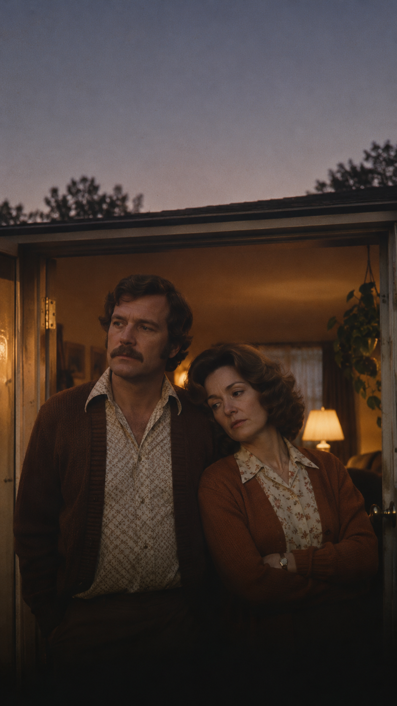

# La costumbre de apagar la luz sin mirarse: La tragedia íntima de «You Don't Bring Me Flowers»

**Por Acordes Ocultos — Colección "Historia en los Acordes"**  
*Tiempo estimado de lectura: 6 minutos*

---

## Prólogo: El crujido de la puerta al final del día

El amor rara vez muere entre llamaradas, gritos desgarrados o portazos que sacuden las paredes de una casa. Esas son las despedidas pirotécnicas del cine. En la vida real, el desamor es casi siempre una enfermedad silenciosa, un polvillo fino que se va depositando imperceptiblemente sobre los muebles de la sala hasta que una tarde cualquiera, al llegar a casa, descubres que la persona que te espera en el pasillo es un completo desconocido con el que compartes la hipoteca.

Ese es el abismo doméstico que retrata «You Don't Bring Me Flowers» (*Ya no me traes flores*). Cuando Barbra Streisand y Neil Diamond entrelazaron sus voces en aquel otoño de 1978, no estaban cantando una simple balada romántica: estaban rodando un cortometraje de cámara sobre el duelo más común, más doloroso y más silenciado de la experiencia humana: el instante en que dos personas que se quisieron hasta la médula se rinden ante la costumbre de no mirarse.

---

## Acto I: El jarrón donde antes ardía la primavera

La historia comienza con un detalle doméstico de una elocuencia devastadora: un jarrón de cristal sobre el aparador. No hace falta un informe pericial para medir la salud de una pareja; basta con observar los pequeños tributos cotidianos. Durante los primeros años de pasión, las flores llegaban solas, impulsivas, sin fecha de aniversario, como un soborno involuntario a la alegría de volver a verse.

Pero el tiempo es un escultor implacable. La canción se abre con esa queja suave, desprovista de rencor pero empapada de melancolía: *«You don't bring me flowers, you don't sing me love songs...»* (*Ya no me traes flores, ya no me cantas canciones de amor*). 

La tragedia no reside en la ausencia de las flores en sí, sino en lo que su falta denuncia: el desinterés. La certeza de que el otro ya no siente la necesidad de conquistar lo que da por sentado. Y desde el otro lado de la mesa, la voz masculina devuelve el golpe con una verdad igualmente punzante: *«You hardly talk to me anymore, when you come through the door at the end of the day...»* (*Apenas me hablas cuando cruzas la puerta al caer la tarde*). La casa se ha transformado en un apeadero donde dos náufragos coinciden para cenar en silencio.

---

## Acto II: La distancia en la misma cama

A medida que el diálogo avanza, la cámara cinematográfica de la letra se traslada al espacio más vulnerable de cualquier intimidad: el dormitorio. 

Hubo una época —evocan ambos con nostalgia punzante— en que separarse por unas horas dolía físicamente: *«I remember when you couldn't wait to love me, used to hate to leave me...»*. La urgencia de la piel joven, donde cualquier rincón era un refugio y el futuro cabía entero entre las sábanas.

Sin embargo, el paso de las décadas ha sustituido el fuego por un trámite mecánico. La estrofa más cruda y honesta de la canción no tiene parangón en el cancionero popular anglosajón:
> *«Now after lovin' me late at night, when it's good for you and you're feeling alright...  
> well, you just roll over and turn out the light...»*  
> *(«Ahora, después de hacerme el amor tarde en la noche, cuando ha sido bueno para ti y te sientes bien... te das la vuelta y apagas la luz»).*

Ese gesto —darse la vuelta y apagar la lámpara de la mesilla de noche dejando al otro contemplando el techo en penumbra— es la radiografía exacta del abandono emocional. No hay violencia, no hay insultos: solo una espalda tibia que se convierte en una muralla infranqueable.

---

## Acto III: Barrer las promesas del pasillo

¿Qué ocurre con todas las palabras que una pareja se susurra cuando cree que su historia será eterna? La letra de Alan y Marilyn Bergman encuentra una de las metáforas más bellas y tristes de la poesía contemporánea:
> *«It used to be so natural to talk about forever...  
> but used-to-be's don't count anymore, they just lay on the floor 'til we sweep them away...»*  
> *(«Solía ser tan natural hablar de para siempre... pero los "solía ser" ya no cuentan: se quedan tirados en el suelo hasta que los barremos»).*

Las promesas de juventud, los viajes planeados que nunca se hicieron, los juramentos de envejecer tomados de la mano se convierten con los años en hojarasca seca. Se acumulan en las esquinas de los pasillos como pelusas de polvo que estorban el paso, hasta que uno de los dos toma la escoba y las aparta para no tropezar con la memoria.

---

## Acto IV: La paradoja del último adiós

El clímax de la canción alcanza una altura dramática desgarradora en su desenlace. Ambos protagonistas reconocen que han aprendido todo lo necesario para sobrevivir en la vida adulta:
> *«I learned how to laugh and I learned how to cry...  
> well, I learned how to love and even learned how to lie...  
> So you'd think I could learn how to tell you goodbye...»*  
> *(«Aprendí a reír y aprendí a llorar... aprendí a amar e incluso aprendí a mentir... ¿Por qué entonces no puedo aprender a decirte adiós?»).*

Esa es la gran paradoja del matrimonio que agoniza: el ser humano es capaz de aprender a fingir una sonrisa delante de los amigos, de aprender a disimular la decepción, de aprender a convivir con la soledad compartida... pero se paraliza de terror ante la única palabra que podría devolverle la libertad. La inercia de la costumbre es más pesada que la infelicidad.

---

## Epílogo: El silencio que no cicatriza

«You Don't Bring Me Flowers» termina como empezó: suspendida en una frase que se apaga en el aire (*«You don't bring me flowers anymore...»*). No hay un portazo final, ni maletas en la acera, ni abogados repartiendo muebles. La canción nos deja en esa misma sala en penumbra, con dos personas mirándose fijamente, sabiendo que nada cambiará mañana por la mañana.

Nos recuerda que los amores no suelen morir por un cataclismo exterior, sino por el veneno lento de la desatención. Que regalar una flor nunca fue una cuestión botánica, sino una declaración de presencia: el recordatorio humilde de que, en medio de la vorágine del mundo, todavía elijo mirarte.

---

### 📚 Fuentes y Archivo Documental

* **Bergman, Alan & Marilyn**: *The Poetry of Pop Ballads* (Entrevistas y ensayos sobre la composición lírica para Columbia Records, 1978).
* **Billboard Archive**: Análisis lírico y chart performance del dueto en el otoño-invierno de 1978.
* **Gaudio, Bob**: *Behind the Console: Producing the Streisand-Diamond Duet* (Cherokee Studios Session Notes, Hollywood, 1978).
* **Discografía Oficial**: Álbum *Songbird* (Barbra Streisand, 1978) y álbum *I'm Glad You're Here with Me Tonight* (Neil Diamond, 1977), Columbia Records.
