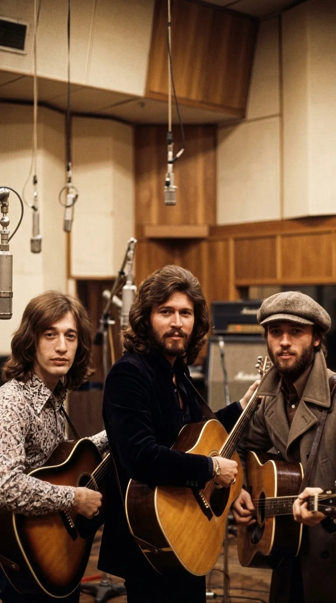
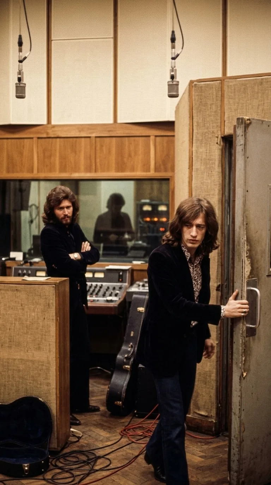
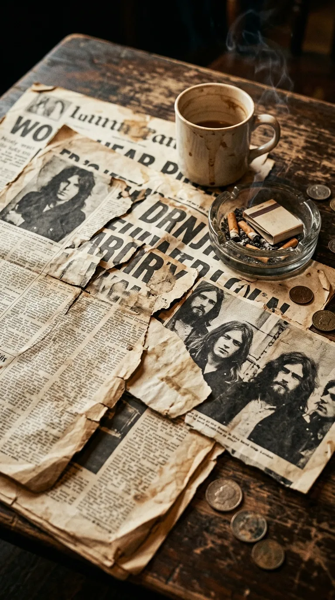
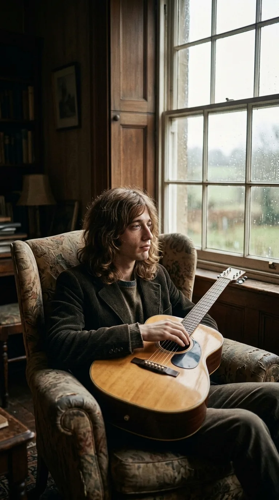
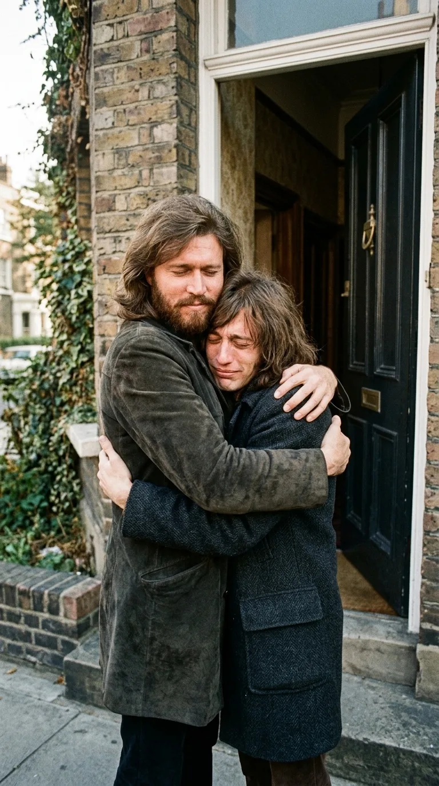
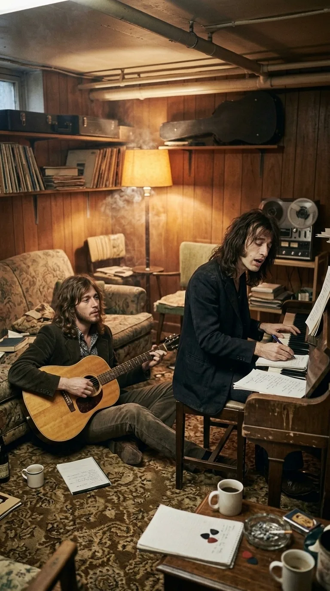
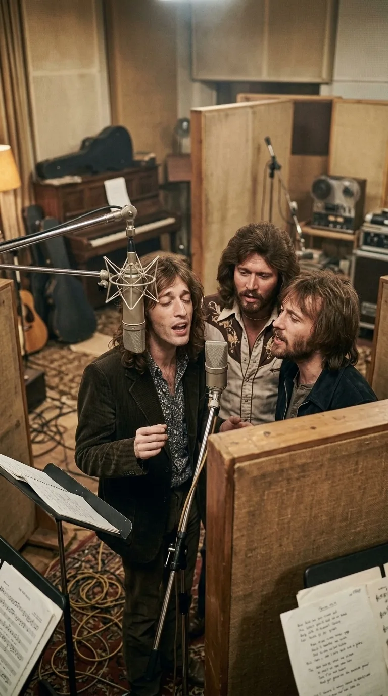
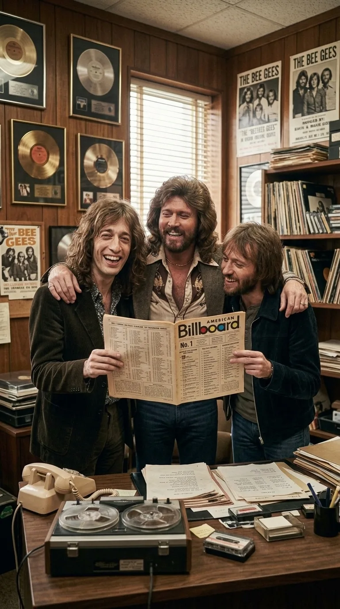
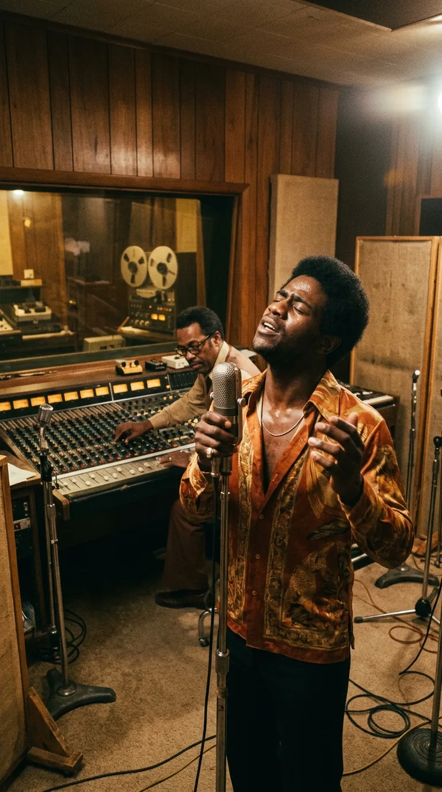

# The Pact in the Ashes: The Brotherly Wound Behind "How Can You Mend a Broken Heart"

> *"How can you mend a broken heart? How can you stop the rain from falling down? How can you stop the sun from shining? What makes the world go round?"*  
> — Barry Gibb and Robin Gibb (1970)

---

*The Bee Gees: The three brothers whose reconciliation forged one of the most moving ballads in pop history.*

---

### Prologue: The Ballad That Wasn't About Romance

For more than five decades, millions of listeners around the world have sought solace in one of the most aching melodies ever committed to tape. The gentle cadence of an acoustic guitar, a hushed piano, and a trembling voice that breaks as it poses a universal question: *How can you mend a broken heart?*

To the vast majority of the public, **"How Can You Mend a Broken Heart"** has always stood as the quintessential epitaph for a withered romance, the lament of someone standing amid the ruins of a finished love affair.

Yet behind the score, there was no jilted lover and no broken wedding vow. The song was born out of a far deeper, bleeding wound: **the bitterness, jealousy, and fratricidal rift that nearly destroyed the Bee Gees forever**. When Barry and Robin Gibb wrote those lines on a warm August afternoon in 1970, they were not crafting a commercial anthem; they were asking each other for forgiveness. It was a plea through which two blood brothers desperately tried to piece a shattered family back together before resentment consumed them completely.

*1969: The bitter fracture after the Odessa sessions that drove Robin apart from his brothers.*

---

### Act I: The War of Egos and the Fall of *Odessa* (1969)

To understand where the song came from, you have to step back to the early months of 1969. The Bee Gees had just finished recording their most ambitious work, the double album *Odessa*. Yet at the very height of their creative power, the poison of ego seeped into the studio.

Robin Gibb, blessed with a haunting vibrato and a singular sensibility, felt that manager Robert Stigwood and his older brother Barry were systematically pushing him into the background. The final spark blew up over the choice of the album's lead single: Robin demanded that it be his poignant ballad *"Lamplight,"* while Barry and the record label insisted on *"First of May."*

The argument was volcanic. Wounded in his pride and feeling betrayed by his own flesh and blood, Robin stormed out of the studio and slammed the door behind him. At just nineteen years old, he publicly announced his departure from the group to launch a solo career. Barry and Maurice pressed on briefly under the Bee Gees name with *Cucumber Castle*, but the alchemy had vanished.

Over the next fifteen months, brotherhood turned into a public battlefield. Across the pages of the British music press (*Melody Maker*, *NME*), the brothers traded venomous barbs. Barry declared they would never work together again; Robin insisted he didn't need his brothers to succeed. It looked like the permanent end of one of the most extraordinary vocal partnerships of the twentieth century.

*British press, 1969: The public echoes of a feud that threatened to tear the Bee Gees apart for good.*

---

### Act II: The Hollowness of Solitude (1970)

By the middle of 1970, the dust kicked up by wounded pride began to settle, and harsh reality set in on both sides. Although Robin had scored a solo hit with *"Saved by the Bell,"* his subsequent releases stalled. Likewise, Barry and Maurice's album without Robin failed to ignite the public's imagination.

Beyond record sales, however, lay an emotional amputation. The three brothers had sung together since boyhood in Manchester and Brisbane; their voices shared a harmonic DNA that no room full of session musicians could ever replicate.

Robin sat in his Surrey home steeped in isolation and nostalgia; Barry, in his London apartment, stared at his instruments with the quiet certainty that something vital had died inside him. Pride had kept them apart, yet the silence had grown unbearable.

*1970: Robin's lonely isolation in Surrey and Barry in London contemplating an uncertain future.*

---

### Act III: The Afternoon of Forgiveness on Addison Road (August 1970)

The thaw came on an unforgettable day in August 1970. After months without exchanging a single word, it was Robin who picked up the telephone and dialed his older brother's number. The call was brief, free of accusations, and full of shy hesitation. They agreed to meet that very afternoon.

Robin drove to Barry's apartment on **Addison Road**, in London's leafy Kensington neighborhood. When the door opened, the weight of fifteen months of bitterness dissolved in a matter of seconds. The two brothers fell into a long, silent embrace.

Hours later, they went down to the apartment's carpeted basement. They didn't call producers, managers, or lawyers; it was just the two of them, a Gibson acoustic guitar, and an upright piano. The music came pouring back like a dammed-up river finally breaking free.

In that single reunion session, Barry and Robin wrote two of the defining songs of their catalog in a sudden rush of inspiration: first *"Lonely Days,"* and immediately afterward, the unhurried, solemn chords of *"How Can You Mend a Broken Heart."*

*August 1970: The reunion embrace on Addison Road that washed away fifteen months of silence and resentment.*

---

### Act IV: The Anatomy of a Brotherly Prayer

As Barry drew his fingers across the acoustic guitar strings and Robin leaned toward the music stand, the lyrics reached for no elaborate metaphors. The words were a candid outpouring of human fragility in the face of loss:

> *"I can think of younger days when living for my life / Was everything a man could want to do..."*

Both of them were thinking back to those innocent years when they shared a bunk bed and sang in local movie theaters in Australia, long before limousines and record-label checks poisoned their bond. When they reached the chorus:

> *"How can you mend a broken heart? How can you stop the rain from falling down?"*

Barry and Robin knew precisely whose heart they were singing about. It was the heart of a family that had stood at the edge of ruin. Maurice Gibb joined them just days later, bringing with his melodic bass, his piano, and his instinctive ear for harmony the invisible glue that fused his brothers' voices into a single living instrument. The Bee Gees had been reborn.

*The Kensington basement: Barry and Robin at the piano and guitar, composing a plea for forgiveness together.*

---

### Act V: The Sacred Session at IBC Studios (January 1971)

In January 1971, the three brothers walked together into London's storied **IBC Studios** on Portland Place to commit the song to two-inch tape.

The vocal arrangement was a masterstroke of mutual empathy. To seal their reconciliation, Barry handed the opening verse entirely to Robin. When Robin stepped up to the condenser microphone and sang with his unmistakable, vulnerable vibrato, hovering right on the edge of tears—  
*"I can think of younger days..."*—  
everyone in the control room knew it was no performance: it was an open confession.

Barry followed on the second verse with his warm, protective tone, before all three voices braided together into an ethereal unison on the chorus. To cradle the track, arranger **Bill Shepherd** scored a restrained, deeply moving string arrangement that lifted the weeping acoustic guitars without ever suffocating the intimacy of the voices.

*IBC Studios, January 1971: Robin, Barry, and Maurice recording the definitive vocal harmonies alongside Bill Shepherd.*

---

### Act VI: Their First US Number One (August 1971)

Released in May 1971 as the lead single from the album *Trafalgar*, the song needed only a few weeks to send a wave of quiet awe across radio stations worldwide.

On August 7, 1971, *"How Can You Mend a Broken Heart"* achieved what no Bee Gees record had managed in their previous twelve years together: **it reached number one on the US Billboard Hot 100**, holding the top spot for four consecutive weeks in the most influential music market in the world.

The press that had written them off as finished had no choice but to surrender to the proof. The song did more than save the Bee Gees' career; it proved that when brotherly love outweighs ego, the art that emerges transcends every generational boundary.

*August 1971: Four consecutive weeks atop the Billboard Hot 100, crowning their artistic resurrection.*

---

### Act VII: Al Green's Spiritual Elevation (1972)

The stature of a masterpiece is also measured by the lives it touches far beyond its creators. In 1972, at Hi Records' studio in Memphis, Tennessee, soul titan **Al Green** and legendary producer Willie Mitchell decided to record a version of the song for the album *Let's Stay Together*.

Al Green took the Gibb brothers' pop ballad and immersed it in the sacred waters of gospel and Southern soul. Across a six-minute-plus performance alive with whispers, ecstatic cries, and a smoldering horn section, Green transformed *"How Can You Mend a Broken Heart"* into a universal prayer of spiritual redemption.

Years later, Barry Gibb himself would say with complete generosity:  
*"Al Green's version is the definitive form of that song. He took it to a spiritual place we could never have reached."*

*Memphis, 1972: Al Green at Royal Studios recording the soul rendition that lifted the plea to another realm.*

---

### Epilogue: Barry's Solitary Guitar

Time, relentless as ever, eventually claimed its toll on the brotherhood. Maurice Gibb died suddenly in January 2003 at the age of fifty-three; nine years later, in May 2012, cancer silenced Robin's voice at sixty-two.

Today, Barry Gibb stands as the sole surviving guardian of that dynasty. Whenever he picks up his acoustic guitar on his solo tours and plays the opening notes of *"How Can You Mend a Broken Heart,"* the screens behind him fill with images of his two brothers smiling in their youth. In that moment, the song takes on its final, most overwhelming meaning: the certainty that hearts broken by death never fully mend, yet music keeps them beating together across time.

*The closing image: Three teacups on a table and a guitar at rest, evoking the enduring brotherhood of the Gibb brothers.*

---

### 📚 Sources and Archival Records

1. **Bilyeu, Melinda; Cook, Hector; Hughes, Andrew M.** (2009). *The Bee Gees: The Ultimate Biography*. Omnibus Press, London. (Chapters 8 and 9: The *Odessa* crisis, the 1969 split, and the reconciliation on Addison Road).
2. **Gibb, Barry** (2020). Testimonial interviews for the HBO documentary *The Bee Gees: How Can You Mend a Broken Heart*, directed by Frank Marshall. (Detailed account of the songwriting afternoon with Robin).
3. **Melody Maker & New Musical Express (NME)** (1969–1971). British press archives covering Robin Gibb's public dispute and the trio's reunion.
4. **Billboard Magazine** (August 1971). Official *Hot 100* chart archives and RIAA certifications for the lead single from *Trafalgar*.
5. **IBC Studios Historical Logbooks** (London, 1971). Technical recording sheets and personnel credits for Bill Shepherd and the Atlantic/Polydor sound engineers.
6. **Green, Al** (2000). *Take Me to the River*. HarperCollins. (Memoir recounting the 1972 recording session at Royal Recording Studios in Memphis).
