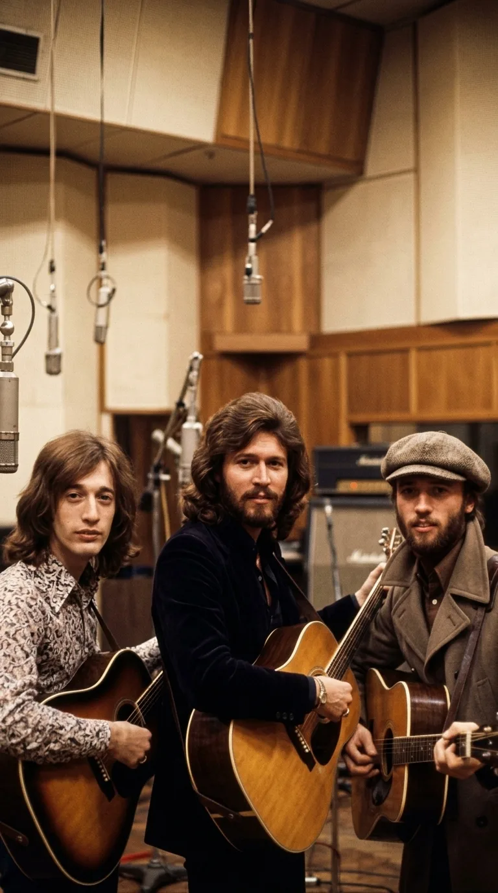
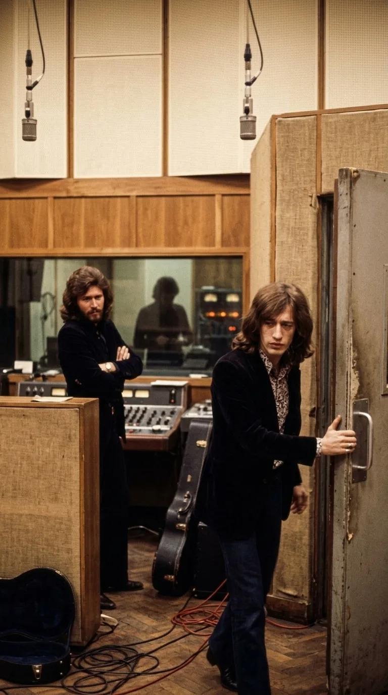
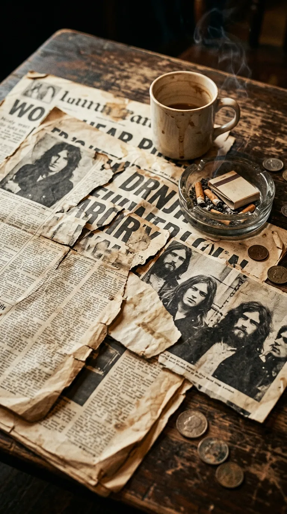
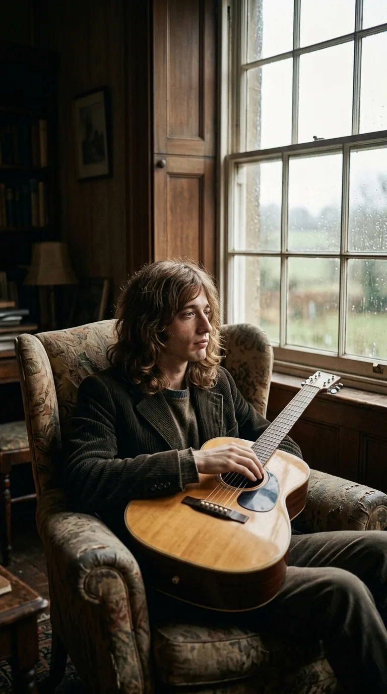
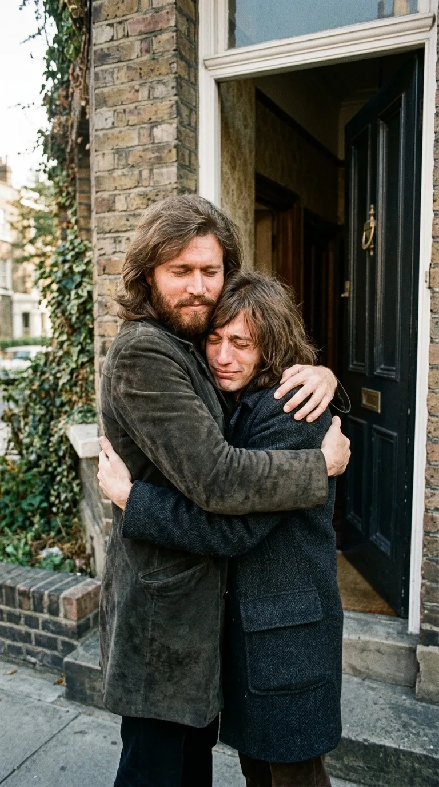
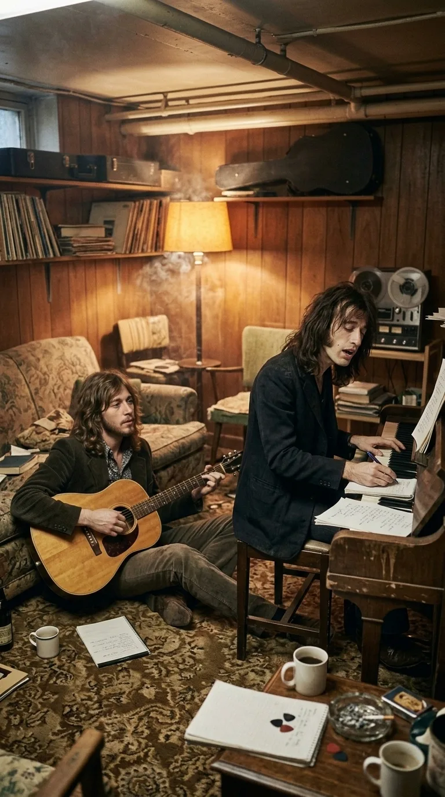
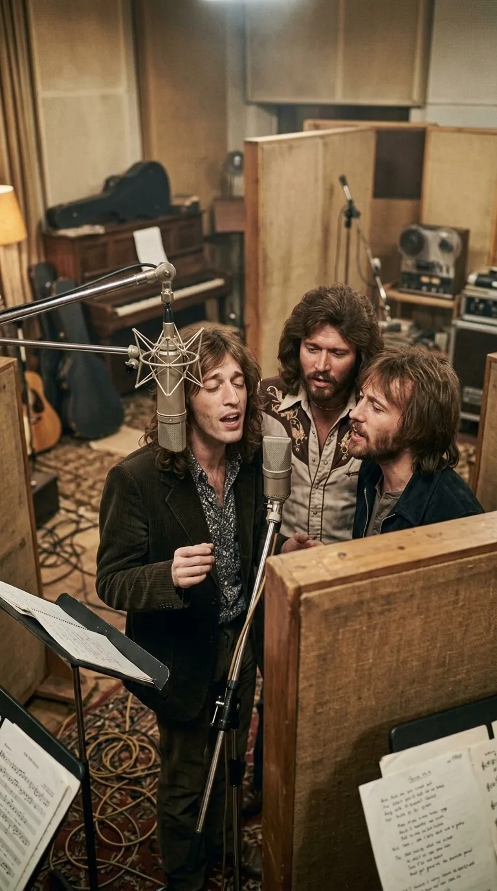
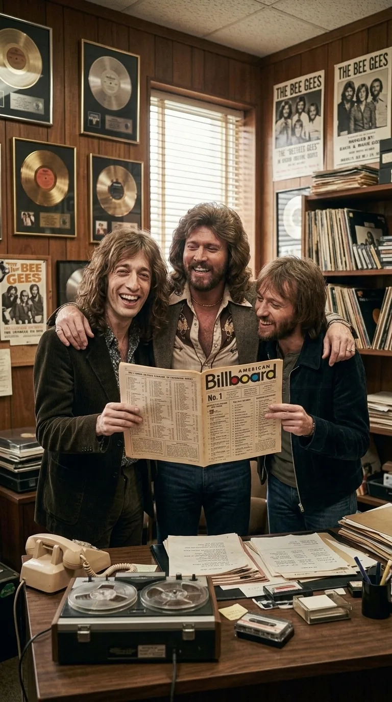
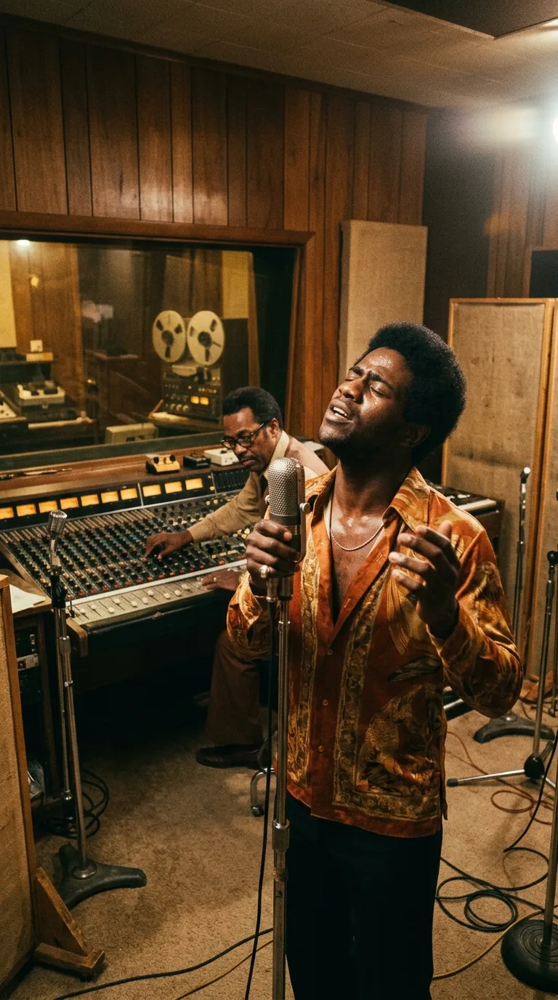
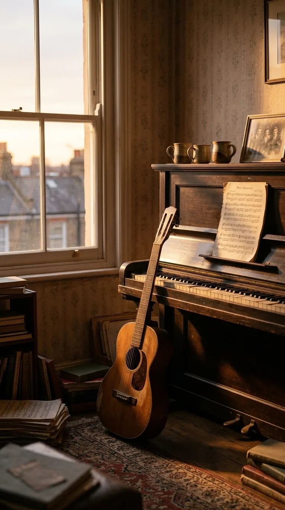

# El Pacto de las Cenizas: La Herida Fraterna tras «How Can You Mend a Broken Heart»

> *«How can you mend a broken heart? How can you stop the rain from falling down? How can you stop the sun from shining? What makes the world go round?»*  
> — Barry Gibb y Robin Gibb (1970)

---

*Bee Gees: Los tres hermanos cuya reconciliación fraterna forjó una de las baladas más conmovedoras de la historia del pop.*

---

### Prólogo: La Balada que No Era de Amor

Durante más de cinco décadas, millones de oyentes en todo el mundo han buscado consuelo en una de las melodías más desgarradoras jamás grabadas por la música popular. La cadencia suave de una guitarra acústica, un piano sosegado y una voz temblorosa que se quiebra al formular una pregunta universal: *¿Cómo puedes remendar un corazón roto?*

Para la inmensa mayoría del público, **«How Can You Mend a Broken Heart»** siempre fue el epitafio perfecto para un amor marchito, el lamento de alguien que contempla las ruinas de un romance terminado. 

Sin embargo, detrás de la partitura no había ninguna mujer despechada ni ninguna promesa matrimonial rota. Aquella canción nació de una herida mucho más profunda y sangrante: **el odio, los celos y la fractura fratricida que casi destruye para siempre a los Bee Gees**. Cuando Barry y Robin Gibb escribieron esas líneas en una calurosa tarde de agosto de 1970, no estaban componiendo un himno comercial; se estaban pidiendo perdón. Era la súplica con la que dos hermanos de sangre intentaron desesperadamente recomponer una familia destrozada antes de que el rencor los consumiera por completo.

*1969: La fractura amarga tras las sesiones de Odessa que distanció a Robin de sus hermanos.*

---

### Acto I: La Guerra de los Egos y la Caída de Odessa (1969)

Para comprender el origen de la canción, es necesario retroceder a los primeros meses de 1969. Los Bee Gees venían de grabar su obra más ambiciosa, el álbum doble *Odessa*. Pero en el pináculo de su creatividad, el veneno del ego se infiltró en el estudio.

Robin Gibb, poseedor de un vibrato conmovedor y una sensibilidad única, sintió que el mánager Robert Stigwood y su hermano mayor Barry lo estaban relegando sistemáticamente a un segundo plano. La chispa definitiva estalló con la elección del sencillo principal del álbum: Robin exigía que fuera su emotiva balada *Lamplight*, pero Barry y la discográfica impusieron *First of May*.

La discusión fue volcánica. Robin, herido en su orgullo y sintiéndose traicionado por su propia sangre, abandonó la sala de grabación dando un portazo. A los diecinueve años, anunció públicamente su separación del grupo para iniciar una carrera solista. Barry y Maurice continuaron brevemente bajo el nombre de Bee Gees con el proyecto *Cucumber Castle*, pero la magia se había esfumado.

Durante los siguientes quince meses, la hermandad se convirtió en un campo de batalla público. En las páginas de la prensa musical británica (*Melody Maker*, *NME*), los hermanos se lanzaban acusaciones venenosas. Barry declaraba que jamás volverían a trabajar juntos; Robin aseguraba que no necesitaba a sus hermanos para triunfar. Parecía el final definitivo de una de las asociaciones vocales más asombrosas del siglo XX.

*Prensa británica, 1969: Los ecos públicos de una disputa que amenazaba con destruir a los Bee Gees.*

---

### Acto II: El Vacío de la Soledad (1970)

A mediados de 1970, la polvareda del orgullo comenzó a asentarse y la cruda realidad golpeó a ambos lados. Aunque Robin había conseguido un éxito solitario con *Saved by the Bell*, sus lanzamientos posteriores se estancaron. Del mismo modo, el disco de Barry y Maurice sin Robin no logró encender el fervor del público.

Pero más allá de las cifras de ventas, existía una mutilación afectiva. Los tres hermanos habían cantado juntos desde su infancia en Mánchester y Brisbane; sus voces compartían un ADN armónico que ninguna orquesta de sesionistas podía replicar. 

Robin vivía en su residencia de Surrey sumido en el aislamiento y la nostalgia; Barry, en su apartamento de Londres, contemplaba sus instrumentos con la certeza de que algo vital había muerto en su interior. El orgullo los había mantenido separados, pero el silencio se había vuelto insoportable.

*1970: El aislamiento solitario de Robin en Surrey y Barry en Londres contemplando un futuro incierto.*

---

### Acto III: La Tarde del Perdón en Addison Road (Agosto de 1970)

El deshielo ocurrió en una fecha imborrable de agosto de 1970. Tras meses sin cruzar una sola palabra, fue Robin quien tomó el teléfono y marcó el número de su hermano mayor. La conversación fue breve, libre de reproches y llena de timidez. Quedaron en verse esa misma tarde.

Robin condujo hasta el apartamento de Barry en **Addison Road**, en el elegante barrio londinense de Kensington. Cuando la puerta se abrió, el peso de quince meses de amargura se disolvió en cuestión de segundos. Los dos hermanos se fundieron en un abrazo largo y silencioso.

Horas después, bajaron al sótano alfombrado del apartamento. No llamaron a productores, mánagers ni abogados; solo estaban ellos dos, una guitarra acústica Gibson y un piano vertical. La música volvió a brotar como un torrente contenido.

En esa misma sesión de reencuentro, Barry y Robin compusieron en una ráfaga de inspiración dos de las piezas más monumentales de su repertorio: primero *Lonely Days*, y de inmediato, las notas pausadas y solemnes de *How Can You Mend a Broken Heart*.

*Agosto de 1970: El abrazo de reencuentro en Addison Road que disolvió quince meses de silencio y rencor.*

---

### Acto IV: La Anatomía de una Plegaria Fraterna

Cuando Barry deslizó los dedos sobre las cuerdas de la guitarra acústica y Robin se inclinó sobre el atril, las palabras no buscaron metáforas sofisticadas. La letra era un desahogo directo sobre la fragilidad humana ante la pérdida:

> *«I can think of younger days in the shine of my life / Everything is pleasant, every smile is bright...»*  
> (Puedo pensar en días más jóvenes, en el brillo de mi vida / Donde todo es agradable y cada sonrisa es luminosa...)

Ambos recordaban los años de inocencia en que compartían una litera y cantaban en cines locales de Australia, antes de que las limusinas y los cheques discográficos envenenaran su relación. Cuando llegaron al estribillo:

> *«How can you mend a broken heart? How can you stop the rain from falling down?»*

Barry y Robin sabían exactamente a qué corazón se referían. Era el corazón de una familia que había estado al borde del abismo. Maurice Gibb se sumó pocos días después, aportando con su bajo melódico, su piano y su oído armónico el pegamento invisible que convertía la voz de sus hermanos en un solo organismo sonoro. Los Bee Gees habían renacido.

*El sótano de Kensington: Barry y Robin al piano y la guitarra componiendo juntos una súplica de perdón.*

---

### Acto V: La Sesión Sagrada en IBC Studios (Enero de 1971)

En enero de 1971, los tres hermanos entraron juntos a los míticos **IBC Studios** en Portland Place (Londres) para plasmar la canción en cinta de dos pulgadas.

La estructura vocal fue una decisión maestra de empatía mutua. Para sellar la reconciliación, Barry cedió la estrofa inicial por completo a Robin. Cuando Robin se colocó frente al micrófono de condensador y cantó con su característico vibrato vulnerable, casi al borde del llanto:  
*«I can think of younger days...»*  
todos los presentes en la cabina de control supieron que no era una actuación: era una confesión abierta.

A continuación, Barry tomó la segunda estrofa con su tono cálido y protector, antes de que las tres voces se entrelazaran en un unísono celestial durante el estribillo. Para arropar el tema, el arreglista **Bill Shepherd** compuso una partitura de cuerdas orquestales contenida y conmovedora, que sostenía el llanto de las guitarras acústicas sin asfixiar la intimidad de las voces.

*IBC Studios, enero de 1971: Robin, Barry y Maurice grabando las armonías vocales definitivas con Bill Shepherd.*

---

### Acto VI: El Primer Número Uno en Estados Unidos (Agosto de 1971)

Lanzada en mayo de 1971 como sencillo de adelanto del álbum *Trafalgar*, la canción tardó apenas unas semanas en desatar una ola de conmoción en las emisoras de radio internacionales.

El 7 de agosto de 1971, *How Can You Mend a Broken Heart* logró lo que ninguna canción de los Bee Gees había conseguido en sus doce años de trayectoria previa: **alcanzó el número 1 del Billboard Hot 100 de los Estados Unidos**, manteniéndose cuatro semanas consecutivas en la cima de la nación más influyente de la música.

La prensa que los había dado por muertos y enterrados tuvo que rendirse ante la evidencia. Aquel tema no solo salvó la carrera de los Bee Gees; demostró que cuando el amor fraterno prevalece sobre el ego, el resultado artístico trasciende cualquier frontera generacional.

*Agosto de 1971: Cuatro semanas consecutivas en el número uno del Billboard Hot 100 coronando su resurrección.*

---

### Acto VII: La Elevación Espiritual de Al Green (1972)

La grandeza de una obra maestra se mide también por las vidas que toca más allá de sus creadores. En 1972, en los estudios Hi Records de Memphis (Tennessee), el titán del soul **Al Green** y el legendario productor Willie Mitchell decidieron grabar una versión del tema para el álbum *Let's Stay Together*.

Al Green tomó la balada pop de los hermanos Gibb y la sumergió en las aguas sagradas del gospel y el soul sureño. Con una interpretación de más de seis minutos marcada por susurros, gritos de éxtasis y una sección de vientos humeante, Green convirtió *How Can You Mend a Broken Heart* en una plegaria universal de redención espiritual.

Años más tarde, el propio Barry Gibb declararía con generosidad absoluta:  
*«La versión de Al Green es la forma definitiva de esa canción. La llevó a un lugar espiritual donde nosotros jamás hubiéramos podido llegar».*

*Memphis, 1972: Al Green grabando en Royal Studios la versión soul que elevó la plegaria a una dimensión cósmica.*

---

### Epílogo: La Guitarra Solitaria de Barry

El tiempo, implacable, cobró su tributo sobre la hermandad. Maurice Gibb falleció repentinamente en enero de 2003 a los cincuenta y tres años; nueve años después, en mayo de 2012, el cáncer apagó la voz de Robin a los sesenta y dos.

Hoy, Barry Gibb permanece como el único guardián de aquella dinastía. Cuando en sus conciertos en solitario empuña la guitarra acústica y entona las primeras notas de *How Can You Mend a Broken Heart*, las pantallas muestran las imágenes de sus dos hermanos sonriendo en su juventud. En ese instante, la canción adquiere su significado final y más sobrecogedor: la certeza de que los corazones rotos por la muerte nunca se remiendan del todo, pero la música los mantiene latiendo juntos en la eternidad.

*La metáfora final: Tres tazas sobre la mesa y una guitarra en reposo evocando la hermandad eterna de los hermanos Gibb.*

---

### 📚 Fuentes y Archivo Documental

1. **Bilyeu, Melinda; Cook, Hector; Hughes, Andrew M.** (2009). *The Bee Gees: The Ultimate Biography*. Omnibus Press, Londres. (Capítulos 8 y 9: La crisis de Odessa, la separación de 1969 y la reconciliación en Addison Road).
2. **Gibb, Barry** (2020). Entrevistas testimoniales para el documental de HBO *The Bee Gees: How Can You Mend a Broken Heart*, dirigido por Frank Marshall. (Relato detallado sobre la tarde de composición con Robin).
3. **Melody Maker & New Musical Express (NME)** (1969–1971). Archivos hemerográficos de prensa británica con la cobertura de la disputa pública de Robin Gibb y el regreso del trío.
4. **Billboard Magazine** (Agosto de 1971). Archivo de listas oficiales del *Hot 100* y certificaciones discográficas de la RIAA para el sencillo de *Trafalgar*.
5. **IBC Studios Historical Logbooks** (Londres, 1971). Hojas técnicas de grabación y créditos de personal de Bill Shepherd y los ingenieros de sonido de Atlantic/Polydor.
6. **Green, Al** (2000). *Take Me to the River*. HarperCollins. (Memorias sobre la sesión de grabación de 1972 en Royal Recording Studios de Memphis).
