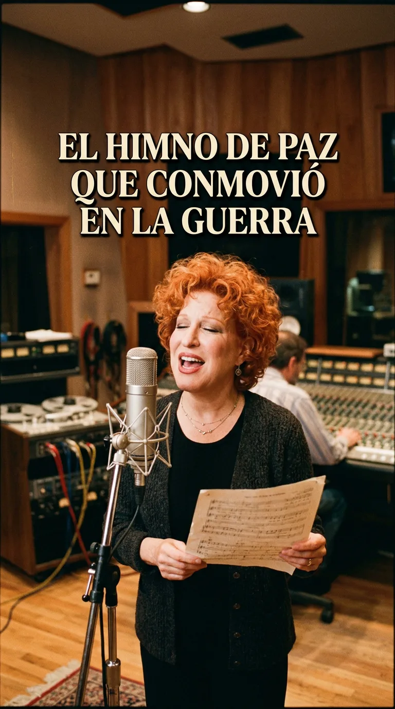
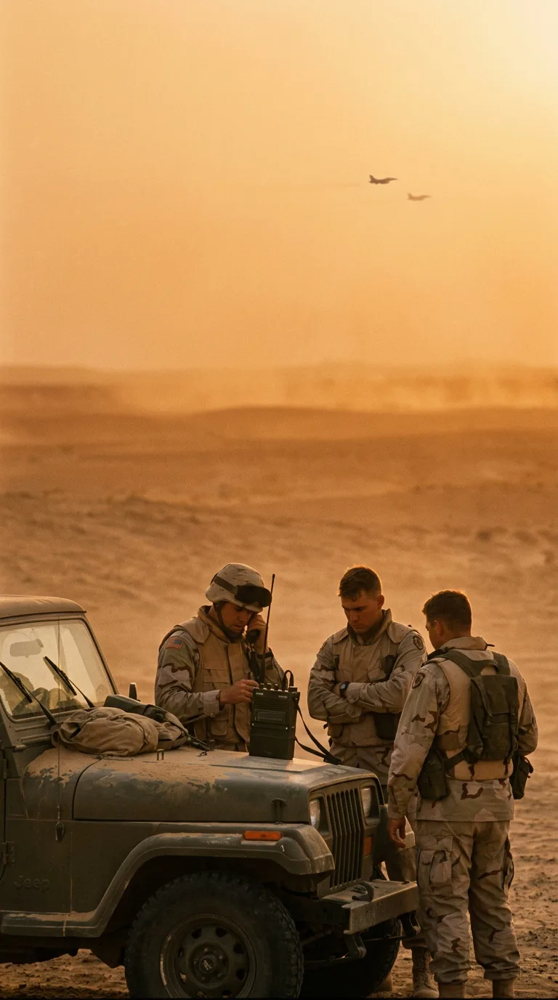
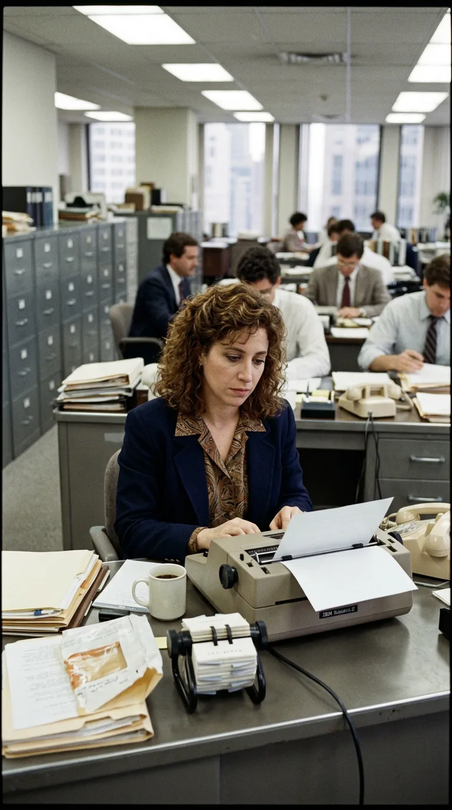
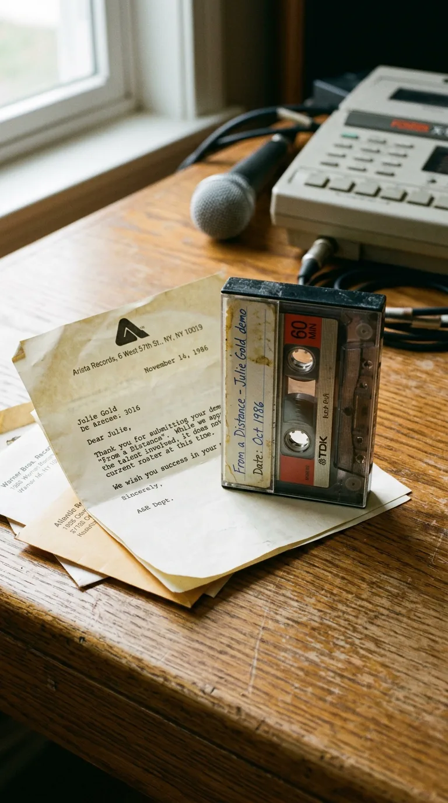
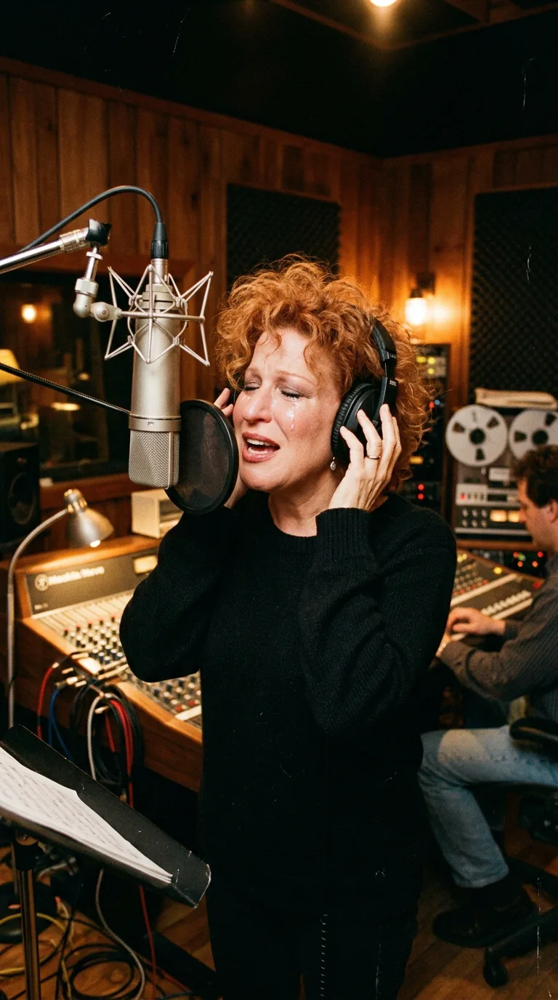
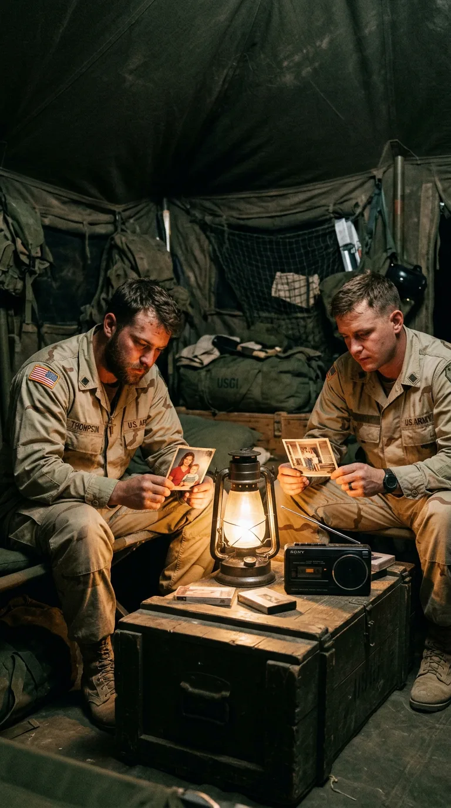
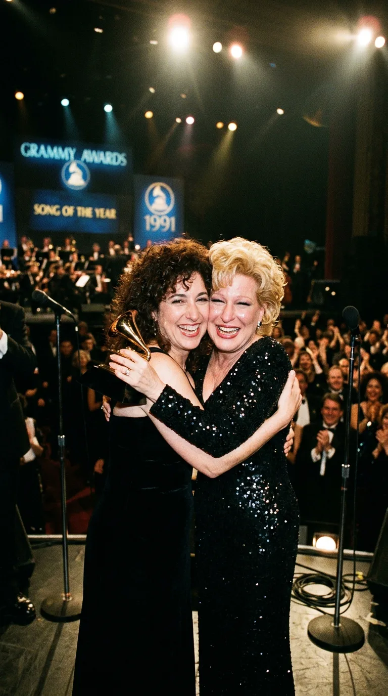
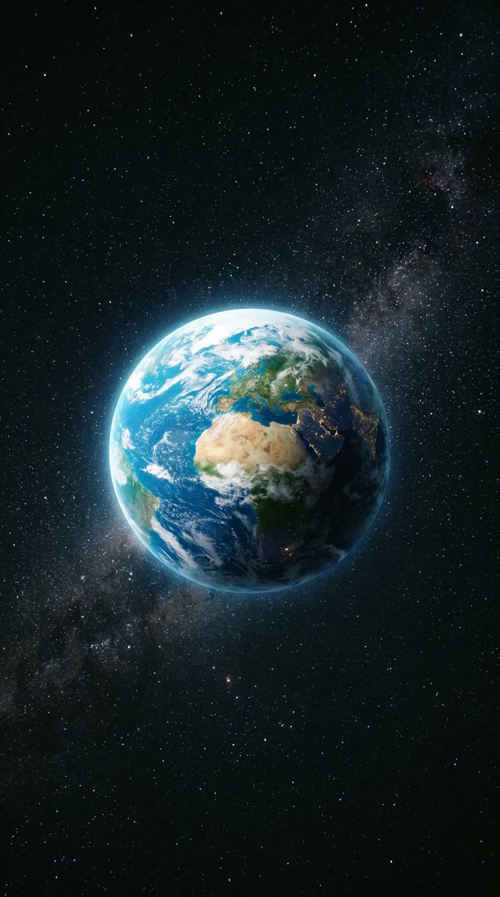

# El Himno de Paz que Conmovió en la Guerra

*1990: Bette Midler, la voz que transformó una plegaria íntima en un rezo colectivo de esperanza.*

### Prólogo: El rezo en medio de la tormenta

> *«From a distance the world looks blue and green / And the snow-capped mountains white... / From a distance there is harmony / And it echoes through the land...»*

En el gélido amanecer del **17 de enero de 1991**, cuando el cielo nocturno sobre Bagdad y Kuwait se iluminó con las primeras ráfagas antiaéreas y los misiles Tomahawk de la **Operación Tormenta del Desierto** (*Guerra del Golfo Pérsico*), más de medio millón de jóvenes soldados estadounidenses, británicos y aliados se encontraban atrincherados en el desierto frente a la frontera iraquí.

*Kuwait, 1991: Soldados estadounidenses escuchando la radio de campaña en el desierto al atardecer.*

En medio del rugido de los cazabombarderos F-15 y el olor a queroseno quemado, las radios portátiles de campaña y los altavoces de los jeeps militares sintonizaban con fervor casi religioso una sola melodía: la voz desgarrada, maternal y profundamente humana de **Bette Midler** entonando una plegaria sobre cómo la Tierra, contemplada desde el espacio, carece de fronteras, ejércitos y odio.

Sin embargo, detrás de aquel himno que acompañó a las tropas en la mayor conflagración militar de finales del siglo XX no había un encargo de propaganda institucional ni un cálculo de laboratorio discográfico: había la resistencia silenciosa de una secretaria de Manhattan que llevaba una década recibiendo cartas de rechazo y un viejo piano vertical enviado por sus padres para salvarla de la rendición.

---

### Acto I: Una máquina de escribir en la Sexta Avenida (1985)

Para entender el milagro hay que retroceder a **1985** en Nueva York. **Julie Gold** (nacida en 1956 en Havertown, Pensilvania) tenía veintinueve años y trabajaba ocho horas al día como secretaria en el departamento de programación de la cadena de televisión por cable **HBO** en la Sexta Avenida.

*Manhattan, 1985: Julie Gold tecleando en su máquina de escribir entre archivadores, soñando con componer.*

Gold llevaba más de diez años persiguiendo el sueño de componer canciones. Por las noches, en su diminuto apartamento de Greenwich Village, grababa maquetas caseras en casete y las enviaba por correo a todas las editoriales discográficas de Nueva York, Nashville y Los Ángeles. La respuesta era siempre la misma: cartas tipo en las que los ejecutivos aseguraban con frialdad que sus composiciones eran «demasiado reflexivas, lentas o poco comerciales» para la radio pop de los ochenta.

Al borde de cumplir treinta años y agotada por la falta de recursos y el desaliento, Julie llamó a sus padres en Filadelfia dispuesta a tirar la toalla: vendería sus instrumentos y se resignaría a ser oficinista para siempre.

Sus padres se negaron en redondo a permitir que se rindiera. Para su **30.º cumpleaños**, pagaron de su bolsillo los gastos de mudanza para trasladar desde Filadelfia hasta su pequeño piso de Nueva York el viejo **piano vertical de madera** en el que Julie había aprendido a tocar de niña.

*Greenwich Village, 1985: Frente al piano vertical regalado por sus padres, Julie compone «From a Distance».*

Unas semanas después, con el sol de la tarde entrando por la ventana y las manos posadas sobre el teclado familiar, Julie Gold experimentó una sensación de paz repentina. Pensó en cómo las disputas humanas, la codicia y las guerras parecen gigantescas cuando estamos en el suelo, pero diminutas y absurdas si pudiéramos observar nuestro planeta flotando en la inmensidad del cosmos. En apenas **dos horas**, música y letra quedaron completas sobre el atril: acababa de nacer **«From a Distance»** (*Desde la distancia*).

---

### Acto II: El peregrinaje de la cinta y las lágrimas de Bette Midler

Durante casi cuatro años, la canción continuó siendo un secreto ignorado por la gran industria. Julie Gold regalaba copias en casete a otros cantautores del circuito *folk* de Greenwich Village. La primera en grabarla comercialmente fue la cantautora texana **Nanci Griffith** en su álbum *Lone Star State of Mind* (1987), convirtiéndola en una pieza de culto en círculos acústicos, pero sin repercusión masiva.

*1986: La modesta cinta de casete con la maqueta original rodeada por cartas de rechazo discográfico.*

A finales de **1989**, una de aquellas cintas llegó a manos del legendario productor turco-estadounidense **Arif Mardin** (productor de Aretha Franklin, Chaka Khan y Norah Jones), quien se encontraba en Nueva York seleccionando repertorio para el nuevo álbum de **Bette Midler**, ***Some People's Lives*** (**1990**).

Cuando Mardin le puso la maqueta a Bette Midler en la sala de escucha de Atlantic Records, la cantante rompió a llorar antes de que terminara el primer estribillo. Midler —conocida tanto por su temperamento teatral exuberante como por su inmensa hondura como baladista dramática en *«The Rose»* y *«Wind Beneath My Wings»*— sintió que aquella canción le pertenecía al alma del mundo:

> *«Cuando escuché las líneas que dicen: "Dios nos está mirando desde la distancia... En este mundo no hay hambre ni armas, todos tenemos suficiente", no pude contener el llanto. Era exactamente lo que la humanidad necesitaba recordar»*.

*Nueva York, 1990: Bette Midler conmovida hasta las lágrimas al grabar la pista vocal en el estudio de Atlantic.*

En el estudio, Arif Mardin construyó un arreglo orquestal solemne y emotivo, donde el piano acústico guía a la voz de Midler hasta culminar en un coro celestial que abraza cada verso con reverencia.

---

### Acto III: Las arenas del Golfo y el rezo en las trincheras

El sencillo fue publicado por **Atlantic Records** en **octubre de 1990**. Pocas semanas antes, el **2 de agosto de 1990**, las tropas de Sadam Husein habían invadido Kuwait, desatando la crisis internacional del Golfo Pérsico y el despliegue militar de la **Operación Escudo del Desierto** (*Desert Shield*).

*El Golfo Pérsico, 1990: Blindados militares avanzando bajo el humo oscuro de los pozos en llamas.*

De forma totalmente espontánea, sin ninguna campaña publicitaria previa, **«From a Distance»** fue adoptada como un himno por los dos lados del océano:
* En Estados Unidos, millones de familias con hijos en el frente ponían la canción en bucle en sus casas y ataban lazos amarillos en los árboles mientras esperaban su regreso.
* En el desierto de Arabia Saudita y Kuwait, los soldados escuchaban la voz de Bette Midler en sus radiocasetes portátiles a la luz de las linternas en las tiendas de campaña, encontrando en sus versos un refugio espiritual contra el terror del combate.

*En la trinchera del desierto: Soldados contemplando fotos familiares a la luz de una linterna con la canción de fondo.*

La canción escaló vertiginosamente hasta el **puesto número 2 del *Billboard Hot 100*** en Estados Unidos, permaneció **seis semanas consecutivas en el número 1 de la lista *Adult Contemporary*** y vendió más de dos millones de copias en todo el mundo.

---

### Epílogo: El abrazo en la noche de los Grammy

El **20 de febrero de 1991**, en el Radio City Music Hall de Nueva York —a pocas manzanas del edificio donde Julie Gold tecleaba memos como secretaria apenas unos años antes—, la Academia de la Grabación celebró la **33.ª entrega de los Premios Grammy**.

Cuando los presentadores abrieron el sobre más importante de la velada para anunciar el galardón a la **Canción del Año** (*Song of the Year*, el premio exclusivo para los compositores), no pronunciaron el nombre de ninguna estrella consagrada: pronunciaron el nombre de **Julie Gold**.

*Radio City Music Hall, 1991: Julie Gold y Bette Midler alzando el Grammy a Canción del Año con júbilo fraternal.*

Sobre el escenario, bañada en lágrimas de emoción y arropada por el abrazo cariñoso de Bette Midler, Julie Gold dedicó el premio a sus padres y a todos los soñadores anónimos que jamás se rinden:

> *«Esta canción la escribió una secretaria que soñaba frente a un piano viejo. Si alguien allá afuera siente que está perdiendo la fe en lo que hace, por favor, siga adelante. La belleza siempre encuentra su camino»*.

*La Tierra suspendida en el silencio cósmico: un hogar azul sin fronteras que espera aprender a vivir en paz.*

Más de treinta años después, cada vez que el mundo vuelve a temblar bajo las sombras de la guerra o la división, **«From a Distance»** sigue flotando en el aire como un recordatorio inapelable: que cuando aprendemos a mirar la existencia humana desde la altura del amor, descubrimos que todos habitamos la misma frágil esfera azul, y que bajo el mismo cielo no hay enemigos, sino hermanos aprendiendo a convivir.

---

### 📚 Fuentes y Archivo Documental

1. **Testimonios de Composición y Carrera de Julie Gold (1985–1991)**:
   * Gold, Julie. Testimonios autobiográficos en el *Songwriters Hall of Fame*, *NPR* y *The New York Times* («From a Distance: The Story of a Song», febrero de 1991), detallando su labor como secretaria en HBO, el traslado del piano por sus padres y la escritura de la canción en dos horas.
   * Griffith, Nanci. Libreto del álbum *Lone Star State of Mind* (MCA Records, 1987), primera versión fonográfica comercial de la partitura de Julie Gold.
2. **Grabación de Bette Midler y Créditos Fonográficos (1990)**:
   * Midler, Bette (1990). Álbum ***Some People's Lives*** y sencillo 7" *«From a Distance / One More Round»* (Atlantic Records, 7-87887, publicado en octubre de 1990). Producción y arreglos de **Arif Mardin**; ingeniería de **Jack Joseph Puig**.
3. **Reconocimientos Oficiales y Contexto de la Guerra del Golfo (1991)**:
   * **33.ª Ceremonia de los Premios Grammy (20 de febrero de 1991)**: Ganadora oficial del **Grammy a la Canción del Año** (*Song of the Year*) para Julie Gold.
   * Archivos hemerográficos de *Billboard Magazine* y la *Associated Press* (enero–marzo de 1991): Crónicas sobre el impacto de la canción entre las tropas aliadas de la Operación Tormenta del Desierto.
