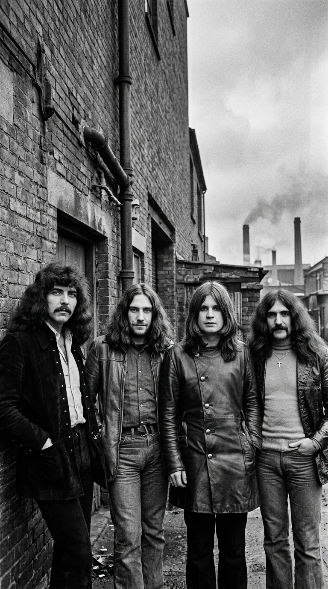
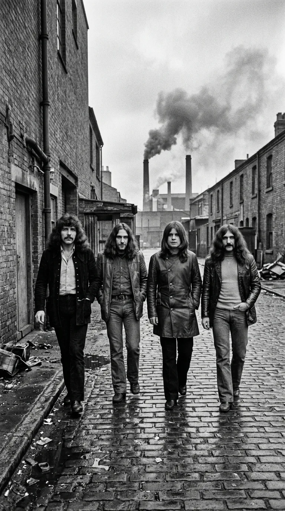
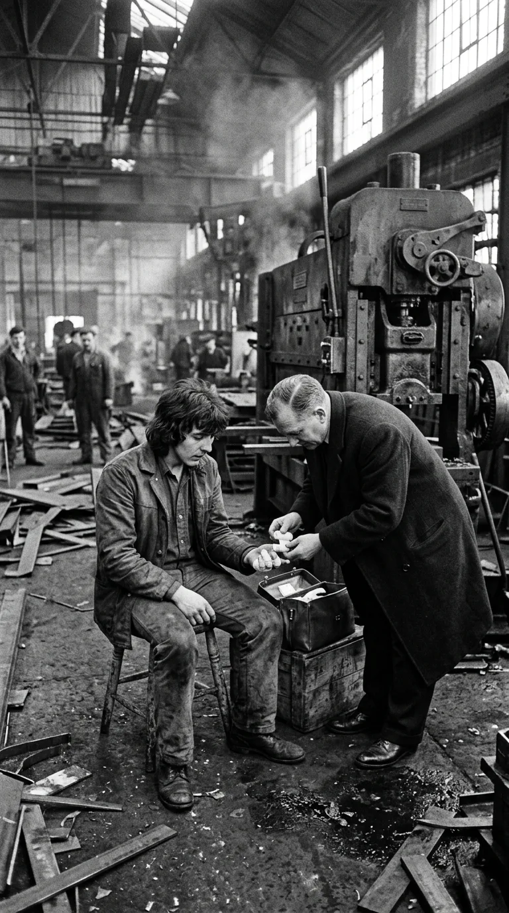
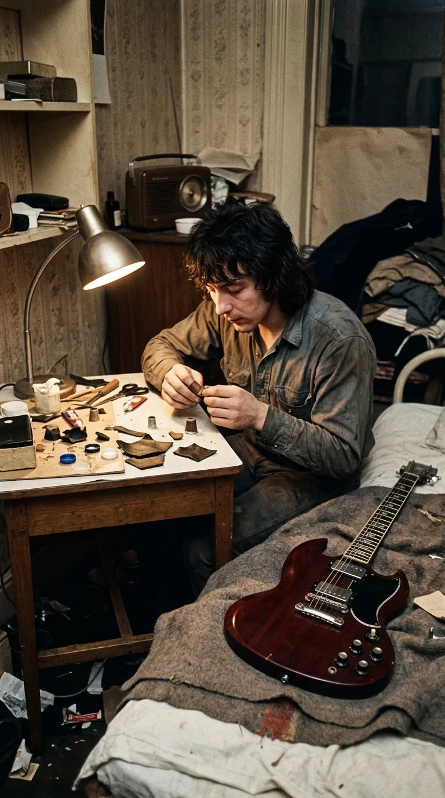
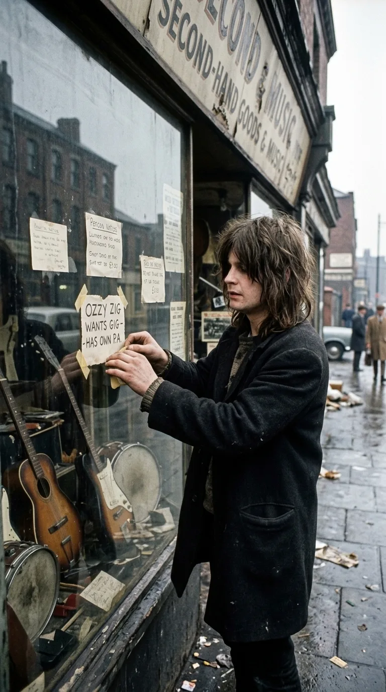
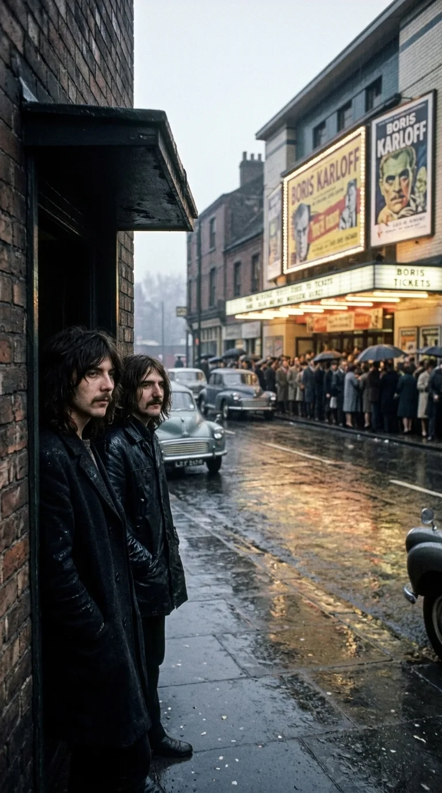
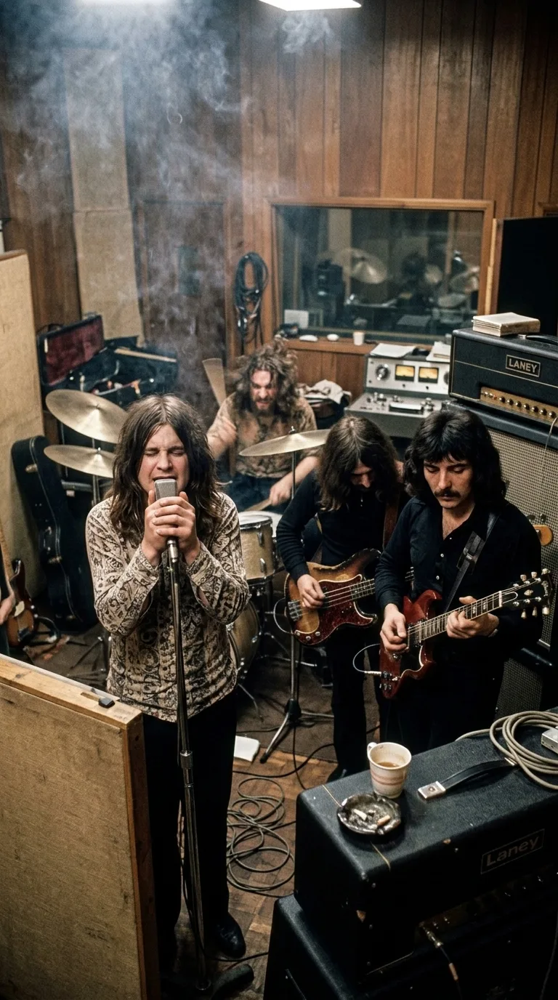
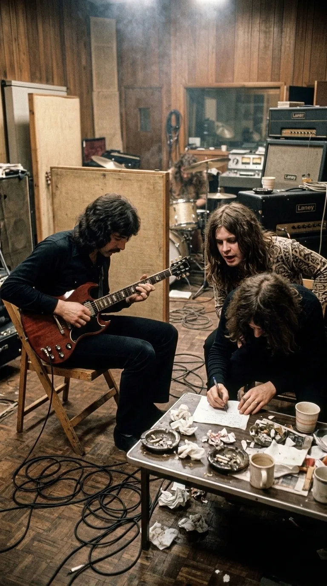
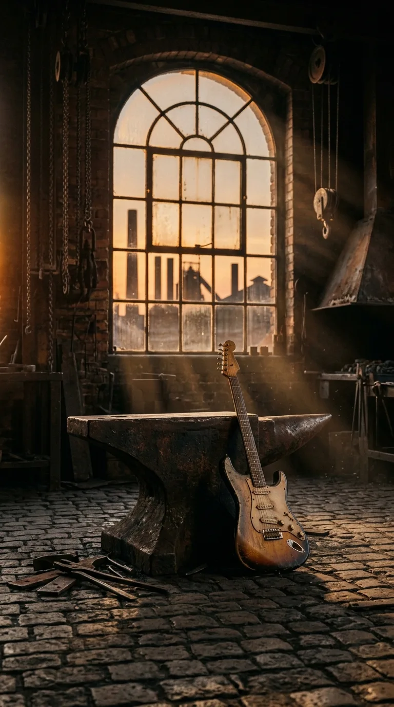

# The Steel That Bled in the Mist: Black Sabbath and the Industrial Requiem of "Paranoid"

### By Secret Chords — Forged in the Mud

*Black Sabbath: Four working-class kids who forged the foundational sound of Heavy Metal in the mud of Birmingham.*

There are sounds born in perfumed parlors warmed by privilege, and there are roars that can only rise from the gut of a bruised city—out of blast-furnace soot, the deafening hiss of white-hot metal, and the quiet desperation of a generation sentenced to the foundry. The story of **Black Sabbath** is not the chronicle of four virtuosos smiled upon by fortune; it is the most relentless working-class epic in the history of modern music.

Born in **Aston**, one of the hardest-hit, poorest districts of postwar **Birmingham**, **Anthony Frank "Tony" Iommi**, **John Michael "Ozzy" Osbourne**, **Terence Michael "Geezer" Butler**, and **William Thomas "Bill" Ward** had no Plan B. In that wasteland of coal-blackened brick and lingering Nazi bomb scars, a working-class boy's future offered only two paths: the unforgiving grind of a steel mill, or petty crime just to keep hunger at bay.

Yet against every odd, against suffocating poverty and a devastating physical mutilation that should have silenced their music forever, these four outcasts forged in the mud a sound so massive, dense, and dark that it ended up inventing an entirely new sonic universe: **Heavy Metal**.

---

## Act I: The Smokestacks of Aston and the Sentence of Coal

In the late 1950s and early 1960s, Birmingham was the industrial workshop of the British Empire—a labyrinth of steel foundries, sheet-metal shops, and munitions factories where the air tasted of rust and Victorian facades wore thick coats of impenetrable soot.

*Birmingham, late 1960s: Industrial smokestacks looming over the daily commute of four young working-class men.*

For Ozzy Osbourne's family, simple survival was a daily feat. With six children crammed into a modest two-bedroom terrace house on Lodge Road, with no indoor toilet and no hot water, Ozzy grew up amid malnutrition and school failure. By fifteen, he was already working in slaughterhouses carving up carcasses, sweeping chimneys, and running metal presses for pocket change that barely bought enough scrap coal to heat the house.

Tony Iommi and Geezer Butler stared out at the exact same horizon. Along Aston's cobbled streets, the clatter of steam engines and hydraulic drop hammers was never mere background noise: it was the steady heartbeat setting the tempo of their lives. That monotonous, menacing factory roar etched itself deep into the collective unconscious of four kids searching, through borrowed instruments, for a narrow crack through which to breathe clean air.

---

## Act II: The Guillotine Blade and the Broken Hand

At seventeen, Tony Iommi finally caught sight of a way out. He had been invited to tour Germany with a semi-professional band, and all that stood between him and the road was one final shift as a sheet-metal factory operator. On that fateful last day, the woman who usually ran the industrial guillotine didn't show up for work, and Iommi was ordered to take her place.

*1965: The sheet-metal workshop where an industrial press severed the tips of Tony Iommi's fingers on his final shift.*

In a fraction of a second, the steel blade dropped early onto his right hand. Iommi yanked back in panic, but it was too late: the machine cleanly sheared off the tips of his middle and ring fingers down to the bone. At the hospital, surgeons delivered the cruelest verdict imaginable for a left-handed guitarist who used that exact hand to fret every note on the neck: *"Your fingers are ruined. You'll never play again. Forget about music."*

Almost anyone else would have surrendered to the working-class resignation of the era. Iommi sank into a deep depression, shutting himself in his bedroom for weeks staring at his silent guitar. Then fate intervened in the form of his factory foreman, who came by the house and played him a recording of the legendary jazz guitarist **Django Reinhardt**, reminding him that the Belgian master had revolutionized music playing with only two fingers after suffering severe burns in a fire.

---

## Act III: The Alchemy of Plastic Bottle Caps

Stirred by Reinhardt's courage, Iommi decided that if medicine couldn't give him his fingers back, he would build himself a new hand. In a feat of sheer working-class ingenuity, he took an empty *Fairy Liquid* detergent bottle, melted its plastic over a flame, and molded tiny thimbles fitted precisely to his stumps.

*Iommi's bedroom: Melting plastic and cutting leather to craft the prosthetics that gave birth to the Black Sabbath sound.*

So that the caps could grip the fretboard without slipping off the steel strings or triggering blinding pain, he cut strips of leather from an old worn jacket and glued them to the tips. Even so, the hard plastic sent searing jolts through his exposed nerves whenever he tried to press down standard guitar strings.

That was when he hit upon a revolutionary solution: he fitted thin banjo strings, loosened the instrument's usual tension by detuning a step and a half (down to C-sharp and E-flat), and stumbled across a colossal acoustic phenomenon. Those slack strings did more than spare his fingers; they unleashed a cavernous, dark, elastic, sludgy growl. Without even realizing it, Tony Iommi's amputation had just laid the acoustic foundation of the modern heavy riff.

---

## Act IV: The Cell at Winson Green and the Card in the Window

While Iommi was learning to master his plastic prosthetics, Ozzy Osbourne was hitting rock bottom. With no money to get by, he pulled off a string of clumsy break-ins at local shops, stealing broken televisions and clothes. Caught by police and hit with a twenty-five-pound fine that his father refused to pay in order to teach him a lesson, Ozzy spent six weeks locked inside the grim walls of **Winson Green** prison.

*1968: Fresh out of prison, Ozzy pins a handwritten card in a shop window looking for someone to share his restlessness.*

That stretch behind bars branded the young singer for life. Stepping back into the open air, he knew music was his only lifeline. He borrowed money from his father to buy a fifty-watt PA amplifier and penciled a small card that he taped to the window of an Aston pawnshop: *"Ozzy Zig needs gig. Has own PA."*

Geezer Butler spotted the card, and alongside Iommi and Bill Ward—who already knew each other from earlier neighborhood bands—decided to give him a shot. Their first meeting in the Osbournes' living room bordered on comic: a kid with a buzzcut, his grandfather's threadbare coat, and mismatched shoes turned up barefoot in front of them. Yet the moment he opened his mouth, he didn't sing with conservatory polish: he wailed with the raw ache of someone who had seen the coldest corners of existence.

---

## Act V: The Cinema Across the Street and the Devil's Interval

Rehearsing at first under the name *Earth*, the quartet practiced in a rundown community hall directly across from a movie theater. One rainy afternoon in 1969, taking a break and staring through the wet glass, Geezer Butler and Tony Iommi noticed something strange: a winding line of people standing out in the cold downpour, eager to pay good money to watch a Boris Karloff horror film.

*1969: Watching the rain-soaked lines outside the cinema that sparked the idea of making frightening music.*

Butler tossed out a thought that would reshape popular culture forever: *"Why do people spend their hard-earned money to get scared in a dark room? If the whole world pays to be frightened, why isn't anyone making scary music?"*

That afternoon, Iommi strapped on his red Gibson SG and searched for a sound that carried the weight of the factories and the dread of the unknown. He struck a three-note progression built around an augmented fourth: the **tritone**, known in the Middle Ages as *Diabolus in musica* and shunned by the Church for centuries as a demonic dissonance. Hearing that dense, ominous chord ring out, Ozzy began singing off the cuff: *"What is this that stands before me? Figure in black which points at me..."* The band had just renamed itself **Black Sabbath**. Heavy Metal was born.

---

## Act VI: Twelve Hours of Blood at Regent Sound

In October 1969, an independent label threw them a bare-bones lifeline: a budget of six hundred pounds and barely two days inside London's cramped **Regent Sound Studios**. Record executives viewed them as an oddity with no commercial future.

*London, October 1969: Playing live in a single marathon stretch to capture their visceral sound.*

With no money for hotels and no time to waste on overdubs, the four boys from Birmingham set up their amplifiers in the tiny room and tore through their live set from start to finish, completely live, as if they were playing a back-alley club. In just twelve straight hours of sweat—Ozzy singing from an adjoining booth while speaker cones shook on the brink of overload—they cut their self-titled debut, *Black Sabbath*.

The very next day they packed their gear and boarded a ferry to play seedy clubs across Switzerland and Germany for ten pounds a night. Released on Friday the 13th of February 1970, the album baffled established critics, who dismissed it as loud and primitive. Out on the streets, though, working-class kids across Britain and America cleared the shelves within weeks. That sound was no posture; it was the soundtrack to their own lives.

---

## Act VII: Twenty Minutes for Eternity

In June 1970, Black Sabbath returned to the studio to record their second album, originally titled *War Pigs* as a fierce indictment of the horrors of the Vietnam War. Once they had wrapped up towering tracks like *"Iron Man,"* *"Hand of Doom,"* and *"Fairies Wear Boots,"* producer **Rodger Bain** checked the running time on the master tape and hit them with an unexpected demand: *"We're short about two and a half to three minutes to fill out the LP. We need another song, and we need it now."*

*June 1970: Tony Iommi stumbles onto the Paranoid riff during a lunch break while Geezer Butler scribbles the lyrics down.*

It was lunchtime. While Bill Ward, Ozzy, and Geezer crossed the street to the pub for sandwiches and a pint, Tony Iommi stayed behind in the studio alone. Sitting on a wooden chair with his guitar resting across his lap, he began sliding his plastic thimbles up at the twelfth fret, hunting for a fast, hypnotic, razor-sharp pulse in E minor.

When his bandmates walked back in twenty minutes later, Iommi met them with a knowing grin and launched into the rhythmic pattern. Bill Ward slid straight behind the kit, driving the beat like an iron piston; Geezer Butler grabbed a notepad and scribbled down a stark lyric in minutes about mental alienation, loneliness, and the inability to connect with the world (*"All day long I think of things but nothing seems to satisfy..."*). Ozzy learned the lines in two passes at the mic.

In less than twenty-five minutes, the track was written, arranged, and cut to master tape. No one in the room suspected that this rushed filler track, christened **"Paranoid,"** would end up renaming the album, storming to number four on the *UK Singles Chart* and number one across Europe, and becoming one of the most influential and widely covered anthems in the history of rock.

---

## Epilogue: The Anvil and the Cathedral of Steel

The triumph of *Paranoid* hurled four kids written off by British society onto the world's biggest stages. Highbrow critics, who had sneered at them as crude and morbid, were forced to face the truth: Black Sabbath had captured the anxious, alienated, defiant pulse of an era shadowed by the Cold War and deindustrialization.

*The quiet of the foundry: A solid iron anvil and a guitar at rest in the fading twilight of Birmingham.*

More than fifty years later, when the opening bars of "Paranoid" thunder out, the world isn't merely hearing a catchy song; it is hearing the triumph of human resilience over misfortune. It hears a guitarist with severed fingertips who melted plastic over a flame rather than let go of his dream; a kid fresh out of prison who found his redemption at a microphone; and four working-class brothers who proved that out of the thickest, grayest mud can rise a monument built to outlast time.

---

### 📚 Sources and Archival Records

1. **Iommi, Tony (with T. J. Lammers).** *Iron Man: My Journey through Heaven and Hell with Black Sabbath*. Da Capo Press, Boston, 2011. Official autobiography containing a detailed account of the factory accident and the crafting of his homemade prosthetics.
2. **Osbourne, Ozzy (with Chris Ayres).** *I Am Ozzy*. Grand Central Publishing, New York, 2010. Memoirs of childhood in Aston, time served at Winson Green prison, and the band's earliest auditions.
3. **Butler, Geezer.** *Into the Void: From Birth to Black Sabbath—And Beyond*. HarperCollins, 2023. Firsthand account of the lyrical conception of "Paranoid" and the horror cinema epiphany.
4. **Popoff, Martin.** *Black Sabbath FAQ: All That's Left to Know on the First Name in Metal*. Backbeat Books, Milwaukee, 2011. Discographical analysis and session logs from Regent Sound and Island Studios (1969–1970).
5. **Vertigo Records / Philips Archives.** *Recording logs and original masters for the albums "Black Sabbath" (VO 6, 1970) and "Paranoid" (6360 011, 1970)*. London.
6. **New Musical Express (NME) & Melody Maker.** *Historical archive of album reviews, backstage interviews, and British sales charts*, 1970–1971.
