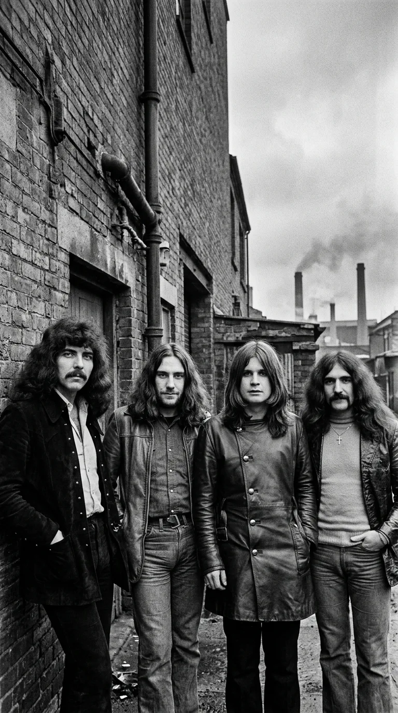
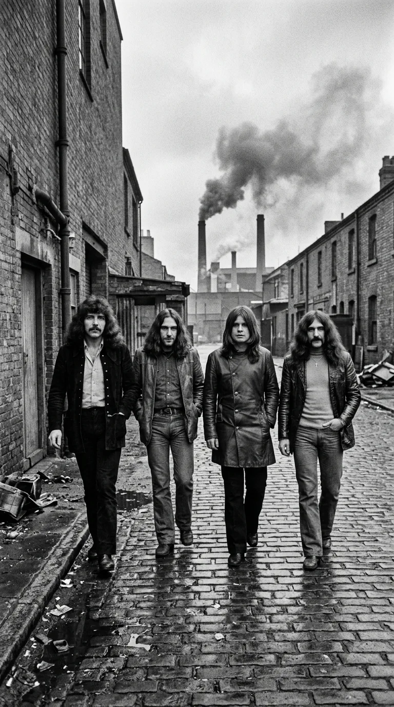
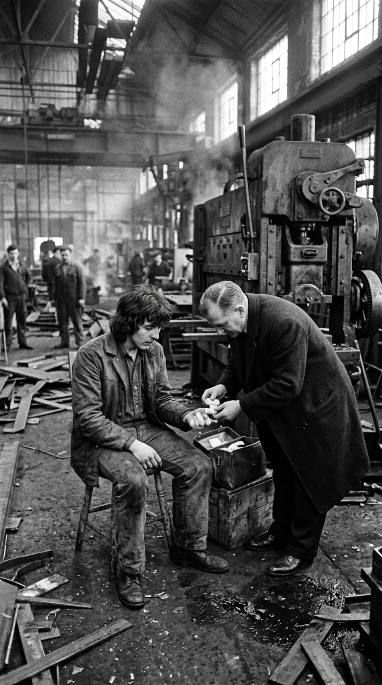
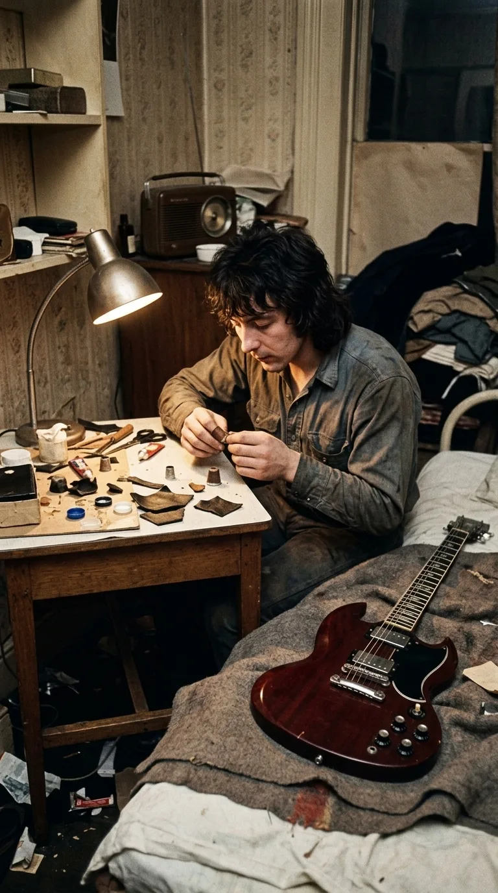
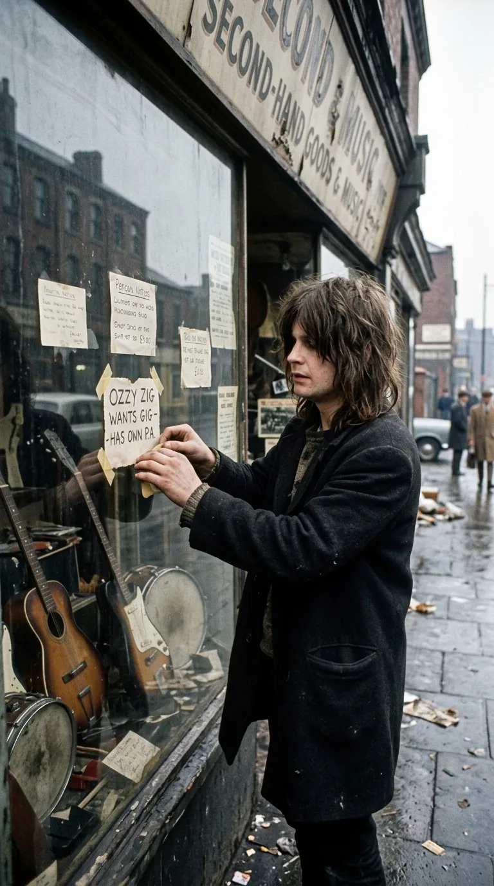
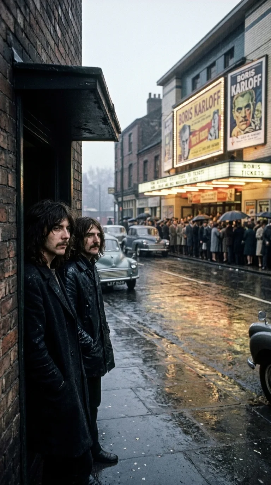
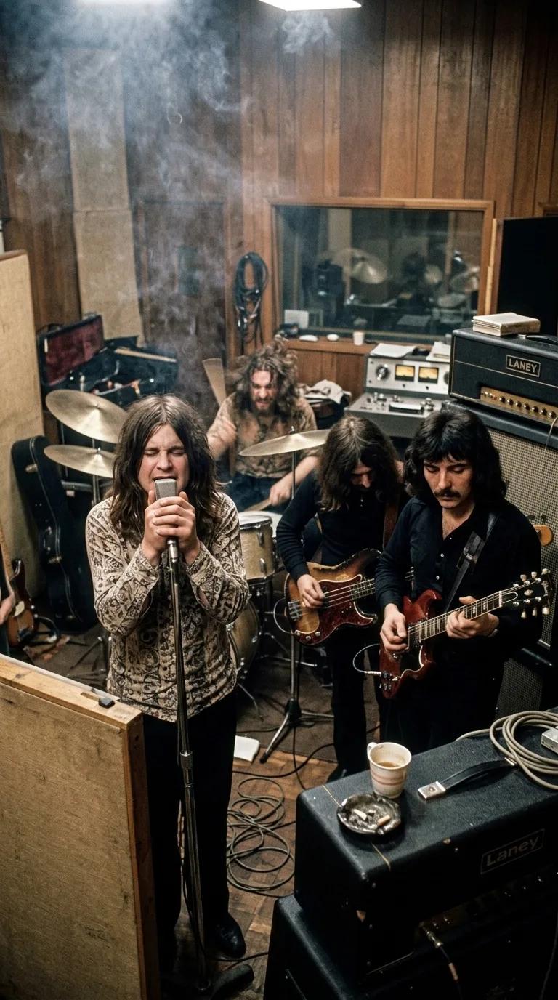
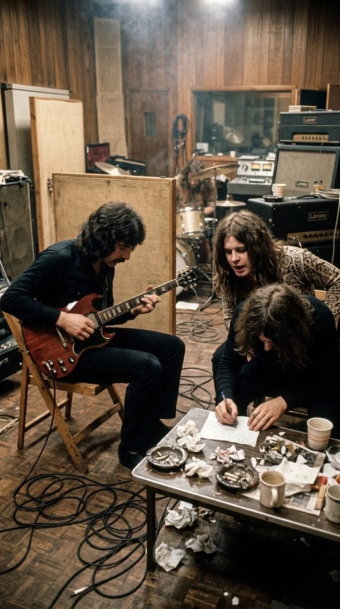
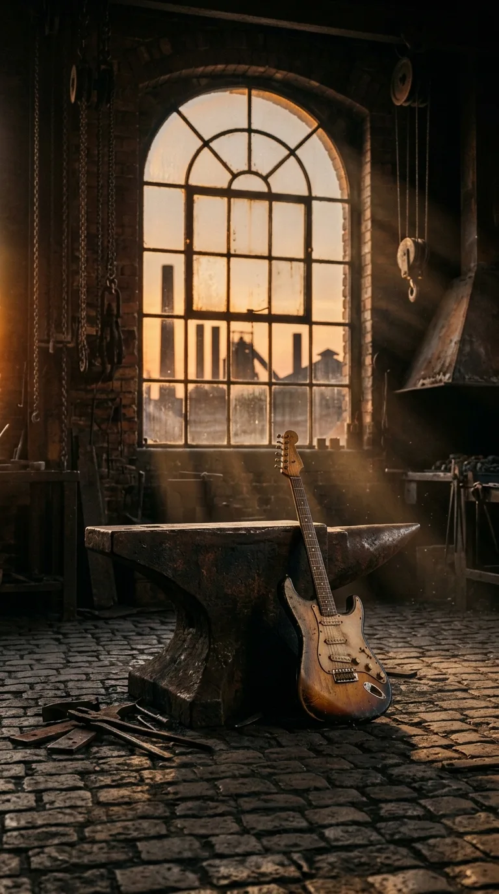

# El Acero que Sangró en la Niebla: Black Sabbath y el Réquiem Industrial de Paranoid

### Por Acordes Ocultos — Forjados en el Barro

*Black Sabbath: Cuatro muchachos de clase obrera que forjaron en el fango de Birmingham el sonido fundacional del Heavy Metal.*

Hay sonidos que nacen en salones perfumados al calor de la abundancia, y hay rugidos que solo pueden brotar de las entrañas de una ciudad herida, entre el hollín de los altos hornos, el silbido ensordecedor del metal caliente y la desesperación de una juventud condenada a la fundición. La historia de **Black Sabbath** no es la crónica de cuatro virtuosos favorecidos por la fortuna; es la epopeya obrera más implacable de la historia de la música contemporánea.

Nacidos en **Aston**, uno de los distritos más castigados y paupérrimos de la **Birmingham** de posguerra, **Anthony Frank «Tony» Iommi**, **John Michael «Ozzy» Osbourne**, **Terence Michael «Geezer» Butler** y **William Thomas «Bill» Ward** no tenían un plan B. En aquel páramo de ladrillo ennegrecido por el carbón y cicatrices de bombas nazis, el destino de un muchacho de clase trabajadora solo ofrecía dos caminos: la disciplina implacable de una fábrica siderúrgica o la delincuencia de poca monta para escapar del hambre. 

Sin embargo, contra toda lógica, contra la miseria más asfixiante y contra una mutilación física devastadora que debió haber silenciado para siempre su música, estos cuatro parias forjaron en el fango un sonido tan monumental, denso y oscuro que terminó por inventar un nuevo universo sonoro: el **Heavy Metal**.

---

## Acto I: Las chimeneas de Aston y la condena del carbón

A finales de la década de 1950 y principios de los 60, Birmingham era el taller industrial del Imperio británico. Un laberinto de fundiciones de acero, talleres de prensado y fábricas de municiones donde el aire sabía a óxido y las fachadas victorianas acumulaban capas de hollín impenetrable. 

*Birmingham, finales de los años 60: Las chimeneas industriales y el paso cotidiano de cuatro jóvenes obreros.*

Para la familia de Ozzy Osbourne, sobrevivir era una proeza diaria. Con seis hermanos hacinados en una modesta vivienda de dos habitaciones en Lodge Road, sin baño interior ni agua caliente, Ozzy creció entre la desnutrición y el fracaso escolar. A los quince años ya trabajaba en mataderos despedazando reses, limpiando chimeneas y operando prensas mecánicas por unas pocas monedas que apenas alcanzaban para calentar la casa con carbón de desecho.

Tony Iommi y Geezer Butler compartían un horizonte idéntico. En las calles empedradas de Aston, el ruido de las máquinas de vapor y los martillos hidráulicos no era un sonido de fondo: era el latido constante que marcaba el pulso de sus vidas. Aquel estruendo fabril, monótono y amenazante, quedaría grabado a fuego en el inconsciente colectivo de cuatro muchachos que buscaban en los instrumentos prestados una rendija por donde respirar aire limpio.

---

## Acto II: El filo de la guillotina y la mano rota

A los diecisiete años, Tony Iommi acariciaba por fin una salida. Había sido invitado a una gira por Alemania con una banda semiprofesional y solo le restaba cumplir una jornada más en su puesto como operario en una fábrica de corte de láminas de metal. Aquel fatídico último día, la mujer encargada de la guillotina industrial no asistió al trabajo y le ordenaron sustituirla.

*1965: El taller de prensado donde una máquina cortó las falanges de Tony Iommi en su último turno de trabajo.*

En una fracción de segundo, la cuchilla de acero descendió antes de tiempo sobre su mano derecha. Iommi reaccionó tirando hacia atrás con desesperación, pero era demasiado tarde: la máquina le rebanó limpiamente las yemas de los dedos anular y medio hasta el hueso. Al llegar al hospital, los cirujanos le dieron el veredicto más cruel para un guitarrista zurdo que utilizaba precisamente esa mano para digitar las notas en el mástil: *«Tus dedos están destrozados. No volverás a tocar jamás. Olvídate de la música»*.

Cualquier otro se habría hundido en la resignación obrera de su tiempo. Iommi cayó en una profunda depresión, encerrado en su habitación durante semanas contemplando su guitarra silenciada. Pero el destino intervino a través del capataz de su fábrica, quien visitó su casa y le puso una grabación del mítico guitarrista de jazz **Django Reinhardt**, recordándole que el belga había revolucionado el mundo tocando únicamente con dos dedos tras sufrir graves quemaduras en un incendio.

---

## Acto III: La alquimia de los tapones de plástico

Inspirado por el coraje de Reinhardt, Iommi decidió que si la medicina no podía devolverle los dedos, él mismo se fabricaría una mano nueva. En un alarde de ingenio obrero, tomó una botella vacía de detergente *Fairy Liquid*, fundió el plástico de los tapones al fuego y moldeó unos pequeños dedales a la medida exacta de sus muñones.

*La habitación de Iommi: Fundiendo plástico y cuero para crear las prótesis que dieron origen al sonido de Black Sabbath.*

Para que los dedales pudieran presionar el diapasón sin resbalar sobre el metal ni causarle un dolor insoportable, recortó trozos de cuero de una vieja chaqueta gastada y los pegó con adhesivo en los extremos. Pero el plástico duro aún le causaba un dolor lacerante en los nervios expuestos al intentar pisar las cuerdas estándar de guitarra. 

Fue entonces cuando concibió una solución revolucionaria: tomó cuerdas finas de banjo, aflojó la tensión habitual del instrumento bajando la afinación un tono y medio (en Do sostenido y Mi bemol) y descubrió un fenómeno acústico colosal. Aquellas cuerdas flojas no solo mitigaban el dolor de sus dedos; producían un sonido cavernoso, oscuro, elástico y pantanoso. Sin saberlo, la amputación de Tony Iommi acababa de sentar las bases acústicas del riff moderno.

---

## Acto IV: La celda de Winson Green y el cartel en la ventana

Mientras Iommi domaba sus prótesis de plástico, Ozzy Osbourne tocaba fondo. Sin dinero para subsistir, cometió una serie de torpes hurtos en tiendas locales robando televisores rotos y prendas de vestir. Capturado por la policía y condenado a pagar una multa de veinticinco libras que su padre se negó a abonar para darle una lección, Ozzy pasó seis semanas recluido en la dura prisión de **Winson Green**.

*1968: Tras salir de prisión, Ozzy cuelga una nota manuscrita en un escaparate buscando con quién compartir su angustia.*

Aquella experiencia tras las rejas marcó a fuego al cantante. Al recuperar la libertad, comprendió que su única salvación era la música. Pidió prestado a su padre el dinero para comprar un amplificador de cincuenta vatios y redactó a lápiz una pequeña cartulina que pegó en la cristalera de una tienda de empeños de Aston: *«Ozzy Zig busca concierto. Tengo amplificador propio»*.

Geezer Butler vio la tarjeta y, junto a Iommi y Bill Ward (quienes ya se conocían de aventuras juveniles previas), decidieron darle una oportunidad. La primera reunión en la sala de estar de los Osbourne fue casi cómica: un chico de pelo rapado, abrigo raído de su abuelo y una zapatilla de cada color se presentó ante ellos descalzo. Pero cuando abrió la boca, no cantaba con técnica académica: aullaba con el desgarro de quien ha visto los rincones más fríos de la existencia.

---

## Acto V: El cine de enfrente y el intervalo del diablo

Reunidos bajo el nombre inicial de *Earth*, el cuarteto ensayaba en un destartalado centro comunitario frente a una sala de cine. Una tarde lluviosa de 1969, mientras hacían una pausa mirando a través de la ventana mojada, Geezer Butler y Tony Iommi repararon en un detalle insólito: una fila kilométrica de personas soportaba el frío y el aguacero solo para pagar una entrada y ver una película de terror protagonizada por Boris Karloff.

*1969: La visión de las colas bajo la lluvia frente al cine que inspiró la creación de música oscura.*

Butler soltó una reflexión que cambiaría la historia de la cultura popular: *«¿Por qué la gente gasta su dinero duramente ganado para pasar miedo en una sala oscura? Si el mundo entero paga por asustarse, ¿por qué nadie hace música que dé miedo?»*.

Aquella tarde, Iommi se colgó su Gibson SG roja y buscó un acorde que evocara la opresión de las fábricas y la amenaza de lo desconocido. Tocó una progresión de tres notas separadas por una cuarta aumentada: el **tritono**, conocido en la Edad Media como *Diabolus in musica* y prohibido durante siglos por la Iglesia al considerarse una disonancia demoníaca. Al escuchar aquel acorde denso y siniestro, Ozzy comenzó a cantar de manera espontánea: *«What is this that stands before me? Figure in black which points at me...»*. La banda acababa de rebautizarse como **Black Sabbath**. El Heavy Metal había nacido.

---

## Acto VI: Doce horas de sangre en Regent Sound

En octubre de 1969, un sello independiente les concedió una oportunidad ínfima: seiscientas libras de presupuesto y apenas dos días en los modestos **Regent Sound Studios** de Londres. Los ejecutivos discográficos los consideraban una rareza sin futuro comercial.

*Londres, octubre de 1969: Tocando en directo en una sola jornada maratoniana para capturar su sonido visceral.*

Sin dinero para hoteles ni tiempo que perder en repeticiones de pistas, los cuatro chicos de Birmingham montaron sus amplificadores en el diminuto estudio y tocaron su repertorio de principio a fin, en riguroso directo, como si estuvieran en un club clandestino. En solo doce horas de sudor continuo, con Ozzy cantando en una cabina contigua y los conos de los altavoces vibrando al límite de la saturación, grabaron el álbum homónimo *Black Sabbath*. 

Al día siguiente empacaron sus cosas y tomaron un ferry para tocar en tugurios de Suiza y Alemania por diez libras la noche. El disco, lanzado en un viernes 13 de febrero de 1970, desconcertó a la crítica establecida, que lo tachó de ruidoso y primitivo; pero en la calle, los jóvenes de la clase obrera británica y estadounidense agotaron las copias en cuestión de semanas. Aquel sonido no era una pose; era la banda sonora de su propia realidad.

---

## Acto VII: Veinte minutos para la eternidad

En junio de 1970, Black Sabbath regresó a los estudios para registrar su segundo álbum, concebido inicialmente bajo el título de *War Pigs* como un alegato feroz contra los horrores de la Guerra de Vietnam. Tras completar las pistas magistrales de *Iron Man*, *Hand of Doom* y *Fairies Wear Boots*, el productor **Rodger Bain** revisó el cronómetro de la cinta máster y los enfrentó con una exigencia imprevista: *«Nos faltan entre dos minutos y medio y tres minutos de música para completar el minutaje del vinilo. Necesitamos otra canción, y la necesitamos ya»*.

*Junio de 1970: Tony Iommi descubre el riff de Paranoid en un receso mientras Geezer Butler garabatea la letra en una servilleta.*

Eran las horas del almuerzo. Mientras Bill Ward, Ozzy y Geezer cruzaban la calle hacia el pub para conseguir unos emparedados y una pinta de cerveza, Tony Iommi se quedó solo en la sala de grabación. Sentado en una silla de madera con su guitarra sobre las piernas, empezó a deslizar sus dedales de plástico sobre el traste doce, buscando un pulso rápido, hipnótico y cortante en Mi menor.

Cuando sus compañeros regresaron veinte minutos después, Iommi los recibió con una sonrisa cómplice y tocó el patrón rítmico. Bill Ward se sentó de inmediato tras la batería marcando el ritmo con la fuerza de un pistón mecánico; Geezer Butler tomó un bloc de notas y escribió en minutos una letra visceral sobre la alienación mental, la soledad y la incapacidad de conectar con el mundo (*«All day long I think of things but nothing seems to satisfy...»*). Ozzy memorizó las líneas en dos pasadas frente al micrófono.

En menos de veinticinco minutos, la canción estaba compuesta, arreglada y grabada en cinta máster. Nadie en la sala sospechaba que aquel relleno apresurado, bautizado como **«Paranoid»**, daría nombre al álbum, se encaramaría al número cuatro del *UK Singles Chart* y al número uno de ventas en Europa, transformándose en uno de los himnos más influyentes y versionados de toda la historia del rock universal.

---

## Epílogo: El yunque y la catedral de acero

El triunfo de *Paranoid* catapultó a cuatro muchachos desahuciados por la sociedad británica a la cima de los escenarios mundiales. La crítica intelectual, que al principio los despreció tachándolos de oscurantistas y toscos, tuvo que rendirse ante la evidencia: Black Sabbath había capturado el espíritu angustioso, alienado y desafiante de una época marcada por la Guerra Fría y la desindustrialización.

*El silencio de la fundición: Un yunque de hierro macizo y una guitarra en reposo bajo la luz crepuscular de Birmingham.*

Cincuenta años después, cuando retumban los primeros compases de «Paranoid», el mundo no escucha únicamente una canción pegadiza; escucha el triunfo de la resiliencia humana sobre el infortunio. Escucha a un guitarrista con los dedos cercenados que fundió plástico con fuego para no abandonar sus sueños; a un chico salido de la cárcel que encontró su redención en un micrófono; y a cuatro hermanos de clase obrera que demostraron que del barro más espeso y gris puede emerger un monumento que desafíe a la eternidad.

---

### 📚 Fuentes y Archivo Documental
1. **Iommi, Tony (con T. J. Lammers).** *Iron Man: My Journey through Heaven and Hell with Black Sabbath*. Da Capo Press, Boston, 2011. Autobiografía oficial con el relato detallado del accidente fabril y la fabricación de las prótesis caseras.
2. **Osbourne, Ozzy (con Chris Ayres).** *I Am Ozzy*. Grand Central Publishing, Nueva York, 2010. Memorias de infancia en Aston, estancia en la prisión de Winson Green y primeras audiciones de la banda.
3. **Butler, Geezer.** *Into the Void: From Birth to Black Sabbath―And Beyond*. HarperCollins, 2023. Archivo testimonial sobre la concepción lírica de «Paranoid» y la escena del cine de terror.
4. **Popoff, Martin.** *Black Sabbath FAQ: All That's Left to Know on the First Name in Metal*. Backbeat Books, Milwaukee, 2011. Análisis discográfico y registros de sesiones en Regent Sound e Island Studios (1969-1970).
5. **Vertigo Records / Philips Archives.** *Bitácoras de grabación y másters originales de los álbumes «Black Sabbath» (VO 6, 1970) y «Paranoid» (6360 011, 1970)*. Londres.
6. **New Musical Express (NME) & Melody Maker.** *Hemeroteca histórica de reseñas discográficas, entrevistas en camerinos y listas de éxitos británicas*, 1970–1971.
