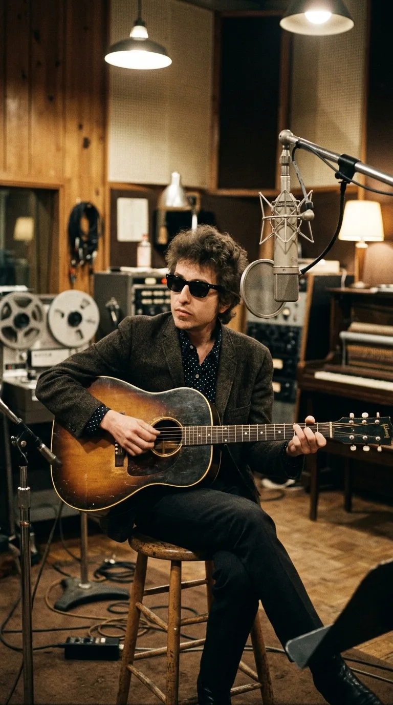
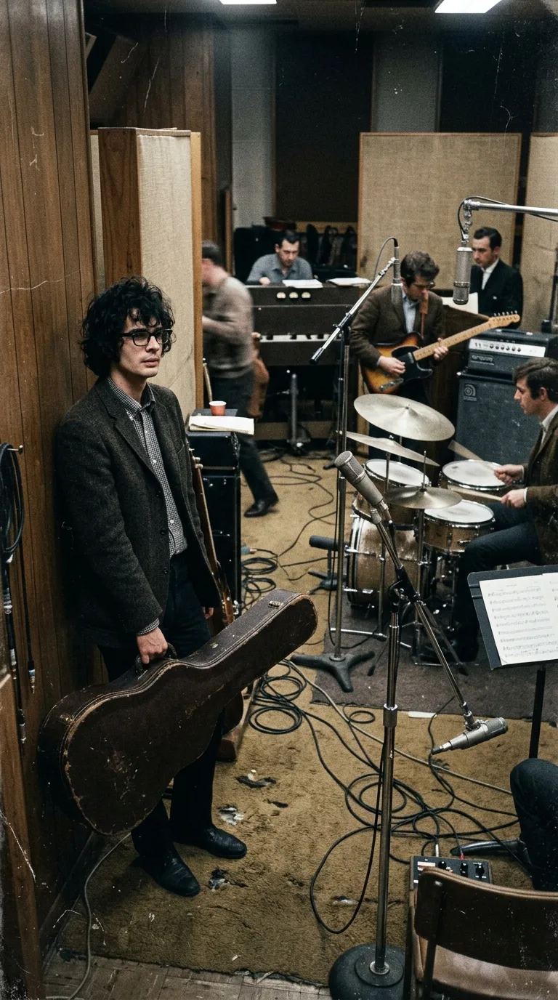
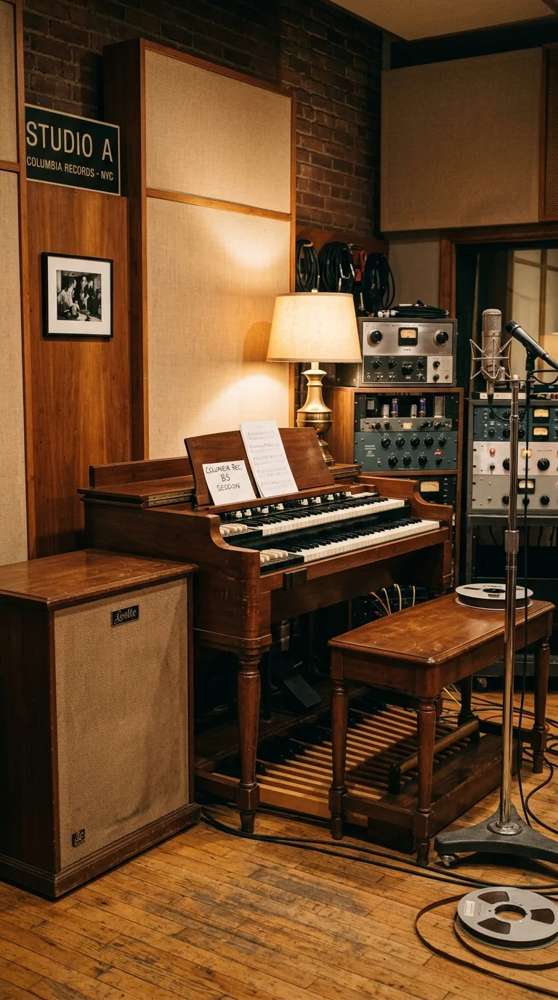
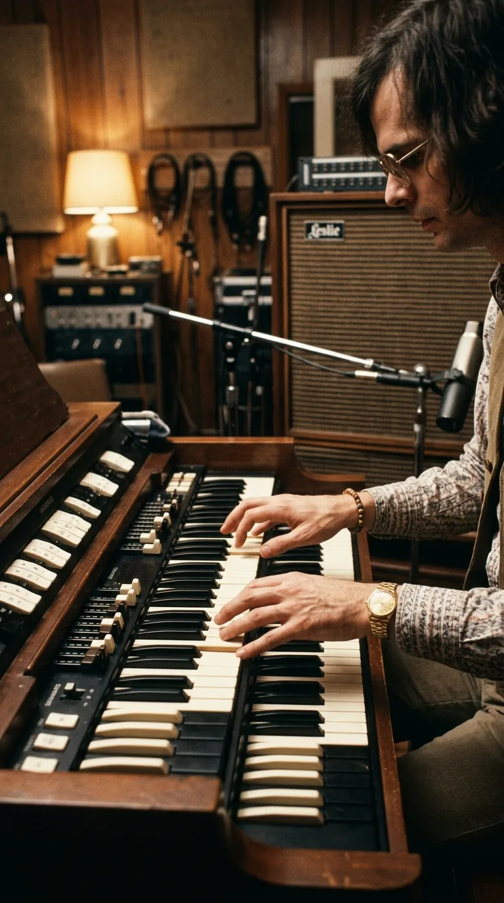
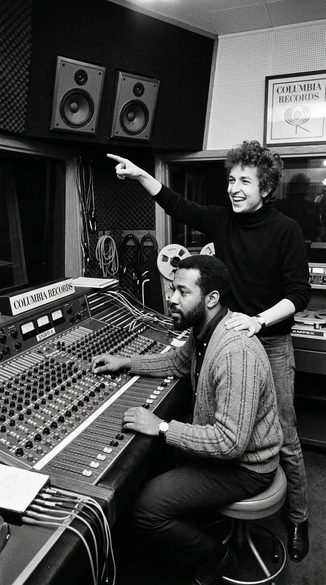
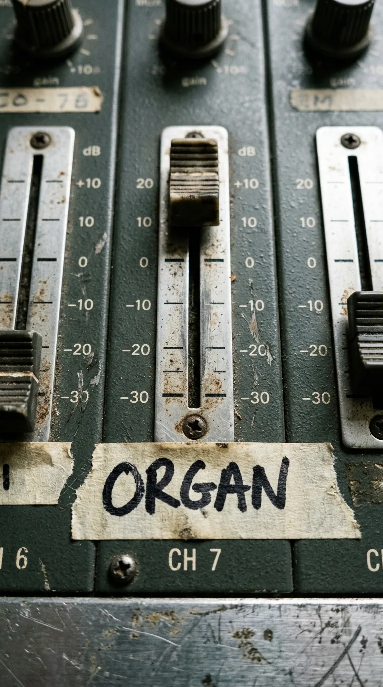
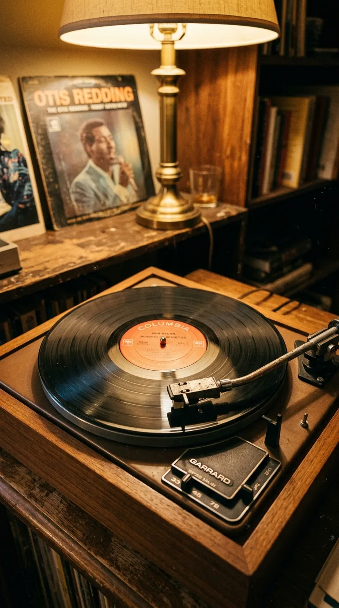

*Nueva York, 16 de junio de 1965: La sesión clandestina en Columbia 30th Street Studio que redefinió para siempre los límites del pop mundial.*

---

### Prólogo: El desahogo furioso de veinte páginas

En los primeros días de junio de **1965**, Bob Dylan regresó a Nueva York física y espiritualmente exhausto. Su reciente gira acústica por el Reino Unido —inmortalizada en el documental *Dont Look Back* de D.A. Pennebaker— lo había dejado al borde del colapso nervioso: asediado por fanáticos puristas que le exigían himnos de protesta política, agotado por la prensa sensacionalista y hastiado de la etiqueta de «profeta generacional» que él jamás había solicitado.

Encerrado en su cabaña de Woodstock, Dylan se sentó frente a una máquina de escribir con la firme convicción de abandonar la música. Lo que brotó de sus dedos en aquellas noches febriles no fue una canción: fue un vómito lírico ininterrumpido de diez a veinte páginas de furia visceral, sarcasmo y desprecio hacia la hipocresía social. En aquel manuscrito descarnado arremetía contra una figura femenina que lo había tenido todo —privilegios, aduladores, alta cuna— y que ahora deambulaba despojada de su máscara, obligada a mendigar una verdad en las calles de la intemperie:

> *«How does it feel? / How does it feel / To be without a home, / Like a complete unknown, / Like a rolling stone?»*  
> *(«¿Qué se siente? / ¿Qué se siente / Estar sin un hogar, / Como un perfecto desconocido, / Como una piedra rodante?»)*

Dylan podó aquel torrente hasta dejarlo en cuatro estrofas colosales. Tenía entre manos el texto más demoledor y poético jamás concebido para la música popular; pero para encenderlo, necesitaba una combustión eléctrica que nadie en la industria discográfica se había atrevido a imaginar.

*Manhattan, junio de 1965: Bob Dylan busca una nueva dimensión sonora para dinamitar los cánones del folk tradicional.*

---

### Acto I: La humillación silenciosa de Al Kooper

El **15 de junio de 1965**, el veterano productor **Tom Wilson** convocó a los músicos en el legendario **Columbia 30th Street Studio** de Manhattan, una antigua iglesia con techos de treinta metros cuya acústica celestial había albergado a Miles Davis y Thelonious Monk.

Entre los asistentes merodeaba un joven guitarrista de sesión de apenas veintiún años llamado **Al Kooper**. Kooper no había sido contratado formalmente; Wilson simplemente lo había invitado como observador al estudio. Sin embargo, ambicioso y audaz, Kooper llegó temprano con su guitarra colgada al hombro, la enchufó a un amplificador y comenzó a calentar en un rincón, soñando con que el productor le permitiera participar en la sesión de su ídolo.

Aquella ilusión duró exactamente quince minutos.

De pronto, la pesada puerta del estudio se abrió y entró un muchacho menudo de Chicago, vestido con camisa arrugada y sin estuche de guitarra, cargando una Fender Telecaster desgastada bajo la lluvia: era **Mike Bloomfield**. 

Bloomfield saludó con un gesto seco, se enchufó directamente y comenzó a calentar los dedos con una ráfaga de blues eléctrico tan feroz, afilada y telepática que la mandíbula de Kooper cayó al suelo. *«En ese preciso instante —recordaría Kooper años más tarde— comprendí lo que era un verdadero guitarrista. Me sentí tan humillado y diminuto que desenchufé mi guitarra en silencio, la guardé en su estuche, me senté en la sala de control y decidí no volver a tocarla en todo el día»*.

*Columbia 30th Street Studio: La velocidad salvaje y el tono incisivo de Mike Bloomfield intimidan al joven Al Kooper.*

---

### Acto II: La fuga clandestina hacia el Hammond B-3

La primera jornada de grabación fue caótica. Dylan insistía en un compás de vals en tres cuartos (3/4) que sonaba pesado y sin pulso. Al día siguiente, el **16 de junio**, la banda decidió acometer el tema en un contundente cuatro por cuatro (4/4), guiado por un golpe seco de redoblante ejecutado por **Bobby Gregg** que sonó como un pistoletazo de salida.

Durante una pausa en la Toma 4, el teclista oficial de la sesión, **Paul Griffin**, se levantó del órgano Hammond B-3 para ocupar el piano de cola acústico por sugerencia de Dylan.

En ese milisegundo, Al Kooper vio la oportunidad de su vida. 

Aprovechando que Tom Wilson estaba distraído hablando por teléfono en la cabina de control, Kooper cruzó la sala de puntillas y se deslizó en la cabina del órgano. Jamás había tocado un **Hammond B-3** profesional en una sesión formal: no sabía encender los amplificadores rotatorios Leslie ni regular con precisión las barras de tracción (*drawbars*). Para colmo, Wilson colgó el teléfono, miró por el cristal de la consola y vio al muchacho sentado tras las teclas:

—*«Al, ¿qué demonios haces ahí? ¡Tú no eres organista!»* —gritó Wilson por el intercomunicador.

Kooper, pálido pero resuelto, solo atinó a sonreír y fingir que sabía lo que hacía. Wilson, agobiado por el tiempo de estudio, se encogió de hombros y ordenó: *«Está bien... ¡Toma cuatro, grabando!»*.

*16 de junio de 1965: Aterrorizado de arruinar la toma, Al Kooper se sienta clandestinamente ante el imponente órgano.*

---

### Acto III: El retraso de una fracción de segundo que creó la magia

Lo que ocurrió durante los siguientes seis minutos cambió el sonido del rock para siempre.

Kooper no conocía la progresión de acordes de la canción con exactitud. Con las manos sudorosas y el corazón en la garganta, decidió aplicar una estrategia de supervivencia: mirar fijamente las manos de Paul Griffin en el piano y tocar las notas en el órgano una **fracción de segundo después** de que Griffin las ejecutara en el teclado, asegurándose de no equivocarse de tonalidad.

Ese retraso vacilante —una semicorchea involuntaria provocada por el pánico escénico— generó un efecto acústico milagroso. En lugar de entrar con la rigidez de un acorde marcado sobre el compás, las notas del órgano flotaban como un velo cálido, envolviendo las punzantes frases de guitarra de Bloomfield y empujando las sílabas arrastradas de Dylan con una respiración majestuosa y ondulante. 

Era el sonido de un río crecido: majestuoso, imperfecto, humano e irrepetible.

*La cabina de Columbia: Tom Wilson y Roy Halee contemplan perplejos la toma irrepetible de seis minutos.*

---

### Acto IV: «¡Sube ese órgano al máximo!»

Cuando concluyeron la Toma 4, la sala se sumió en un silencio reverencial. Todos los presentes —el bajista Joe Macho Jr., el baterista Bobby Gregg, Bloomfield y Griffin— sabían que habían capturado un relámpago en una botella.

Dylan y la banda subieron a la cabina de control para escuchar la reproducción de la cinta de dos pulgadas. Mientras la música sonaba a través de los monitores Altec, Tom Wilson tomó el control de la consola analógica e intentó atenuar el canal del órgano, considerando que aquel relleno no formaba parte del arreglo original y que sonaba fuera de tiempo.

En ese instante, Bob Dylan extendió el brazo con firmeza, detuvo la mano del productor y señaló con el dedo hacia el altavoz:

—*«Espera, Tom... ¡Sube ese órgano! ¡Súbelo al máximo!»*

Wilson, atónito, intentó protestar:  
—*«Pero Bob, ese chico ni siquiera es organista profesional...»*

Dylan lo miró con esa frialdad magnética que desarmaba a ejecutivos y eruditos por igual, y zanjó la discusión con una frase que quedó grabada en el mármol de la historia:  
—*«Me importa un demonio lo que sea. Sube ese órgano. Es lo mejor que he escuchado en mi vida.»*

*«¡Súbelo al máximo!»: La intuición implacable de Bob Dylan rescata el accidente de Al Kooper y lo convierte en el riff central del tema.*

---

### Acto V: La revolución de los seis minutos que quebró a la radio

Lanzada como sencillo el **20 de julio de 1965**, *«Like a Rolling Stone»* provocó una revuelta inmediata en los despachos de Columbia Records. Los directores de ventas consideraban inviable programar en las emisoras juveniles un tema que duraba seis minutos y trece segundos, duplicando el estándar infranqueable de tres minutos de las radiofórmulas de la época.

La discográfica intentó incluso editar un disco promocional dividido en dos caras (*Parte 1* y *Parte 2*). Pero la juventud neoyorquina no aceptó mutilaciones. Los DJs más influyentes de Manhattan y San Francisco comenzaron a pinchar la cara completa desafiando las órdenes comerciales; los pinchadiscos de las discotecas ponían la pista íntegra dos y tres veces consecutivas ante pistas de baile enmudecidas por la potencia del texto.

En cuestión de semanas, el tema escaló hasta el **número dos del Billboard Hot 100** —solo frenado por *«Help!»* de The Beatles— y transformó la concepción misma de la música popular: el pop dejaba de ser un mero producto de entretenimiento para adolescentes y se convertía en literatura de alta tensión, capaz de albergar la filosofía, el desgarro moral y la crítica social más abrasiva.

*Verano de 1965: Las emisoras de radio y las tiendas de discos de todo el planeta capitulan ante la obra cumbre de Dylan.*

---

### Epílogo: El acorde que nunca se detuvo

Sesenta años después de aquella calurosa tarde de junio en Manhattan, el acorde inicial de caja de batería y la entrada ondulante del órgano Hammond de Al Kooper siguen estremeciendo el aire como si se hubieran grabado esta misma mañana.

La anécdota de *«Like a Rolling Stone»* nos enseña una verdad suprema sobre la creación artística: que las mayores revoluciones culturales casi nunca nacen de cálculos matemáticos ni de sesiones de estudio pulcras y asépticas. Nacen del error afortunado, del coraje de colarse en una sala prohibida y de la mirada genial de un autor que supo ver en el temblor de un muchacho asustado el acorde exacto que el mundo estaba esperando para despertar.

*La metáfora final: El silencio en Columbia 30th Street Studio, donde un feliz accidente técnico inauguró para siempre la era dorada del rock.*

---

### 📚 Fuentes y Archivo Documental

1. **Kooper, Al** (1998/2008). *Backstage Passes & Backstabbing Bastards: Memoirs of a Rock 'n' Roll Survivor*. Billboard Books / Backbeat Books, San Francisco. Relato pormenorizado en primera persona sobre su infiltración en Columbia Studios, su temor ante Mike Bloomfield y la llamada de Dylan para subir el órgano.
2. **Marcus, Greil** (2005). *Like a Rolling Stone: Bob Dylan at the Crossroads*. PublicAffairs, Nueva York. Análisis hemerográfico e historiográfico exhaustivo de las sesiones del 15 y 16 de junio de 1965 en Columbia 30th Street Studio.
3. **Heylin, Clinton** (2009). *Revolution in the Air: The Songs of Bob Dylan 1957–1973*. Chicago Review Press. Documentación cronológica de las cintas máster, transcripciones de los manuscritos de Woodstock y registros de toma.
4. **Columbia Records Archive & Sony Music Master Tape Logs (1965)**. Fichas de sesión de grabación del álbum *Highway 61 Revisited* (Sesiones CO-86445 / Productor: Tom Wilson; Ingenieros: Roy Halee y Gregg Landaker).
5. **Wolkin, Jan Mark & Keenom, Bill** (2000). *Michael Bloomfield: If You Love These Blues*. Miller Freeman Books. Testimonios sobre la participación del guitarrista de Chicago en las sesiones de Nueva York.
6. **Billboard Magazine Archives (julio–septiembre de 1965)**. Clasificaciones del Hot 100, reseñas críticas de la época y notas sobre la resistencia inicial de las emisoras AM a radiar cortes de seis minutos.
