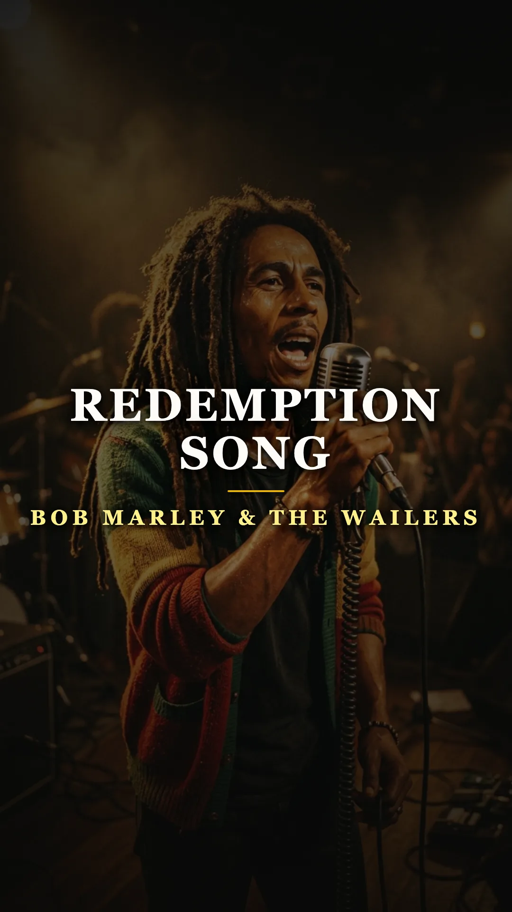
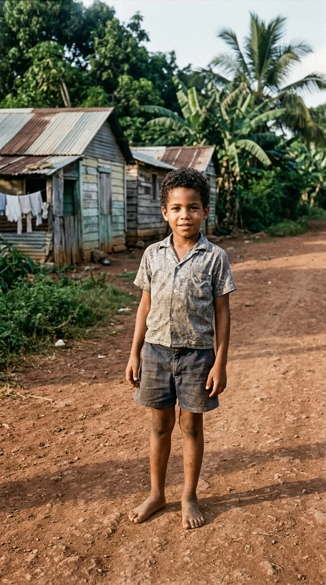
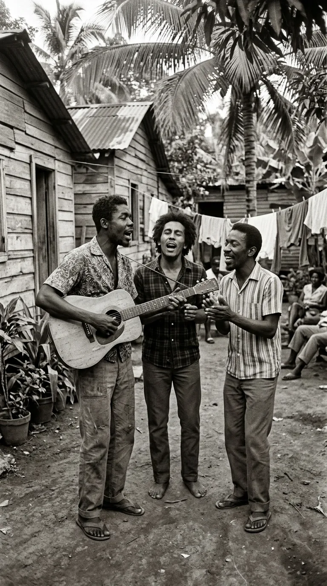
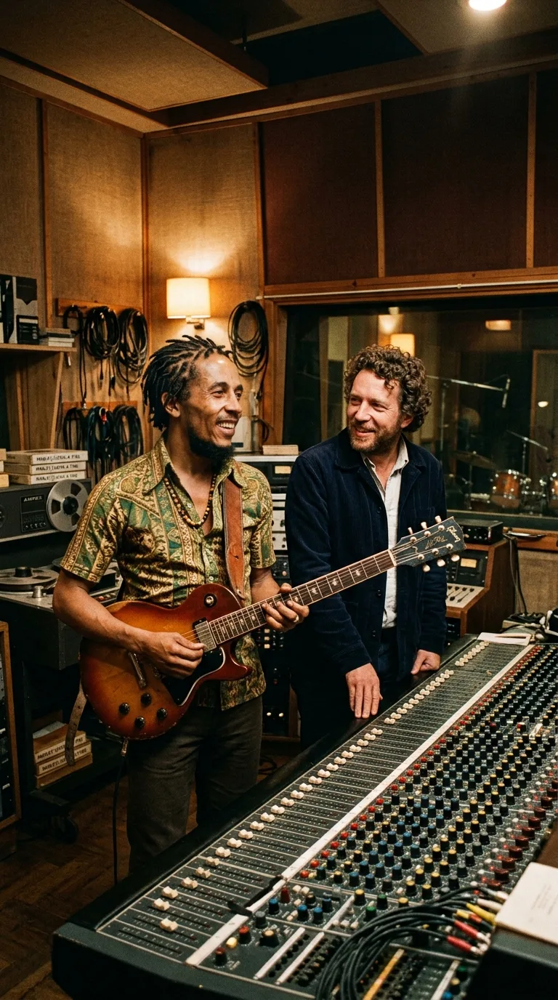
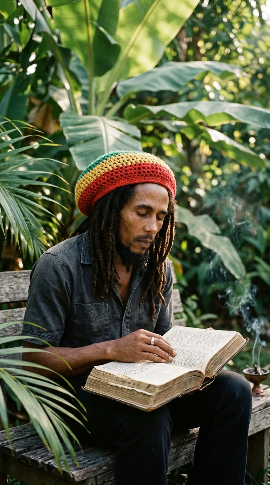
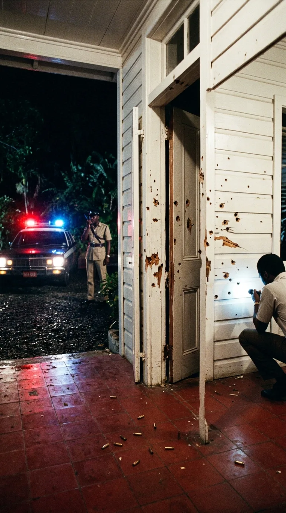
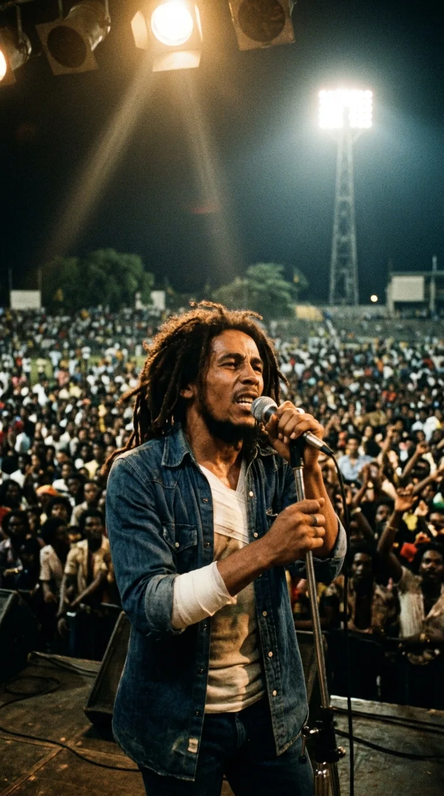
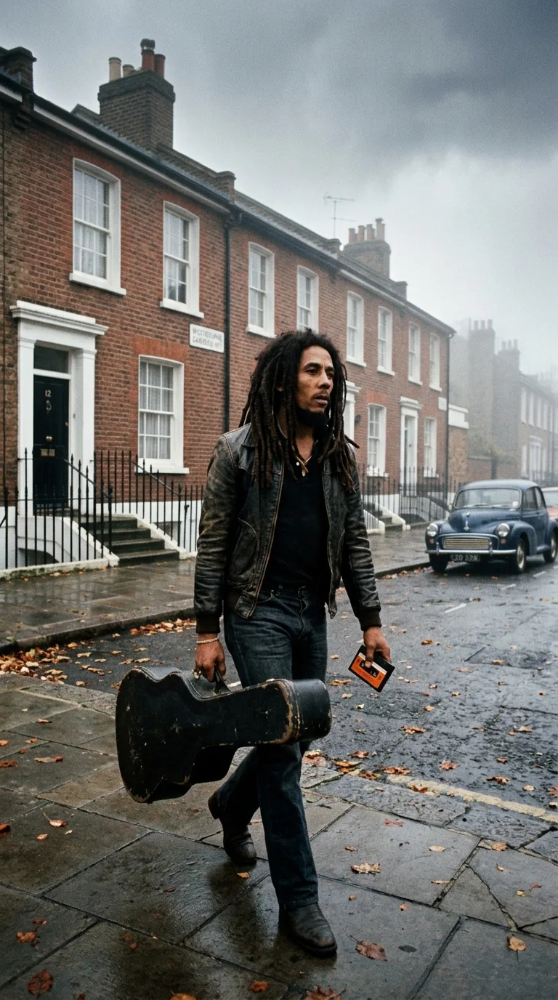
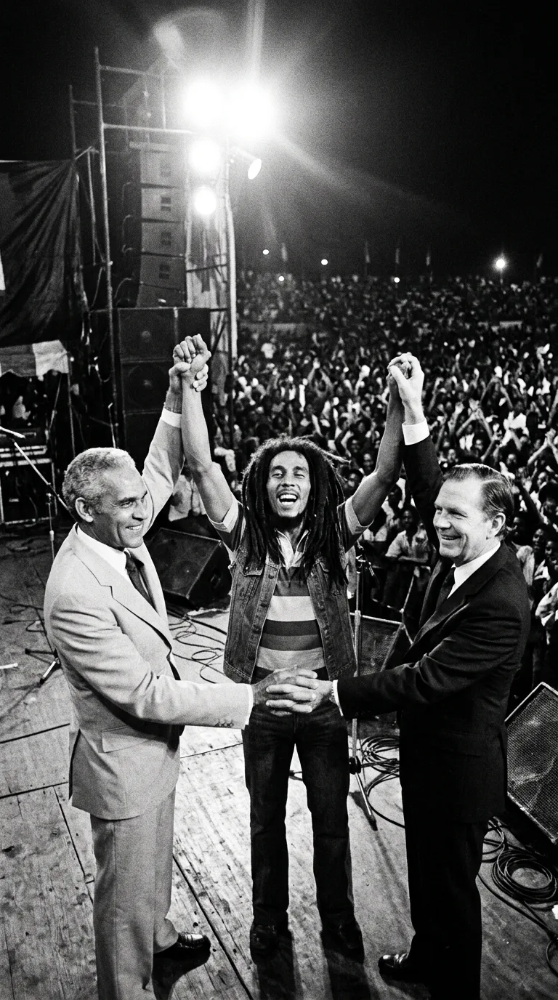
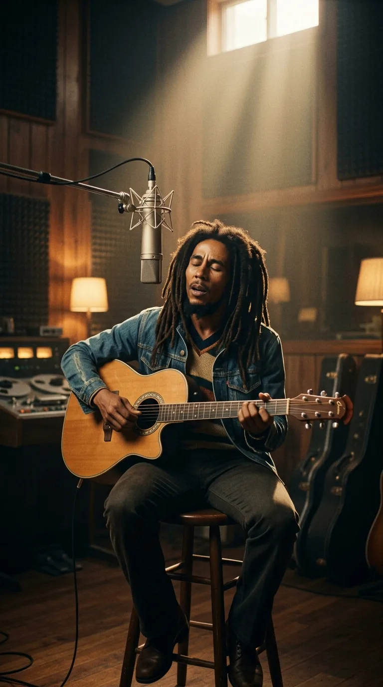

# 🦁 The Barefoot Prophet Who Defied Death: Bob Marley and the Nine Flashes of Glory

### *From the zinc yards of Trenchtown to the stage where he sang with a bullet wound before eighty thousand compatriots: the luminous journey of a man who transformed the sorrow of the dispossessed into the greatest prayer for freedom in "Redemption Song".*

---

**By the Secret Chords Editorial Board**  
*Estimated reading time: 12 minutes*

*Bob Marley: The luminous figure who transformed the sorrow of the dispossessed into a universal prayer of emancipation and dignity.*

---

### Prologue: The Bullet That Couldn't Silence the Song

There are voices whose vibration does not belong to the balance sheets of the music industry, but rather to the earth that bore them and the human tides that have no platform in the newspapers. Robert Nesta Marley did not take to the stage seeking vanity or perishable luxuries; he appeared as a herald of dignity, his eyes closed in devotional trance, his dreadlocked mane trailing trails of light beneath the spotlights, and his rhythm guitar pulsing the collective heartbeat of oppressed peoples.

His passage through the world had the brevity and force of a lightning bolt. In barely a decade of ecumenical resonance—from the release of *Catch a Fire* in 1973 to his premature departure in May 1981—that mixed-race boy born in the rural foothills of Jamaica elevated the Patois dialect, the syncopated cadence of the drums, and the mysticism of his faith to the rank of a moral anthem for the disinherited. He survived the gunfire of a paramilitary death squad, united the hands of two political warlords in the midst of a civil war, and, in the twilight of his days, knowing an implacable tumor was surrounding his organs, he sat alone with an acoustic guitar to offer humanity the purest testament of spiritual emancipation popular music has ever known.

This is the documentary reconstruction of his nine flashes of glory: the nine cardinal moments that consecrated the life, resistance, and immortality of Bob Marley.

---

### Milestone I (1945–1955): The Biracial Stigma in Nine Mile and the Mud of Trenchtown

To decipher the fortitude that animated Bob Marley, it is essential to ascend the red dirt paths of **Nine Mile**, in the mountainous parish of Saint Ann, where he was born on February 6, 1945. His mother, **Cedella Malcolm**, was an eighteen-year-old Afro-Jamaican peasant; his father, **Norval Sinclair Marley**, was a marine captain of British origin and white descent well over fifty, who abandoned the home after the birth and limited his connection to sporadic financial assistance until his death.

That dual bloodline marked Nesta’s childhood with a painful stigma. In the rigid social pyramid of colonial Jamaica, Bob was viewed by Kingston’s bourgeoisie as a poor peasant, while in the Black neighborhoods he was pointed at with disdain as a *"half-caste"* or *"the white boy."* In both worlds, he grew up as an exile, finding a refuge of belonging only in nature and the spiritual songs of his maternal grandfather.

*Nine Mile and Trenchtown: From the green hills of Saint Ann to the urban mire of the tenement yards, where young Nesta forged the resistance that defined his poetry.*

Toward the end of the 1950s, seeking to escape rural destitution, Cedella and Bob moved to the capital. They arrived in **Trenchtown**, a working-class enclave built upon the muddy swamplands of West Kingston, where dozens of families shared a single communal water tap and outdoor corrugated tin kitchens. In that environment of deprivation and gang rivalries, Bob learned to defend his space with serenity and steady fists—earning him the street moniker *"Tuff Gong"*—while discovering his true vocation tuning shortwave radios to the soul and rhythm and blues broadcasts drifting across the water from New Orleans and Miami.

---

### Milestone II (1962–1965): The Forging of The Wailers and the Birth of the Beat

In the yards of Trenchtown, beneath the shade of breadfruit trees, Bob crossed paths with two young men who shared his artistic aspirations: **Neville O'Riley Livingston** (whom the world would come to know as **Bunny Wailer**) and a lean instrumentalist with a rebellious gaze named **Peter McIntosh** (**Peter Tosh**).

Under the community tutelage of singer **Joe Higgs**—a neighborhood luminary who offered free lessons in vocal harmony and pitch as evening fell—the trio founded The Teenagers, a formation that would mutate into The Wailing Rudeboys and finally into **The Wailers** (*Those who wail*).

*Kingston, early 1960s: Bob Marley, Peter Tosh, and Bunny Wailer harmonize in a wooden yard, bridging the sonic gap between island ska and soul.*

In 1963, the veteran producer **Clement "Coxsone" Dodd** welcomed them into the facilities of **Studio One** on Brentford Road. Their first recorded single, *"Simmer Down"*—a rhythmic plea backed by The Skatalites urging armed suburban youth gangs to halt the bloodshed—climbed to the top of the Jamaican charts, shifting tens of thousands of copies.

As the months passed, the celebratory urgency of ska began to slow its pulse to match the Caribbean heat and the cadence of everyday conversation. In collaboration with the singular producer **Lee "Scratch" Perry**, The Wailers polished the empty spaces, the weight of the bass, and the offbeat accent, giving birth to the sonic architecture of a genre that would cross borders: **reggae**.

---

### Milestone III (1972–1973): Chris Blackwell’s Audacity and the Fire of "Catch a Fire"

Despite their popular roots in Kingston, The Wailers faced a precarious financial situation due to draconian contracts with local producers. In the freezing winter of 1971 to 1972, after accompanying singer Johnny Nash on a British tour that suddenly collapsed, the band was stranded in London, without funds for lodging or return tickets to Jamaica.

At that crossroads, Bob Marley walked into the offices of **Island Records** in Notting Hill and requested an audience with its founder, **Chris Blackwell**, a Jamaican-born entrepreneur who had built his label distributing Caribbean music in the United Kingdom.

Blackwell immediately perceived the artist’s singularity:
> *"Most executives viewed Caribbean groups as occasional vocal novelties. I saw in Bob a figure with the same magnetic stature and rebellious audacity as Bob Dylan or the Rolling Stones, yet bearing a spiritual message unexplored by the West."*

*London, 1972: Bob Marley at Basing Street Studios with his Gibson Les Paul guitar, chiseling the universal projection of reggae with Catch a Fire.*

Blackwell advanced them four thousand pounds sterling in a vote of confidence without prior contractual guarantees so they could produce a full-length album in Jamaica. The fruit of that pact was **"Catch a Fire"** (1973), presented in its original edition with an iconic die-cut sleeve shaped like a Zippo lighter.

Featuring added rock lead guitars and keyboards that facilitated its reception among Anglo audiences, tracks like *"Concrete Jungle"* and *"Slave Driver"* thrust Marley into the international critical spotlight. When Eric Clapton covered *"I Shot the Sheriff"* in 1974—pushing it to number one on the Billboard Hot 100—the world's eyes turned toward the author who had conceived that chronicle of moral justice.

---

### Milestone IV (1974–1975): The Prophet of Zion and Rastafari Consecration

By 1974, ideological differences and a weariness of grueling international tours led to the departure of Peter Tosh and Bunny Wailer. Far from faltering, Bob assumed leadership of the project as **Bob Marley & The Wailers**, adding the **I-Threes** (**Rita Marley**, **Judy Mowatt**, and **Marcia Griffiths**) on backing vocals.

His music then deepened into the worldview of the **Rastafari** movement. Marley articulated the Caribbean experience through prophetic scriptures, embracing the figure of Ethiopian Emperor **Haile Selassie I** (*Ras Tafari*) as a living symbol of liberation and reclaiming the spiritual return to Africa (*Zion*) in defiance of colonial oppression (*Babylon*).

*Kingston, mid-1970s: Bob Marley in spiritual contemplation, studying the scriptures and speeches that fueled works like Natty Dread and Rastaman Vibration.*

In monumental works such as **"Natty Dread"** (1974) and **"Rastaman Vibration"** (1976), pieces like *"No Woman, No Cry"*, *"Them Belly Full (But We Hungry)"*, and *"War"*—whose lyrics transcribe the speech delivered by Haile Selassie before the UN General Assembly in October 1963 denouncing racial segregation—transformed Marley into the tutelary voice of African peoples amid their struggle against colonialism and apartheid.

---

### Milestone V (December 3, 1976): The Hope Road Ambush and the Lead Miracle

By late 1976, Jamaica was burning under a severe spiral of political violence. The general elections pitted the democratic socialist supporters of Prime Minister **Michael Manley** (People's National Party, PNP) against the conservative, pro-Western base of **Edward Seaga** (Jamaica Labour Party, JLP). In the streets of Kingston, armed factions fought for control of electoral districts amid an everyday climate of hostility.

In an effort to calm the waters, Marley agreed to headline a free, conciliatory concert titled **"Smile Jamaica,"** scheduled for December 5 at National Heroes Park. However, when Manley's government called general elections for December 15—barely ten days after the event—opposition sectors interpreted the musician's performance as an implicit endorsement of the ruling party.

On the night of **Friday, December 3, 1976**, forty-eight hours before the festival, violence struck inside his own home. While the band rested from a rehearsal in the kitchen and living rooms of **56 Hope Road**, seven gunmen arrived in two vehicles and opened fire with pistols and submachine guns through doors and windows.

*Kingston, December 3, 1976: Bullet holes pockmark the walls of Hope Road following the coordinated attack against Bob Marley and his inner circle.*

Rita Marley was struck in the head while trying to shield her young children in a car; miraculously, the density of her dreadlocks deflected the bullet's trajectory beneath her scalp without fracturing her skull. His manager, Don Taylor, took multiple rounds to the pelvis and legs that left him on the brink of death.

Inside the residence, an assailant fired directly at Bob. A bullet grazed his sternum mere millimeters from his heart and lodged in the muscle tissue of his left forearm. Providentially, no one lost their life in the shootout.

---

### Milestone VI (December 5, 1976): The Concert of Supreme Defiance

With the colonial police overwhelmed and a well-founded fear of a second sniper attack, security advisors and friends implored Marley to cancel his appearance and leave the island under guard.

Bob refused.

On the afternoon of **December 5, 1976**, barely forty-eight hours after the shooting, an escort vehicle transported the singer-songwriter to National Heroes Park. Waiting before the stage was an expectant crowd of over **eighty thousand people** who erupted into thunderous applause when the musician's silhouette emerged beneath the spotlights.

*Kingston, December 5, 1976: Bob Marley on the Smile Jamaica stage, medical bandages wrapped around his arm and chest, defying fear before his people.*

Marley performed with visible bandages covering his wounds beneath an unbuttoned denim shirt. The initial agreement was for him to sing a single track to calm tensions before being evacuated. Yet, upon gripping his guitar, he delivered an electrifying ninety-minute performance, lifting his song as an act of collective resistance.

Toward the end, he unbuttoned his shirt to show the audience the dressings stained by recent gauze pads. Asked afterward about his reasons for defying imminent danger, he left a reflection etched into our era's cultural memory:

> *"The people who are trying to make this world worse are not taking a day off. How can I take one?"*

---

### Milestone VII (1977): Exile in London and the Pinnacle of "Exodus"

Understanding that his presence on the island would further polarize the conflict, Bob flew temporarily to Nassau and subsequently settled in **London**, where he lived a productive sixteen-month exile.

Housed at 42 Oakley Street in Chelsea, the songwriter and The Wailers locked themselves away in Basing Street Studios to process the experience of the assassination attempt and homesickness into a definitive masterpiece: **"Exodus"** (1977).

*London, 1977: In the quiet of his Chelsea refuge, Bob Marley conceived Exodus, hailed by Time magazine as the best album of the 20th century.*

Structured with goldsmith precision, the record presented a conceptual diptico: the first side contained a reflection on political combat and spiritual indictment (*"Natural Mystic"*, *"Guiltiness"*, *"The Heathen"*, *"Exodus"*), while the reverse offered a balm of celebration, vital optimism, and human fraternity (*"Jamming"*, *"Waiting in Vain"*, *"Three Little Birds"*, *"One Love / People Get Ready"*).

In 1999, **Time** magazine declared *Exodus* the **Best Album of the 20th Century**, placing it at the pinnacle of contemporary discography as an ecumenical monument to hope over adversity.

---

### Milestone VIII (1978): The Handshake at the One Love Peace Concert

In early 1978, the lingering scars of partisan violence threatened to tear apart Kingston's social fabric. In an unprecedented initiative, leaders of the main warring neighborhood factions traveled to London to ask the musician to return and headline a community reconciliation concert.

On **April 22, 1978**, at the National Stadium in Kingston, the **One Love Peace Concert** took place before more than thirty thousand people. In the official box, seated close together yet estranged by years of feuding, were Prime Minister Michael Manley and opposition leader Edward Seaga.

During a performance of *"Jamming"*, Marley began to improvise a prayer over Aston "Family Man" Barrett’s bassline:
> *"To bring peace, speeches alone are not enough. It takes the honest will of men..."*

*April 22, 1978, One Love Peace Concert: Bob Marley brings the hands of Michael Manley and Edward Seaga together on stage in a gesture of national reconciliation.*

Bob stretched his arms toward the authorities and summoned them onto the stage. Amid bated breath, Manley and Seaga advanced to the center. Marley took both leaders' hands, interlaced them high in the air, and lifted the antagonists' arms toward the Kingston sky, unleashing an ovation that symbolized a whole nation's yearning for harmony.

That same year, at United Nations headquarters in New York, the African delegation decorated Marley with the **Third World Peace Medal**, in recognition of his commitment to concord and social justice.

---

### Milestone IX (1980–1981): Marcus Garvey’s Psalm and a Colossal Farewell

In July 1977, after aggravating a persistent injury to his right big toe during his stay in Europe, doctors diagnosed Marley with **acral lentiginous melanoma**, a rare form of skin cancer. Physicians advised the immediate amputation of the toe. Rooted in his Rastafarian religious convictions—which reject intentional bodily mutilation following Old Testament precepts (*"You shall not make any cuttings in your flesh"*)—Bob refused radical amputation and opted only for tissue excision with a skin graft, resuming his grueling touring schedule.

In April 1980, at the peak of his moral prestige, he traveled with his own crew to Africa to headline the official **Zimbabwe Independence** celebrations at Rufaro Stadium in Harare. However, by the summer of that year, the cellular progression had metastasized to vital organs.

Mindful of his physical decline, during the sessions for his final studio album, **"Uprising"**, Marley asked his bandmates to leave the recording room at Tuff Gong studios. Stripped of electric instrumentation, he embraced an Ovation acoustic guitar and recorded his earthly farewell entirely alone: **"Redemption Song"**.

*Kingston, 1980: Alone before the microphone, Bob Marley records Redemption Song with an acoustic guitar, inspired by the words of Marcus Garvey.*

In that stripped-down composition, Marley paid homage to one of his greatest tutelary references, rescuing almost word-for-word the historic speech panafrican leader **Marcus Garvey** delivered in 1937 in Nova Scotia:

> *"Emancipate yourselves from mental slavery; none but ourselves can free our minds...  
> Have no fear for atomic energy, 'cause none of them can stop the time...  
> All I ever have: redemption songs"*

On September 23, 1980, after collapsing while jogging through Central Park in New York, he gave his final performance at the Stanley Theater in Pittsburgh. With conventional therapies exhausted, he sought relief at Dr. Josef Issels' clinic in the Bavarian Alps (Rottach-Egern). Upon confirmation that his clinical condition was irreversible, he undertook the journey back to Jamaica. During the intercontinental flight, his health worsened, forcing an emergency landing in Florida.

On **May 11, 1981**, at Cedars of Lebanon Hospital in Miami, at **thirty-six years of age**, Bob Marley closed his eyes for the last time. His final words of confidence to his firstborn son Ziggy condensed the wisdom of his time on earth:
> *"Money can't buy life."*

---

### Epilogue: The Red Hill of Nine Mile

On May 21, 1981, Jamaica honored its greatest cultural ambassador with a State funeral that mobilized hundreds of thousands of citizens along the highways connecting Kingston with the mountains of Saint Ann.

His remains rest in a mausoleum erected on the summit of **Nine Mile**, where he played as a child. Inside the bronze sepulcher, he is accompanied by the symbols of his earthly journey: his Gibson Les Paul guitar, a soccer ball, a cannabis seedling, the ring given by the Ethiopian crown, and an open Bible turned to Psalm 23: *"The Lord is my shepherd; I shall not want."*

Like all great meteors that leave an indelible trail across universal culture, Bob Marley did not need an affluent old age to build his monument. He turned the adversity of leaden bullets into a bridge of concord and bequeathed in the naked chords of "Redemption Song" the enduring certainty that true freedom is an inner conquest no tyranny can ever break.

---

### 📚 Sources, Newspaper Archives, and Documentary Records

* **Testimonial and Oral Biography:** White, Timothy. *Catch a Fire: The Life of Bob Marley*. Henry Holt & Co., New York, 1983 (Definitive expanded edition, 2006).
* **Family Memoirs:** Marley, Rita; with Jones, Hettie. *No Woman No Cry: My Life with Bob Marley*. Hyperion Books, New York, 2004.
* **Documented Oral History:** Steffens, Roger. *So Much Things to Say: The Oral History of Bob Marley*. W. W. Norton & Company, New York, 2017.
* **Critical Biography:** Salewicz, Chris. *Bob Marley: The Untold Story*. HarperCollins, London, 2009.
* **Pan-African Discursive Archive:** Garvey, Marcus Mosiah. *"The Work That Has Been Done"* (Speech at Menelik Hall, Sydney, Nova Scotia, October 1937), in *The Marcus Garvey and Universal Negro Improvement Association Papers*, University of California Press.
* **Jamaican Historical Press Archive:** *The Daily Gleaner* (Kingston), coverage of the Hope Road assassination attempt (December 1976), *One Love Peace Concert* (April 1978), and State funeral (May 1981).
* **International Recognitions:** *Time Magazine*, special edition on the album of the 20th century (*Exodus*, December 1999); United Nations Archives (Concession of the Third World Peace Medal, June 1978).
* **Official Phonographic Cataloging:** Island Records / Tuff Gong, recording credits for *Catch a Fire* (1973), *Exodus* (1977), and *Uprising* (1980).