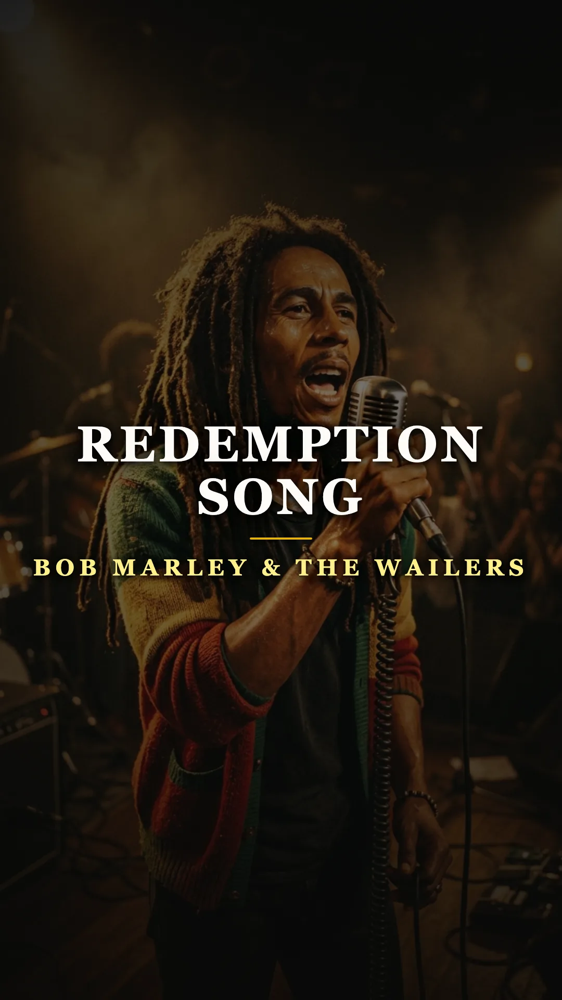
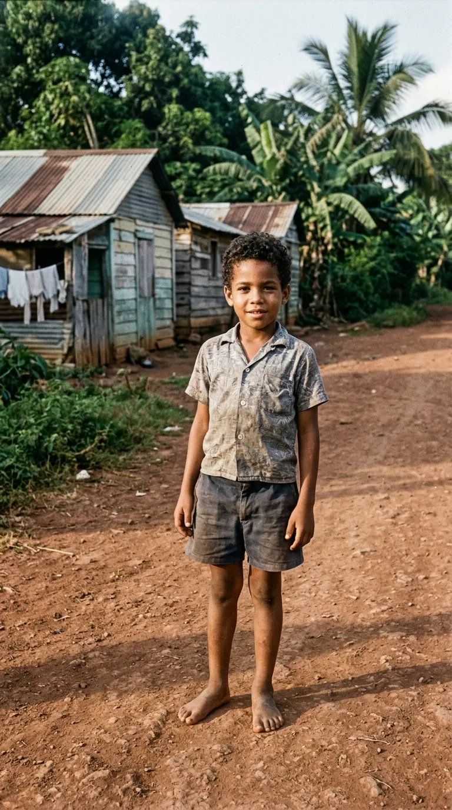
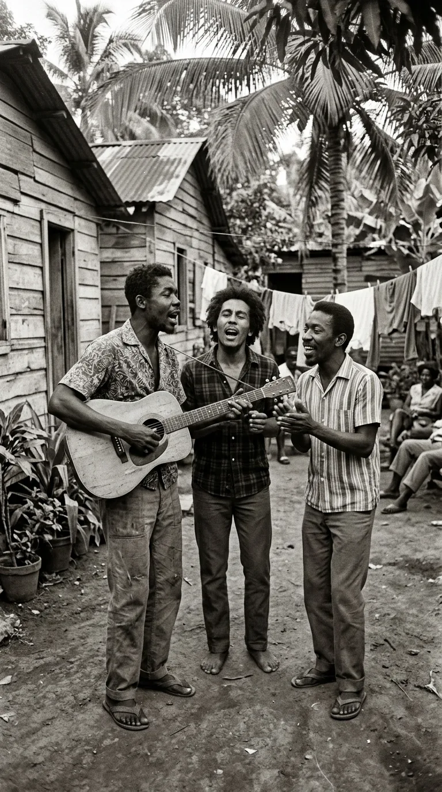
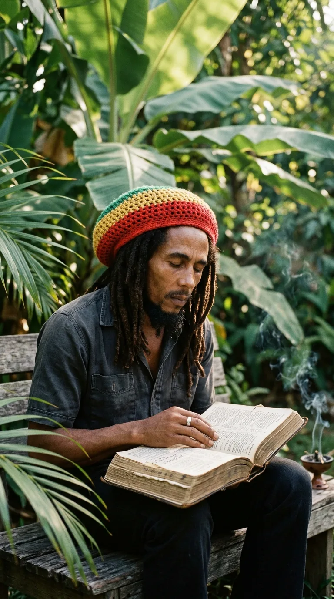
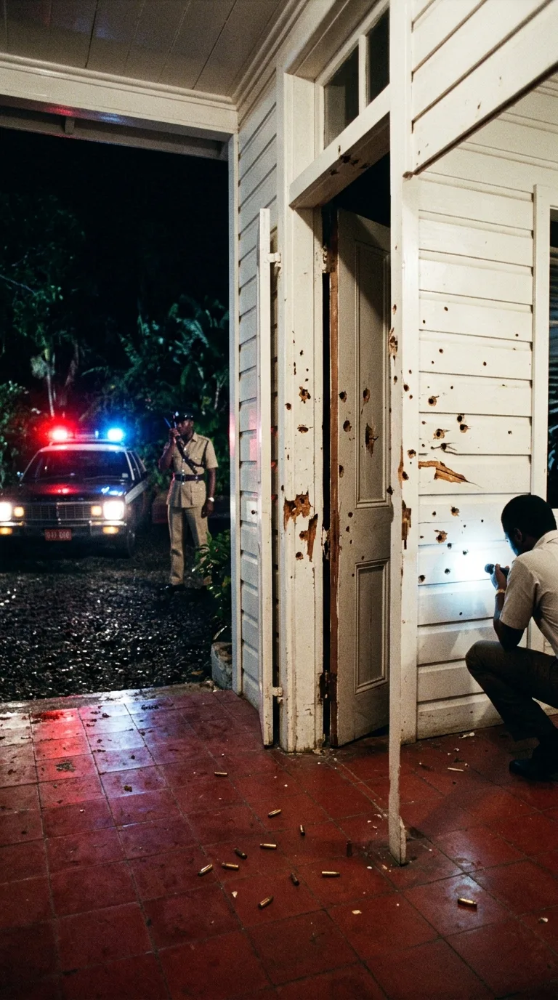
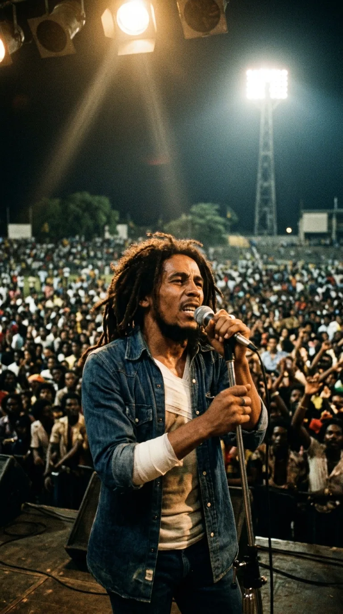
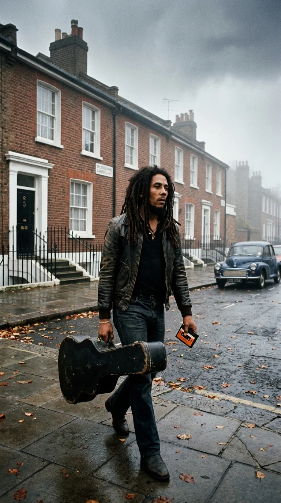
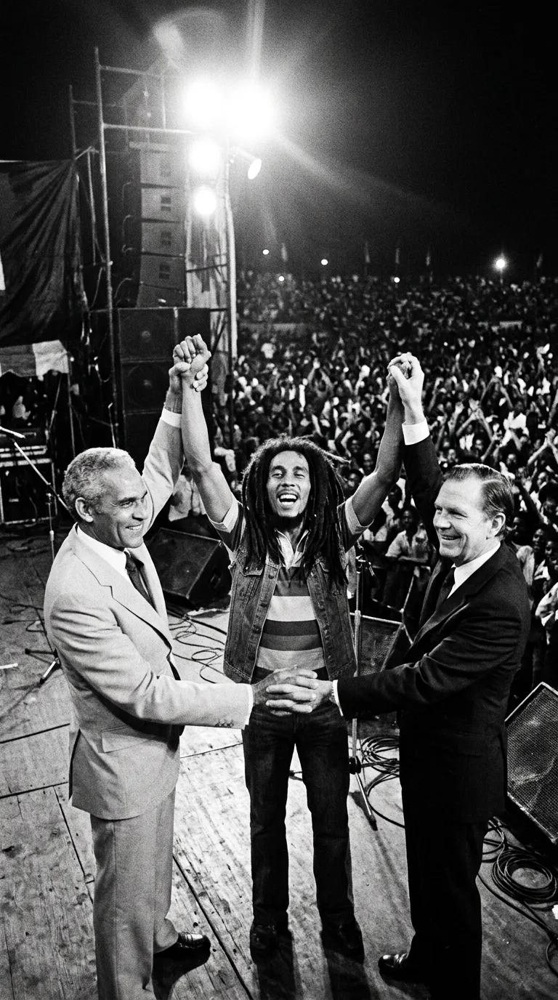
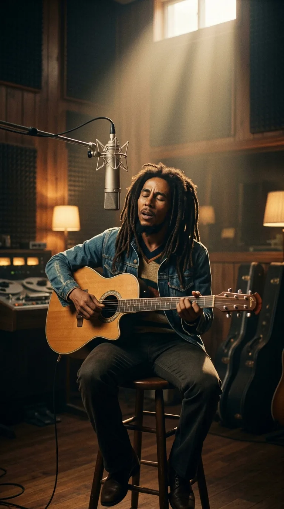

# 🦁 El Profeta Descalzo que Desafió a la Muerte: Bob Marley y los Nueve Destellos de Gloria

### *De los patios de zinc en Trenchtown al estrado donde cantó herido de bala ante ochenta mil compatriotas: el viaje luminoso de un hombre que transformó el dolor de los desposeídos en la mayor oración de libertad en «Redemption Song».*

---

**Por la redacción de Acordes Ocultos**  
*Tiempo de lectura estimado: 12 minutos*

*Bob Marley: La figura luminosa que transformó el dolor de los desposeídos en una plegaria universal de emancipación y dignidad.*

---

### Prólogo: La bala que no pudo apagar el canto

Hay voces cuya vibración no pertenece a los balances de la industria musical, sino a la tierra que las engendra y a las mareas humanas que no tienen tribuna en los periódicos. Robert Nesta Marley no subía a los escenarios buscando vanidad ni lujos perecederos; comparecía como un heraldo de la dignidad, con los ojos apretados en trance devocional, su melena de rastas trazando estelas bajo los reflectores y su guitarra rítmica pulsando el latido colectivo de los pueblos oprimidos.

Su paso por el mundo tuvo la brevedad y la fuerza de un rayo. En apenas una década de resonancia ecuménica —desde la salida de *Catch a Fire* en 1973 hasta su partida prematura en mayo de 1981—, aquel muchacho mulato nacido en las estribaciones rurales de Jamaica elevó el dialecto patois, la cadencia síncopa de los tambores y la mística de su fe al rango de himno moral de los desheredados. Sobrevivió a los disparos de un comando paramilitar, unió las manos de dos caudillos políticos en plena guerra civil y, en el crepúsculo de sus días, consciente de que un tumor implacable cercaba sus órganos, se sentó a solas con una guitarra acústica para ofrendar a la humanidad el testamento más puro de emancipación espiritual que haya conocido la música popular.

Esta es la reconstrucción documental de sus nueve destellos de gloria: los nueve instantes cardinales que consagraron la vida, la resistencia y la inmortalidad de Bob Marley.

---

### Hito I (1945–1955): El estigma birracial en Nine Mile y el barro de Trenchtown

Para descifrar el temple que animaba a Bob Marley es indispensable ascender por los senderos de tierra roja de **Nine Mile**, en la parroquia montañosa de Saint Ann, donde nació el 6 de febrero de 1945. Su madre, **Cedella Malcolm**, era una joven campesina afrojamaicana de apenas dieciocho años; su padre, **Norval Sinclair Marley**, un capitán de marina de origen británico y ascendencia blanca que superaba los cincuenta años, quien abandonó el hogar tras el alumbramiento y limitó su vínculo a esporádicas ayudas materiales hasta su muerte.

Esa dualidad sanguínea marcó la infancia de Nesta con un estigma doloroso. En la rígida pirámide social de la Jamaica colonial, Bob era visto por la burguesía de Kingston como un campesino pobre, mientras que en las barriadas negras se le señalaba con desdén como *«half-caste»* (mestizo) o *«el chico blanco»*. En ambos mundos creció como un desterrado, encontrando únicamente en la naturaleza y en los cantos espirituales de su abuelo materno un remanso de pertenencia.

*Nine Mile y Trenchtown: De los cerros verdes de Saint Ann al fango urbano de los patios colectivos, donde el joven Nesta forjó la resistencia que definió su poesía.*

Hacia finales de los años cincuenta, buscando escapar del desamparo rural, Cedella y Bob se trasladaron a la capital. Llegaron a **Trenchtown**, un enclave obrero levantado sobre terrenos fangosos de West Kingston, donde decenas de familias compartían un único grifo de agua comunal y cocinas exteriores de hojalata. En aquel entorno de privaciones y rivalidades de pandillas, Bob aprendió a defender su espacio con serenidad y puños firmes —lo que le valió el sobrenombre callejero de *«Tuff Gong»*—, mientras descubría su verdadera vocación sintonizando en radios de onda corta las emisiones de soul y rhythm and blues que navegaban desde Nueva Orleans y Miami.

---

### Hito II (1962–1965): La forja de The Wailers y el nacimiento del ritmo

En los patios de Trenchtown, al cobijo de los árboles de panapén, Bob coincidió con dos jóvenes que compartían sus mismas inquietudes artísticas: **Neville O'Riley Livingston** (a quien el mundo conocería como **Bunny Wailer**) y un espigado instrumentista de mirada rebelde llamado **Peter McIntosh** (**Peter Tosh**).

Bajo la tutela comunitaria del cantante **Joe Higgs** —figura tutelar de la barriada que impartía nociones gratuitas de armonía vocal y afinación al caer la tarde—, el trío fundó The Teenagers, formación que mutaría en The Wailing Rudeboys y finalmente en **The Wailers** (*Los que claman*).

*Kingston, comienzos de los años 60: Bob Marley, Peter Tosh y Bunny Wailer armonizan en un patio de madera, trazando el puente sonoro entre el ska insular y el soul.*

En 1963, el avezado productor **Clement «Coxsone» Dodd** los acogió en las instalaciones de **Studio One**, en Brentford Road. Su primer sencillo grabado, *«Simmer Down»* —un alegato rítmico respaldado por The Skatalites que exhortaba a las bandas juveniles armadas de los suburbios a frenar el derramamiento de sangre—, trepó a la cumbre de las listas de Jamaica, despachando decenas de miles de copias.

Con el paso de los meses, la urgencia festiva del ska comenzó a ralentizar su pulso para acoplarse al calor caribeño y a la cadencia de la conversación cotidiana. En colaboración con el singular productor **Lee «Scratch» Perry**, The Wailers pulieron los espacios vacíos, el peso del bajo y el acento a contratiempo, alumbrando la arquitectura sonora de un género que trascendería fronteras: el **reggae**.

---

### Hito III (1972–1973): La audacia de Chris Blackwell y el fuego de «Catch a Fire»

A pesar de su arraigo popular en Kingston, The Wailers enfrentaban una precaria situación financiera por contratos leoninos de productores locales. En el invierno gélido de 1971 a 1972, tras acompañar al cantante Johnny Nash en una gira británica que se desmoronó repentinamente, la banda quedó abandonada en Londres, sin fondos para costear el hospedaje ni pasajes de retorno a Jamaica.

En esa encrucijada, Bob Marley se presentó en las oficinas de **Island Records**, en Notting Hill, y solicitó audiencia con su presidente, **Chris Blackwell**, empresario jamaiquino que había edificado su sello distribuyendo música caribeña en el Reino Unido.

Blackwell percibió de inmediato la singularidad del artista:
> *«La mayoría de los ejecutivos veían a los grupos caribeños como atracciones vocales de ocasión. Yo vi en Bob a una figura con la misma estatura magnética y el arrojo rebelde de Bob Dylan o los Rolling Stones, pero portador de un mensaje espiritual inexplorado por Occidente»*.

*Londres, 1972: Bob Marley en Basing Street Studios junto a su guitarra Gibson Les Paul, cincelando la proyección universal del reggae con Catch a Fire.*

Blackwell les adelantó cuatro mil libras esterlinas en un voto de confianza sin garantías contractuales previas para que produjeran un larga duración en Jamaica. El fruto de aquel pacto fue **«Catch a Fire»** (1973), presentado en su edición original con una icónica funda troquelada en forma de encendedor Zippo. 

Con agregados de guitarras solistas de rock y teclados que facilitaron su recepción en las audiencias anglosajonas, temas como *«Concrete Jungle»* y *«Slave Driver»* situaron a Marley bajo el foco de la crítica internacional. Cuando Eric Clapton versionó en 1974 *«I Shot the Sheriff»* —alcanzando el número uno del Billboard Hot 100—, las miradas del mundo se volvieron hacia el autor que había concebido aquella crónica de justicia moral.

---

### Hito IV (1974–1975): El profeta de Zion y la consagración Rastafari

Hacia 1974, las divergencias ideológicas y el rechazo a las prolongadas giras internacionales motivaron la salida de Peter Tosh y Bunny Wailer. Lejos de amilanarse, Bob asumió el liderazgo del proyecto como **Bob Marley & The Wailers**, sumando en los coros a las **I-Threes** (**Rita Marley**, **Judy Mowatt** y **Marcia Griffiths**).

Su música profundizó entonces en la cosmovisión del movimiento **Rastafari**. Marley articuló la experiencia caribeña a través de las escrituras proféticas, asumiendo la figura del emperador etíope **Haile Selassie I** (*Ras Tafari*) como símbolo viviente de la liberación y reivindicando el retorno espiritual a África (*Zion*) frente a la opresión del sistema colonial (*Babylon*).

*Kingston, mediados de los 70: Bob Marley en recogimiento espiritual, estudiando las escrituras y discursos que nutrieron obras como Natty Dread y Rastaman Vibration.*

En trabajos monumentales como **«Natty Dread»** (1974) y **«Rastaman Vibration»** (1976), piezas como *«No Woman, No Cry»*, *«Them Belly Full (But We Hungry)»* y *«War»* —cuya letra transcribe el discurso pronunciado por Haile Selassie ante la Asamblea General de la ONU en octubre de 1963 denunciando la segregación racial— convirtieron a Marley en la voz tutelar de los pueblos africanos en plena lucha contra el colonialismo y el apartheid.

---

### Hito V (3 de Diciembre de 1976): La emboscada de Hope Road y el milagro del plomo

Hacia finales de 1976, Jamaica ardía bajo una severa espiral de violencia política. Las elecciones generales enfrentaban a los partidarios socialistas democráticos del primer ministro **Michael Manley** (People's National Party, PNP) contra las bases conservadoras y prooccidentales de **Edward Seaga** (Jamaica Labour Party, JLP). En las calles de Kingston, facciones armadas se disputaban el control de los distritos electorales en un clima de hostilidad cotidiana.

En un esfuerzo por apaciguar los ánimos, Marley aceptó encabezar un concierto gratuito y conciliador denominado **«Smile Jamaica»**, programado para el 5 de diciembre en el National Heroes Park. Sin embargo, cuando el gobierno de Manley convocó las elecciones generales para el 15 de diciembre —apenas diez días después del evento—, sectores opositores interpretaron la presentación del músico como un respaldo implícito al partido gobernante.

La noche del **viernes 3 de diciembre de 1976**, a cuarenta y ocho horas del festival, la violencia irrumpió en su propio hogar. Mientras la banda descansaba de un ensayo en la cocina y salas del **56 de Hope Road**, siete hombres armados descendieron de dos vehículos y abrieron fuego con pistolas y metralletas a través de las puertas y ventanas.

*Kingston, 3 de diciembre de 1976: Los impactos de bala en las paredes de Hope Road tras el ataque coordinado contra Bob Marley y su entorno.*

Rita Marley fue alcanzada en la cabeza cuando intentaba poner a salvo a sus hijos pequeños en un automóvil; milagrosamente, la densidad de sus dreadlocks desvió la trayectoria del proyectil bajo el cuero cabelludo sin fracturar el cráneo. Su mánager, Don Taylor, recibió múltiples impactos en la pelvis y piernas que lo pusieron al borde de la muerte.

En el interior de la residencia, un atacante disparó directamente contra Bob. Una bala le rozó el esternón a escasos milímetros del pecho y quedó alojada en la masa muscular de su antebrazo izquierdo. De forma providencial, ninguna de las víctimas perdió la vida en la refriega.

---

### Hito VI (5 de Diciembre de 1976): El concierto del desafío supremo

Con la policía colonial desbordada y el temor fundado a un segundo ataque de francotiradores, asesores de seguridad y allegados imploraron a Marley que cancelara su comparecencia y abandonara la isla bajo resguardo.

Bob rehusó la sugerencia.

La tarde del **5 de diciembre de 1976**, apenas cuarenta y ocho horas después del tiroteo, un dispositivo de escolta trasladó al cantautor hasta el National Heroes Park. Frente a la tarima aguardaba una muchedumbre expectante de más de **ochenta mil personas** que prorrumpió en una aclamación atronadora cuando la silueta del músico emergió bajo los reflectores.

*Kingston, 5 de diciembre de 1976: Bob Marley sobre las tablas del Smile Jamaica, con vendajes médicos en brazo y pecho, desafiando el miedo ante su pueblo.*

Marley se presentó con vendajes visibles cubriendo sus heridas bajo una camisa de mezclilla desabotonada. El acuerdo inicial contemplaba que cantara un único tema para sosegar los ánimos antes de ser evacuado. No obstante, al empuñar la guitarra, sostuvo una actuación electrizante de noventa minutos, elevando su canto como un acto de resistencia colectiva.

Hacia el desenlace, desabrochó su camisa y mostró a la concurrencia los vendajes manchados por los apósitos recientes. Preguntado con posterioridad sobre las razones de su temeridad frente al peligro inminente, dejó una reflexión grabada en la memoria cultural de nuestra era:

> *«La gente que está intentando hacer de este mundo un lugar peor no se toma ni un solo día libre. ¿Por qué tendría que tomármelo yo?»*.

---

### Hito VII (1977): El exilio en Londres y la cúspide de «Exodus»

Comprendiendo que su permanencia en la isla polarizaría aún más el conflicto, Bob voló temporalmente a Nassau y se estableció a continuación en **Londres**, donde vivió un productivo exilio durante dieciséis meses.

Instalado en el número 42 de Oakley Street, en el barrio de Chelsea, el compositor y The Wailers se enclaustraron en los estudios Basing Street para procesar la experiencia del atentado y la nostalgia de la patria en una obra definitiva: **«Exodus»** (1977).

*Londres, 1977: En la quietud de su refugio en Chelsea, Bob Marley concibió Exodus, proclamado por la revista Time el mejor álbum del siglo XX.*

Estructurado con precisión de orfebre, el disco presentaba un díptico conceptual: la primera cara contenía una reflexión de combate político y denuncia espiritual (*«Natural Mystic»*, *«Guiltiness»*, *«The Heathen»*, *«Exodus»*), mientras que el reverso ofrecía un bálsamo de celebración, optimismo vital y fraternidad humana (*«Jamming»*, *«Waiting in Vain»*, *«Three Little Birds»*, *«One Love / People Get Ready»*). 

En 1999, la revista **Time** declaró a *Exodus* como el **Mejor Álbum del Siglo XX**, situándolo en la cúspide de la discografía contemporánea como un monumento ecuménico a la esperanza sobre la adversidad.

---

### Hito VIII (1978): El apretón de manos en el One Love Peace Concert

A comienzos de 1978, las secuelas de la violencia partidista amenazaban con destruir el tejido social de Kingston. En una iniciativa insólita, cabecillas de las principales facciones barriales enfrentadas viajaron a Londres para pedir al músico que regresara a encabezar un recital de reconciliación comunitaria.

El **22 de abril de 1978**, en el Estadio Nacional de Kingston, se celebró el **One Love Peace Concert** ante más de treinta mil personas. En la tribuna oficial, sentados a corta distancia pero distanciados por años de rencillas, se encontraban el primer ministro Michael Manley y el líder opositor Edward Seaga.

Durante el desarrollo de *«Jamming»*, Marley comenzó a entonar una plegaria improvisada sobre la base del bajo de Aston «Family Man» Barrett:
> *«Para que exista la paz no bastan los discursos oficiales. Se requiere la voluntad honesta de los hombres...»*.

*22 de abril de 1978, One Love Peace Concert: Bob Marley reúne sobre el escenario las manos de Michael Manley y Edward Seaga en un gesto de reconciliación nacional.*

Bob extendió los brazos hacia las autoridades y los convocó a subir al escenario. En medio de una expectación contenida, Manley y Seaga avanzaron hacia el centro. Marley tomó la mano de ambos líderes, las entrelazó en alto y levantó los brazos de los antagonistas hacia el cielo de Kingston, desatando una ovación que simbolizó el anhelo de concordia de todo un país.

Ese mismo año, en la sede de las Naciones Unidas en Nueva York, la delegación africana condecoró a Marley con la **Medalla de la Paz del Tercer Mundo**, en reconocimiento a su compromiso con la concordia y la justicia social.

---

### Hito IX (1980–1981): El salmo de Marcus Garvey y el adiós de un coloso

En julio de 1977, tras resentirse de una lesión persistente en el dedo gordo del pie derecho durante su estadía en Europa, los médicos diagnosticaron a Marley un **melanoma lentiginoso acral**, forma infrecuente de cáncer cutáneo. Los facultativos aconsejaron la amputación inmediata del dedo. Sustentado en sus convicciones religiosas rastafaris —que rechazan la ablación corporal intencionada siguiendo los preceptos del Antiguo Testamento (*«no haréis incisiones en vuestra carne»*)—, Bob rehusó la amputación radical y se limitó a una escisión de tejido con injerto cutáneo, reanudando sus extenuantes compromisos escénicos.

En abril de 1980, en la cumbre de su prestigio moral, viajó con sus propios equipos a África para encabezar las celebraciones oficiales de la **Independencia de Zimbabue** en el Rufaro Stadium de Harare. Sin embargo, hacia el verano de ese mismo año, el avance celular había diseminado metástasis en órganos vitales.

Consciente de su declive físico, durante las sesiones de su último disco de estudio, **«Uprising»**, Marley pidió a sus compañeros de banda que abandonaran la sala de grabación de los estudios Tuff Gong. Desprovisto de instrumentación eléctrica, abrazó una guitarra acústica Ovation y grabó en solitario su despedida terrenal: **«Redemption Song»**.

*Kingston, 1980: A solas frente al micrófono, Bob Marley registra con guitarra acústica Redemption Song, inspirándose en las palabras de Marcus Garvey.*

En esa composición despojada, Marley rindió homenaje a una de sus mayores referencias tutelares, rescatando casi palabra por palabra el histórico discurso que el líder panafricano **Marcus Garvey** había pronunciado en 1937 en Nueva Escocia:

> *«Emancipate yourselves from mental slavery; none but ourselves can free our minds...  
> Have no fear for atomic energy, 'cause none of them can stop the time...  
> All I ever have: redemption songs»*.

El 23 de septiembre de 1980, tras sufrir un desvanecimiento mientras corría por Central Park en Nueva York, ofreció su última actuación en el Stanley Theater de Pittsburgh. Agotadas las terapias convencionales, buscó contención en la clínica del doctor Josef Issels en los Alpes bávaros (Rottach-Egern). Al confirmarse la irreversibilidad del cuadro clínico, emprendió el regreso a Jamaica. Durante el vuelo intercontinental su estado empeoró, obligando a un aterrizaje de emergencia en Florida.

El **11 de mayo de 1981**, en el hospital Cedars of Lebanon de Miami, a los **treinta y seis años de edad**, Bob Marley cerró los ojos definitivamente. Su última confidencia a su primogénito Ziggy condensó la sabiduría de su paso por el mundo:
> *«El dinero no puede comprar la vida»*.

---

### Epílogo: La colina roja de Nine Mile

El 21 de mayo de 1981, Jamaica honró a su mayor embajador cultural con un funeral de Estado que movilizó a cientos de miles de ciudadanos a lo largo de las carreteras que unen Kingston con las montañas de Saint Ann.

Sus restos descansan en un mausoleo erigido en la cumbre de **Nine Mile**, donde jugó en su niñez. En el interior del sepulcro de bronce le acompañan los símbolos de su periplo terrenal: su guitarra Gibson Les Paul, una pelota de fútbol, un brote de cannabis, el anillo entregado por la corona etíope y una Biblia abierta en las líneas del Salmo 23: *«El Señor es mi pastor, nada me faltará»*.

Como todos los grandes meteoros que han dejado una estela indeleble en la cultura universal, Bob Marley no precisó de una vejez acomodada para levantar su monumento. Convirtió la adversidad del plomo en un puente de concordia y legó en los acordes desnudos de «Redemption Song» la certeza perenne de que la verdadera libertad es una conquista interior que ninguna tiranía puede doblegar.

---

### 📚 Fuentes, Hemeroteca y Archivo Documental

* **Biografía Testimonial y Oral:** White, Timothy. *Catch a Fire: The Life of Bob Marley*. Henry Holt & Co., Nueva York, 1983 (Edición definitiva ampliada, 2006).
* **Memorias Familiares:** Marley, Rita; con Jones, Hettie. *No Woman No Cry: My Life with Bob Marley*. Hyperion Books, Nueva York, 2004.
* **Historia Oral Documentada:** Steffens, Roger. *So Much Things to Say: The Oral History of Bob Marley*. W. W. Norton & Company, Nueva York, 2017.
* **Biografía Crítica:** Salewicz, Chris. *Bob Marley: The Untold Story*. HarperCollins, Londres, 2009.
* **Archivo Discursivo Panafricano:** Garvey, Marcus Mosiah. *«The Work That Has Been Done»* (Discurso en Menelik Hall, Sydney, Nueva Escocia, octubre de 1937), en *The Marcus Garvey and Universal Negro Improvement Association Papers*, University of California Press.
* **Hemeroteca Histórica Jamaiquina:** *The Daily Gleaner* (Kingston), coberturas del atentado de Hope Road (diciembre de 1976), *One Love Peace Concert* (abril de 1978) y funeral de Estado (mayo de 1981).
* **Reconocimientos Internacionales:** *Time Magazine*, edición especial sobre el álbum del siglo XX (*Exodus*, diciembre de 1999); Archivos de la Organización de las Naciones Unidas (Concesión de la Medalla de la Paz del Tercer Mundo, junio de 1978).
* **Catalogación Fonográfica Oficial:** Island Records / Tuff Gong, créditos de grabación de *Catch a Fire* (1973), *Exodus* (1977) y *Uprising* (1980).
