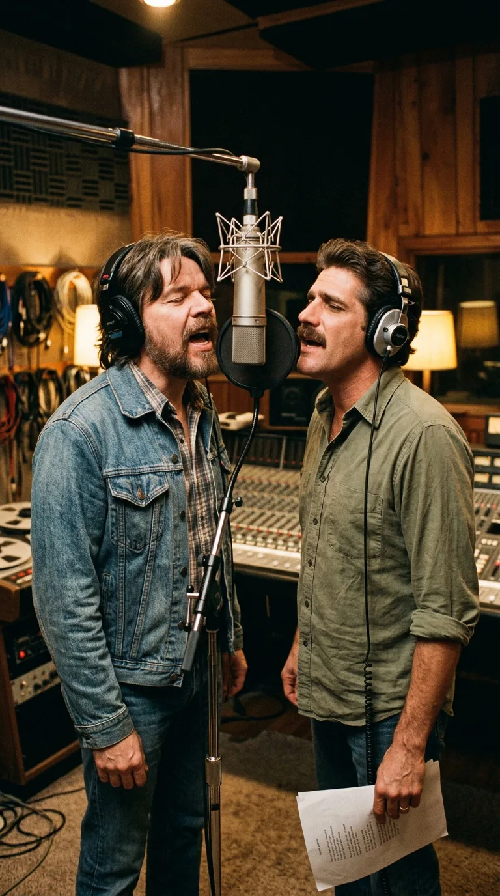
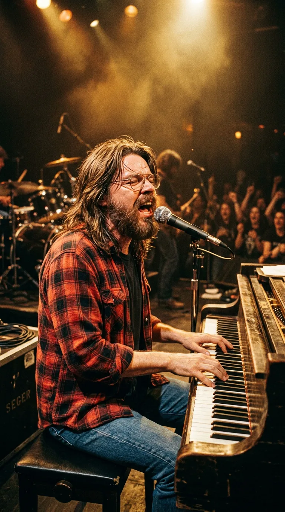
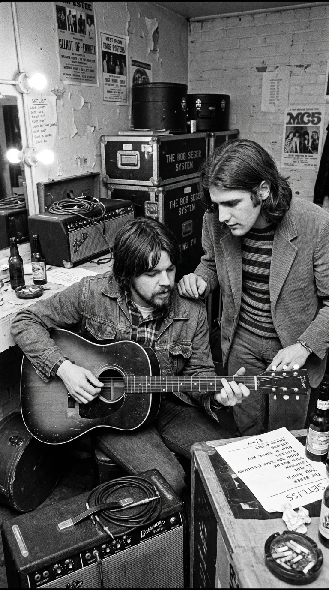
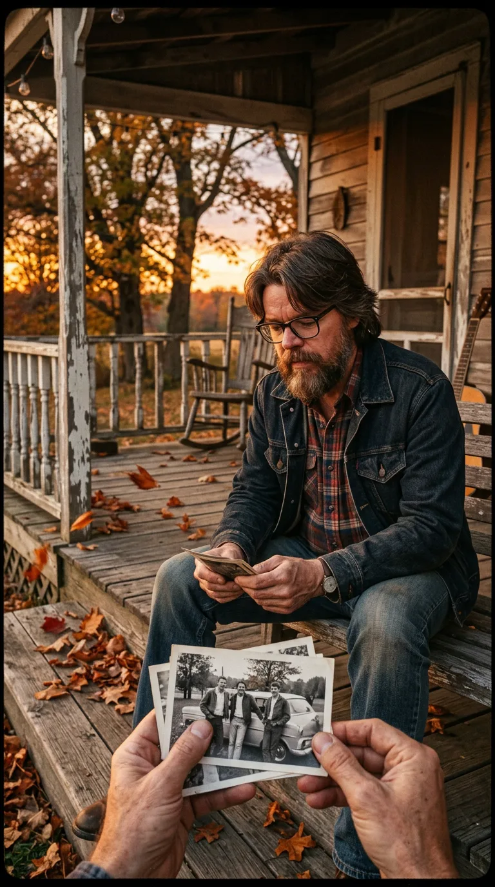
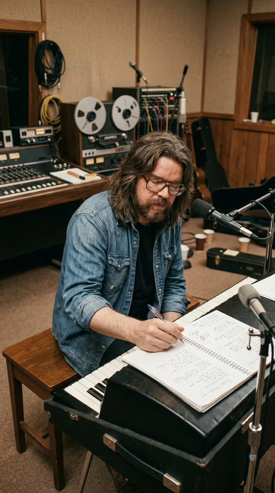
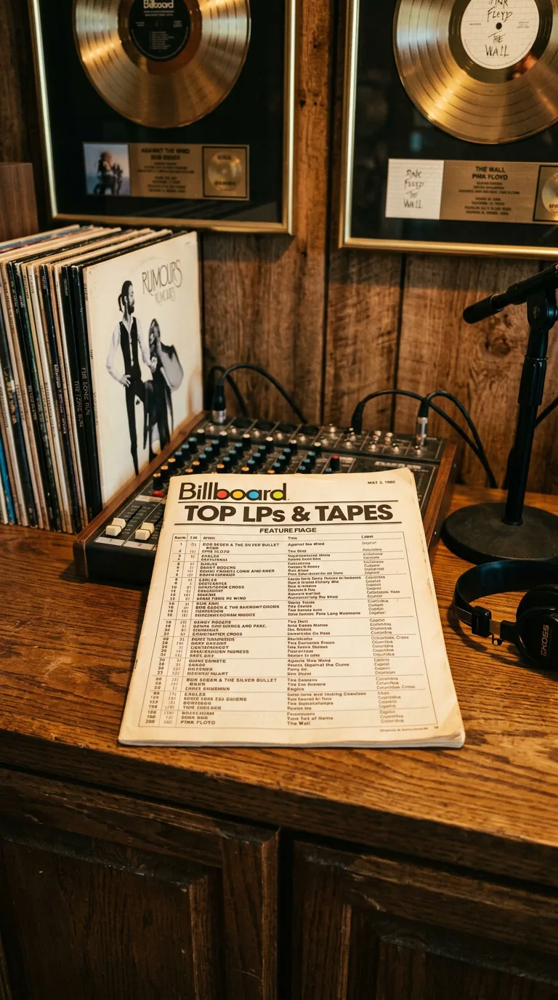

# Running Against the Wind: Bob Seger, Glenn Frey, and the Scars of Time

> *"People think 'Against the Wind' is a poetic metaphor dreamed up in some coffeehouse. It's not. It came out of the physical ache in my legs and the freezing air burning my lungs when I ran cross-country in high school in Ann Arbor. I learned that running with the wind at your back is easy—anybody can do that. But when you run against the wind, every step takes twice the sweat, and it makes you indestructible for the rest of your days."*  
> — **Bob Seger**, interview with *Rolling Stone*, June 1980.

---

*Bob Seger: The workingman of rock and roll who turned the scars of growing older into a timeless anthem of endurance.*

---

## Prologue: The Hard Ground of the Midwest

In the mythology of 1970s American rock and roll, the spotlights usually lingered on the hedonistic excess of Los Angeles or the restless, nihilistic pulse of New York. Yet across the auto plants, factory suburbs, and blizzard-swept plains of the Midwest—from Detroit to Chicago and Cleveland—the music beat to a different rhythm: it smelled of motor oil, night-shift sweat, and an unvarnished honesty that had no patience for passing fads.

The undisputed monarch of that territory was Bob Seger. With a voice like sandpaper wrapped in velvet, a thick woodsman's beard, and a guitar worn down by thousands of nights in battered roadside clubs, Seger embodied the triumph of rock's journeyman: a man who had spent fifteen years sleeping in freezing vans and playing dive bars for fifty patrons before the entire country finally fell at his feet with *Live Bullet* and *Night Moves* in 1976.

*1980: Bob Seger onstage. The hard-won triumph of a man who never forgot where he came from or what every inch of the road had cost.*

Yet when he reached the summit of his artistic maturity in 1980 with the album and title track *"Against the Wind,"* Seger did not write a boastful fanfare about the spoils of victory. Instead, he wrote one of the most moving, autumnal, and clear-eyed reflections in rock history on the passage of time, the price of our scars, and the quiet ache of losing youthful innocence.

---

## Act I: The Distance Runner of Ann Arbor

The origin of the metaphor that named Bob Seger's most universal anthem did not spring from Beat Generation poetry or heartbreak in a luxury hotel. It was born in the mud, the frost, and the aching tendons of a seventeen-year-old boy in the autumn of 1962.

During his teenage years at **Ann Arbor High School** in Michigan, Seger was a shy working-class student whose sole escape from his family's financial struggles was the school track and cross-country team.

*Michigan, 1962: young Bob Seger training cross-country. Pushing through the freezing winds off the Great Lakes would shape his philosophy for life.*

Winters around the Great Lakes show no mercy. Coaches sent the boys out on five- and ten-mile circuits across snow-dusted hills, dry cornfields, and country roads where icy gusts swept down from the north and hit them head-on with brutal force.

*"I remember the exact feeling of rounding a bend on a country road and feeling an invisible wall of freezing air slam straight into your chest,"* Seger told *The Detroit Free Press*. *"It burned your throat, froze the sweat on your eyebrows, and felt like it was shoving you three steps backward for every step you took forward. But if you didn't quit—if you lowered your head and kept pushing into that wind—you learned a lesson that never left your soul: you learned that the things truly worth having in this life never come with the wind at your back."*

That physical memory remained branded in him for nearly two decades, waiting for the moment life would hurl him into winds far harsher than any Michigan snowstorm.

---

## Act II: The Kid from Detroit and Glenn Frey's Debt

In the late 1960s, long before the world knew the Eagles or the Silver Bullet Band, Detroit was a pressure cooker of musical creativity and sheer survival. In 1968, a twenty-three-year-old Bob Seger—fighting to break through with his band, the Bob Seger System—met a local nineteen-year-old guitarist backstage at The Hideout club: gifted, eager, and completely adrift. His name was **Glenn Frey**.

Seger recognized the spark in the kid's eyes right away. He invited him over to his modest apartment, taught him the craft of songwriting—how to structure blues bars, how to pivot harmonic bridges—and brought him into Pampa Studios to play acoustic guitar and sing backing vocals on his first major regional hit of 1968, *"Ramblin' Gamblin' Man."*

*Detroit, 1968: Bob Seger takes an unknown nineteen-year-old Glenn Frey under his wing, planting a loyalty that would last a lifetime.*

Frey never forgot that act of brotherly generosity in an industry notorious for jealousy and cutthroat ambition. Soon afterward, Glenn moved to Los Angeles, formed the Eagles with Don Henley, and conquered the globe with *Hotel California*. Yet whenever anyone asked about his mentor, Frey answered with unwavering devotion: *"Bob Seger taught me everything I know about writing a rock-and-roll song. If it hadn't been for him, I'd probably be a mechanic in Michigan today."*

---

## Act III: The Autumn of 1979 and the Loss of Innocence

By 1979, riding the massive impact of *Night Moves* (1976) and *Stranger in Town* (1978), Bob Seger found himself, for the first time in his life, financially secure. He could afford comfortable homes, new cars, and the finest instruments money could buy. Yet sitting on the wooden porch of his house watching the autumn leaves come down, a deep melancholy settled over him.

*1979: at thirty-four, Seger looks back. Success had arrived, but the road had claimed its toll in old friends and lost innocence.*

Too many of his old road companions had fallen by the wayside—some worn down by drugs and alcohol, others broken by debt and frustration, and still others turned into cynical industry executives who could no longer remember why they had picked up a guitar in the first place. Growing older, he realized, carried an unavoidable freight of disappointments, quiet betrayals, and disenchantment.

He picked up his Ovation acoustic guitar and began strumming a gentle, wistful progression in G major. The words poured out like a river of memory:

> *"Seems like yesterday, but it was long ago,*  
> *Janey was lovely, she was the queen of my nights.*  
> *There in the darkness with the radio playing low...*  
> *And I remember what she said to me,*  
> *How she swore that it never would end.*  
> *I remember how she held me, oh so tight,*  
> *Wish I didn't know now what I didn't know then..."*

That closing line—***"Wish I didn't know now what I didn't know then"***—would become one of the most quoted, instantly recognizable lyrics in American popular song. It distilled an elemental human longing: the impossible wish to recover the unguarded trust of youth, before the world ever taught us how easily forever breaks.

---

## Act IV: The Criteria Studios Session and the Reunion in Miami

In the winter of 1980, Bob Seger walked into Miami's legendary **Criteria Studios** to cut the master tracks for the ballad, sharing production duties with his longtime manager **Punch Andrews** alongside the studio craftsmanship of **Bill Szymczyk** (who would later mix the master at **Bayshore Recording Studios** in Coconut Grove).

To capture the song's organic, rootsy texture, Seger called in the most respected rhythm section in the American South: Alabama's famed **Muscle Shoals Rhythm Section**. The lineup was stellar: **Barry Beckett** on acoustic piano, **Pete Carr** on six- and twelve-string acoustic guitars, **David Hood** on bass, and **Roger Hawkins** on drums. Beckett's piano pulse was no mere embellishment—it was the song's beating heart, its graceful arpeggios falling like raindrops down a fogged windowpane.

*Criteria Studios, Miami, 1980: Barry Beckett at the piano and Bob Seger on acoustic guitar cutting the definitive take of 'Against the Wind.'*

Even once the instrumental track was complete, Seger felt the chorus was still missing a vital vocal dimension: he needed a warm, enveloping voice to counterbalance his own gritty rasp—someone to sing the refrain of perseverance alongside him: *"Against the wind / Still running against the wind."*

Bob picked up the phone and called Glenn Frey, who was back in Los Angeles exhausted by the internal friction tearing at the Eagles:  
*"Glenn, I've got a song I need you to sing with me. You have to fly down to Miami."*

Frey didn't hesitate for a second. He caught the first commercial flight to Florida. Inside Criteria Studios, the two old friends from Detroit stood side by side before the same Neumann condenser microphone. The moment Frey began doubling Seger's voice on the chorus, weaving his smooth, aching harmony into Seger's gravel, everyone in the control room knew the song had crossed into the realm of timeless classics.

*Reunion of Detroit brothers: Glenn Frey answered his mentor's call to seal the most moving chorus of 1980.*

---

## Act V: Number One and the Victory Over "The Wall"

Released in the spring of 1980, the album *Against the Wind* became a runaway phenomenon. At a moment when American radio was dominated by punk, British new wave, and the last gasps of disco, Bob Seger's bare-knuckled honesty struck a chord with millions of ordinary people who felt that everyday life amid an economic recession was an unrelenting battle against the elements.

Its commercial impact was staggering. On **May 3, 1980**, *Against the Wind* climbed to **number one on the Billboard 200**, achieving the historic feat of **knocking Pink Floyd's colossal rock opera *The Wall* out of the top spot** after fifteen consecutive weeks entrenched at the summit. Seger's album held number one for six straight weeks, becoming the only album of his entire career to conquer the top of the Billboard chart.

*Spring 1980: Bob Seger dethrones Pink Floyd atop the Billboard chart and claims victory at the Grammy Awards.*

The title track *"Against the Wind"* rose to number five on the Billboard Hot 100 and earned sweeping recognition across the industry. At the 23rd Annual Grammy Awards in February 1981, Bob Seger & The Silver Bullet Band won **Best Rock Performance by a Duo or Group with Vocal**, while art director **Roy Kohara** took home **Best Album Package** for the iconic cover featuring Thomas Locker's painting of wild horses. The album went on to sell more than five million copies in the United States alone.

---

## Epilogue: The Wind Keeps Blowing

More than four decades after its release, *"Against the Wind"* has not lost a single ounce of its poetic force. In a culture where everything seems built to be consumed and discarded in seconds, and where the mirage of perpetual youth hides the hard-earned richness of lived scars, Bob Seger's voice endures as a monument to the dignity of those who keep going.

*The metaphor of the road: running against the wind is not a curse—it is the proving ground that tempers the spirit.*

The song reminds us that growing older is not a defeat, but proof of having fought for every inch of ground; that it is alright to look back with longing and admit we have lost battles and had our hearts broken; and that so long as there is breath left in our lungs, the only honorable answer to adversity is to square our shoulders, lift our chins, and keep running against the wind.

*The quiet after the storm: a solitary guitar, the whisper of an autumn wind, and the certainty that every scar was worth it.*

---

### 📚 Sources and Archival Records

1. **Seger, Bob** (1980). *"Bob Seger: The Rolling Stone Interview,"* by Dave Marsh. *Rolling Stone Magazine*, Issue 319 (June 1980). In-depth interview covering the writing of *Against the Wind*, his high-school cross-country running in Ann Arbor, and the lyrical dilemma behind the Janey verse.
2. **Graff, Gary & Weschler, Tom** (2011 / rev. ed. 2023). *Travelin' Man: On the Road and Behind the Scenes with Bob Seger*. Wayne State University Press, Detroit. Documentary chronicle of Seger's formative Detroit years, Pampa Studios, and his brotherly bond with Glenn Frey.
3. **Frey, Glenn** (2013). *History of the Eagles* (Official documentary directed by Alison Ellwood, Jigsaw Productions). Firsthand testimony from Glenn Frey recounting his songwriting apprenticeship with Bob Seger in 1968 and the backing-vocal session at Criteria Studios.
4. **Billboard Magazine** (1980). *Billboard 200 Top LPs & Tape Charts: Weeks of May 3 through June 7, 1980*. Archival chart records documenting the album's rise to number one, ending Pink Floyd's run with *The Wall* and holding the top spot for six consecutive weeks.
5. **Capitol Records** (1980). *Technical credits for the album Against the Wind (SOO-12041)*: recordings by the Muscle Shoals Rhythm Section (Barry Beckett, Pete Carr, David Hood, Roger Hawkins) at Criteria Studios (Miami) and mixing by Bill Szymczyk at Bayshore Recording Studios (Coconut Grove, Florida).
6. **National Academy of Recording Arts and Sciences (NARAS)** (1981). *23rd Annual Grammy Awards Official Record*. Official record of the awards for *Best Rock Performance by a Duo or Group with Vocal* (Bob Seger & The Silver Bullet Band) and *Best Album Package* (Roy Kohara, Art Director).
