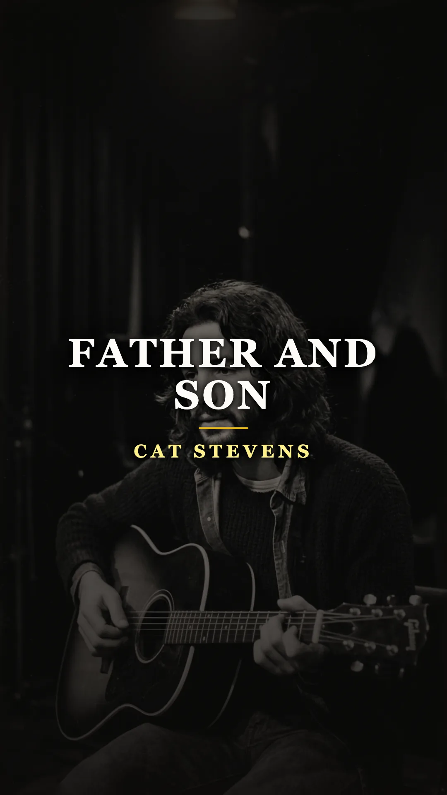
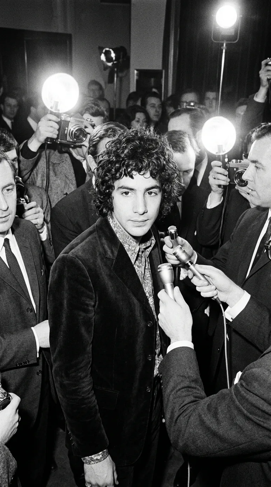
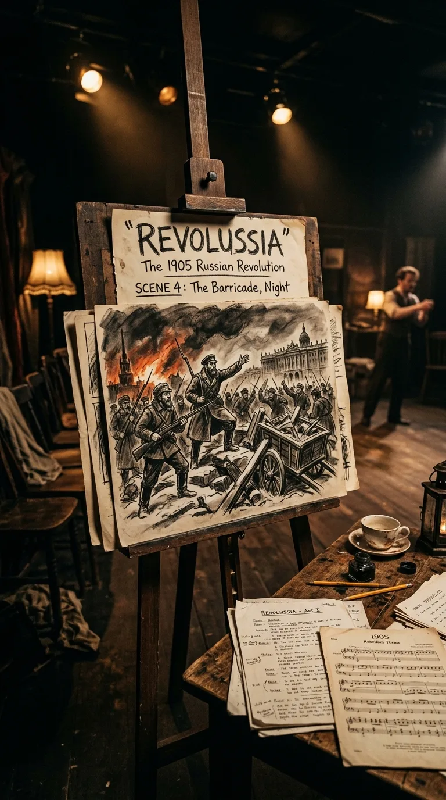
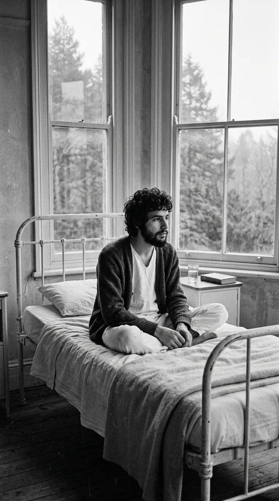
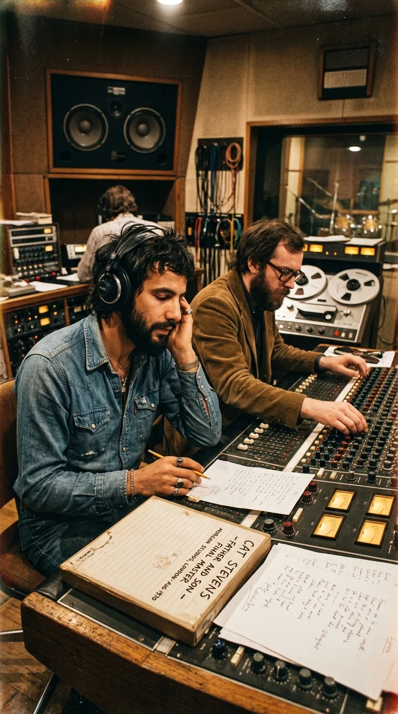
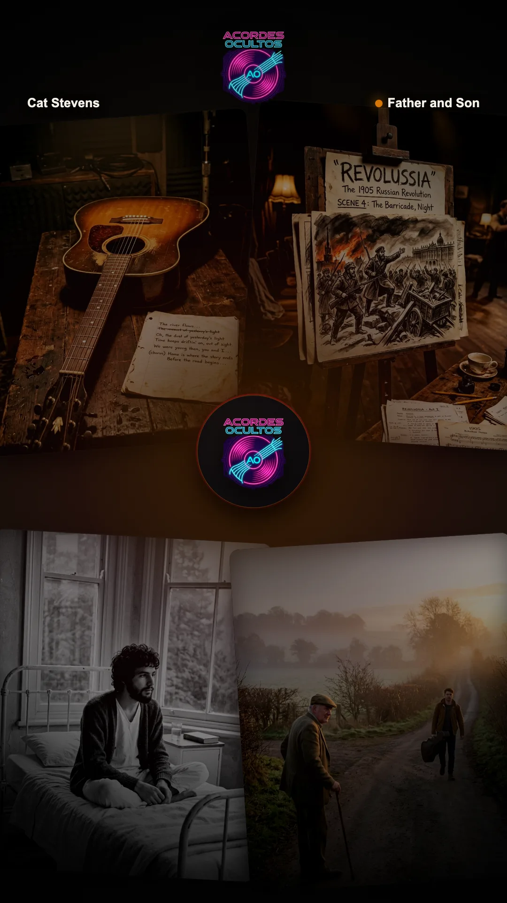

# The Hidden Rifle in the Snow: The Ballad That Saved a Man from Death

> *“For years people thought I was singing to my father at the restaurant on Shaftesbury Avenue. In truth, it was written for a young Russian revolutionary in 1905 who had decided to march to the front with a rifle. When I nearly died of tuberculosis in Midhurst, I realized that boy was me: the revolution was not against the tsars or against my family, but against the lie of becoming someone I was not.”*  
> — **Yusuf / Cat Stevens**, autobiographical memoir *Cat: On the Road to Findout*, 2025.

---

*Cat Stevens: The ballad born from a revolutionary clash that saved the authenticity of a man on the brink of death.*

## Prologue: The Illusion of the Bourgeois Parlor

For more than half a century, millions of fathers and sons across five continents have sat before a stereo or an acoustic guitar, eyes misting and throats tightening, convinced they were listening to the definitive domestic chronicle: a British sitting room in the middle of the afternoon, a teacup on the table, and two generations struggling to bridge an unbridgeable divide.

The older man, shaped by the chill of caution, counsels patience: *“It's not time to make a change, just relax, take it easy... You're still young, that's your fault; there's so much you have to know...”* The boy, consumed by the urgency of his own blood, answers with his eyes fixed on the open door: *“From the moment I could talk, I was ordered to listen... Now there's a way, and I know that I have to go away.”*

It is one of the most moving and universal conversations ever committed to popular music. Yet it conceals a secret buried deep beneath the layers of time. That dialogue was never born in a London kitchen, nor was it about youthful independence in the 1970s.

In its original conception, the boy was not packing a suitcase to leave for university or look for work in the big city: **he was picking up a bolt-action rifle to go die on the peasant barricades of the 1905 Russian Revolution**, and his father knew that if he crossed the threshold of the cabin, he would never return alive.

For that funeral march through the tsarist snow to become Cat Stevens's crowning achievement, fate first had to deliver a shattering blow: a collapsed lung, blood coughed onto the pavement, and an entire year of silence along the borders of death.

---

## Act I: The Wind-Up Toy of Carnaby Street

To understand the desperation that gave birth to the song, one has to travel back to London in 1967. Steven Demetre Georgiou—the son of a Greek Cypriot immigrant who ran the *Moulin Rouge* restaurant on Shaftesbury Avenue and a Swedish mother—was then a nineteen-year-old boy whom the record industry machine had rechristened with a catchy moniker: **Cat Stevens**.

*London, 1967: A young Cat Stevens surrounded by the press and the pop industry before his physical collapse.*

Under the guidance of producer Mike Hurst and *Deram Records*, the teenager was thrown without armor into the whirlwind of *Swinging London*. Dressed in tailored velvet suits, frilled shirts, and the latest hairstyle, he strung together British chart hits such as *“I Love My Dog”* and *“Matthew and Son.”*

Behind the flashbulbs and the deafening screams of teenage fans, however, Steven felt himself suffocating. His most intimate, stripped-down compositions were systematically buried under syrupy orchestral arrangements, blaring brass, and prefabricated backing vocals. The industry wanted a disposable pop puppet; he—a young man raised in the bustle of the West End's alleys and a voracious reader of poetry—was searching desperately for an artistic truth no one in the record-company offices seemed willing to grant him.

---

## Act II: «Revolussia» and Blood in the Trenches

In early 1968, looking to escape the tyranny of commercial pop, Stevens teamed up with the esteemed British actor and playwright **Nigel Hawthorne** on a clandestine project far outside every commercial convention: an ambitious historical musical provisionally titled **«Revolussia»**.

The work set its drama in St. Petersburg and the Russian countryside of 1905, amid the bloody prelude to the peasant and workers' uprising against the autocracy of Tsar Nicholas II.

*Original set-design sketches for «Revolussia», the historical musical that tuberculosis prevented from ever reaching the stage.*

The central plot revolved around a generational conflict steeped in gunpowder. A young farmhand from a remote province absorbs the revolutionary ideas burning in the capital and decides to join the armed insurgents. His father, an old man battered by famines and pitiless winters, sees the world through the lens of bare biological survival: keep your head down, work the family land, and hold on to your breath.

Cat Stevens wrote the climactic number of the show. In the original libretto, the ideological clash was unforgiving:
> 📝 **THE DIALOGUE IN THE SNOW:** *The father was not saying “find a girl, settle down” to invite him into bourgeois comfort, but to save his skin: “Marry, stay on the farm, work... don't go out into the snow to let the Cossack cavalry run a saber through your chest.” And the son's answer was no adolescent tantrum; it was the wrenching resolve of someone who believes his freedom is worth more than his own life: “From the moment I could talk, I was ordered to listen... now I know that I have to go away.”*

The script was finished and theatrical preparations were beginning to take shape. But life had a far more dramatic and personal turn waiting in the wings.

---

## Act III: The White Room in Midhurst

The relentless pace of late-night recording sessions, exhausting provincial tours, a meager diet of black coffee, and chain-smoking finally collected their bill in late 1968.

During a performance in the north of England, barely twenty years old, Stevens staggered onstage. Stepping out into the damp alley behind the theater, a violent coughing fit doubled him over: **he spat fresh blood onto the cobblestones**.

He was rushed to a London hospital. X-rays delivered a terrifying diagnosis: he had **advanced cavitary tuberculosis**, and his left lung had partially collapsed. The specialists were blunt: unless he entered a sanatorium immediately under strict isolation, he had only weeks to live. And even if he survived, the severe lung damage left serious doubts about whether he would ever sing again.

The *“Revolussia”* project was buried on the spot.

*Midhurst, 1969: Cat Stevens convalescing after months of isolation for tuberculosis.*

Stevens was admitted to **King Edward VII Hospital in Midhurst**, deep in the wooded countryside of Sussex. He spent nearly a year confined within whitewashed walls, breathing the scent of tincture of iodine and watching the oak trees in the rain through the tall windows.

That forced retreat at the edge of the abyss became the true awakening of his life. Cut off from the deafening clamor of fame, Cat Stevens devoured books on Eastern philosophy, Buddhism, Sufi mysticism, and astrology. He stopped shaving, let his dark hair grow into thick curls, and watched the mask of the pop dandy dissolve.

*The metamorphosis: With a guitar in his hospital bed, the Bolshevik conflict evolved into a universal dialogue.*

With an acoustic guitar he was allowed to keep beside his bed, Stevens opened his old notebook from *“Revolussia.”* He began crossing out the references to soldiers, the tsar, the trenches, and the mud. And in that instant came the catharsis: **the young man who could not bear to stay on the farm was himself**.

His own battle was not against Russian Cossacks, but against the gilded cage of fleeting success and the expectations others had drawn up for him. He had been forced to look death in the face to understand that the only rebellion that truly matters is the one undertaken to save one's own authenticity.

---

## Act IV: The Booth at Morgan Studios and the Double Voice

In the summer of 1970, physically recovered and carrying a voice made raspier, deeper, and more seasoned by the scars inside his airways, Cat Stevens signed with Island Records and walked into **Morgan Studios** in Willesden, northwest London. Alongside him were his inseparable acoustic guitarist, **Alun Davies**, and producer **Paul Samwell-Smith** (former bassist of The Yardbirds).

The album they were forging would be titled *«Tea for the Tillerman»*. When the time came to record *«Father and Son»*, Stevens rejected the suggestion of hiring a veteran actor to play the father's part. He wanted the gulf between the two ages to rise from his own throat.

*Morgan Studios, August 1970: Stevens before the tube Neumann microphone for his vocals and the acoustic take of his guitar.*

Working with engineers **Mike Bobak** and **Robin Black**, Stevens pulled off a feat of vocal modulation and emotional nuance:
* For the **Father's** verses, he dropped into a deep, grave, unhurried baritone, nearly whispered into the microphone, relaxing his throat to convey the stillness, weariness, and quiet fear of a man who has seen too much of the world and only longs to shield his own.
* For the **Son's** replies, he shifted into a high, impassioned tenor on the edge of breaking, projecting his voice with the aching urgency of someone who feels that standing still is a slow death from within.

Under Samwell-Smith's guidance, the acoustic guitars of Stevens and Alun Davies laid down a calm, measured pulse, enriched by John Ryan's bass, Harvey Burns's subtle drumming, and the delicate string arrangements orchestrated by Del Newman.

*The definitive session: The two-inch analog tapes that preserved one of the high-water marks of folk rock.*

When the two-inch tape came to a halt on the control-room reel-to-reel machine, the silence in the studio was palpable. They had captured a timeless piece: a mirror in which any human being, in any corner of the earth, would recognize the echo of their own filial wounds.

---

## Epilogue: Leaving So as Not to Die

*«Tea for the Tillerman»* was released on November 23, 1970 through Island Records. Anchored by the magnetic depth of *«Father and Son»*, the album immediately took its place as an indisputable classic of contemporary folk rock, hailed by critics and embraced by millions of listeners.

The song held a truth so unvarnished that neither the passing of decades nor countless cover versions have ever dulled its emotional force.

The final paradox of Cat Stevens is that he would eventually live out the decree of his own song with complete fidelity. Years later, after brushing against death once more in the Pacific surf off Malibu, he kept his promise to sever ties with the music industry: he auctioned his instruments, donated his royalties, adopted the name **Yusuf Islam**, and stepped away in peace, taking the reins of his own existence.

For as he had come to understand in that hospital room with a shattered chest, the greatest loss a human being can suffer is neither choosing the wrong road nor risking a fall; the true tragedy is standing motionless on a shore that is not yours, living a life that never belonged to you.

---

### 📚 Sources and Archival Records

For the rigorous historical, biographical, and technical reconstruction of this chronicle, the *Secret Chords* editorial team consulted and cross-referenced the following documentary sources:

1. **Stevens, Yusuf / Cat** (2025). *Cat: On the Road to Findout* (Official Autobiography). HarperCollins, London.
2. **Charlesworth, Chris** (1984). *Cat Stevens: The Complete Illustrated Biography*. Proteus Books, London. Chapters devoted to his hospitalization at King Edward VII Hospital in Midhurst, his spiritual retreat, and the conception of *Tea for the Tillerman*.
3. **Samwell-Smith, Paul, Bobak, Mike & Black, Robin** (1970–2020). Morgan Studios (Willesden, London) session archives and production notes for *Tea for the Tillerman* (Island Records, ILPS 9135). Commemorative interviews in *Sound on Sound* and *Mojo Magazine*.
4. **Island Records & Island Music Publishing Archive.** Original manuscripts, sheet music, and libretto notes from the unproduced theatrical project *«Revolussia»* (1968–1969), in collaboration with Nigel Hawthorne.
5. **Davies, Alun.** Testimonies and audio archives on crafting the acoustic guitar arrangements and vocal counterpoints at Morgan Studios.
6. **British Music Press Archives (1970–1971).** *Melody Maker*, *New Musical Express (NME)*, and *Record Mirror*: contemporary launch reviews of *Tea for the Tillerman*, features, and period interviews.

---

*Secret Chords editorial teaser for the chronicle of Cat Stevens and the birth of «Father and Son».*
