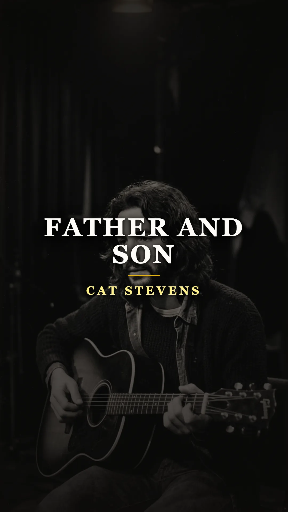
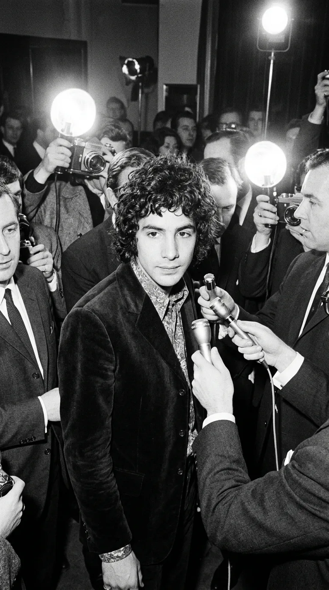
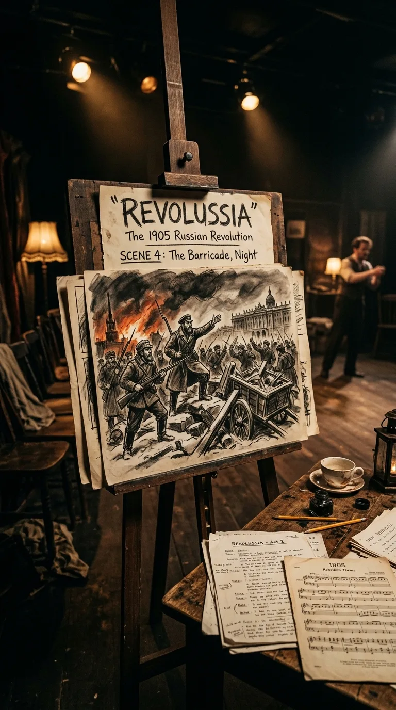
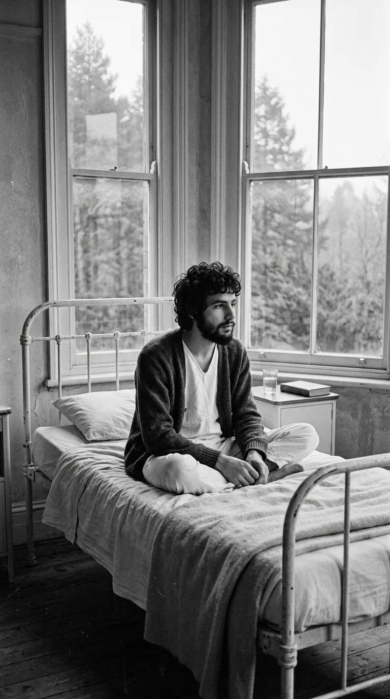
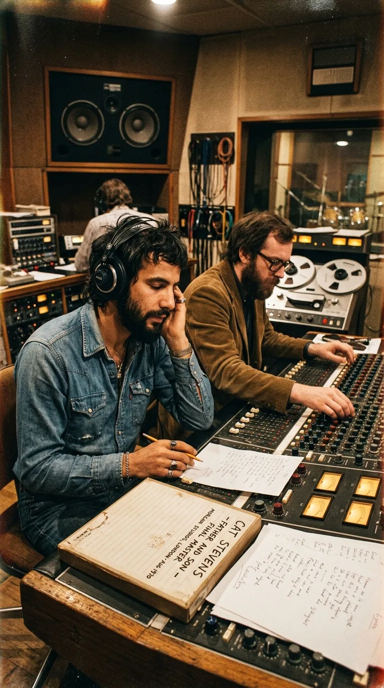
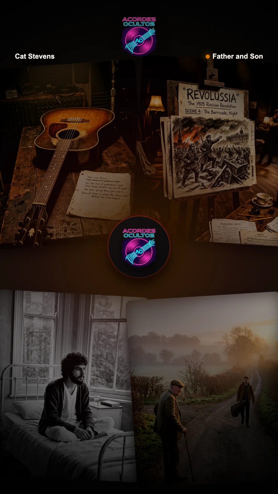

# El Fusil Enterrado en la Nieve: La Balada que Salvó a un Hombre de la Muerte

> *"Durante años la gente pensó que le cantaba a mi padre en el restaurante de Shaftesbury Avenue. Pero en realidad nació para un joven revolucionario ruso de 1905 que decidía marcharse al frente con un fusil. Cuando casi muero de tuberculosis en Midhurst, comprendí que aquel muchacho era yo mismo: la revolución no era contra los zares ni contra mi familia, sino contra la mentira de convertirme en alguien que no era."*  
> — **Yusuf / Cat Stevens**, memoria autobiográfica *Cat: On the Road to Findout*, 2025.

---

*Cat Stevens: La balada nacida de un conflicto revolucionario que salvó la autenticidad de un hombre al borde de la muerte.*

## Prólogo: El engaño de la sobremesa burguesa

Durante más de medio siglo, millones de padres e hijos en los cinco continentes se han sentado frente a un reproductor o una guitarra acústica, con los ojos empañados y un nudo en la garganta, convencidos de que escuchaban la crónica doméstica definitiva: una sala de estar británica a media tarde, una taza de té sobre la mesa y dos generaciones intentando salvar una distancia insalvable.

El anciano, moldeado por el frío de la prudencia, aconseja calma: *«No es momento de hacer cambios, relájate, tómalo con calma... aún eres joven, ese es tu error; hay tanto que tienes que aprender...»*. El muchacho, devorado por la prisa de su propia sangre, responde con la mirada clavada en la puerta abierta: *«Desde el momento en que pude hablar se me ordenó escuchar... Ahora hay una salida y sé que tengo que marcharme»*.

Es una de las conversaciones más conmovedoras y universales registradas jamás por la música popular. Sin embargo, encierra un secreto celosamente sepultado bajo las capas del tiempo. Aquel diálogo no nació en ninguna cocina londinense, ni trataba sobre la emancipación juvenil en los años setenta. 

En su concepción original, el muchacho no estaba haciendo las maletas para marcharse a la universidad o buscar un empleo en la gran ciudad: **estaba tomando un fusil de cerrojo para ir a morir a las barricadas campesinas de la Revolución Rusa de 1905**, y su padre sabía que, si cruzaba el umbral de la cabaña, jamás volvería con vida.

Para que aquella marcha fúnebre entre la nieve zarista se transformara en la obra cumbre de Cat Stevens, el destino tuvo que asestar un golpe demoledor: un pulmón colapsado, esputos de sangre sobre el pavimento y un año entero de silencio en las fronteras de la muerte.

---

## Acto I: El muñeco de cuerda de Carnaby Street

Para entender la desesperación que engendró la canción, es preciso viajar al Londres de 1967. Steven Demetre Georgiou, hijo de un inmigrante grecochipriota que regentaba el restaurante *Moulin Rouge* en Shaftesbury Avenue y de una madre sueca, era entonces un muchacho de apenas diecinueve años al que la maquinaria discográfica había rebautizado con un apodo pegadizo: **Cat Stevens**.

*Londres, 1967: El joven Cat Stevens rodeado por la prensa y la industria del pop antes del colapso físico.*

Bajo la tutela del productor Mike Hurst y el sello *Deram Records*, el adolescente fue arrojado sin armadura a la vorágine del *Swinging London*. Con elegantes trajes de terciopelo hechos a medida, camisas con chorreras y peinados a la última moda, encadenó sencillos exitosos en las listas británicas como *«I Love My Dog»* y *«Matthew and Son»*. 

Pero detrás de los destellos de magnesio y los gritos ensordecedores de las adolescentes, Steven sentía que se asfixiaba. Sus composiciones más íntimas y desnudas eran sepultadas sistemáticamente por arreglos orquestales empalagosos, metales estruendosos y coros prefabricados. La industria quería un muñeco pop de consumo rápido; él, un muchacho educado en el bullicio de los callejones del West End y lector voraz de poesía, buscaba desesperadamente una verdad artística que nadie en los despachos discográficos parecía dispuesto a concederle.

---

## Acto II: «Revolussia» y la sangre en la trinchera

A comienzos de 1968, buscando escapar de la tiranía del pop comercial, Stevens se asoció con el prestigioso actor y dramaturgo británico **Nigel Hawthorne** para un proyecto clandestino y fuera de toda convención comercial: la composición de un ambicioso musical histórico titulado provisionalmente **«Revolussia»**.

La obra situaba su drama en el San Petersburgo y la campiña rusa de 1905, durante los sangrientos prolegómenos de la revolución campesina y obrera contra la autocracia del zar Nicolás II. 

*Bocetos originales de escenografía para «Revolussia», el musical histórico que la tuberculosis impidió estrenar.*

La trama central giraba en torno a un conflicto generacional teñido de pólvora. Un joven agricultor de una provincia remota se empapa de las ideas revolucionarias que arden en la capital y decide unirse a los insurrectos armados. Su padre, un anciano golpeado por hambrunas e inviernos implacables, entiende el mundo desde la mera supervivencia biológica: agachar la cabeza, trabajar la tierra familiar y conservar el aliento.

Cat Stevens compuso el tema culminante de la obra. En el libreto original, el choque ideológico era implacable:
> 📝 **EL DIÁLOGO EN LA NIEVE:** *El padre no le decía «busca una chica y cásate» para invitarlo a la comodidad burguesa, sino para salvarle el pellejo: «Cásate, quédate en la granja, trabaja... no vayas a la nieve a que la caballería cosaca te atraviese el pecho con un sable». Y la respuesta del hijo no era un berrinche juvenil; era la resolución desgarradora de quien siente que su libertad vale más que su propia vida: «Desde el momento en que pude hablar se me ordenó escuchar... ahora sé que tengo que marcharme»*.

El libreto estaba terminado y los preparativos teatrales comenzaban a tomar forma. Pero la vida tenía reservado un giro infinitamente más dramático y personal.

---

## Acto III: La habitación blanca de Midhurst

El ritmo desenfrenado de grabaciones nocturnas, giras extenuantes por provincias, una dieta precaria a base de café negro y un consumo incesante de cigarrillos cobraron su factura definitiva a finales de 1968. 

Durante una actuación en el norte de Inglaterra, con apenas veinte años, Stevens se tambaleó sobre las tablas. Al salir al callejón húmedo del teatro, un ataque de tos convulsa lo dobló por la mitad: **arrojó sangre fresca sobre el adoquinado**.

Fue trasladado de urgencia a un hospital londinense. Las radiografías revelaron un diagnóstico aterrador: padecía una **tuberculosis cavitaria avanzada** y su pulmón izquierdo había colapsado parcialmente. Los especialistas fueron categóricos: si no ingresaba de inmediato en un sanatorio bajo aislamiento absoluto, le quedaban pocas semanas de vida. E incluso si lograba sobrevivir, el daño pulmonar severo ponía en seria duda que pudiera volver a cantar.

El proyecto de *«Revolussia»* quedó sepultado en el acto.

*Midhurst, 1969: Cat Stevens convaleciente tras meses de aislamiento por tuberculosis.*

Stevens fue internado en el hospital **King Edward VII en Midhurst**, en el corazón boscoso de Sussex. Pasó cerca de un año recluido entre paredes encaladas, oliendo a tintura de yodo y contemplando los robles bajo la lluvia a través de los ventanales. 

Aquel retiro forzoso al borde del abismo fue el verdadero despertar de su vida. Privado del ruido ensordecedor de la fama, Cat Stevens devoró textos de filosofía oriental, budismo, mística sufí y astrología. Dejó de afeitarse, permitió que su cabello oscuro cayera en rizos espesos y vio cómo la máscara del dandi pop se desvanecía. 

*La metamorfosis: Con una guitarra en la cama del hospital, el conflicto bolchevique mutó en el diálogo universal.*

Con una guitarra acústica que le permitieron tener junto a la cama, Stevens abrió su viejo cuaderno de notas de *«Revolussia»*. Comenzó a tachar las menciones a los soldados, al zar, a las trincheras y al fango. Y en ese instante sobrevino la catarsis: **aquel joven que no soportaba quedarse en la granja era él mismo**. 

Su propia lucha no era contra los cosacos rusos, sino contra la prisión de oro del éxito efímero y las expectativas que otros habían trazado para él. Había tenido que asomarse a la muerte para comprender que la única rebelión que tiene sentido es la que se emprende para salvar la propia autenticidad.

---

## Acto IV: La cabina de Morgan Studios y la doble voz

En el verano de 1970, recuperado físicamente y con una voz más áspera, profunda y templada por las cicatrices en sus vías respiratorias, Cat Stevens firmó con Island Records e ingresó a los estudios **Morgan** de Willesden, al noroeste de Londres. Lo acompañaban su guitarrista acústico inseparable, **Alun Davies**, y el productor **Paul Samwell-Smith** (ex bajista de The Yardbirds).

El álbum que estaban forjando se llamaría *«Tea for the Tillerman»*. Cuando llegó el momento de registrar *«Father and Son»*, Stevens descartó la sugerencia de contratar a un actor veterano para que interpretara al padre. Quería que el abismo entre las dos edades naciera de su propia garganta.

*Morgan Studios, agosto de 1970: Stevens frente al micrófono Neumann de válvulas para su voz y la toma acústica de su guitarra.*

Junto a los ingenieros **Mike Bobak** y **Robin Black**, Stevens ejecutó una proeza de modulación vocal y sensibilidad:
* Para las estrofas del **Padre**, utilizó un registro de barítono profundo, grave y pausado, casi susurrado al micrófono, relajando la garganta para proyectar el sosiego, el cansancio y el miedo de quien ya ha visto demasiado mundo y solo anhela proteger a los suyos.
* Para las respuestas del **Hijo**, cambió a una tesitura de tenor agudo, apasionado y al borde del desgarro, proyectando la voz con la urgencia dolorosa de quien siente que quedarse inmóvil equivale a morir por dentro.

Bajo la supervisión de Samwell-Smith, las guitarras acústicas de Stevens y Alun Davies marcaron un pulso sereno y cadencioso, enriquecido por el bajo de John Ryan, la batería sutil de Harvey Burns y los delicados arreglos de cuerda orquestados por Del Newman.

*La sesión definitiva: Las cintas analógicas de 2 pulgadas donde quedó inmortalizada una de las cumbres del folk rock.*

Cuando la cinta de dos pulgadas se detuvo en el magnetófono de la sala de control, el silencio en el estudio era conmovedor. Habían registrado una pieza atemporal: un espejo donde cualquier ser humano, en cualquier rincón del mundo, encontraría el eco de sus propias heridas filiales.

---

## Epílogo: Marcharse para no morir

*«Tea for the Tillerman»* vio la luz el 23 de noviembre de 1970 a través de Island Records. Impulsado por la hondura magnética de *«Father and Son»*, el disco se transformó de inmediato en un clásico indiscutible del folk rock contemporáneo, aclamado por la crítica y abrazado por millones de oyentes. 

La canción poseía una verdad tan desnuda que ni el paso de los decenios ni las innumerables versiones posteriores han logrado mitigar su impacto emocional. 

La paradoja final de Cat Stevens es que él mismo terminaría aplicando con absoluta coherencia el mandato de su propia obra. Años más tarde, tras volver a rozar la muerte en las aguas del Pacífico en Malibú, cumplió su promesa de romper los lazos con la industria de la música: subastó sus instrumentos, donó sus regalías, adoptó el nombre de **Yusuf Islam** y se retiró en paz, tomando las riendas de su propia existencia.

Porque, tal como comprendió en aquella habitación de hospital con el pecho destrozado, la mayor pérdida para un ser humano no es errar el camino ni asumir el riesgo de tropezar; la verdadera tragedia consiste en permanecer inmóvil en una orilla que no es la nuestra, viviendo una vida que jamás nos perteneció.

---

## 💬 La Pregunta para Nuestra Comunidad

La grandeza de *«Father and Son»* radica en que nos coloca frente a dos verdades humanas irreconciliables: la prudencia del padre que solo desea salvar la vida de su hijo, y la determinación del muchacho que necesita emprender su propio camino aunque el precio sea la caída.

**¿De qué lado te encontraste tú en tu momento más decisivo? ¿Tuviste alguna vez que alejarte de los consejos de quienes más te amaban para no renunciar a quien realmente eras?**

*Te leemos en los comentarios de nuestra publicación semanal.*

---

### 📚 Fuentes y Archivo Documental

Para la rigurosa reconstrucción histórica, biográfica y técnica de esta crónica, la redacción de *Acordes Ocultos* ha consultado y contrastado las siguientes fuentes documentales:

1. **Stevens, Yusuf / Cat** (2025). *Cat: On the Road to Findout* (Autobiografía oficial). HarperCollins, Londres.
2. **Charlesworth, Chris** (1984). *Cat Stevens: The Complete Illustrated Biography*. Proteus Books, Londres. Capítulos dedicados a la hospitalización en el King Edward VII Hospital de Midhurst, el retiro espiritual y la concepción de *Tea for the Tillerman*.
3. **Samwell-Smith, Paul, Bobak, Mike & Black, Robin** (1970–2020). Archivos de sesión y notas de producción de Morgan Studios (Willesden, Londres) para *Tea for the Tillerman* (Island Records, ILPS 9135). Entrevistas conmemorativas en *Sound on Sound* y *Mojo Magazine*.
4. **Island Records & Island Music Publishing Archive.** Manuscritos originales, partituras y notas del libreto del proyecto teatral inédito *«Revolussia»* (1968–1969), en colaboración con Nigel Hawthorne.
5. **Davies, Alun.** Testimonios y archivos sonoros sobre el ensamblaje de arreglos de guitarra acústica y contrapuntos vocales en Morgan Studios.
6. **Hemeroteca de Prensa Musical Británica (1970–1971).** Revistas *Melody Maker*, *New Musical Express (NME)* y *Record Mirror*: reseñas de lanzamiento de *Tea for the Tillerman*, crónicas y entrevistas de época.

---

*Avance editorial de Acordes Ocultos para la crónica de Cat Stevens y el nacimiento de «Father and Son».*
