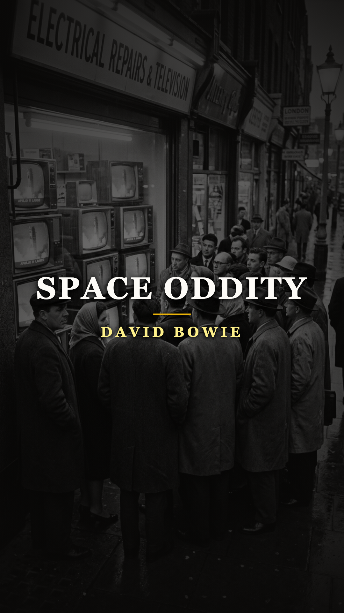
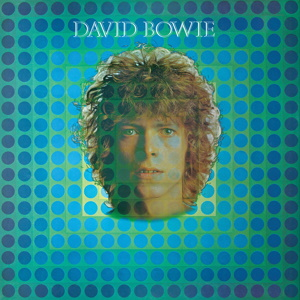
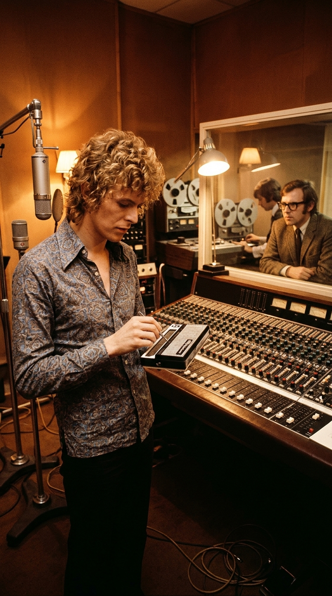
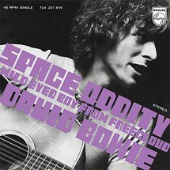

# La despedida de un astronauta que la televisión no se atrevió a emitir

**Por el equipo editorial de Acordes Ocultos**

---

> *«For here am I sitting in a tin can / Far above the world / Planet Earth is blue / And there’s nothing I can do...»*

El 20 de julio de 1969, seiscientos millones de personas contuvieron la respiración frente a las pantallas parpadeantes de sus televisores en blanco y negro. A cuatrocientos mil kilómetros de distancia, el módulo lunar *Eagle* descendía sobre la superficie polvorienta del Mar de la Tranquilidad. En Londres, la British Broadcasting Corporation (BBC) desplegaba una cobertura histórica sin precedentes, coordinando transmisiones vía satélite con Houston, paneles de científicos y una ambientación sonora diseñada para subrayar la mayor proeza técnica en la historia de la humanidad.

Entre la música seleccionada para acompañar las horas previas y los boletines especiales figuraba un sencillo recién salido de fábrica, publicado apenas nueve días antes: **«Space Oddity»**, de un joven desconocido de veintidós años llamado David Bowie. Para los programadores de la cadena, el título —un guiño descarado a la película *2001: Odisea del Espacio* de Stanley Kubrick— parecía el complemento moderno y juvenil perfecto para la fiebre cósmica que envolvía al planeta.

Sin embargo, a mitad de la retransmisión, los directores de la BBC escucharon con verdadera atención la letra. El estupor dio paso a un pánico frío e inmediato. La orden bajó como un rayo a las cabinas de control: **prohibir y retirar la canción del aire de forma fulminante**. No era un himno a la gloria del Apolo 11. Era la crónica fúnebre de un astronauta que perdía el control de su cápsula espacial y se resignaba a morir flotando en la nada absoluta.

---

## Acto I: La soledad de Beckenham y el fin del primer amor (1968-1969)

Para entender por qué David Bowie concibió una odisea espacial tan desprovista de triunfalismo patriótico, es necesario asomarse a la habitación que ocupaba en Southend Road, en el suburbio londinense de Beckenham, a finales de 1968. Bowie no era aún la estrella camaleónica que redefiniría la cultura popular de la década siguiente. Era un aspirante a cantautor arruinado, cuyo primer álbum homónimo de 1967 había sido un fracaso comercial estrepitoso, arrinconado por una industria que lo consideraba poco más que un imitador simpático de Anthony Newley.

A la asfixia económica se sumó una herida íntima devastadora. Durante el rodaje de una película promocional previa, Bowie se había enamorado perdidamente de la bailarina y actriz **Hermione Farthingale**. Durante casi un año compartieron departamento, proyectos teatrales y sueños artísticos en un trío folk llamado *Feathers*. Pero a comienzos de 1969, Hermione decidió poner fin a la relación y marcharse a Noruega para rodar el filme *Song of Norway*.

Bowie quedó destrozado. Sintió que el suelo se abría bajo sus pies. Años más tarde confesaría que pasó meses sumido en una depresión paralizante, caminando en círculos y sintiéndose completamente incomunicado del resto de la especie humana. Fue en ese estado de vulnerabilidad extrema cuando acudió a una sala de cine londinense a ver *2001: A Space Odyssey* de Stanley Kubrick. La cinta lo conmocionó. No por los efectos especiales de naves flotantes, sino por el sobrecogedor sentimiento de pequeñez, aislamiento y silencio que envolvía al doctor David Bowman vagando por el infinito.

De regreso en su habitación, armado únicamente con una guitarra acústica de doce cuerdas y el corazón roto, Bowie creó al **Major Tom** (el Mayor Tom). No se trataba de un héroe militar de la NASA ni de un heraldo del imperialismo tecnológico de la Guerra Fría; Major Tom era el propio David: un hombre suspendido en una frágil «lata de hojalata» (*«tin can»*), contemplando la belleza azul de la Tierra pero incapaz de regresar a ella, susurrando su último mensaje al único vínculo que alguna vez le importó:

> *«Tell my wife I love her very much... she knows.»*

---

## Acto II: El rechazo en Trident y el juguete de Marc Bolan (Junio de 1969)

En mayo de 1969, Bowie grabó una precaria maqueta de la canción junto a su amigo John Cambridge. Cuando se la presentó a su productor de confianza y cómplice creativo, **Tony Visconti**, la reacción fue demoledora. Visconti, quien consideraba a Bowie un talento poético genuino, detestó la composición de inmediato: la juzgó como un burdo intento de oportunismo comercial diseñado para exprimir el dinero de la inminente misión lunar estadounidense. Visconti se negó rotundamente a producir la sesión.

Ante la negativa de su mano derecha, la discográfica Mercury Records asignó el proyecto a un joven ingeniero y productor de los estudios Trident: **Gus Dudgeon**. A diferencia de Visconti, Dudgeon percibió de inmediato la desoladora belleza que latía bajo los acordes acústicos de Bowie y diseñó una producción monumental.

El 20 de junio de 1969, en el legendario estudio de Saint Anne's Court en el Soho londinense, se obró el milagro sonoro. Dudgeon convocó al arreglista orquestal Paul Buckmaster para tejer un manto de cuerdas cinematográficas que simularan la ignición de los motores y el vértigo del despegue. Pero el elemento más icónico de la pista no provino de una orquesta sinfónica ni de un costoso sintetizador de laboratorio.

Días antes, su amigo **Marc Bolan** (líder de T. Rex) le había prestado a Bowie un curioso aparato que acababa de salir al mercado: un **Stylophone**, un diminuto órgano de bolsillo infantil con teclado de lámina metálica que se tocaba mediante un puntero con cable. Aquel zumbido agudo, titubeante y casi cómico se convirtió en el latido nervioso de la nave espacial, encarnando con escalofriante precisión la precariedad de la tecnología humana enfrentada al vacío sideral.

---

## Acto III: Nueve días antes de la Luna y la censura de la BBC (Julio de 1969)

El sencillo de «Space Oddity» se prensó a velocidad de vértigo y llegó a las tiendas británicas el **11 de julio de 1969**, exactamente nueve días antes de que el Saturno V impulsara al Apolo 11 fuera de la atmósfera terrestre. La campaña de marketing de Philips/Mercury apostaba a que el interés por la Luna arrastraría al disco a los primeros puestos de venta.

La BBC, preparando su ambiciosa cobertura televisiva de 27 horas seguidas conducida por James Burke y Cliff Michelmore, incluyó la canción en sus cabinas de transmisión. Durante las primeras emisiones previas al despegue, los acordes de guitarra acústica y la cuenta regresiva (*«Ten, nine, eight, seven...»*) resonaron en las salas de estar de millones de británicos.

Pero a medida que el viaje avanzaba hacia su momento más crítico, alguien en la cúpula directiva de la cadena prestó atención al desenlace de la historia:

> *«Ground Control to Major Tom / Your circuit’s dead, there’s something wrong / Can you hear me, Major Tom?...»*

El astronauta de Bowie no clavaba la bandera británica ni estadounidense en el cráter de un mundo nuevo; su sistema vital colapsaba, perdía la señal de radio y se quedaba a la deriva, condenado a una muerte lenta y solitaria entre las estrellas.

El terror de los directores era plenamente fundado. La misión Apolo 11 era una ruleta rusa tecnológica: en 1967, los tres astronautas del Apolo 1 experimentaron una tragedia fatal calcinados en la plataforma de lanzamiento; cualquier fallo en los propulsores del módulo lunar dejaría a Neil Armstrong y Buzz Aldrin varados para siempre en la superficie lunar sin posibilidad de rescate, asfixiándose en directo ante los ojos de la humanidad. Si aquello ocurría mientras la BBC ponía de fondo la canción de Bowie, la cadena parecería culpable de una profecía siniestra y de un escarnio imperdonable.

La orden fue irrevocable: **«Space Oddity» fue archivada y retirada de todas las listas de reproducción de radio y televisión de la BBC**. Ningún oyente británico volvería a escuchar la voz de Major Tom mientras los astronautas estuvieran en el espacio.

---

## Acto IV: El regreso a la Tierra y el mito del Mayor Tom

El 24 de julio de 1969, la cápsula *Columbia* del Apolo 11 amerizó con éxito en las aguas del océano Pacífico, recuperada por el portaaviones USS *Hornet*. Los tres astronautas estaban vivos y a salvo. La pesadilla de una tragedia televisada se había disipado.

Con el alivio colectivo, el veto de la BBC se levantó de inmediato. La emisora volvió a programar «Space Oddity», pero esta vez el impacto fue un tsunami. El público, fascinado por la inmensidad del espacio que acababa de atestiguar, encontró en la composición de Bowie una dimensión existencial que ninguna crónica periodística podía ofrecer. En septiembre de 1969, el sencillo ingresó en el Top 10 británico, alcanzando el número cinco y otorgándole a David Bowie el primer gran éxito discográfico de su vida.

Seis años después, en 1975, cuando el tema fue reeditado como sencillo en el Reino Unido, trepó finalmente hasta el **número uno absoluto**, consagrando a Major Tom como una de las figuras más mitológicas del imaginario popular del siglo XX. El propio Bowie jamás pudo desprenderse del todo de su astronauta: lo resucitaría en 1980 en *«Ashes to Ashes»* (revelando con amarga crudeza que el heroico viajero se había convertido en un adicto perdido en el espacio) y volvería a rozar su sombra en 1995 con *«Hallo Spaceboy»* y en 2015 en el video testamentario de *«Blackstar»*, donde un esqueleto con traje espacial yacía sobre el suelo de un planeta lejano.

---

## Epílogo: La herida humana detrás de la odisea

Medio siglo después de aquel julio febril de 1969, *«Space Oddity»* sigue siendo celebrada como una de las cumbres indiscutibles de la música contemporánea. Sin embargo, su triunfo imperecedero no radica en la épica de los cohetes ni en la fascinación por las órbitas lunares.

El verdadero secreto que la BBC no supo descifrar a tiempo fue que David Bowie nunca intentó cantar sobre la conquista del cosmos. Cantó sobre el misterio irreductible del alma humana: la certeza de que un hombre puede estar rodeado de seiscientos millones de voces y, aun así, encontrarse a cientos de miles de kilómetros de distancia de quien ama; la paradoja de que a veces se necesita mirar la Tierra desde la más absoluta soledad para comprender, en un susurro, que lo único que de verdad importaba era decir adiós antes de que se apague el último circuito.

---

### 📚 Fuentes y Archivo Documental

* **Bowie, David.** Entrevistas y declaraciones autobiográficas compiladas en *Bowie on Bowie: Interviews and Encounters with David Bowie* (Sean Egan, Chicago Review Press, 2015).
* **Pegoraro, Nicholas.** *The Complete David Bowie* (Titan Books, edición ampliada 2016). Análisis musicológico y cronología de grabación en Trident Studios.
* **Dudgeon, Gus.** Testimonios de producción sobre las sesiones de grabación del Stylophone y arreglos de Paul Buckmaster (Sound on Sound Archives, 1999).
* **BBC Written Archives Centre (Caversham).** Registros de programación y directrices de emisión de la BBC durante la cobertura del Apolo 11 (julio de 1969).
* **Farthingale, Hermione.** Memorias y testimonios documentales en *David Bowie: Finding Fame* (BBC Two, documental dirigido por Francis Whately, 2019).
* **Trynka, Paul.** *Starman: David Bowie, The Definitive Biography* (Sphere, 2011). Capítulos dedicados a la época de Beckenham y el lanzamiento de Philips Records.