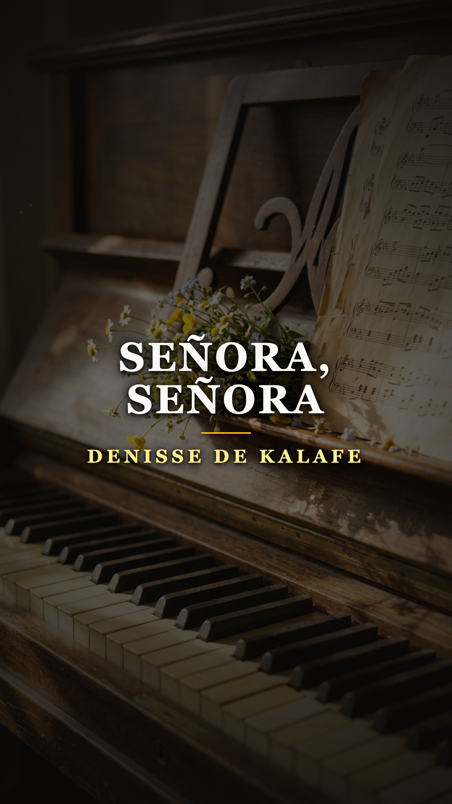
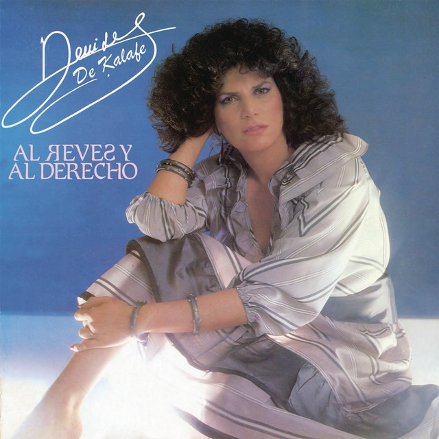

# La llamada a Brasil que inspiró el himno de las madres en una bolsa de pan

**Por el equipo editorial de Acordes Ocultos**

---

> *«A ti que me diste tu vida, tu amor y tu espacio / a ti que cargaste en tu vientre dolor y cansancio...»*

Cada diez de mayo, en escuelas, hogares, plazas y estaciones de radio de toda América Latina, basta escuchar el primer arpegio descendente de piano para que se instale un silencio reverencial. Pocas melodías en el cancionero hispanoamericano poseen un poder evocativo tan instantáneo como *«Señora, señora»*. 

Sin embargo, detrás de la liturgia anual que une a millones de familias, la historia de su concepción no pertenece al laboratorio de una discográfica ni a una estrategia de temporada. Nació en 1980, en la intimidad de un departamento en la Ciudad de México, fruto de una punzada lacerante de nostalgia migratoria, una llamada a miles de kilómetros y una hoja improvisada de papel de estraza tomada de una panadería.

---

## Acto I: La soledad de la distancia (México, 1980)

Hacía casi una década que Denisse de Kalafe había dejado atrás su natal Ponta Grossa, en el estado brasileño de Paraná, para abrirse camino como cantautora en México. Con una voz poderosa, versatilidad para fusionar la bossa nova con la balada y una personalidad arrolladora, Denisse había logrado notoriedad continental tras ganar el Festival OTI Nacional en 1978 y obtener el segundo lugar en la edición internacional en Santiago de Chile con *«El amor... cosa tan rara»*.

Pero el éxito artístico no inmuniza contra la soledad. Vivir como creadora independiente en una metrópoli ajena implicaba noches de profunda introspección. En una tarde de 1980, tras mantener una larga conversación telefónica con su madre, doña Linda de Kalafe, una ola de añoranza invadió a la cantante. La distancia física con Brasil se tornó insoportable. Colgó el auricular con la garganta anudada por la *morriña*, ese sentimiento intraducible que abraza el dolor de lo que se ama y no se puede tocar.

Impulsada por una necesidad casi física de desahogo, caminó directamente hacia el piano vertical de su sala.

---

## Acto II: El dictado en la bolsa de pan

Al sentarse frente al teclado, las manos de Denisse comenzaron a pulsar acordes solemnes en una cadencia suave y envolvente. De inmediato, las palabras empezaron a encadenarse con una fluidez que la desbordaba. Desesperada por no perder la inspiración, buscó a su alrededor algún cuaderno de pautas o libreta de notas, pero no había nada a mano. 

Fue entonces cuando localizó una bolsa vacía de papel de estraza —el clásico empaque marrón de pan de panadería— y un lápiz común. Regresó al piano y, mientras las melodías fluían, comenzó a trazar versos sobre el papel rugoso:

> *«A ti, guerrera invencible / a ti, luchadora incansable / a ti, mi amiga constante, de todas las horas...»*

La propia Denisse relató en testimonios posteriores que aquella experiencia tuvo algo de providencial y místico. Sentía como si alguien estuviera de pie detrás de ella, susurrándole al oído cada una de las frases exactas para rendir tributo a la figura materna. No hubo tachaduras ni correcciones metódicas: era una plegaria de gratitud filial brotada de un tirón, desde la primera línea hasta el remate que consagraría la canción: *«Señora, señora, señora»*.

---

## Acto III: El contrato de los dos mil pesos y el despegue

La obra estaba terminada, pero la realidad económica no concedía treguas. Aquel mismo año, apremiada por cubrir el alquiler de su departamento, Denisse acudió a las oficinas de una editora musical (Pham / Fam). Con la urgencia de quien debe liquidar una deuda doméstica inmediata, acordó compartir los derechos de la pieza a cambio de una suma modesta que la propia artista ha situado entre dos mil y dos mil doscientos cincuenta pesos de la época.

Aquel trámite administrativo, sellado con premura, marcaría el destino legal de la obra durante las décadas venideras. 

En 1981, la canción fue grabada con arreglos orquestales e incluida en su producción discográfica *«Amar es...»*. Cuando el disco comenzó a girar en las estaciones de radio, el impacto fue inmediato y transversal. La pieza no solo conmovió a las madres de México, sino que se arraigó con una fuerza identitaria asombrosa en toda Centroamérica, Colombia y la comunidad hispana en Estados Unidos. Se convirtió en el himno escolar por antonomasia de cada diez de mayo, aprendido por millones de niños que año tras año ensayan sus compases para cantársela a sus madres.

---

## Acto IV: La casa en Holbox y la causa solidaria

A lo largo de los años, *«Señora, señora»* generó regalías considerables que, lejos de un despojo absoluto, le permitieron a Denisse adquirir su casa en la idílica isla de Holbox, en el Caribe mexicano. Allí, la artista encontró un refugio natural donde ha alzado la voz en reiteradas ocasiones por la preservación ecológica y la defensa comunitaria del ecosistema insular, sin renunciar jamás a la música ni a presentaciones en directo.

No obstante, la convivencia con un himno de tal magnitud entrañó sus propias complejidades. En entrevistas retrospectivas, Denisse admitió haber sentido en ocasiones la pesadumbre de que un solo título eclipsara el resto de su prolífico catálogo autoral. Pero con el paso del tiempo, la madurez transformó esa relación en un compromiso de generosidad.

En fechas recientes, la cantautora ha manifestado públicamente su propósito de batallar legalmente para recuperar la totalidad de los derechos editoriales compartidos de la canción. Su objetivo declarado no es acumular riqueza personal, sino canalizar el cien por ciento de las regalías futuras hacia fundaciones dedicadas a la detección y tratamiento del cáncer de mama en mujeres de escasos recursos. Un círculo poético que devuelve a la salud de las madres lo que de una madre nació.

---

## Epílogo: El valor de lo verdadero

En una industria musical habituada a la fabricación de éxitos efímeros mediante algoritmos y presupuestos millonarios, *«Señora, señora»* pervive como un testimonio de autenticidad irrepetible. 

Aquella noche de 1980 no había productores de renombre ni estrategias de mercadeo. Solo había una hija migrante extrañando a su madre, un piano vertical y una bolsa de papel de pan. Porque cuando las canciones nacen de una verdad humana inapelable, no necesitan mármol ni pergaminos para grabarse en la memoria viva de todo un continente.

---

### 💬 Comunidad Acordes Ocultos

¿En qué festival escolar o momento íntimo de tu infancia recuerdas haber escuchado por primera vez *«Señora, señora»*? ¿Qué sentiste al cantársela a tu madre? Te leemos en los comentarios.

---

### 📚 Fuentes y Archivo Documental

1. **El Universal Espectáculos**: *"Denisse de Kalafe revela cómo escribió Señora, Señora y el tributo a su madre Linda de Kalafe"*, archivo hemerográfico y cobertura especial de mayo.
2. **Radio Fórmula**: *"La historia detrás del 'Señora, Señora' de Denisse de Kalafe: la morriña, el piano y la bolsa de papel"*, entrevista testimonial con la autora (2019).
3. **Las Estrellas / Televisa Espectáculos**: *"Denisse de Kalafe confiesa cómo y dónde escribió hace más de 40 años el tema Señora, Señora"*, declaraciones de primera mano sobre el proceso compositivo.
4. **TV Azteca (Ventaneando)**: Entrevista con Paty Chapoy y Denisse de Kalafe sobre la titularidad compartida con la editora Pham, el pago del alquiler y su vida en Holbox (Emisión de mayo 2020).
5. **La Jornada Maya**: Cobertura sobre las iniciativas ambientales y pronunciamientos de Denisse de Kalafe en la Isla de Holbox, Quintana Roo.
6. **Catálogo Fonográfico Discos Melody / Musart**: Ficha técnica del álbum *«Amar es...»* (1981), registro de autoría de Denisse de Kalafe.
