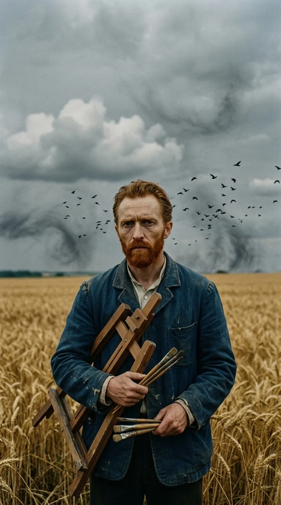
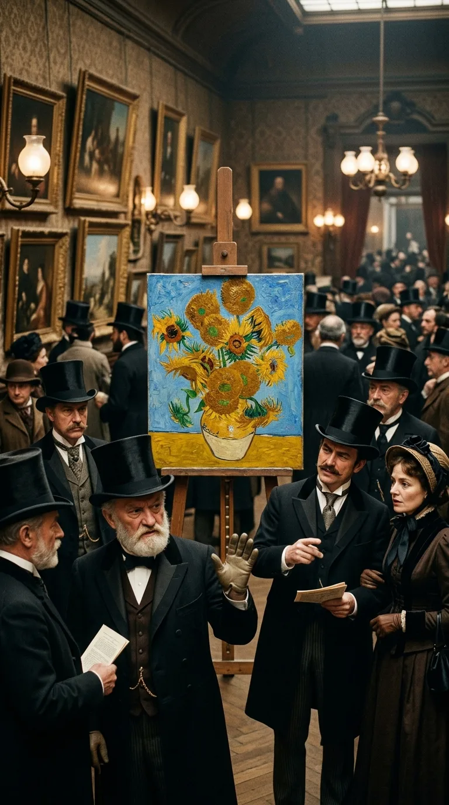
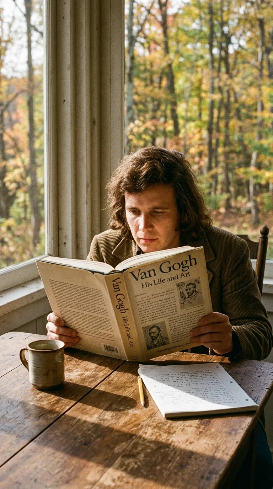
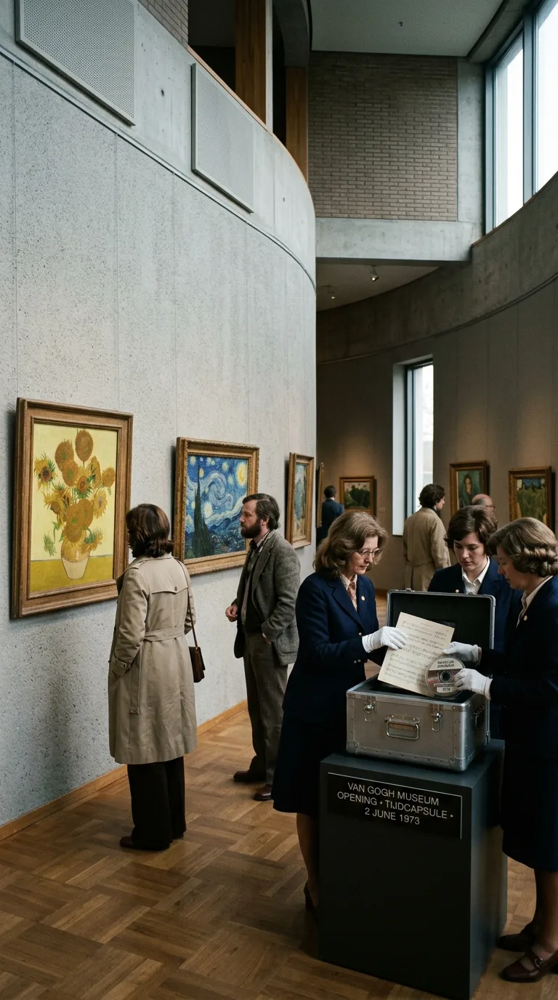
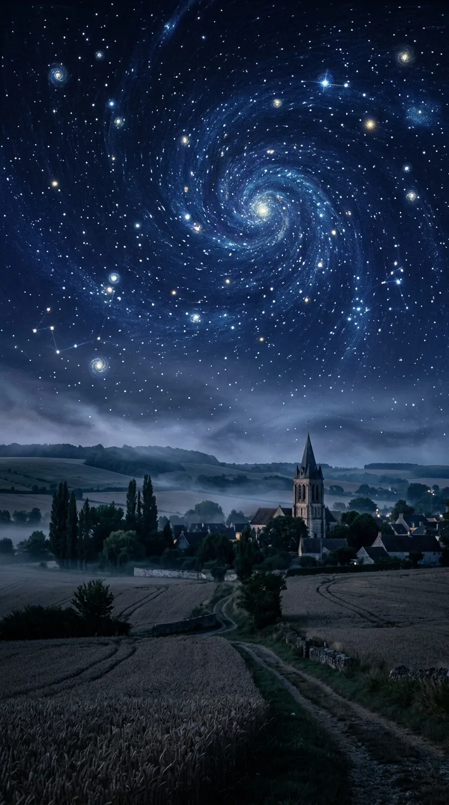

# La disculpa que tardó 80 años en llegar

### Por Acordes Ocultos

En los últimos días de julio de 1890, entre los campos de trigo ondulados de Auvers-sur-Oise, Vincent van Gogh caminó hacia la penumbra con una herida que apagó lentamente sus treinta y siete años de tormento. En su lecho final, mientras su hermano menor Theo sostenía su mano entre lágrimas desoladas, Vincent susurró una frase que quedaría suspendida en el aire como una sentencia amarga: *«La tristeza durará para siempre»*. Murió sumido en la miseria más absoluta, repudiado por los salones de París y convencido de que su existencia sobre la tierra no había sido más que un fracaso estéril. Solo había logrado vender un único cuadro formal en toda su vida: *El viñedo rojo*, adquirido por apenas 400 francos belgas. 

Ochenta años después, en el otoño de 1970, un joven músico estadounidense de veinticinco años llamado Don McLean se sentó en la galería de una pequeña casa de madera en los montes Berkshires, Massachusetts. McLean estaba completamente arruinado, sobreviviendo con presentaciones escolares mal pagadas y cargando con el duelo silencioso de haber perdido a su padre siendo apenas un adolescente. Sobre la mesa descansaba una biografía prestada sobre Vincent van Gogh, basada en las cartas íntimas que el pintor intercambió con su hermano Theo. Al devorar aquellas páginas, McLean no encontró a un loco desquiciado como la cultura popular solía retratarlo. Encontró a un hombre dotado de una ternura insoportable, un alma herida que intentó salvar al mundo derramando soles de cromo y cielos de cobalto sobre lienzos que nadie quiso mirar.

Con una guitarra acústica destartalada y un sobre usado donde garabateó las primeras líneas, Don McLean compuso una plegaria que no pretendía ser un éxito comercial, sino un desagravio histórico: *«Vincent (Starry, Starry Night)»*. Aquella balada se convertiría en la disculpa que la humanidad tardó casi un siglo en ofrecer a uno de sus mayores genios.

---

### Acto I: El dolor incomprendido y la promesa de Theo

La correspondencia entre Vincent y Theo van Gogh constituye uno de los monumentos epistolares más conmovedores de la historia del arte. A través de más de seiscientas cartas, Vincent vertió sus inseguridades, sus colapsos nerviosos y, por encima de todo, su devoción inquebrantable por capturar la luz espiritual de las cosas sencillas: la mirada cansada de un campesino que come patatas, el azul eléctrico de una noche en Arlés o la textura áspera de unos girasoles marchitos.

> *«Pongo mi corazón y mi alma en mi trabajo, y he perdido mi mente en el proceso... Sueño con pintar y luego pinto mi sueño».*  
> — Vincent van Gogh, carta a Theo (1888).

Para los habitantes de Arlés, Vincent era un extranjero excéntrico y peligroso; firmaron incluso peticiones públicas exigiendo su expulsión y confinamiento tras el doloroso episodio en el que se seccionó parte de la oreja izquierda. La soledad no era una pose romántica, sino una condena cotidiana. Theo, quien trabajaba como marchante de arte en la prestigiosa firma Boussod & Valadon de París, intentó con todas sus fuerzas exhibir las obras de su hermano en una época dominada por el academicismo tradicional. Sin embargo, el público y los coleccionistas se burlaban de los trazos gruesos y los colores ardientes que desafiaban la realidad fotográfica.

Cuando Vincent falleció en la modesta habitación de la posada Ravoux el 29 de julio de 1890, el golpe fue letal para Theo. Incapaz de superar la pérdida y debilitado por su propia enfermedad, el hermano fiel murió apenas seis meses después, en enero de 1891. Antes de partir, Theo confió a su esposa, Jo van Gogh-Bonger, una misión sagrada: preservar aquellos lienzos y cartas olvidados en un desván, porque estaba seguro de que el tiempo terminaría haciendo justicia.

---

### Acto II: El despertar en los montes Berkshires (1970)

Para Don McLean, el año 1970 no era una época de ensueño. Había lanzado un primer disco, *Tapestry*, que pasó prácticamente inadvertido, y para subsistir aceptó un empleo como trovador itinerante en el sistema escolar público de Berkshire, Massachusetts. Viajaba de escuela en escuela con su guitarra al hombro, cantando canciones folclóricas en gimnasios y aulas de clase para alumnos que rara vez le prestaban atención.

Una mañana de otoño, mientras hojeaba un libro sobre Van Gogh en la casa donde se alojaba, McLean sintió una descarga íntima al leer los testimonios de las cartas. Recordó cómo su propia familia y el entorno social a menudo juzgaban el dolor ajeno como un defecto o una debilidad de carácter. Como explicaría años después:

> *«Estaba leyendo el libro y de pronto me di cuenta de que tenía que escribir una canción sobre Vincent. La gente creía que estaba loco, pero no estaba loco: tenía una enfermedad y sufría enormemente por el rechazo. Sabía cómo era sentirse ignorado y aislado. Cogí una copia de 'La noche estrellada', miré las espirales de estrellas y las primeras palabras simplemente brotaron: Starry, starry night...»*  
> — Don McLean.

En apenas una hora, apoyado contra una pared de madera y con el eco de los acordes de su vieja guitarra acústica, McLean estructuró la canción entera. En cada estrofa intercaló citas visuales directas de las obras cumbre de Vincent: *«Flaming flowers that brightly blaze / Swirling clouds in violet haze»* haciendo alusión a los lirios y girasoles; *«Shadows on the land / Sketch the trees and the daffodils»* evocando sus dibujos al carboncillo; y el sobrecogedor estribillo que resumía el dilema existencial de la genialidad:

> *Now I understand what you tried to say to me  
> And how you suffered for your sanity  
> And how you tried to set them free  
> They would not listen, they did not know how  
> Perhaps they'll listen now.*  
>  
> *(Ahora comprendo lo que intentaste decirme,  
> y cómo sufriste por tu cordura,  
> y cómo intentaste liberarlos.  
> No quisieron escuchar, no sabían cómo...  
> Quizás ahora escuchen).*

---

### Acto III: Del silencio de Abbey Road al Museo Van Gogh en Ámsterdam

McLean grabó la canción en mayo de 1971 en los estudios Record Plant de Nueva York, bajo la producción de Ed Freeman. A diferencia de las complejas orquestaciones de la época, McLean exigió que *Vincent* se mantuviera casi desnuda: solo su voz cálida, una guitarra acústica arpegiada con sutileza cristalina y un delicado manto de cuerdas que entra como una brisa nocturna en los momentos de mayor conmoción.

La canción fue incluida en el álbum *American Pie*, publicado en octubre de 1971. Aunque el tema homónimo se convirtió en un torbellino cultural de proporciones colosales, fue *Vincent* la pista que caló hondo en la fibra emocional de millones de oyentes en todo el mundo. En 1972, la canción alcanzó el número 1 en el Reino Unido y se instaló en los primeros lugares de las listas globales.

Pero el verdadero milagro de la canción no se midió en ventas ni en discos de oro. Tuvo lugar en los Países Bajos.

En 1973 se inauguró oficialmente en Ámsterdam el Museo Van Gogh, reuniendo la colección monumental que Jo van Gogh-Bonger y su hijo Vincent Willem habían protegido durante décadas. Durante años, la dirección del museo reprodujo la canción de Don McLean por el sistema de altavoces de la galería principal y en las salas de descanso, considerando que ninguna explicación académica explicaba con tanta compasión y exactitud el espíritu del pintor como aquella melodía de tres minutos. Décadas más tarde, cuando el museo decidió enterrar una cápsula del tiempo conmemorativa para el futuro de la institución, colocaron dentro las partituras y la grabación original de la canción de Don McLean, junto a una copia de los pinceles del propio Vincent.

---

### Epílogo: El arte como refugio contra el olvido

La tragedia de Vincent van Gogh nos recuerda la crueldad de un mundo que a menudo llega demasiado tarde para salvar a quienes más belleza le entregan. Vincent no pintaba para impresionar a los salones burgueses ni para acumular fortunas; pintaba porque el color era la única trinchera donde su espíritu podía respirar sin ahogarse en la angustia.

Don McLean entendió que la música tiene el poder sagrado de reparar el pasado. Su balada no pudo devolverle la vida a Vincent, ni ahorrarle a Theo la desolación de su muerte prematura. Pero cada vez que esos acordes acústicos suenan y el cielo estrellado vuelve a iluminarse en la memoria colectiva, la humanidad salda una pequeña parte de su deuda con aquel hombre de barba rojiza que nos enseñó que incluso en la noche más oscura, las estrellas siempre giran llenas de luz.

---

### 📚 Fuentes y Archivo Documental

* **Van Gogh, Vincent & Van Gogh, Theo**: *The Letters of Vincent van Gogh*. Edición integral anotada por Ronald de Leeuw. Penguin Classics, 1997.
* **Naifeh, Steven & White Smith, Gregory**: *Van Gogh: The Life*. Random House, Nueva York, 2011.
* **McLean, Don**: Entrevistas históricas para la BBC (*Songwriters Circle*, 1972) y testimonios sobre la composición de *American Pie* y *Vincent* (Documental *Don McLean: The Day the Music Died*, Paramount+, 2022).
* **Van Gogh Museum Amsterdam**: Archivos históricos de inauguración (1973) y registro hemerográfico sobre la cápsula del tiempo y la recepción institucional de *Vincent*.
* **Freeman, Ed**: Notas de producción y sesiones de grabación en Record Plant Studios (Nueva York, mayo de 1971).
