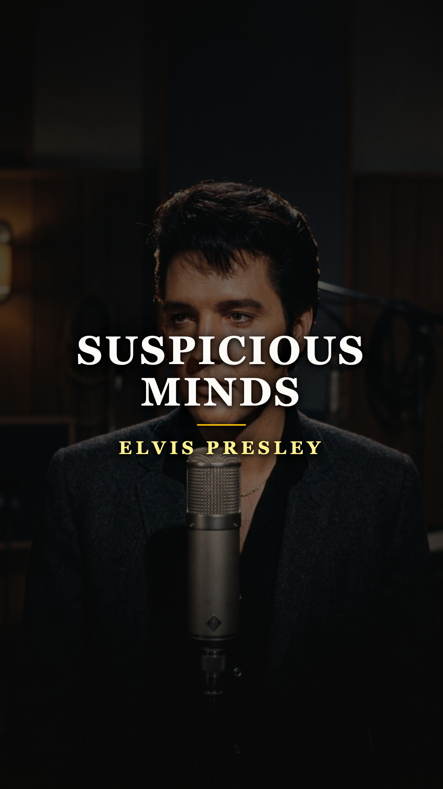
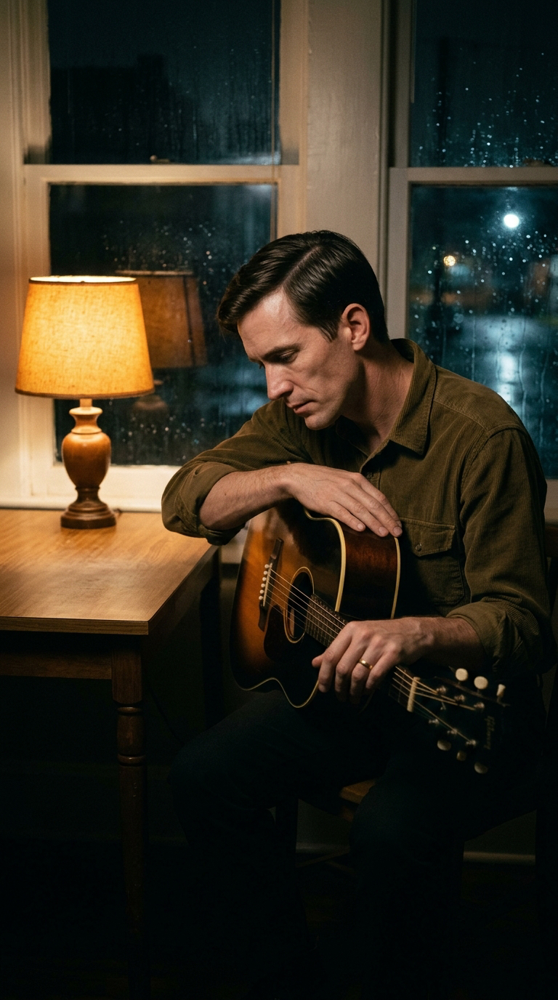
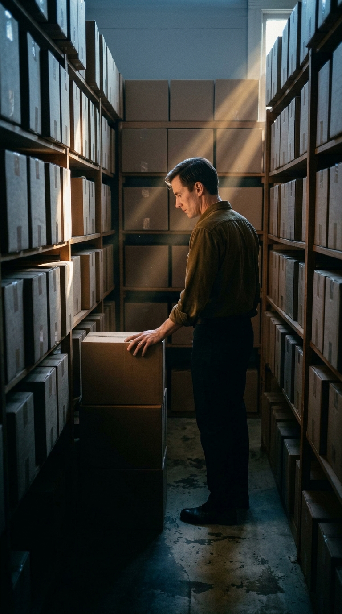
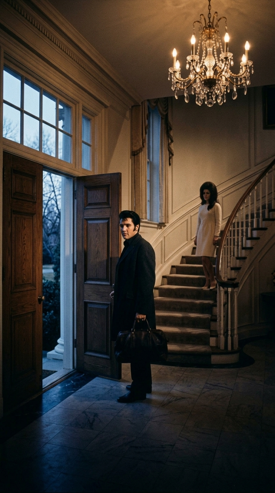
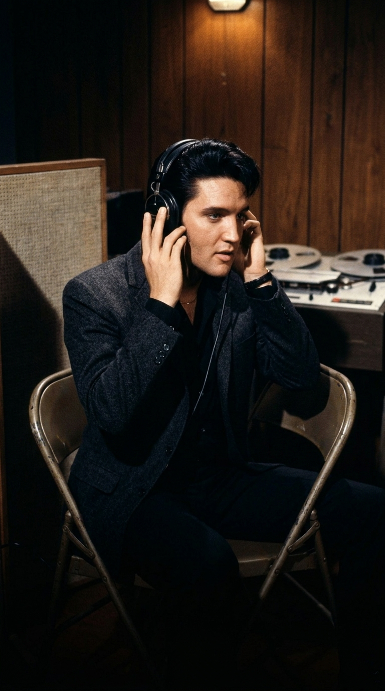
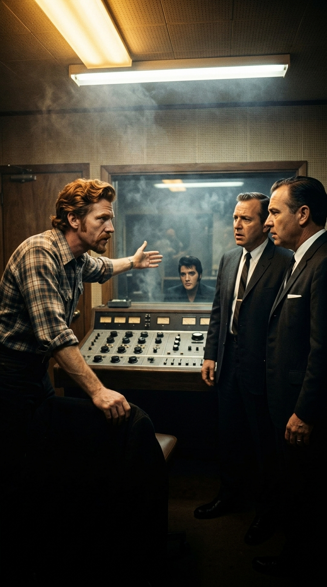
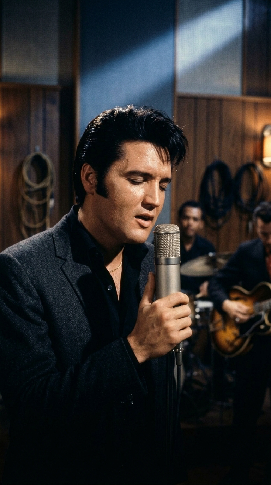
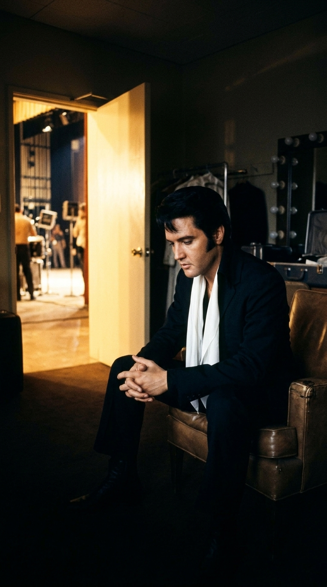

# A las cuatro de la mañana en Memphis: la rebelión editorial y la profecía rota detrás de «Suspicious Minds»

Hay canciones que parecen escritas bajo los reflectores de un casino repleto y otras que suenan, incluso medio siglo después, a una conversación desesperada en el pasillo de una casa cuando el reloj ya pasó de las cuatro de la mañana. Basta que entren ese rasgueo hipnótico de guitarra y la voz de **Elvis Presley** —*«We're caught in a trap, I can't walk out / because I love you too much, baby»*— para sentir que allí nadie estaba interpretando un papel. Quien cantaba en esa penumbra era un hombre de treinta y cuatro años jugándose al mismo tiempo su dignidad como músico y el techo de su propio hogar.

Lo más sobrecogedor de ***«Suspicious Minds»*** es que estuvo a punto de no existir dos veces: primero cuando naufragó en el olvido como la confesión privada de un compositor desconocido, y meses más tarde cuando la maquinaria financiera que rodeaba a Elvis intentó bloquearla en pleno estudio por un porcentaje de dinero. Que aquella madrugada de enero de 1969 sobreviviera para convertirse en el último número uno en vida del Rey del Rock —y en el presagio exacto de su divorcio— es una de las páginas más humanas de la música popular.

---

### Acto I: Houston y Memphis, 1968: tres corazones encerrados en la misma habitación

Antes de pertenecer a Elvis, la herida tenía otro nombre: **Francis Rodney Zambon**, un joven músico nacido en Houston que adoptó el nombre artístico de **Mark James** cuando se mudó a Memphis buscando abrirse camino como compositor de planta para el productor **Chips Moman**.

A finales de **1968**, James tenía veintisiete años y cargaba en silencio con una contradicción sentimental que le quitaba el sueño. Estaba casado con su primera esposa, **Shirley Yates**, a quien apreciaba sinceramente, pero jamás había logrado apagar el sentimiento que arrastraba desde la adolescencia por **Karen Taylor**, su novia de juventud en Houston, quien a su vez también estaba casada allá en Texas.

Una noche en su apartamento de Memphis, abrumado por la culpa y la sensación de herir a quienes quería hiciera lo que hiciera, le vinieron a la cabeza unos versos desnudos sobre estar atrapados en una trampa de la que ninguno de los tres podía salir caminando (*«all three of us were caught in this trap that we couldn't walk out of»*, recordaría décadas más tarde). No era la postal cínica de un engaño pasajero, sino la angustia real de comprender que, cuando la sospecha se instala entre dos personas que aún se quieren, cada palabra de consuelo parece una mentira más.

Convencido por Chips Moman de que nadie cantaría esa urgencia mejor que quien la estaba viviendo, el propio Mark James grabó la versión original de *«Suspicious Minds»* en el **American Sound Studio** de Memphis en 1968, publicada por el sello **Scepter Records**. Pero Scepter atravesaba estrecheces económicas y apenas destinó recursos para promover el sencillo en las radios. El disco pasó inadvertido fuera de unos pocos diales locales y las cajas quedaron apiladas en silencio, esperando una voz que tuviera el tamaño de aquella tormenta.

---

### Acto II: Enero de 1969: el regreso de un rey cansado a su propia ciudad

Mientras aquella cinta dormía en un estante de la calle Thomas, a pocos kilómetros al sur —tras las rejas de hierro forjado de **Graceland**— **Elvis Presley** atravesaba una encrucijada vital silenciosa. A comienzos de enero de 1969 acababa de cumplir treinta y cuatro años. Aunque el especial televisivo de diciembre de 1968 en la NBC le había devuelto el pulso eléctrico frente a las cámaras, Elvis arrastraba casi **siete años sin alcanzar el número uno** en las listas estadounidenses —desde *«Good Luck Charm»* en la primavera de 1962—, desgastado por una cadena interminable de películas ligeras de Hollywood cuyas canciones él mismo detestaba cantar.

Pero la grieta más honda no estaba en los ránkings discográficos, sino puertas adentro de su matrimonio con **Priscilla Beaulieu**. Casados en mayo de 1967 y padres recientes de la pequeña Lisa Marie, la vida conyugal de ambos comenzaba a resquebrajarse entre largas ausencias de rodaje, el cerco asfixiante del séquito permanente de Elvis, episodios de infidelidad y una desconfianza mutua que volvía tensas las despedidas.

Decidido a no volver a pisar los estudios corporativos de Hollywood donde se sentía domesticado, Elvis aceptó la sugerencia de su amigo Marty Lacker y cruzó su propia ciudad para encerrarse en el **American Sound Studio** (`827 Thomas Street`), un local austero de barrio con paredes revestidas de madera y techo bajo dirigido por **Chips Moman** y respaldado por una banda extraordinaria conocida como ***The Memphis Boys*** —con músicos como el guitarrista **Reggie Young** y el baterista **Gene Chrisman**—.

En la madrugada del **jueves 23 de enero de 1969**, cuando el cansancio ya pesaba sobre el estudio cerca de las **cuatro de la mañana**, Moman y Mark James pusieron frente a Elvis la cinta olvidada de *«Suspicious Minds»*. Bastaron unos compases en los auriculares para que Elvis quedara inmóvil. Aquellos versos sobre lágrimas reales que el otro ya no logra creer, sobre secar el llanto de unos ojos heridos y suplicar que algo hermoso no termine de morir por culpa de la sospecha, parecían copiados palabra por palabra de las habitaciones de Graceland. Elvis pidió grabarla esa misma noche.

---

### Acto III: El ultimátum frente a los hombres del Coronel y ocho tomas hasta el amanecer

Antes de que la cinta pudiera girar en serio, estalló en la sala de control el conflicto que pudo haber borrado *«Suspicious Minds»* de la historia. Durante más de una década, la oficina del **Coronel Tom Parker** y la editorial **Hill & Range** —representada en aquellas sesiones por enviados como **Freddy Bienstock** y el asistente de Parker, **Tom Diskin**— habían impuesto una regla no escrita a todo compositor que aspirara a ser cantado por Elvis: ceder entre la mitad y la totalidad de los derechos editoriales de la canción como peaje obligatorio.

Cuando los emisarios reclamaron ese porcentaje sobre el catálogo de Moman y James en pleno estudio, se toparon con el hombre equivocado. **Chips Moman**, curtido desde abajo en los estudios independientes del sur, se plantó detrás de la consola y lanzó un ultimátum tajante: antes que regalar la mitad del trabajo de su compositor, prefería detener la grabación en ese instante, devolver el anticipo económico a **RCA Victor** y pedir a la gente del Coronel que abandonara su edificio.

En cualquier otro año de los sesenta, aquella rebelión habría significado el fin inmediato de la sesión. Pero esa madrugada ocurrió algo distinto: tanto el productor de RCA **Felton Jarvis** como el propio **Elvis** sabían que en ese cuarto estaba ocurriendo un milagro artístico que no podía sacrificarse por avaricia contable. Con el respaldo silencioso pero firme de Elvis, los emisarios retrocedieron y la puerta del estudio volvió a cerrarse para dejar paso únicamente a la música.

Entre las **4:00 y las 7:00 de la mañana del 23 de enero de 1969**, mientras Mark James prefería mantenerse discreto al fondo para no intimidar a su ídolo, Elvis se entregó en cuerpo entero a lo largo de **ocho tomas**. Cantó de pie, rodeado por los músicos en vivo, pasando del ruego casi susurrado del puente intermedio (*«Oh, let our love survive / I'll dry the tears from your eyes»*) al estallido desesperado en que la batería de Gene Chrisman volvía a precipitar el compás como una puerta que se cierra de golpe. Cuando salió del estudio bajo la luz fría de las siete de la mañana de Memphis, todos los presentes sabían que el viejo Elvis de las comedias playeras había quedado atrás.

---

### Epílogo: La última cima y la profecía que el éxito no pudo detener

Publicada como sencillo el **26 de agosto de 1969**, tras su regreso triunfal a los escenarios en vivo en el Hotel International de Las Vegas, *«Suspicious Minds»* escaló sin freno hasta coronar el **número uno del Billboard Hot 100 el 1 de noviembre de 1969**. Fue el **decimoctavo número uno** de Elvis Presley en Estados Unidos y, sin que nadie pudiera sospecharlo aquella semana de celebración, **el último que alcanzaría en vida** antes de su fallecimiento en agosto de 1977.

El destino reservó a sus dos protagonistas giros opuestos pero igualmente reveladores. **Mark James**, tras divorciarse de su primera esposa, terminó reencontrándose y casándose en 1971 con aquella novia de juventud de Houston —Karen Taylor— por quien había escrito la canción en una noche de insomnio, compartiendo el resto de su vida hasta su muerte en junio de 2024.

Para **Elvis**, en cambio, la canción terminó cumpliéndose verso a verso como una profecía íntima. Ni los estadios llenos, ni los trajes resplandecientes, ni el regreso al trono mundial pudieron reparar las grietas de la distancia y la desconfianza: en febrero de 1972 **Priscilla** se marchó definitivamente y el divorcio quedó sellado en octubre de 1973. Quedó, sin embargo, aquella grabación tomada antes del amanecer en una calle humilde de Memphis, recordándonos que ningún imperio protege a un hogar donde entra la sospecha, pero que cuando un ser humano se atreve a cantar su miedo sin máscaras, su verdad sobrevive al paso de todas las épocas.

---

*¿En qué momento de tu vida o junto a qué recuerdo escuchaste por primera vez «Suspicious Minds» en la voz de Elvis Presley? Te leemos en los comentarios.*

---

### 📚 Fuentes y Archivo Documental

* **Guralnick, Peter (1999).** *Careless Love: The Unmaking of Elvis Presley*. Little, Brown and Company, Boston / Nueva York. (Documentación detallada sobre las sesiones de enero de 1969 en el American Sound Studio de Memphis, la crisis matrimonial entre Elvis y Priscilla y el enfrentamiento por los derechos editoriales entre Chips Moman y el entorno de Hill & Range / Coronel Tom Parker).
* **Jorgensen, Ernst (1998).** *Elvis Presley: A Life in Music — The Complete Recording Sessions*. St. Martin's Press, Nueva York. (Registro oficial de archivo de RCA Victor: sesión del 23 de enero de 1969, de 4:00 a 7:00 a. m., tomas 1 a 8 de *«Suspicious Minds»*, créditos de *The Memphis Boys* y lanzamiento del sencillo RCA 47-9764 el 26 de agosto de 1969).
* **Jones, Roben (2010).** *Memphis Boys: The Story of American Studios*. University Press of Mississippi. (Testimonios directos de Chips Moman, Reggie Young, Gene Chrisman y Mark James sobre la grabación original de 1968 en Scepter Records y la negativa de Moman a ceder los derechos de publicación en enero de 1969).
* **The Washington Post — Archivo Necrológico y Musical (junio de 2024).** *Mark James, songwriter of 'Suspicious Minds' and 'Always on My Mind,' dies at 83*. (Confirmación biográfica del triángulo emocional real de 1968 entre su matrimonio con Shirley Yates y su amor de juventud Karen Taylor en Houston, con quien contrajo matrimonio en 1971).
* **Billboard Hot 100 Official Chart Archives (1 de noviembre de 1969).** Certificación histórica de *«Suspicious Minds»* como el 18.º y último sencillo número uno en Estados Unidos alcanzado por Elvis Presley en vida.
