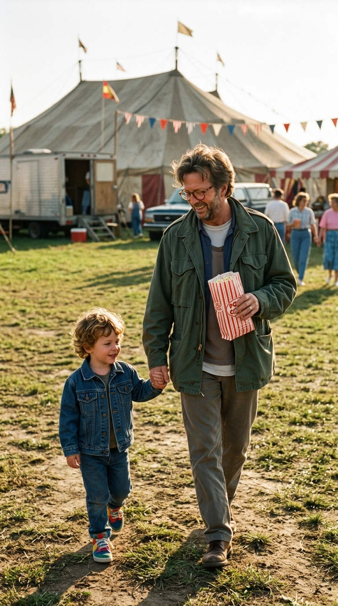
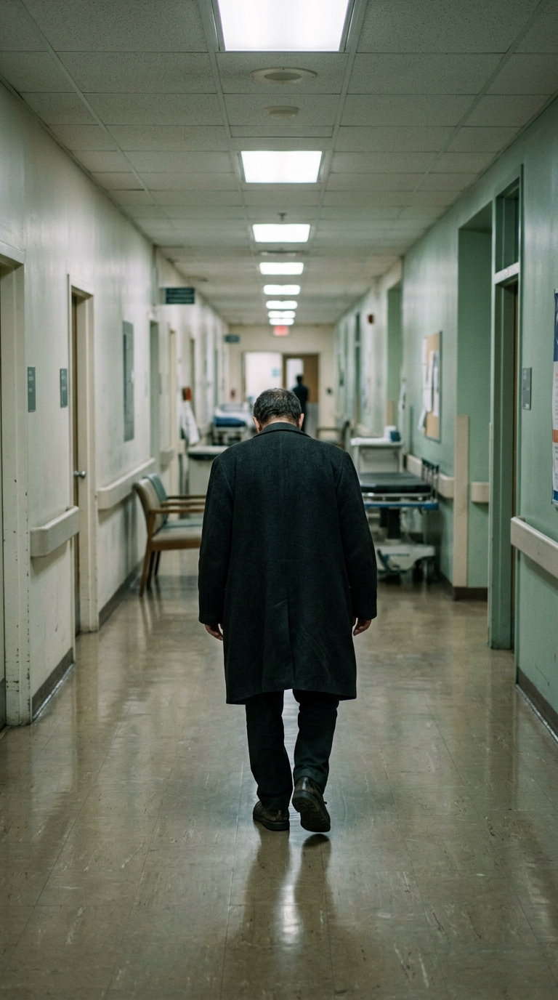
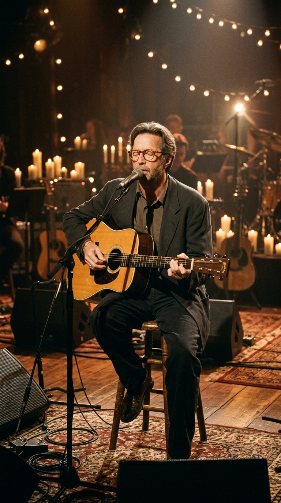

# 🕊️ The Chord That Held a Grieving Father: The Truth Behind «Tears in Heaven»

### *When life's most devastating blow threatened to extinguish everything, Eric Clapton sought refuge not in oblivion, but in the six strings of a guitar. This is the intimate story of an inconsolable loss and the song that transformed one man's grief into a universal prayer.*

---

## Prologue: The Fragility of an Afternoon at the Circus

Memory sometimes preserves its brightest hours right before the storm breaks. On March 19, 1991, Eric Clapton lived one of the most peaceful days of his adult life. He took his four-year-old son, Conor, to the circus at the Nassau Coliseum on Long Island. In his memoirs, the guitarist would recall that outing as the first time he had spent an entire day completely alone with the boy, discovering the quiet tenderness of walking hand in hand amid laughter, clowns, and cotton candy.

They made plans to see each other again the next morning to visit the animals at the Central Park Zoo. For a musician who had known both the heights of global fame and the darkest winters of solitude, Conor's presence was a clean anchor—a daily reason to guard the sobriety he had fought so hard to win barely three years earlier.

Yet spring in New York that year held an unforeseen rupture that would alter his existence forever.

---

## Act I: The Morning in Manhattan

On the morning of March 20, 1991, Clapton was in his room at the Mayfair Regent Hotel, getting ready to pick Conor up. The suite's telephone rang with urgent insistence. On the other end of the line, the broken, shattered voice of the boy's mother, Italian model Lory Del Santo, could barely form words through her sobs: Conor had fallen from an open window on the 53rd floor of the 57th Street high-rise where he had been playing under the care of his nanny.

The musician walked the few blocks separating him from the building, sealed inside a cloud of disbelief and silence. Minutes later, in the loneliest and most harrowing ordeal a father can ever face, he quietly took on the task of identifying his son's body.

In that exact instant, life came to a halt. Anyone who knew Clapton's past knew how hard it would be to stay standing beneath such a blow. For years, every emotional fracture had found a perilous escape in excess; yet confronted with the final absence of his little boy, Clapton made a quiet, private vow: he would remain sober, so that he might honor Conor's memory with open eyes.

---

## Act II: Refuge on the Island

Following the funeral at the parish church in Ripley, in his native England, Clapton needed to pull away from the noise of the world and the lenses of the tabloid press. He retreated for weeks to the Caribbean island of Antigua, dividing his days between long walks, support-group meetings to protect his sobriety, and endless hours alone with his acoustic guitar.

There was no commercial aim, no plan to cut a record, no desire to return to vast stadium tours. Holding the wood of the guitar became, quite simply, a way to keep breathing. His fingers searched out slow arpeggios, gentle melodies that might keep the empty house company and lull a sorrow that admitted no comfort.

In that solitary retreat, the first lines surfaced—a question seeking no theological answers, only the plain human need to imagine a reunion beyond death:

> *Would you know my name if I saw you in heaven?*  
> *Would you hold my hand if I saw you in heaven?...*

---

## Act III: Will Jennings's Words and the Birth of the Anthem

Months later, film director Lili Fini Zanuck asked Clapton to score the feature film *Rush*. It was in that setting that the guitarist chose to share the private melody he had been keeping in his notebook, calling on acclaimed lyricist Will Jennings to help give the composition its final shape.

Jennings admitted his hesitation at first: that grief felt like ground so intimate and sacred that stepping onto it seemed almost reckless. Yet with deep respect for Eric's feelings, the two worked together on the remaining verses. The song pictured heaven not as a distant abstraction, but as a place of peace where a father and son might one day recognize each other—while accepting the hard truth of the present: *“I must be strong and carry on, 'cause I know I don't belong here in heaven.”*

Recorded with understated arrangements, the song premiered in late 1991. Its true collective impact, however, broke open shortly afterward, when Clapton performed it live during the taping of his legendary acoustic concert for MTV.

---

## Act IV: Global Catharsis and the Courage to Heal

Recorded at Bray Studios in Berkshire in January 1992, the *MTV Unplugged* album revealed an Eric Clapton stripped of towering amplifiers and electric pyrotechnics. Seated on a stool with his acoustic Martin guitar and round glasses, his rendition of *“Tears in Heaven”* moved millions of people across the globe.

The song's universality lay in its simplicity: it did not speak of a rock celebrity, but of a vulnerable human being sharing his mourning with the entire world. At the 35th Annual Grammy Awards, held in 1993, the song won three of the evening's top honors—Record of the Year, Song of the Year, and Best Male Pop Vocal Performance—while the album crowned the ceremony as Album of the Year.

As the years went by, the anguish that had sparked the melody gradually found a quieter channel. Around 2004, after singing it on stages around the world for more than a decade, Clapton felt it was time to retire it from his regular setlist. He explained that the sharp agony of those early years had begun to heal, and that he no longer needed to summon that open wound every night to keep his son's memory alive. The song had fulfilled its healing purpose.

---

## Epilogue: The Invisible Bridge

Today, *“Tears in Heaven”* endures as one of the landmark works of contemporary music—not for its sales records, but for its power to walk beside anyone who has ever had to say goodbye to someone they loved too soon.

It reminds us that music, in its purest hours, is not born to feed vanity or fill vaults, but to stretch an invisible bridge toward those who are no longer here. Eric Clapton proved that when life takes away what is most sacred to us, there still remains the dignity of memory, the strength of sobriety, and the beauty of a melody tender enough to touch an absence.

---

### 💬 Secret Chords Community
What did you feel the first time you heard “Tears in Heaven” knowing Conor's story? In what difficult moment of your own life has music served as a refuge for healing? Share your story with us in the comments.

---

### 📚 Sources and Archival Records
* **Clapton, Eric**: *Clapton: The Autobiography* (Broadway Books / Century, 2007; chapters on his sobriety, Conor's life, and his stay in Antigua).
* **Archival interviews**: CBS News (*60 Minutes*, Ed Bradley's interview with Eric Clapton, official 1998 transcript discussing songwriting as personal therapy).
* **Official Chronology**: The Official Eric Clapton Timeline (ericclapton.com, records of the circus outing on March 19, 1991 at Nassau Coliseum and the events in Manhattan).
* **The Recording Academy**: Historical archive of the 35th Annual Grammy Awards (February 1993; official award records for *Tears in Heaven* and *MTV Unplugged*).
* **Rhino Entertainment**: Archival press release on the Crossroads Guitar Festival repertoire (2013).
