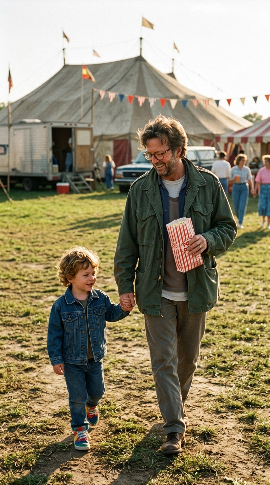
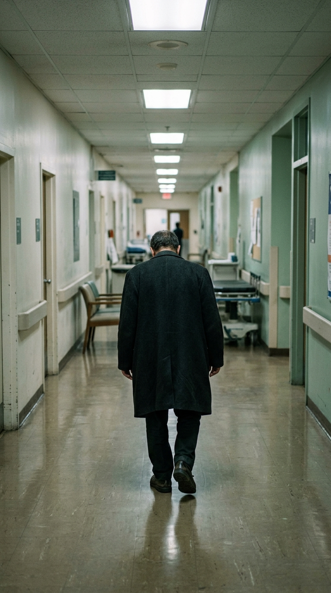
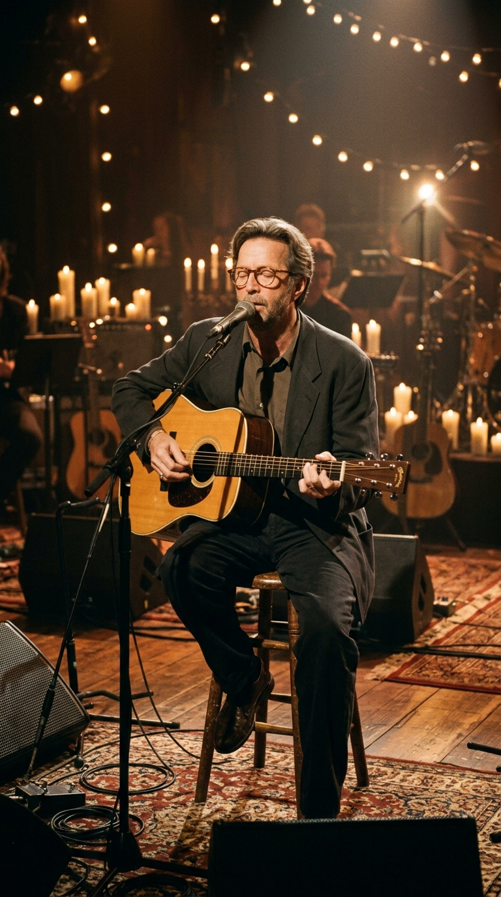

# 🕊️ El Acorde que Sostuvo a un Padre: La Verdad Detrás de «Tears in Heaven»

### *Cuando el golpe más devastador de la vida amenazó con apagarlo todo, Eric Clapton no buscó refugio en el olvido, sino en las seis cuerdas de una guitarra. Esta es la historia íntima de una pérdida inconsolable y la canción que transformó el dolor de un hombre en una plegaria universal.*

---

## Prólogo: La Fragilidad de una Tarde de Circo

La memoria a veces guarda sus momentos más luminosos justo antes de la tormenta. El 19 de marzo de 1991, Eric Clapton vivió una de las jornadas más serenas de su vida adulta. Llevó a su pequeño hijo Conor, de cuatro años, al circo en el Nassau Coliseum de Long Island. En sus propias memorias, el guitarrista recordaría aquella función como la primera vez que compartía una salida completamente a solas con el niño, descubriendo la ternura de caminar de la mano entre risas, payasos y algodón de azúcar.

Habían acordado verse de nuevo a la mañana siguiente para visitar juntos los animales en el zoológico de Central Park. Para un músico que había transitado las cimas del éxito mundial y los inviernos más oscuros de la soledad, la presencia de Conor representaba un ancla limpia, un motivo diario para cuidar la sobriedad que había conquistado con tanto esfuerzo apenas tres años atrás. 

Pero en Nueva York, la primavera de aquel año guardaba un quiebre imprevisto que cambiaría su existencia para siempre.

---

## Acto I: La Mañana en Manhattan

En la mañana del 20 de marzo de 1991, Clapton se encontraba en su habitación del Hotel Mayfair Regent, preparándose para recoger a Conor. El teléfono de la suite sonó con una insistencia urgente. Al otro lado de la línea, la voz rota y descompuesta de la madre del pequeño, la modelo italiana Lory Del Santo, apenas lograba articular palabras entre sollozos: Conor había caído al vacío desde una ventana abierta en el piso 53 del rascacielos de la calle 57, donde jugaba al cuidado de su niñera.

El músico cruzó a pie las pocas calles que lo separaban del edificio, inmerso en una nube de incredulidad y silencio. Minutos más tarde, en la intimidad más solitaria y desgarradora que un padre pueda afrontar, asumió en silencio la tarea de identificar el cuerpo de su hijo.

En ese instante preciso, la vida se detuvo. Quienes conocían el pasado de Clapton sabían lo difícil que resultaba sostenerse en pie ante un golpe semejante. Durante años, cualquier fractura emocional había encontrado una peligrosa salida en los excesos; sin embargo, frente a la ausencia definitiva de su pequeño, Clapton tomó una determinación íntima y silenciosa: debía permanecer sobrio para honrar la memoria de Conor con los ojos abiertos.

---

## Acto II: El Refugio en la Isla

Tras el funeral en la parroquia de Ripley, en su Inglaterra natal, Clapton necesitó alejarse del ruido del mundo y de las cámaras de la prensa sensacionalista. Se recluyó durante semanas en la isla caribeña de Antigua, alternando sus días entre largas caminatas, reuniones de grupos de apoyo para sostener su sobriedad y horas interminables a solas con su guitarra acústica.

No había ningún propósito comercial, ni planes de grabar un disco, ni intenciones de regresar a las grandes giras de estadios. Tocar la madera se convirtió simplemente en un ejercicio de respiración. Sus dedos buscaban arpegios lentos, melodías suaves que pudieran acompañar el vacío de la casa y arrullar una tristeza que no admitía consuelo.

En ese retiro solitario brotaron los primeros versos, una interrogante que no buscaba respuestas teológicas, sino la simple necesidad humana de imaginar un reencuentro más allá de la muerte:

> *¿Sabrías mi nombre si te viese en el cielo?*  
> *¿Sería lo mismo si te tomase de la mano?...*

---

## Acto III: Las Palabras de Will Jennings y el Nacimiento del Himno

Meses después, la directora cinematográfica Lili Fini Zanuck le propuso a Clapton componer la música para el largometraje *Rush*. Fue en ese contexto donde el guitarrista decidió compartir aquella melodía privada que guardaba en su libreta de notas, convocando al reconocido letrista Will Jennings para ayudarle a dar forma definitiva a la composición.

Jennings admitió en un principio sus dudas: sentía que aquel dolor era un territorio tan íntimo y sagrado que resultaba casi temerario intervenir en él. No obstante, con un profundo respeto hacia el sentimiento de Eric, ambos trabajaron en los versos complementarios. La canción imaginaba el cielo no como una abstracción lejana, sino como un lugar de paz donde un padre y un hijo podrían algún día reconocerse, aceptando al mismo tiempo la dura realidad del presente: *«Debo ser fuerte y continuar, porque sé que no pertenezco aquí, al cielo»*.

La pieza se grabó con arreglos sutiles y se estrenó a finales de 1991. Pero su verdadero impacto colectivo estalló poco después, cuando Clapton la interpretó en directo durante la grabación del legendario concierto acústico para la cadena MTV.

---

## Acto IV: La Catarsis Mundial y el Valor de Sanar

Grabado en los estudios Bray de Berkshire en enero de 1992, el álbum *MTV Unplugged* mostró a un Eric Clapton despojado de amplificadores gigantes y pirotecnia eléctrica. Sentado en una banqueta con su guitarra acústica Martin y sus gafas redondas, su interpretación de *«Tears in Heaven»* conmovió a millones de personas en todo el planeta. 

La universalidad de la canción radicaba en su sencillez: no hablaba de una celebridad del rock, sino de un ser humano vulnerable que compartía su duelo con el mundo entero. En la 35.ª edición de los Premios Grammy, celebrada en 1993, la canción obtuvo tres de los galardones principales de la noche: Grabación del Año, Canción del Año y Mejor Interpretación Vocal Pop Masculina, mientras el álbum coronaba la ceremonia como Álbum del Año.

Con el paso de los años, el dolor que originó la melodía fue encontrando un cauce de serenidad. Hacia 2004, tras haberla cantado durante más de una década en escenarios de todo el mundo, Clapton sintió que era momento de retirarla de su repertorio habitual. Explicó que el desgarro agudo de los primeros años había comenzado a sanar, y que ya no necesitaba evocar esa herida abierta cada noche para mantener viva la memoria de su hijo. La canción había cumplido su misión sanadora.

---

## Epílogo: El Puente Invisible

Hoy en día, *«Tears in Heaven»* permanece como una de las obras cumbres de la música contemporánea, no por sus récords de ventas, sino por su capacidad de acompañar a cualquiera que haya tenido que despedir a un ser querido antes de tiempo.

Nos recuerda que la música, en sus momentos más puros, no nace para alimentar la vanidad ni para llenar arcas, sino para tender un puente invisible hacia aquellos que ya no están. Eric Clapton demostró que cuando la vida nos arrebata lo más sagrado, siempre queda la dignidad de la memoria, la fuerza de la sobriedad y la belleza de una melodía capaz de acariciar la ausencia.

---

### 💬 Conversación en la Comunidad
¿Qué sentiste la primera vez que escuchaste «Tears in Heaven» conociendo la historia de Conor? ¿En qué momento difícil de tu vida te ha servido la música como refugio para sanar? Te leemos en los comentarios.

---

### 📚 Fuentes y Archivo Documental
* **Clapton, Eric**: *Clapton: The Autobiography* (Broadway Books / Century, 2007; capítulos sobre su sobriedad, la vida de Conor y la estancia en Antigua).
* **Entrevistas de archivo**: CBS News (*60 Minutes*, entrevista de Ed Bradley con Eric Clapton, transcripción oficial de 1998 sobre la composición como terapia personal).
* **Cronología Oficial**: The Official Eric Clapton Timeline (ericclapton.com, registros de la visita al circo el 19 de marzo de 1991 en Nassau Coliseum y sucesos de Manhattan).
* **The Recording Academy**: Archivo histórico de la 35.ª entrega de los Premios Grammy (febrero de 1993; actas oficiales de premiación para *Tears in Heaven* y *MTV Unplugged*).
* **Rhino Entertainment**: Comunicado de archivo sobre el repertorio del Crossroads Guitar Festival (2013).
