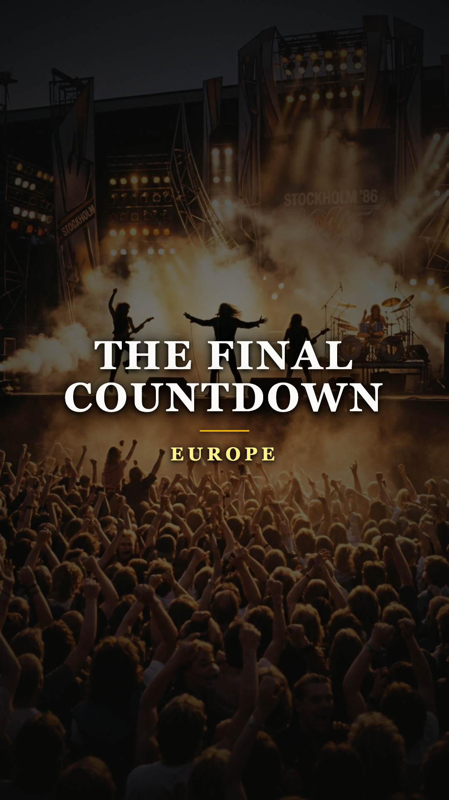

# El riff que conquistó el mundo y destruyó una amistad: la historia oculta de «The Final Countdown»

### Por Acordes Ocultos
*Dedicado a quienes tuvieron que elegir entre el éxito masivo y la lealtad a sí mismos.*

---

### Prólogo: La fanfarria que devoró a sus creadores

En el otoño de 1986, no había rincón del planeta donde no retumbara aquella fanfarria sintética. Eran cuatro compases marciales, brillantes y descaradamente épicos que parecían anunciar la llegada de una nave espacial o el inicio de una olimpiada galáctica. La canción trepó de manera vertiginosa hasta alcanzar el número uno en veinticinco países simultáneamente, vendió millones de copias y catapultó a un cuarteto de jóvenes suecos de cabelleras cardadas al centro del huracán de la cultura pop global.

Para millones de oyentes, *«The Final Countdown»* representó la banda sonora definitiva del optimismo tecnológico de los años ochenta.

Sin embargo, detrás del humo de los escenarios y las luces de neón televisivas, aquella melodía no fue motivo de júbilo para todos sus autores. Había sido el detonante de una feroz batalla interna entre dos amigos inseparables de la adolescencia; una disputa estética y moral tan profunda que, apenas unas semanas después de conquistar el planeta, terminó provocando la renuncia de su guitarrista fundador y fracturando para siempre el alma original del grupo.

---

### Acto I: Los chicos del garaje de Upplands Väsby

A finales de los años setenta, en el modesto suburbio obrero de Upplands Väsby, a unos treinta kilómetros al norte de Estocolmo, dos adolescentes compartían una obsesión casi religiosa por el rock duro británico. **Rolf Magnus Joakim Larsson** (quien más tarde adoptaría el nombre artístico de **Joey Tempest**) y **John Norum** pasaban tardes enteras encerrados en cobertizos helados escuchando vinilos gastados de Thin Lizzy, Deep Purple, UFO y Led Zeppelin.

Ambos poseían talentos complementarios extraordinarios. Tempest era un cantante de garganta prodigiosa y una mente melódica privilegiada; Norum era un prodigio de la guitarra eléctrica, un purista del tono que veneraba a Gary Moore y Michael Schenker y que se negaba a tocar cualquier cosa que no naciera del rugido orgánico de una válvula Marshall saturada.

Junto al bajista John Levén y el baterista Tony Reno (más tarde sustituido por Ian Haugland), fundaron la banda bajo el nombre de Force, ganando en 1982 un certamen nacional de rock en Suecia frente a cuatro mil agrupaciones. Ya rebautizados como **Europe**, sus dos primeros álbumes —*Europe* (1983) y *Wings of Tomorrow* (1984)— consolidaron su reputación como los nuevos baluartes del heavy metal melódico escandinavo: riffs afilados, solos incendiarios y una autenticidad callejera insobornable.

---

### Acto II: El teclado prestado a medianoche

Hacia 1981, mientras estudiaba en la universidad, Joey Tempest le pidió prestado un sintetizador analógico Korg Polysix a su amigo y tecladista Mic Michaeli. En la soledad de su dormitorio, fascinado por las texturas futuristas de David Bowie y el rock sinfónico, Joey comenzó a juguetear con las teclas buscando una fanfarria que imitara el llamado de trompetas clásicas.

En cuestión de minutos encontró la progresión de acordes: un motivo rítmico ascendente en fa sostenido menor que se quedaba grabado en el cerebro al primer instante. Tempest grabó un esbozo rústico en una cinta de casete y lo guardó en un cajón. Sabía que tenía algo descomunal entre manos, pero también sabía que en una banda de guitarras distorsionadas aquel sonido sería considerado un anatema.

Pasaron cuatro años. A finales de 1985, mientras preparaban las maquetas para su tercer álbum de estudio con el sello Epic Records, Joey rescató el casete del cajón y se lo presentó a sus compañeros en el local de ensayo.

La reacción de John Norum fue instantánea y despiadada.

---

### Acto III: «Parece música de circo»

Norum no ocultó su indignación:

> *«Cuando Joey puso la maqueta por primera vez, me quedé helado. Le dije: "¿Qué demonios es esto? Es una canción pop de sintetizadores con trompetas de juguete. Somos una banda de hard rock, Joey. Las guitarras son las que deben mandar. No podemos tocar esta basura de plástico"».*

Para Norum, aquel sonido representaba la claudicación ante las modas superficiales de la radiofórmula estadounidense. Él quería que Europe sonara como los discos más oscuros y pesados de Thin Lizzy; Joey, en cambio, veía en esa fanfarria una declaración cósmica inspirada en *Space Oddity* de Bowie, un relato de ciencia ficción sobre la humanidad abandonando la Tierra rumbo a Venus.

La discusión amenazó con quebrar el grupo antes de entrar al estudio. Finalmente, intervinieron el bajista John Levén y el productor estadounidense **Kevin Elson** (quien venía de trabajar con Journey). Para apaciguar a Norum, sellaron un pacto de caballeros: la canción se grabaría con una duración superior a los cinco minutos, pero **únicamente como tema de apertura instrumental para encender los conciertos en vivo**. Ninguno de ellos pensó jamás en lanzarla como sencillo de radio.

Aceptando el compromiso a regañadientes, Norum se encerró en los Powerplay Studios de Zúrich y, con la determinación de un purista que intenta rescatar un naufragio, grabó un solo de guitarra apoteósico en una sola toma. Fue un despliegue de digitación vertiginosa, bendings perfectos y emoción cruda: su huella dactilar de fuego grabada en el corazón de la electrónica.

---

### Acto IV: La trampa de la fama masiva

Lo que la banda no anticipó fue la reacción de los ejecutivos discográficos en Nueva York. Cuando los directivos de CBS/Epic escucharon la mezcla final de *The Final Countdown*, supieron de inmediato que tenían en sus manos un fenómeno cultural sin precedentes. Pasando por alto las reticencias de los músicos, decidieron editarla como el sencillo principal en mayo de 1986.

El resultado fue un cataclismo comercial. La canción trepó al número uno en el Reino Unido, Alemania, Francia, España, Australia y veintidós países más, colándose en el Top 10 estadounidense. Europe dejó de ser una respetada banda de culto para convertirse en un fenómeno de masas acosado por multitudes adolescentes.

Pero lo que para Joey Tempest significaba el cumplimiento de sus mayores sueños de juventud, para John Norum se transformó en una pesadilla claustrofóbica.

De pronto, los contratos de promoción exigían giras interminables por platós de televisión donde los organizadores no permitían música en vivo: obligaban a los músicos a realizar *playback*, sonriendo a las cámaras mientras fingían rasguear instrumentos desenchufados al compás del omnipresente sintetizador. Para un guitarrista de sangre que vivía por la vibración física de sus cuerdas en el escenario, aquello era una degradación inadmisible.

---

### Epílogo: La partida y el regreso

El 31 de octubre de 1986, tras presentarse en un programa de la televisión neerlandesa, la cuerda se tensó definitivamente. Norum se reunió con Joey Tempest en el camerino:

> *«Joey, no puedo seguir haciendo esto. Nos hemos convertido en una banda de muñecos para adolescentes. El teclado lo tapa todo y yo no nací para hacer el payaso fingiendo que toco en la televisión. Me voy».*

Al día siguiente, John Norum empacó sus guitarras y abandonó a la banda que había cofundado con dieciséis años, justo en el momento en que Europe llenaba arenas por todo el planeta. Fue reemplazado por Kee Marcello, con quien la banda completó la gigantesca gira mundial.

Norum inició una respetada carrera solista colaborando con Glenn Hughes y Dokken, manteniéndose fiel a su credo del rock sin concesiones. Tardarían casi dos décadas en sanar las heridas: en 2003, ya maduros y libres de las presiones comerciales de los ochenta, Joey y John volvieron a abrazarse para refundar Europe con su formación clásica, demostrando que la hermandad de garaje era más fuerte que cualquier desencuentro.

Porque hay canciones que nacen para comprar la gloria del mundo entero en un destello de luz, y hay silencios que nos recuerdan que, en la vida y en el arte, la lealtad a la propia identidad no se vende por ningún disco de oro.

---

### 📚 Fuentes y Archivo Documental

1. **Tempest, Joey**. Entrevistas oficiales sobre la composición de *The Final Countdown*, el Korg Polysix y la influencia de David Bowie en *Classic Rock Magazine* y *Guitar World* (2004, 2016).
2. **Norum, John**. Testimonios autobiográficos sobre su renuncia en 1986, el conflicto de los teclados y su rechazo al playback en *Guitarist Magazine* y *Sweden Rock Magazine* (2008, 2019).
3. **Elson, Kevin**. Notas de producción de las sesiones de grabación en Powerplay Studios (Zúrich, Suiza) y Olympic Studios (Londres), Epic Records Archive (1986).
4. **Wall, Mick**. *Run to the Hills: The Definitive History of 80s Hard Rock*. Sanctuary Publishing, 1998 (Capítulo dedicado al fenómeno de Europe y el auge del hair metal europeo).
5. **Bronson, Fred**. *The Billboard Book of Number One Hits*. Billboard Books, 2003 (Registro histórico de ventas y posicionamiento internacional del álbum *The Final Countdown*).
6. **SVT (Sveriges Television)**. Documental hemerográfico *Historien om Europe: Från garaget till stjärnorna* (Estocolmo, 2011).
