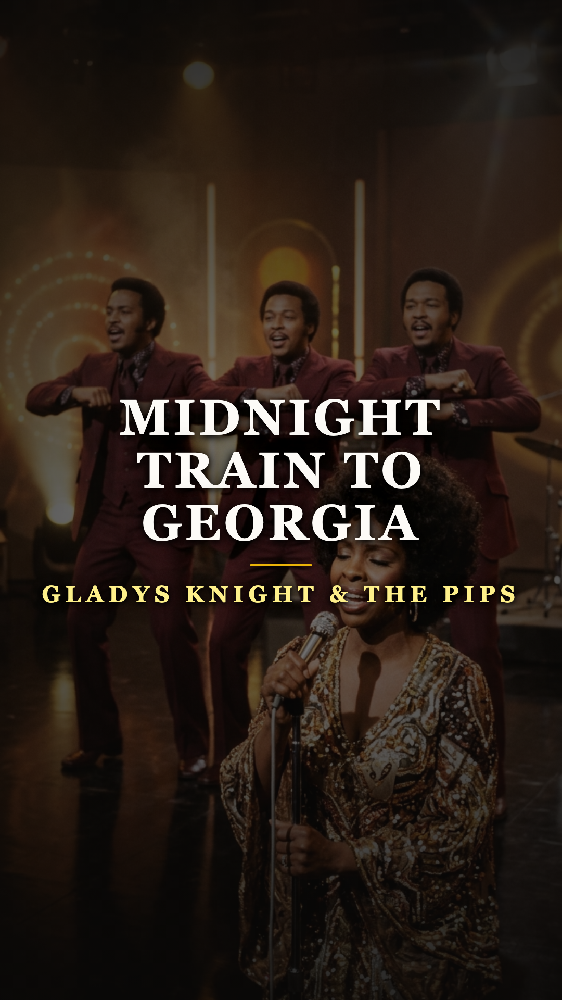
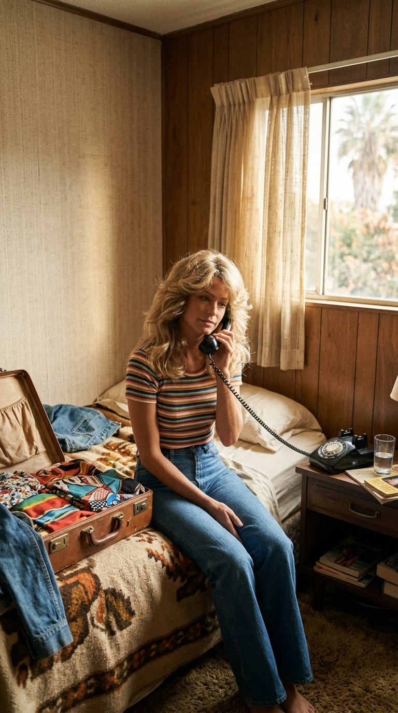
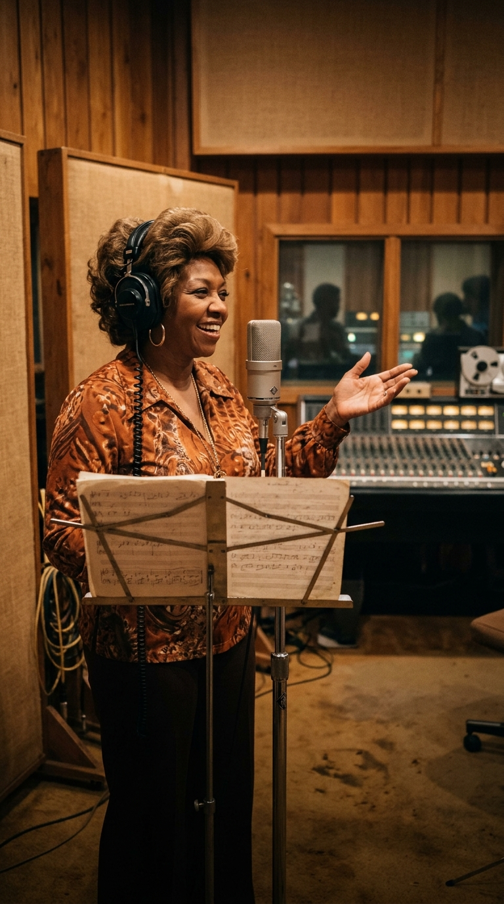
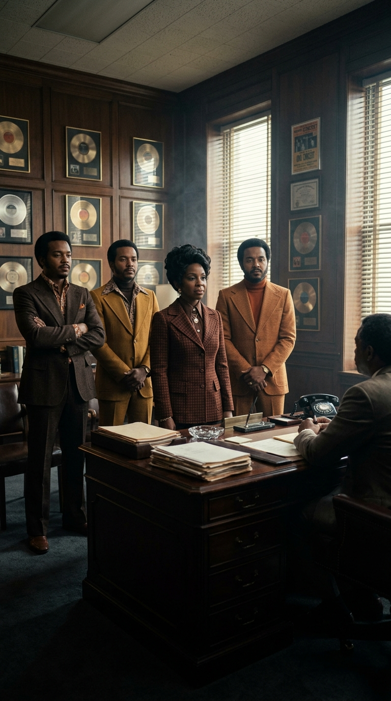
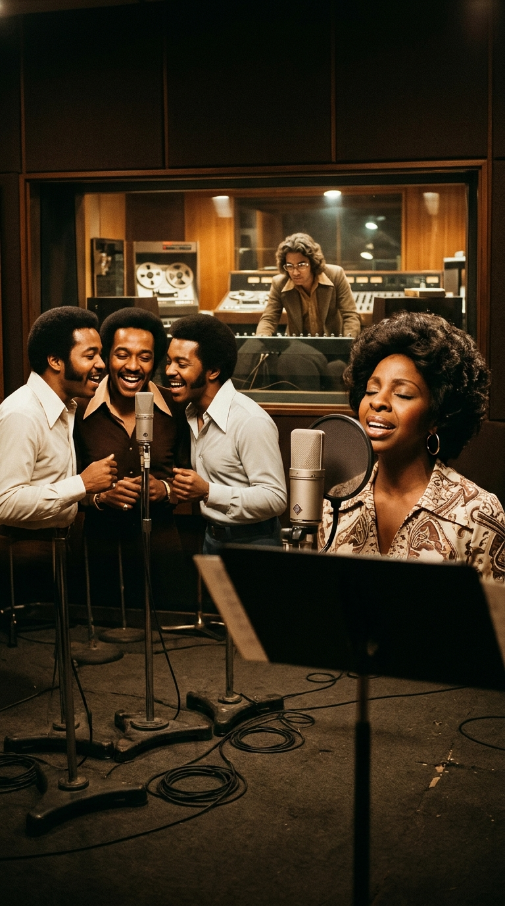
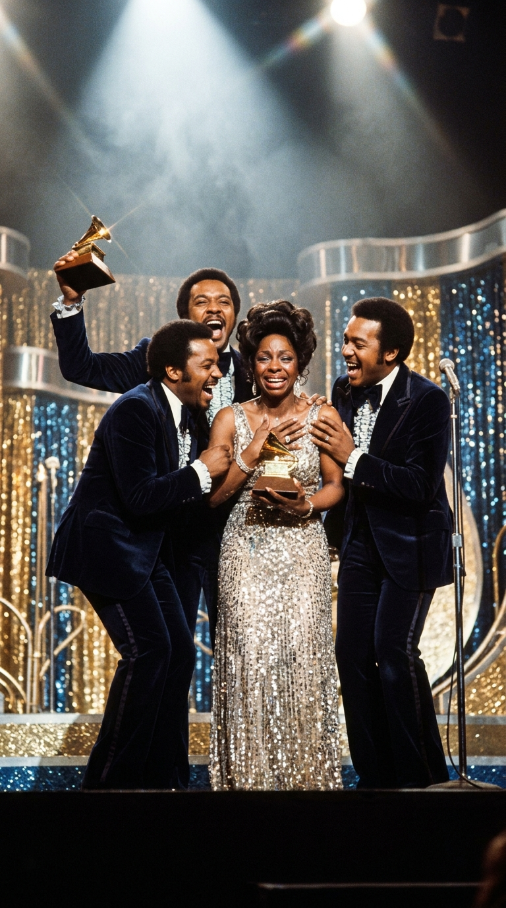
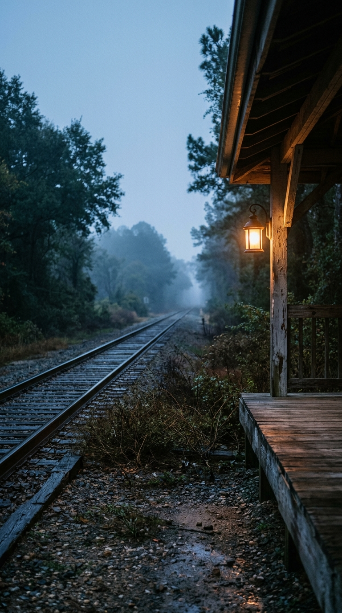

# Una llamada a una actriz desconocida creó la canción que salvó el honor de una banda marginada

**Por el equipo editorial de Acordes Ocultos**

---

> *«L.A. proved too much for the man, he couldn’t make it / So he’s leaving the life he’s come to know... / He’s leaving on that midnight train to Georgia / I’d rather live in his world than live without him in mine.»*

En el otoño de 1973, una introducción suave de piano eléctrico y batería acompasada comenzó a sonar en las estaciones de radio de Estados Unidos, para luego dar paso a una de las entradas vocales más reconocibles de la historia del soul: la voz cálida, rasgada y llena de sabiduría de Gladys Knight, secundada de inmediato por las respuestas corales sincronizadas de The Pips imitando el traqueteo y el silbido distante de una locomotora (*«Leaving on that midnight train... Woo-woo!»*).

La canción, titulada *«Midnight Train to Georgia»*, no tardó en alcanzar el número uno absoluto en las listas de Billboard y en otorgar a la banda el premio Grammy a la mejor interpretación vocal de R&B. Para millones de oyentes, la pieza era una conmovedora oda a las raíces sureñas y al amor incondicional que antepone la lealtad humana al brillo estéril del éxito material. Sin embargo, detrás de aquel himno se escondía una carambola insólita de casualidades: una llamada telefónica atendida por una futura estrella de Hollywood que aún no era nadie, la rectificación cultural de la madre de Whitney Houston y la revancha moral de una agrupación que acababa de huir de la tiranía de Motown.

---

## Acto I: El teléfono en Los Ángeles y la chica del vuelo nocturno (1970)

La historia de la canción no comenzó en Atlanta ni en los campos de algodón de Georgia, sino en un caluroso apartamento de Los Ángeles a finales de 1970. Su autor, **Jim Weatherly**, era un personaje atípico en la industria del espectáculo: un antiguo mariscal de campo estelar de la Universidad de Mississippi que había renunciado al fútbol americano profesional para probar suerte como compositor de música country en California.

Un domingo por la tarde, Weatherly tomó el auricular del teléfono para llamar a su amigo íntimo, el actor **Lee Majors**. Quien contestó la línea no fue Majors, sino su novia de entonces: una joven modelo tejana de veintitrés años, de sonrisa radiante y cabello dorado, que acababa de mudarse a la ciudad con la vaga esperanza de conseguir audiciones en televisión. Su nombre era **Farrah Fawcett**, seis años antes de que el póster del traje de baño rojo y la serie *Los Ángeles de Charlie* la convirtieran en el mayor ícono visual de la década.

Weatherly le preguntó con cortesía qué estaba haciendo. Farrah le respondió con naturalidad que estaba terminando de empacar su equipaje en el dormitorio, porque esa noche abordaría el *«avión de medianoche a Houston»* (*«the midnight plane to Houston»*) para ir a visitar a sus padres a Texas.

Tras despedirse cordialmente, Weatherly colgó el auricular, pero aquella frase continuó resonando en su cabeza con la cadencia de un compás musical. Se sentó inmediatamente frente a su piano y en menos de cuarenta y cinco minutos escribió la letra y la melodía completas. En su imaginación, la anécdota de Farrah se transformó en un drama humano mucho más profundo: la historia de un hombre que llega a Los Ángeles persiguiendo el espejismo del estrellato, se estrella contra la frialdad de la industria y decide empeñar sus ilusiones para volver derrotado a su tierra natal, mientras la mujer que lo ama renuncia voluntariamente al glamour de la gran ciudad para no dejarlo regresar solo.

Weatherly grabó una austera maqueta en clave country acústico bajo el título original de **«Midnight Plane to Houston»**, publicándola en su álbum solista de 1972 sin mayor repercusión comercial.

---

## Acto II: La sentencia de Cissy Houston y el cambio de vías (1972)

Lejos de resignarse, el editor de Weatherly envió la cinta a Sonny Limbo, un productor radicado en Atlanta que buscaba material nuevo para una de las voces góspel más respetadas de la época: **Cissy Houston** (madre de Whitney Houston y tía de Dionne Warwick).

A Cissy le conmovió la hondura emocional de la historia, pero su instinto cultural le advirtió que la letra tenía un problema fundamental de verosimilitud para la comunidad afroamericana del sur. Llamó directamente a Weatherly para plantearle una modificación sin rodeos:

> *«La canción es preciosa, Jim, pero mi gente no toma aviones; mi gente toma trenes. Y nosotros no somos de Houston, Texas; ¡nosotros somos de Georgia! ¿Te molestaría que cambiáramos el avión por un tren y a Houston por Georgia?»*

Weatherly, respetuoso de la autenticidad que Cissy buscaba plasmar, le respondió de inmediato: *«Haz lo que quieras con la letra y el destino, siempre y cuando no alteres la melodía ni la esencia del drama humano»*.

Rebautizada como **«Midnight Train to Georgia»**, Cissy Houston grabó la pieza en 1972 para Janus Records con un arreglo soul sureño austero y gospeliano. Aunque la versión tuvo una acogida radial modesta en los circuitos de R&B, plantó la semilla definitiva que estaba a punto de germinar.

---

## Acto III: El éxodo de Motown y la herida de Gladys Knight (1973)

Mientras tanto, en Detroit, la tensión dentro de las oficinas del mítico sello Motown había llegado a un punto de quiebre insostenible. **Gladys Knight & The Pips** llevaban casi una década entregando éxitos intachables como *«I Heard It Through the Grapevine»*, pero vivían bajo la permanente sensación de ser tratados como ciudadanos de segunda clase. El fundador de la compañía, Berry Gordy, concentraba todos los recursos promocionales, los mejores compositores y las mejores giras en su protegida, Diana Ross, relegando a Gladys y a sus compañeros a las sobras del catálogo.

En 1973, armándose de valor, Gladys Knight tomó la decisión más arriesgada de su trayectoria: no renovar su contrato con Motown y firmar con una discográfica independiente más modesta, Buddah Records, en busca de autonomía creativa y respeto artístico.

Fue en ese momento de incertidumbre cuando Gladys escuchó la grabación de Cissy Houston. La historia del hombre que no pudo triunfar en Los Ángeles y que decide volver con la frente en alto a una vida más simple golpeó directo en su pecho. Para Gladys, la letra no era una fábula ficticia: representaba el desencanto ante las promesas vacías del negocio del entretenimiento y la certeza de que la dignidad humana y el afecto verdadero valen infinitamente más que cualquier contrato discográfico.

---

## Acto IV: La coreografía del tren y la consagración definitiva (1973)

Instalados en los estudios de grabación de Nueva York junto al arreglista y productor **Tony Camillo**, Gladys y The Pips (su hermano Merald «Bubba» Knight y sus primos William Guest y Edward Patten) reconstruyeron la canción desde los cimientos.

Camillo incorporó una rica sección de vientos y cuerdas sobre una base rítmica de bajo funk bailable pero melancólico. Sin embargo, la chispa genial provino de The Pips: inspirados en los sonidos ferroviarios de su infancia en el sur, idearon las célebres réplicas corales al unísono, respondiendo a cada frase de Gladys con comentarios cómplices (*«He said he’s going...»*, *«Leaving on that midnight train...»*) y simulando con la garganta el silbido de vapor del tren. En el escenario, complementaron el arreglo con una coreografía inolvidable, tirando de una cuerda imaginaria con los brazos mientras balanceaban las caderas al compás de la locomotora.

El sencillo se publicó en agosto de 1973 y se convirtió en un fenómeno arrollador. En octubre alcanzó el **número uno del Billboard Hot 100**, donde permaneció dos semanas consecutivas, liderando simultáneamente las listas de R&B. Meses más tarde, en la ceremonia de los premios Grammy de 1974, Gladys Knight & The Pips se alzaron con el galardón a la Mejor Interpretación Vocal de R&B por un Dúo o Grupo.

La pequeña banda relegada por Motown acababa de firmar el sencillo más vendido de aquel año, consagrando una de las revanchas artísticas más nobles y poéticas en los anales de la música moderna.

---

## Epílogo: El refugio de las raíces

Más de medio siglo después de que aquella llamada telefónica interrumpiera el equipaje de una joven Farrah Fawcett, *«Midnight Train to Georgia»* continúa figurando en los altares de la música popular como una de las piezas cumbre del soul estadounidense.

Su belleza no radica únicamente en la perfección tímbrica de la voz de Gladys Knight ni en el ingenio coreográfico de The Pips, sino en el consuelo que ofrece a la condición humana. Nos recuerda que no hay deshonra alguna en haberlo intentado y no haber alcanzado la cima, y que cuando las luces de la gran ciudad se apagan y los aplausos se desvanecen, el mayor triunfo posible es tener a alguien a nuestro lado dispuesto a tomar el tren de vuelta a casa.

---

### 📚 Fuentes y Archivo Documental

1. **Weatherly, Jim.** *Midnight Train: A Songwriter's Journey*. Mercer University Press, 2018. Memorias del compositor con el relato documental sobre la conversación telefónica con Farrah Fawcett y la composición de *«Midnight Plane to Houston»*.
2. **Knight, Gladys.** *Between Each Line of Pain and Glory: My Life Story*. Hyperion, Nueva York, 1997. Testimonio autobiográfico sobre la salida de Motown Records, la firma con Buddah Records y las sesiones de grabación con The Pips y Tony Camillo.
3. **Houston, Cissy.** *How Sweet the Sound: My Life with God and Gospel*. Doubleday, 1998. Declaraciones de la intérprete sobre la modificación del título y el contexto sociocultural del transporte ferroviario sureño.
4. **Archivo Discográfico y Hemerográfico de Billboard Magazine (1973–1974).** Reseñas de lanzamientos de sencillos, posiciones en el Hot 100 y cobertura de la 16.ª edición anual de los Premios Grammy.
5. **National Academy of Recording Arts and Sciences (NARAS).** Registro de inducción de *«Midnight Train to Georgia»* al Salón de la Fama de los Grammy (Grammy Hall of Fame, 1999).
