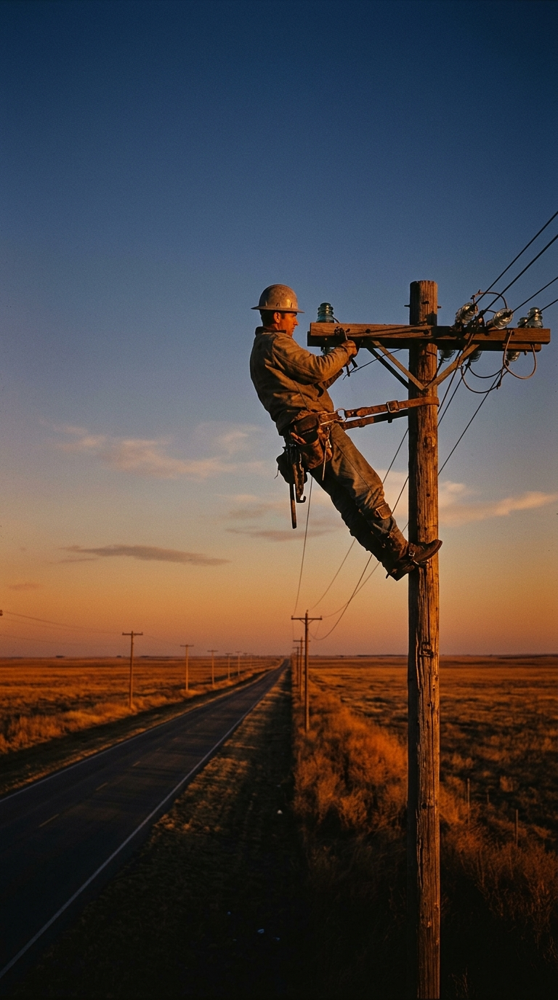
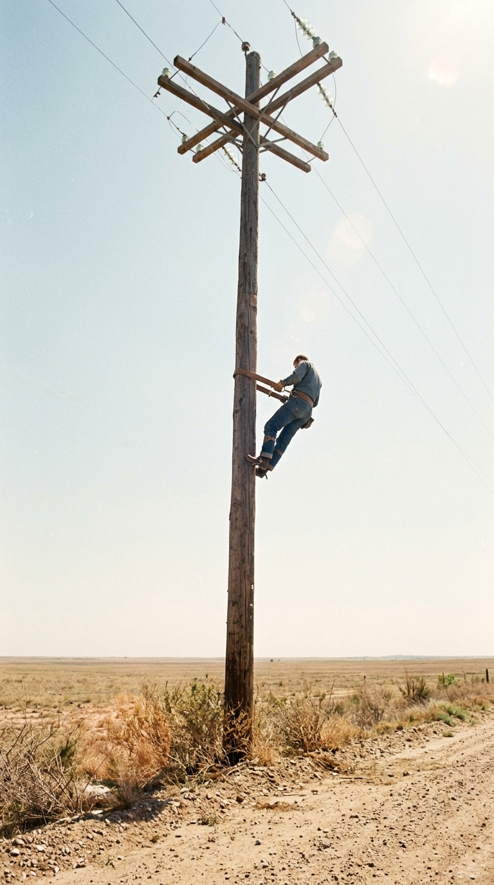
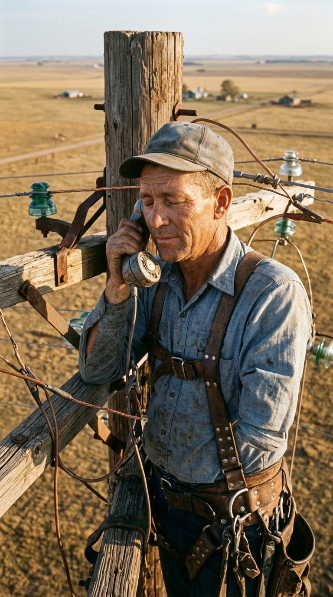
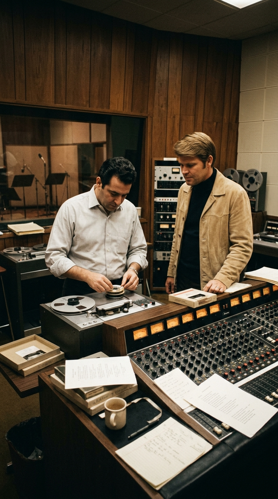
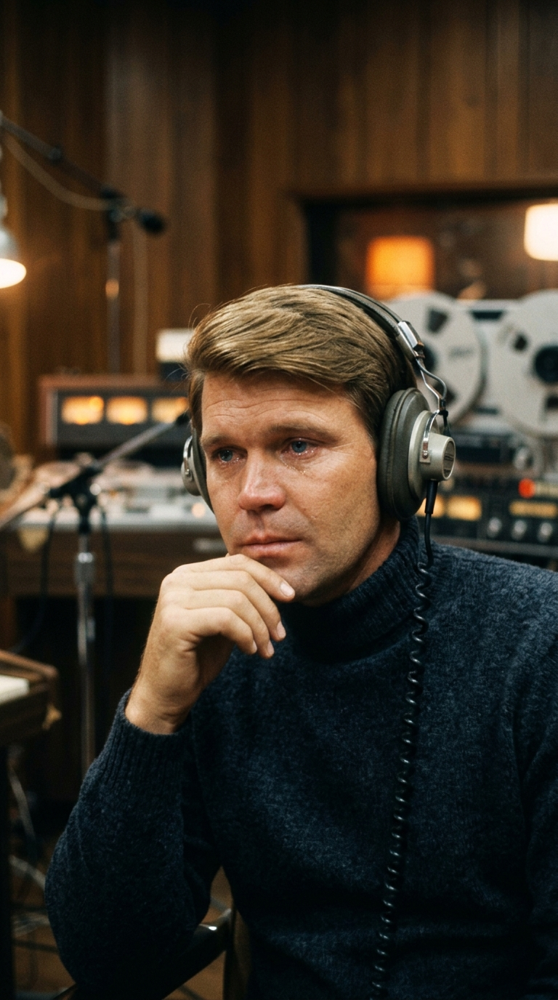
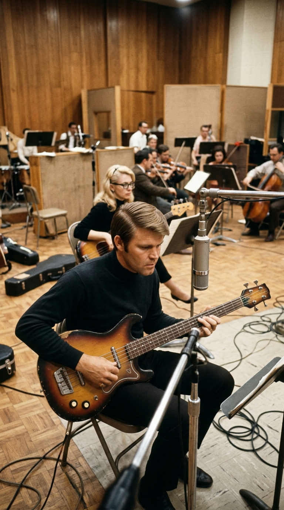
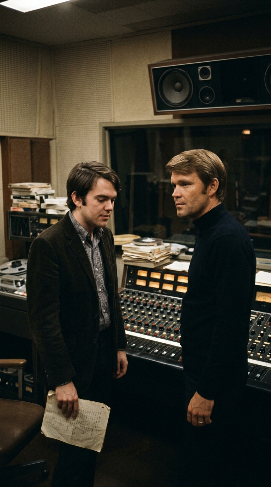
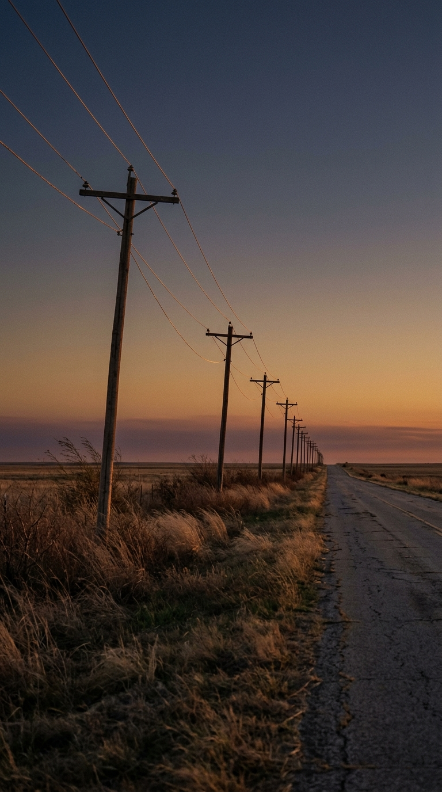

# La canción inacabada del desierto: la historia real detrás de «Wichita Lineman» de Glen Campbell

> *«Sé que necesito unas pequeñas vacaciones, pero no parece que vaya a llover… Y te necesito más de lo que te deseo, y te deseo para toda la vida. Y el operario de Wichita sigue en la línea».*
> — **Jimmy Webb / Glen Campbell**, *«Wichita Lineman»* (1968).

---

### I. El espejismo en la carretera del condado de Washita

En el verano de 1968, las carreteras rurales del suroeste de Oklahoma eran una línea recta trazada sobre la nada. Quien conducía por el condado de Washita rumbo a la frontera con el Panhandle de Texas se enfrentaba a decenas de kilómetros de pradera reseca, trigales quemados por el sol de julio y un horizonte tan plano que la vista parecía doblarse bajo el peso del calor.

Al volante de su automóvil viajaba en absoluta soledad **Jimmy Webb**, un joven compositor de apenas veintiún años nacido en Elk City, Oklahoma, que acababa de conquistar las listas de éxitos de Estados Unidos junto al cantante y guitarrista **Glen Campbell** con *«By the Time I Get to Phoenix»* (1967). Desde Los Ángeles, tanto Campbell como el productor e instrumentista de Capitol Records **Al De Lory** lo llamaban con insistencia: necesitaban de inmediato otra canción que mencionara una ciudad estadounidense para continuar la racha triunfal en la radio.

Pero mientras conducía bajo aquel sol implacable, Webb no pensaba en listas de ventas ni en fórmulas comerciales. Observaba los postes telefónicos de madera que desfilaban uno tras otro al borde de la cuneta, unidos por un hilo interminable de cobre.

De pronto, a través del espejismo que levantaba el asfalto hirviente, divisó algo en las alturas. En lo alto de uno de aquellos postes solitarios, a kilómetros de cualquier pueblo, granja o estación de servicio, **había un hombre suspendido contra el cielo**.

---

### II. El hombre que hablaba con nadie en mitad de la llanura

Aquel trabajador llevaba botas con espuelas de acero clavadas en la madera, un pesado cinturón de cuero alrededor de la cintura y una camisa empapada de sudor. A medida que el automóvil de Jimmy Webb se acercaba y pasaba a toda velocidad junto al poste, el joven compositor alcanzó a ver un detalle que le estremeció el pecho: el operario tenía un auricular de prueba conectado directamente a los cables de alta tensión y **estaba hablando por teléfono allá arriba**.

La imagen quedó grabada a fuego en la memoria de Webb. Como recordaría décadas más tarde en sus memorias y entrevistas documentales:

> *«Cualquiera que haya conducido por el oeste de Estados Unidos conoce esa soledad aplastante. De repente, en lo alto de un poste, vi a un reparador de líneas con un teléfono en la mano hablando con una mujer… o al menos eso imaginé en mi cabeza. Era la estampa perfecta de la soledad humana: aquel trabajador común colgado a diez metros del suelo, rodeado de kilómetros de silencio, aferrado a una voz al otro lado del alambre»*.

Webb sintió que todos podemos vernos reflejados en ese obrero anónimo: hombres y mujeres que trabajan lejos de casa bajo el sol o la nieve, sosteniendo el peso del mundo cotidiano mientras su corazón permanece atado a la persona que aman al otro lado de la distancia.

---

### III. Una maqueta enviada a medias

De regreso en California, Jimmy Webb se sentó frente a su piano vertical. Como el nombre del condado de *Washita* no tenía la sonoridad rítmica que buscaba para el estribillo, lo transformó poéticamente en **Wichita**. 

En apenas unas horas escribió dos estrofas extraordinarias. En la primera, retrató al operario conduciendo por la carretera principal en busca de otro cable caído tras la tormenta, escuchando a la mujer que ama «cantar dentro del alambre» a través del gemido del viento y el hielo en las líneas. En la segunda estrofa, en lugar de recurrir a las frases trilladas del pop romántico, Webb escribió dos versos de una desnudez emocional desarmante:

> *«And I need you more than want you / And I want you for all time»*
> *(«Y te necesito más de lo que te deseo / Y te deseo para toda la vida»).*

Sin embargo, tras escribir aquel puente, Webb se detuvo. Sentía que a la canción le faltaba un tercer verso que cerrara la historia. Como Al De Lory y Glen Campbell le exigían escuchar algo esa misma tarde en el Estudio A de Capitol Records en Hollywood, Webb grabó en una pequeña cinta magnética su voz acompañada únicamente por un órgano y se la envió con una advertencia clara: **la canción estaba inacabada y no debía grabarse todavía**.

---

### IV. Las lágrimas de Glen Campbell y la estrofa que nunca hizo falta

Cuando la cinta llegó al Estudio A de Capitol Records en agosto de 1968, el productor **Al De Lory** tenía una corazonada personal: su propio tío había trabajado como reparador de líneas telefónicas en el condado de Kern, California, y De Lory lo había acompañado de joven a subir a los postes. Al escuchar los acordes suspendidos de Webb, supo que tenía entre manos una obra maestra.

Cuando **Glen Campbell** se colocó los auriculares y escuchó por primera vez la maqueta, la reacción fue inmediata. Al llegar al verso *«Te necesito más de lo que te deseo, y te deseo para toda la vida»*, el cantante nacido en una humilde granja algodonera de Delight, Arkansas, **rompió a llorar en silencio dentro del estudio**. En aquel obrero solitario colgado bajo el sol vio el rostro curtido de su propio padre y la nobleza silenciosa de la gente trabajadora del sur profundo.

Sin esperar a que Jimmy Webb escribiera la tercera estrofa, Campbell y De Lory convocaron a la legendaria élite de músicos de sesión de Los Ángeles conocida como **The Wrecking Crew**: **Carol Kaye** dibujó con su bajo Fender Precision la famosa línea descendente de seis notas que abre la canción; **Al Casey**, **James Burton** y **Hal Blaine** sostuvieron la base rítmica, y Al De Lory escribió un arreglo de violines cuyos arpegios agudos imitaban el zumbido eléctrico de los cables telegráficos en medio de la pradera.

Pero al llegar al minuto `01:47` de la grabación, la banda se topó con el vacío: **no había más letra**.

En ese instante de improvisación pura, Glen Campbell dejó su guitarra acústica, tomó el bajo de seis cuerdas (guitarra barítono Danelectro) de su compañero Al Casey y tocó de memoria una melodía luminosa, grave y solitaria en el hueco donde debía ir la tercera estrofa, mientras el teclado Gulbransen reproducía pequeños pulsos intermitentes que sonaban como mensajes en código Morse viajando por el desierto.

Unos días después, Jimmy Webb llegó al estudio de Capitol Records con una hoja de papel en la mano donde por fin había escrito el tercer verso. Al entrar en la sala de control, Al De Lory y Glen Campbell le dijeron con una sonrisa cómplice: *«Siéntate y escucha esto»*.

Cuando sonó por los altavoces aquella catedral sinfónica de tres minutos y seis segundos, y el solo de guitarra barítono de Campbell llenó el espacio vacío con una elocuencia que ninguna palabra habría podido igualar, Webb guardó su hoja de papel en el bolsillo sin decir nada. La canción estaba terminada.

---

### V. Epílogo: El hombre que sigue en la línea

Publicada en octubre de 1968, *«Wichita Lineman»* alcanzó el número uno en las listas de música country, el número tres en el *Billboard Hot 100* y vendió más de dos millones de copias en pocos meses. Con el paso de las décadas, su estatura artística no dejó de crecer: **Bob Dylan** la definió como *«la canción más grande jamás escrita»*, y críticos de todo el mundo la proclamaron «la primera canción existencial del country».

Casi medio siglo más tarde, cuando el mal de Alzheimer fue apagando poco a poco la memoria de Glen Campbell antes de su fallecimiento en agosto de 2017, quienes lo acompañaron en su gira de despedida fueron testigos de un prodigio humano: aunque olvidara los nombres de las ciudades o las conversaciones de la mañana, cada vez que sonaban las primeras cuerdas de *«Wichita Lineman»*, sus dedos volvían a encontrar sin titubeos el solo de aquella tarde de 1968 y su voz pronunciaba con intacta ternura: *«Te necesito más de lo que te deseo, y te deseo para toda la vida»*.

Porque en el fondo, la obra maestra de Jimmy Webb y Glen Campbell no trata sobre cables ni postes de madera, sino sobre la lealtad invisible que nos mantiene de pie cuando estamos lejos de quienes amamos: la certeza de que, por más fría que sea la tormenta o más larga la carretera, alguien sigue esperando nuestra voz al otro lado de la línea.

---

### 💬 Comunidad Acordes Ocultos
¿A qué persona de tu vida le dirías hoy *«te necesito más de lo que te deseo, y te deseo para toda la vida»*? Déjanos tu recuerdo en los comentarios y comparte esta crónica con quien siempre ha estado al otro lado de la línea.

---

### 📚 Fuentes y Archivo Documental
1. **Webb, Jimmy (1998).** *Tunesmith: Inside the Art of Songwriting*. Hyperion Books, Nueva York. (Capítulos dedicados a la génesis de *«Wichita Lineman»* en el condado de Washita, Oklahoma, y la entrega de la maqueta incompleta a Capitol Records).
2. **Campbell, Glen & Carter, Tom (1994).** *Rhinestone Cowboy: An Autobiography*. Villard Books, Nueva York. (Testimonio directo de Glen Campbell sobre su reacción emocional al escuchar la maqueta y el uso del bajo de seis cuerdas de Al Casey).
3. **Jones, Dylan (2019).** *The Wichita Lineman: The String section, the Six-String Bass and the Song that Transcended Genre*. Faber & Faber, Londres. (Estudio musicológico e histórico íntegro sobre la sesión de grabación del 14 de agosto de 1968 en el Estudio A de Capitol Records con *The Wrecking Crew*, Al De Lory y Carol Kaye).
4. **Archivos de Sesión de Capitol Records (Hollywood, 1968).** Ficha técnica del álbum *Wichita Lineman* (Capitol ST-103), registrado en mayo y agosto de 1968 bajo la producción y arreglos orquestales de Al De Lory.
5. **Library of Congress — National Recording Registry (2019).** Ensayo oficial de preservación histórica de *«Wichita Lineman»* en el Registro Nacional de Grabaciones de los Estados Unidos.
