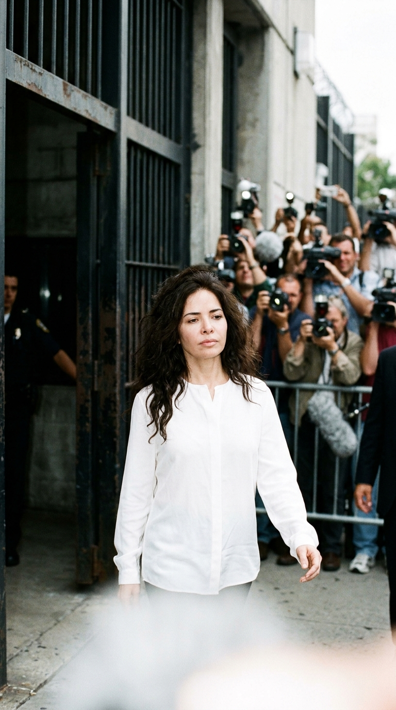
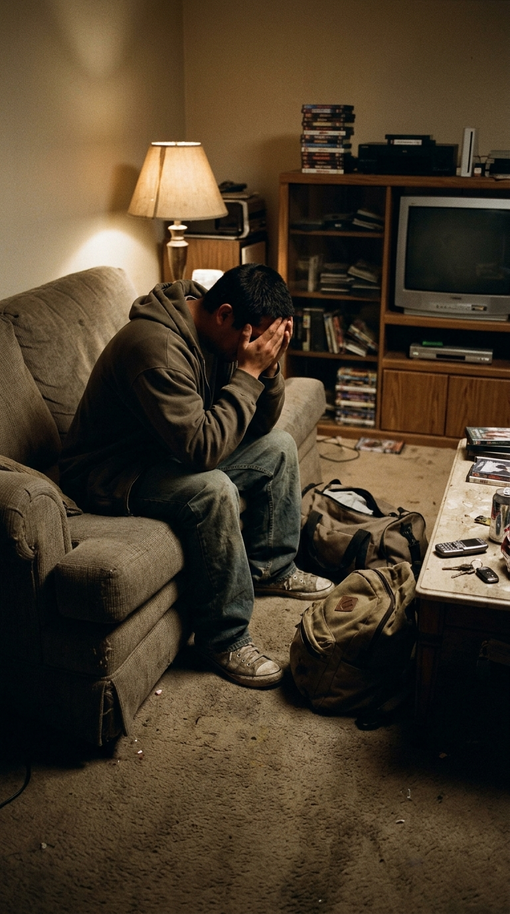
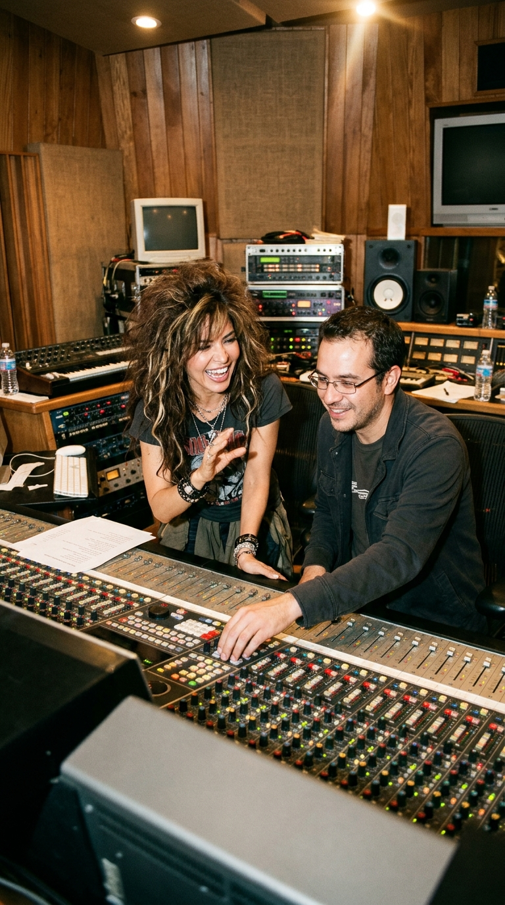
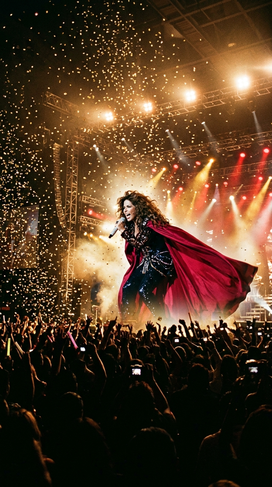
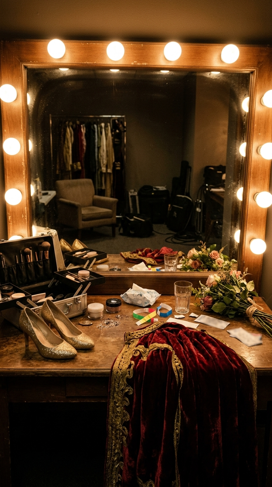

# De la celda y el repudio social a componer el mayor himno de dignidad del pop latino

**Por el equipo editorial de Acordes Ocultos**

---

> *«Y me solté el cabello, me vestí de reina, me puse tacones, me pinté y era bella... y caminé hacia la puerta, te escuché gritarme, pero tus cadenas ya no pueden pararme.»*

En el verano de 2006, una ráfaga de sintetizadores implacables y percusiones electrónicas irrumpió con violencia en las emisoras de radio y las pistas de baile de toda Iberoamérica. La canción llevaba por título *«Todos me miran»*, y su intérprete era Gloria Trevi. Para millones de personas que llenaron discotecas en Ciudad de México, Madrid, Bogotá o Miami, la pieza parecía a primera vista una celebración desbordada de glamour, vanidad y desinhibición nocturna.

Sin embargo, detrás de aquel estribillo monumental no latía la frivolidad de una fiesta, sino el choque de dos supervivencias extremas: el llanto de un joven arrojado a la calle por su propia familia al revelar su identidad, y el calvario de una artista que intentaba ponerse en pie tras haber descendido a los círculos más oscuros del escarnio público y la privación de la libertad.

---

## Acto I: El veredicto y el abismo social (2004–2005)

El 21 de septiembre de 2004, las puertas del Centro de Readaptación Social de Chihuahua se abrieron. Tras cuatro años y ocho meses recluida entre cárceles de máxima seguridad en Brasilia y el norte de México, el juez Javier Pineda Arzuz dictó la sentencia definitiva: absolución total y libertad inmediata por no haberse encontrado elemento probatorio alguno que la vinculara a los delitos imputados por la fiscalía.

No obstante, la absolución en los tribunales no detuvo el juicio sumarísimo de la opinión pública. La industria discográfica, los programadores de radio y los consorcios televisivos que durante años habían alimentado el linchamiento mediático la consideraban un cadáver artístico irrecuperable. Con las cuentas congeladas, deudas acumuladas y el rechazo social latente en cada esquina, Gloria se instaló en una austera cotidianidad, intentando reencontrarse con la maternidad y con una vocación musical que parecía herida de muerte.

Volver a los escenarios no era una ambición comercial; era una necesidad biológica de respirar. Pero el aire exterior estaba cargado de miradas inquisidoras y susurros acusatorios. Gloria descubrió que la celda más difícil de abrir no estaba hecha de rejas de acero, sino de prejuicios colectivos.

---

## Acto II: La confesión de un amigo y la lágrima en el espejo (2005)

En medio de aquel clima de aislamiento, Gloria recibió en su entorno íntimo a un muchacho muy cercano. El joven, quebrado emocionalmente y al borde del colapso, le confesó el infierno que acababa de vivir: tras armarse de valor para hablar con su padre y revelar su homosexualidad, la reacción familiar fue despiadada. Su progenitor, un hombre de arraigadas convicciones machistas y autoritarias, lo agredió físicamente, lo llenó de improperios y lo expulsó de la casa familiar sin dinero ni pertenencias, advirtiéndole que para ellos estaba muerto.

Aterrado, durmiendo en sofás prestados y sumido en una depresión que rozaba pensamientos suicidas, aquel amigo le relató a Gloria el único ritual que lo mantenía con vida:

> *«Cuando llega el fin de semana y siento que el dolor me va a tragar, me encierro en un baño, me maquillo, me pongo tacones, me visto como una reina y me voy a bailar a un club. Bajo esas luces, nadie puede humillarme. Allí no soy el hijo repudiado; soy libre, soy hermoso y soy invencible.»*

Al escuchar aquellas palabras, algo se quebró y se iluminó al mismo tiempo en el pecho de la cantante. Gloria reconoció con exactitud quirúrgica cada una de las sensaciones descritas por su amigo: el frío del rechazo, la mirada acusadora de los demás, la vergüenza impuesta por la moral ajena y, sobre todo, la urgencia de erigir una armadura de dignidad frente a quienes pretenden destruirte.

---

## Acto III: El vuelo de avión y la alianza con Armando Ávila (2005–2006)

Pocos días después de aquella conversación, durante un vuelo comercial rumbo a Ciudad de México, Gloria no pudo dormir. En su libreta de notas, a miles de metros de altura, las palabras comenzaron a fluir con la urgencia de un dictado visceral:

> *«Tú me hiciste sentir que no valía / y mis lágrimas cayeron a tus pies / me miraba en el espejo y no me hallaba / yo era sólo lo que tú querías ver...»*

Aquellas primeras estrofas no hablaban de un desamor romántico común; retrataban la anulación de la identidad impuesta por una figura de poder. Pero el giro de la canción no se quedaba en el lamento: en el pre-coro irrumpía la metamorfosis liberadora (*«Y me solté el cabello, me vestí de reina...»*), desembocando en una catarsis desafiante donde la mirada ajena dejaba de ser un arma de opresión para convertirse en un trofeo de soberanía personal.

Con el texto terminado, Gloria acudió a los estudios del laureado productor mexicano **Armando Ávila**. Conocedor del pulso del pop contemporáneo, Ávila comprendió de inmediato la dimensión del mensaje. Juntos decidieron no arropar la letra como una balada testimonial sombría, sino transformarla en una máquina rítmica de combate.

Inspirados en la estructura emblemática de *«I Will Survive»* de Gloria Gaynor —donde el dolor íntimo se sublima en una explosión bailable—, Ávila construyó una arquitectura sonora a base de sintetizadores analógicos, líneas de bajo de alta propulsión electro-pop y arreglos orquestales dramáticos. La voz de Trevi, desgarrada y volcánica, no cantaba desde la distancia técnica, sino con la rabia de quien sabe lo que cuesta recuperar la respiración.

---

## Acto IV: La catarsis colectiva y el estandarte eterno (2006)

Incluida como tema inédito de estudio en el álbum *La trayectoria* (2006), *«Todos me miran»* vio la luz en mayo de aquel año. La respuesta del público fue un estallido sísmico que desbordó cualquier pronóstico de la industria.

En cuestión de semanas, la canción trepó al número uno de las listas de popularidad en México, España, Estados Unidos y Sudamérica. Sin embargo, su verdadero triunfo no se midió en las cifras de ventas, sino en los espacios de resistencia social. En discotecas, marchas de orgullo y reuniones comunitarias, la comunidad LGBTQ+ adoptó la canción como su himno definitivo. Miles de jóvenes que habían vivido la exclusión familiar, el acoso escolar o la marginación social encontraron en aquellos versos un escudo invulnerable para caminar con la cabeza erguida.

Para Gloria Trevi, el tema representó la resurrección más improbable de la historia del pop latino. Demostró que ninguna campaña de desprestigio ni ningún muro institucional pueden silenciar a un artista cuando su obra se funde con el dolor real de su gente. Al intentar salvar del abismo a un amigo, Gloria terminó salvando su propia voz para siempre.

---

## Epílogo: La victoria de la dignidad

Veinte años después de su lanzamiento, *«Todos me miran»* permanece intacta en la memoria colectiva de millones de personas. Su permanencia no obedece a modas sonoras pasajeras, sino a una verdad humana innegociable: el derecho irrenunciable a existir, a amarse y a ser mirado sin miedo.

La historia de esta obra recuerda que la música más luminosa a menudo nace en los rincones más oscuros del sufrimiento, y que no existe mayor acto de valentía que transformar la herida del rechazo en una corona de dignidad indestructible.

---

### 📚 Fuentes y Archivo Documental

1. **Expediente Judicial de Absolución (2004).** Juzgado Séptimo Penal del Distrito Judicial Morelos, Chihuahua, México. Sentencia absolutoria dictada por el juez Javier Pineda Arzuz en favor de Gloria Treviño Ruiz (21 de septiembre de 2004).
2. **Trevi, Gloria.** Declaraciones testimoniales en el programa *La Entrevista con Yordi Rosado* (junio de 2021) y *El Minuto que Cambió mi Destino* con Gustavo Adolfo Infante. Relato documental sobre la génesis de *«Todos me miran»* a partir de la vivencia de su amigo expulsado de su hogar.
3. **Ávila, Armando.** Entrevistas de archivo para *Billboard Latin* y *Rolling Stone México* (2006–2007) sobre la producción, arreglos sonoros y mezcla de *«Todos me miran»* en los estudios Cosmos Producciones.
4. **Archivo Hemerográfico de El Universal y Reforma (2004–2006).** Crónicas de cobertura periodística sobre la liberación de Gloria Trevi, el lanzamiento del álbum *La trayectoria* y el impacto en listas radiales iberoamericanas.
5. **Estudios Culturales de Género y Música Popular Hispanoamericana (Universidad Nacional Autónoma de México, UNAM, 2018).** Monografía sobre la recepción de *«Todos me miran»* como himno de resistencia e identidad colectiva en los colectivos de diversidad sexual en México y América Latina.
