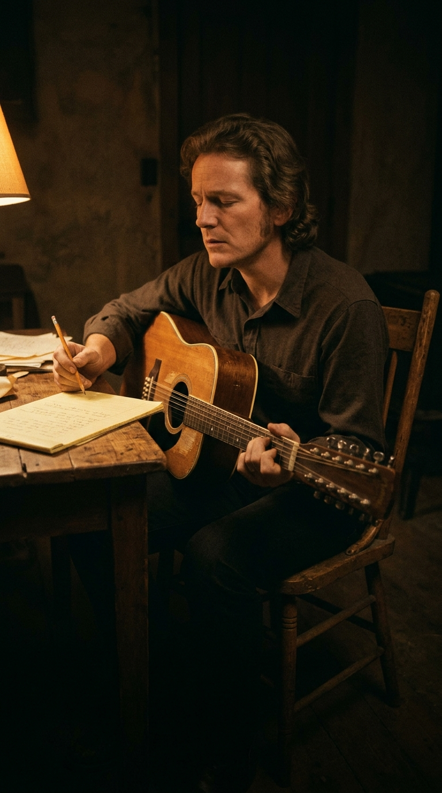
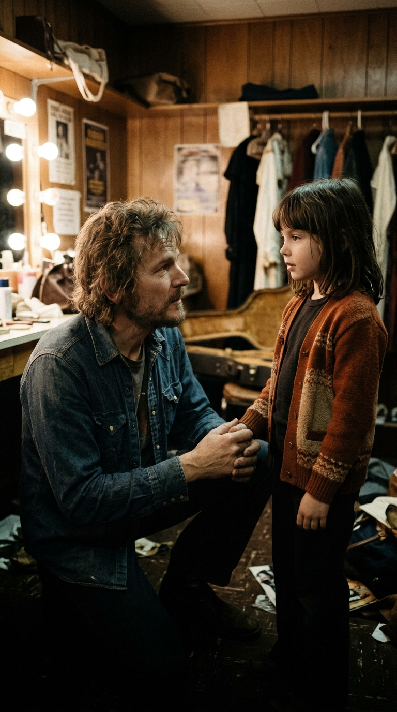
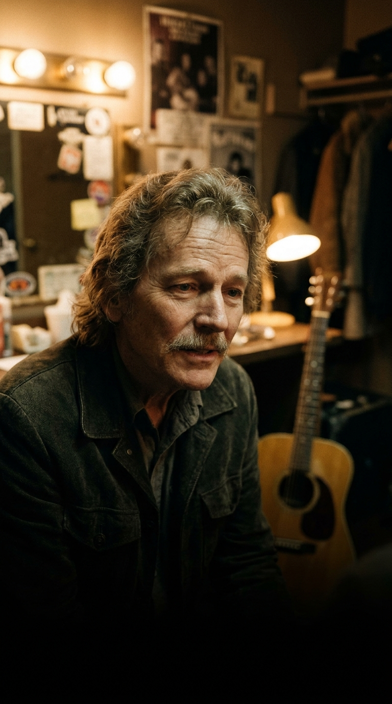

# La balada que su propia hija le obligó a corregir: Gordon Lightfoot y la herida abierta de «If You Could Read My Mind»

**Por el equipo editorial de Acordes Ocultos**

Hay canciones de amor que se desbordan en gritos, promesas eternas y dramatismo desmedido. Y luego existen aquellas pocas obras maestras que comprenden que el verdadero final de un matrimonio rara vez llega con un portazo violento, sino con la quietud gélida de una habitación vacía donde dos personas descubren que ya no tienen nada que decirse.

En el verano de 1969, Gordon Lightfoot se encontraba sentado en el suelo de madera de una casa recién alquilada en Toronto. A su alrededor solo había cajas de cartón sin abrir, rollos de cinta adhesiva y el eco sordo de sus propios pasos. Su matrimonio de casi diez años con la sueca Brita Ingegerd Olaisson había llegado a su punto de no retorno. No hubo escándalos de tabloide ni disputas públicas: simplemente, los meses interminables de giras por carretera, las ausencias prolongadas y las grietas invisibles de la convivencia habían marchitado lo que alguna vez pareció inquebrantable.

Aquella tarde, despojado de poses de estrella y armado únicamente con su guitarra acústica de doce cuerdas, el cantautor canadiense comenzó a rasguear una secuencia melancólica y circular. De esa penumbra doméstica nació *«If You Could Read My Mind»*, una de las reflexiones más lúcidas, poéticas y descarnadas sobre el fracaso sentimental jamás grabadas. Sin embargo, en el corazón de aquella canción perfecta latía un reproche amargo: una frase que responsabilizaba por completo a su expareja del naufragio. Tendrían que pasar varios años para que la persona más inocente de aquella historia —su propia hija— le hiciera ver que en la muerte del amor nadie sale con las manos completamente limpias.

---

### Acto I: El silencio en una casa vacía (Toronto, 1969)

A finales de la década de 1960, Gordon Lightfoot ya era considerado un tesoro nacional en Canadá y un compositor admirado en Estados Unidos. Figuras de la talla de Bob Dylan, Peter, Paul and Mary y Judy Collins habían versionado sus temas con enorme éxito. No obstante, el reconocimiento artístico y el frenesí de los viajes cobraron un peaje devastador en su vida privada.

En 1963, Gordon se había casado con Brita Olaisson, una joven sueca con quien tuvo dos hijos: Fred e Ingrid. Al principio, la familia intentó adaptarse al ritmo implacable de un músico en ascenso, pero la distancia física pronto se transformó en un abismo emocional. Las giras interminables por clubes de folk estadounidenses y los excesos propios de la vida nocturna terminaron por dinamitar la intimidad conyugal.

Cuando el matrimonio colapsó de manera irreversible en 1969, Lightfoot empacó sus pertenencias básicas y se mudó a una residencia temporal desprovista de muebles. Aquel espacio despojado funcionó como una cámara de resonancia para su soledad. «Estaba completamente solo en una casa vacía. No había muebles, solo cajas de mudanza, mi guitarra y un bloc de notas», recordaría años después el músico. 

En lugar de caer en el despecho estridente o en la autocompasión melodramática, Gordon abordó el duelo con la metáfora del cine clásico. La letra imaginaba su mente como una película antigua sobre un fantasma atrapado en un pozo de los deseos, un castillo oscuro o una fortaleza inexpugnable donde los sentimientos se habían consumido sin posibilidad de retorno: *«I don't know where we went wrong, but the feeling's gone and I just can't get it back»* (*«No sé en qué nos equivocamos, pero el sentimiento se ha ido y simplemente no puedo recuperarlo»*).

---

### Acto II: La sesión en Sunwest y el dardo en la última estrofa

A comienzos de 1970, Lightfoot viajó a Los Ángeles para grabar su debut bajo el sello Reprise Records, una filial de Warner Bros. comandada por ejecutivos visionarios como Mo Ostin y Joe Smith. En los estudios Sunwest Recording de Hollywood, bajo la producción de Lenny Waronker y Joe Wissert, las sesiones adquirieron una atmósfera íntima y orgánica.

El arreglo del tema fue una obra maestra de sutileza: Gordon Lightfoot llevó el peso rítmico con su guitarra acústica Martin de doce cuerdas, mientras el virtuoso guitarrista de sesión Red Shea aportaba los delicados arpegios melódicos que envuelven la voz. Para darle un vuelo cinematográfico sin caer en el sentimentalismo empalagoso, el legendario arreglista Nick DeCaro escribió una partitura de cuerdas sobrecogedora, que parece deslizarse como la niebla matutina sobre la melodía.

Sin embargo, al registrar la voz definitiva en el estudio, Gordon dejó grabado un verso que revelaba el resentimiento latente de la separación. En la estrofa final, tras lamentar el final de la historia como un actor que queda atrapado en un guion a tres bandas, Lightfoot cantó:

> *«And if you read between the lines,*  
> *you'll know that I'm just trying to understand*  
> *the feelings that you lack.»*  
> *(«Y si lees entre líneas, sabrás que solo intento comprender los sentimientos de los que tú careces»).*

En aquella frase original, la culpa del distanciamiento recaía de manera exclusiva sobre Brita. Era una acusación velada de frialdad emocional: él había intentado comprenderla, pero ella, supuestamente, era incapaz de sentir.

---

### Acto III: El fenómeno radial inesperado y el costo de una vida rota

El álbum fue publicado inicialmente en abril de 1970 bajo el título *Sit Down Young Stranger*. Durante los primeros meses, el disco pasó prácticamente desapercibido en las listas comerciales. La compañía discográfica no había previsto lanzar *«If You Could Read My Mind»* como sencillo principal. 

Fue la espontaneidad de los programadores de radio lo que alteró el destino del proyecto. En ciudades como Seattle y Filadelfia, varios directores de emisoras comenzaron a poner al aire la pista del álbum por iniciativa propia, fascinados por la respuesta inmediata de los oyentes, que llamaban a las cabinas telefónicas conmovidos hasta las lágrimas para averiguar quién cantaba aquella balada.

Al percatarse del impacto masivo, Warner Bros. tomó una decisión drástica: retiró los ejemplares restantes de las tiendas, rediseñó la portada y relanzó el álbum rebautizándolo con el nombre de la canción. Para comienzos de 1971, *«If You Could Read My Mind»* trepó hasta el puesto número uno en las listas de Canadá y alcanzó el quinto lugar en el Billboard Hot 100 de Estados Unidos, transformando a Gordon Lightfoot en una estrella internacional de primer orden.

Aquel éxito deslumbrante, sin embargo, contrastaba de forma desgarradora con la realidad personal del cantautor. En 1973 se formalizó el divorcio judicial de Brita. La resolución legal otorgó a su exesposa un acuerdo multimillonario y un porcentaje significativo de sus regalías, catalogado en aquel momento por la prensa como el divorcio más costoso de la historia legal canadiense. Lejos de apelar con amargura o quejarse en público, Lightfoot demostró una notable decencia moral: «Ella merecía cada centavo. Estuve demasiado tiempo ausente y la hice atravesar situaciones sumamente difíciles», reconoció con sobria honestidad.

---

### Acto IV: La lección de Ingrid

Durante años, Lightfoot interpretó la canción en teatros y festivales de todo el mundo repitiendo cada noche aquel reproche grabado en vinilo. Para el público era un verso más dentro de una hermosa balada de desamor; para su familia, era un recordatorio constante de una herida abierta.

A mediados de la década de 1970, su hija Ingrid, que había crecido observando a su padre desde bastidores y escuchando las canciones que hablaban de la ruptura de sus padres, decidió hablar con él con la sinceridad desarmante que solo la inocencia infantil puede tener.

Al terminar una prueba de sonido en el camerino, Ingrid se acercó a Gordon y le planteó una pregunta directa:  
*«Papá, ¿por qué cantas que a mamá le faltaban sentimientos? En una separación nunca es culpa de una sola persona. A los dos les faltó algo»*.

Aquel comentario infantil cayó sobre Lightfoot con la fuerza de una revelación. En un instante, el cantautor consagrado comprendió que su dardo lírico no era más que un mecanismo de defensa nacido del orgullo herido. Al acusar a su exesposa de carecer de sentimientos, había intentado eludir su propia responsabilidad en el fracaso conyugal: sus ausencias, sus excesos y su incapacidad para sostener la intimidad cotidiana.

Despojado de vanidad, Gordon aceptó la enmienda de su hija de inmediato. Desde aquel día, y durante las más de cuatro décadas siguientes de conciertos ininterrumpidos hasta su fallecimiento en 2023, Lightfoot jamás volvió a cantar el verso original. En cada actuación en vivo, cambió conscientemente una sola palabra:

> *«...trying to understand the feelings that **we** lack.»*  
> *(«...intentando comprender los sentimientos de los que **ambos** carecemos»).*

Al sustituir el acusatorio *«you»* por el colectivo *«we»*, la canción pasó del juicio rencoroso a la madurez ética. No era la queja de una víctima solitaria, sino la confesión compartida de dos seres humanos que, a pesar de haberlo intentado, no lograron salvarse mutuamente del naufragio.

---

### Epílogo: La herencia de un perdón sincero

A lo largo de las décadas, *«If You Could Read My Mind»* fue adoptada por artistas de sensibilidades disímiles: desde Johnny Cash, que la dotó de una gravedad crepuscular estremecedora, hasta Neil Young, Barbra Streisand y Olivia Newton-John. Sin embargo, ninguna interpretación igualó la honestidad descarnada de su autor original, cuya voz fue adquiriendo con los años los matices gastados y nobles del roble añejo.

En una industria musical dominada por egos monumentales y vanidades indestructibles, el gesto de Gordon Lightfoot de corregir su obra más célebre a instancias de su hija permanece como una lección imperecedera de humildad. Nos recuerda que la verdadera poesía no reside en tener la última palabra en una discusión, sino en la valentía de admitir nuestras propias sombras.

Cuando las luces de los escenarios se apagan y los aplausos se desvanecen en la memoria, lo único que perdura de una canción es su verdad humana. Gordon Lightfoot no pudo salvar su matrimonio en aquella casa desierta de Toronto en 1969; pero gracias a la mirada limpia de su hija, logró que su obra maestra se convirtiera en un refugio eterno para todos aquellos que han tenido que aprender a soltar sin odio, entendiendo que el final del amor duele más cuando se comprende que la ausencia siempre pertenece a los dos.

---

### 📚 Fuentes y Archivo Documental

* **Lightfoot, Gordon.** Entrevistas de archivo con la Canadian Broadcasting Corporation (CBC), retrospectivas biográficas (1975–2015).
* **Jennings, Nicholas.** *Lightfoot* (Viking / Penguin Random House Canada, 2017). Biografía autorizada del cantautor canadiense.
* **Billboard Magazine.** Archivo hemerográfico de listas de éxitos (Hot 100 y Adult Contemporary, enero–abril de 1971).
* **Rolling Stone Magazine.** Reseñas y ensayos sobre la discografía de Gordon Lightfoot y las sesiones en Sunwest Recording Studios (1970).
* **The Toronto Star.** Crónicas de prensa sobre la escena folk de Yorkville y los registros judiciales de la separación de Lightfoot (1969–1973).
