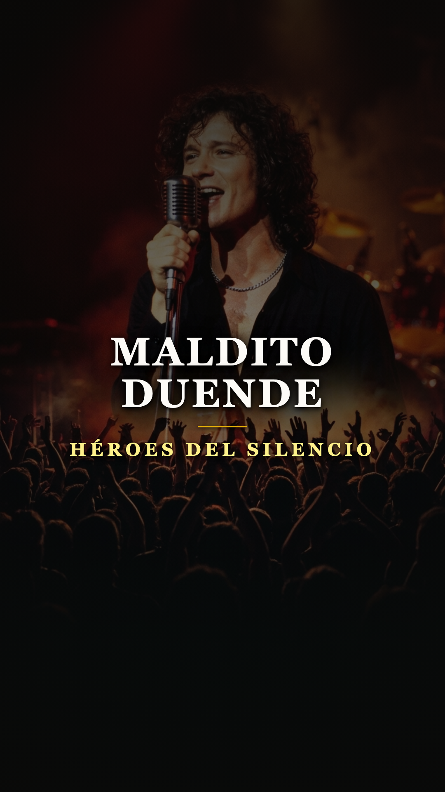

# El poema de un niño de 14 años que se convirtió en leyenda: la historia oculta de «Maldito Duende»

### Por Acordes Ocultos
*Dedicado a quienes encontraron en la madrugada un refugio contra la soledad.*

---

### Prólogo: La llamada de la medianoche

Pocos segundos bastan en la historia del rock en castellano para provocar un estremecimiento tan unánime. No hacen falta distorsiones aplastantes ni alardes pirotécnicos: solo un arpegio limpio, circular y magnético brotando de una guitarra eléctrica, seguido por una voz oscura y solemne que parece emerger de las sombras de un callejón mojado. 

Cuando *«Maldito Duende»* comenzó a rotar en la radio y la televisión en la primavera de 1991, **Héroes del Silencio** dejó de ser una promesa prometedora de provincias para transformarse en un fenómeno cultural desbordante. El tema trepó hasta el número uno de las listas de éxitos, convirtió su segundo disco, *Senderos de Traición* (1990), en un clásico instantáneo y abrió las puertas de par en par para una insólita conquista de estadios no solo en América Latina, sino en el corazón de Europa Central.

Para millones de seguidores que coreaban sus versos con fervor casi religioso, aquella pieza simbolizaba la cumbre de la madurez poética de una banda en la cúspide de su fuerza.

Sin embargo, detrás de la liturgia escénica y los reflectores, el origen de la canción escondía un secreto entrañable y conmovedor: sus versos más desgarradores no habían sido concebidos en las noches de desenfreno de una estrella de rock consagrada, sino en la solitaria libreta escolar de un adolescente de apenas catorce años que buscaba desesperadamente una salida al tedio de su realidad cotidiana.

---

### Acto I: El cuaderno escolar de Zaragoza

A comienzos de los años ochenta, en una Zaragoza provinciana que aún se sacudía el polvo de décadas de aislamiento cultural, un jovencísimo **Enrique Ortiz de Landázuri** se sentía un náufrago. Introvertido, devorador voraz de libros de literatura francesa y fascinado por el simbolismo de Rimbaud, Baudelaire y la ironía melancólica de Oscar Wilde (de cuya obra adoptaría más tarde su emblemático apellido artístico, «Bunbury»), el muchacho pasaba las tardes encerrado en su habitación huyendo del entorno escolar y familiar.

En aquel santuario doméstico, con apenas catorce años, Enrique comenzó a plasmar en un cuaderno escolar una serie de pensamientos sobre la noche, el escapismo y la fragilidad del ser humano.

Lejos de la inocencia propia de su edad, los versos destilaban una hondura poética inusitada: la idea de que la noche ofrecía un manto protector donde las diferencias se desvanecían y un ser invisible —un «duende» nocturno— invitaba a soñar, otorgando una efímera sensación de poder y eternidad. 

Aquellos versos quedaron durmiendo en un cajón durante casi una década, mientras Enrique comenzaba a foguearse como bajista y cantante en grupos escolares como Proceso Entrópico y Zumo de Vidrio, antes de cruzarse en el camino del guitarrista **Juan Valdivia**.

---

### Acto II: La trampa del sonido prefabricado

Para 1988, ya formalizados como Héroes del Silencio junto al bajista Joaquín Cardiel y el baterista Pedro Andreu, la banda logró firmar con la multinacional EMI y publicar su álbum debut, *El mar no cesa*. El disco fue un éxito comercial rotundo gracias a canciones como *«Héroe de leyenda»* y *«Flor venenosa»*, pero en el fuero interno de los músicos la experiencia dejó un sabor amargo.

El productor Gustavo Montesano (exintegrante de Olé Olé) había suavizado el filo cortante del grupo, envolviéndolo en baterías electrónicas, cajas de ritmos y cámaras de reverberación típicas del tecno-pop ochentero. Héroes sonaba en el vinilo como un producto pop complaciente, mientras que en los clubes y festivales su directo era una fiera oscura, ruidosa y visceral.

La banda comprendió que, si no tomaban el control absoluto de su sonido para el segundo álbum, quedarían reducidos a una moda juvenil pasajera. Necesitaban un aliado internacional que comprendiera la crudeza del rock anglosajón y respetara la tensión dramática de su música.

La oportunidad apareció de forma inesperada en el verano de 1989. Durante un festival en Calatayud, los cuatro músicos descubrieron que entre bastidores se encontraba nada menos que **Phil Manzanera**, el legendario guitarrista de **Roxy Music** y reputado productor británico. Sin dudarlo, Bunbury y Valdivia se acercaron con timidez pero con firmeza, le entregaron un casete con sus maquetas y le rogaron que fuera a verlos tocar en directo.

Manzanera aceptó la invitación. Esa misma noche, al ver a Enrique retorcerse sobre el escenario y escuchar la densidad arquitectónica de la guitarra de Juan, el músico británico quedó atónito. Al terminar el concierto, subió al camerino y les estrechó la mano: *«Grabaremos vuestro próximo disco»*.

---

### Acto III: El milagro en los estudios Kirios

En el otoño de 1990, la banda y Phil Manzanera se encerraron en los Estudios Kirios de Madrid para registrar *Senderos de Traición*. La consigna del productor fue radical y liberadora: despojar a la música de cualquier truco electrónico, apagar los sintetizadores de relleno y permitir que la interacción entre el arpegio limpio de Juan Valdivia y la voz teatral de Bunbury respirara con total naturalidad.

Fue en esas sesiones donde Enrique rescató aquel viejo poema de su adolescencia y se lo mostró a Valdivia. Juan tomó su guitarra eléctrica y, procesando su señal a través de un pedal de chorus y un delay sobrio y analógico, compuso una secuencia de acordes arpegiados que parecía el latido de un péndulo en medio de la niebla.

La interpretación vocal de Enrique alcanzó cotas de magnetismo insospechadas. Versos que nacieron de la melancolía de un niño de catorce años cobraron de pronto una dimensión casi mística:

> *«He oído que la noche es toda magia / y que un duende te invita a soñar. / Y sé que te envuelve en su manto de estrellas / y te sientes tan fuerte que olvidas lo que es la soledad...»*

La canción crecía desde un susurro introspectivo hasta un estribillo catártico y arrollador: *«Y las agujas para los que son como yo... ¡Amanecer colgando de tus labios!»*. En apenas tres tomas de grabación, el milagro estaba consumado.

---

### Acto IV: La furia de la crítica y la consagración popular

Lanzado como segundo sencillo de *Senderos de Traición* en marzo de 1991, *«Maldito Duende»* desató un terremoto. El 20 de abril de 1991 coronó la lista de Los 40 Principales y convirtió al cuarteto aragonés en ídolos de masas.

Sin embargo, ese triunfo popular avivó una hostilidad feroz por parte de la prensa musical especializada de Madrid y Barcelona. Revistas influyentes como *Rockdelux* los trataban con desprecio aristocrático, tachando las letras de Bunbury de «pretenciosas», «incomprensibles» o «góticas de saldo». Para los sectores puristas de la Movida, cuatro chicos de Zaragoza sin padrinos en la capital no tenían derecho a usurpar el trono del rock.

Pero al público de los barrios, ajeno a los dictados de los críticos de salón, la canción le pertenecía por derecho propio. Durante años, la juventud española y latinoamericana debatió apasionadamente el significado de la letra. Para unos, era la metáfora perfecta de la adicción y los paraísos artificiales que marcaron a la generación de la resaca de la heroína; para otros, era la encarnación del «duende» lorquiano: esa fuerza salvaje que embriaga al creador sobre el escenario, pero que lo condena a la más amarga soledad cuando se encienden las luces del recinto y el público se marcha a casa.

---

### Epílogo: El pacto con el tiempo

Más de tres décadas después de su publicación, *«Maldito Duende»* permanece inalterable en el olimpo de las composiciones inmortales del rock en nuestra lengua. Cuando Enrique Bunbury se reencontró con la banda en la histórica gira de despedida de 2007, aquel arpegio inicial volvió a hacer rugir a decenas de miles de personas en estadios de Monterrey, Buenos Aires, Ciudad de México y Zaragoza como si el tiempo se hubiera detenido.

La historia de esta obra maestra nos recuerda una lección hermosa sobre el misterio de la creación artística: que detrás de los himnos monumentales que hacen temblar estadios de fútbol no siempre hay estrategias de laboratorio, sino la honestidad desnuda de un cuaderno de infancia. 

Porque a veces, el dolor y la soledad de un niño de catorce años son suficientes para alumbrar una luz que jamás se apaga.

---

### 📚 Fuentes y Archivo Documental

1. **Bunbury, Enrique**. Testimonios autobiográficos sobre la génesis temprana de *Maldito Duende*, la poesía simbolista y las sesiones de *Senderos de Traición* en *El método Bunbury* de Fernando Navarro (Alianza Editorial, 2023) y *Bunbury: En ruta con Héroes del Silencio* (2012).
2. **Valdivia, Juan**. Entrevistas técnicas sobre el diseño de arpegios, guitarras y producción con Phil Manzanera en *Guitarrista Magazine* (edición española, 1998, 2007).
3. **Manzanera, Phil**. Notas de producción de las sesiones de grabación en Estudios Kirios (Madrid) y Metropolis Studios (Londres), EMI-Odeón Records Archive (1990).
4. **Cardiel, Joaquín & Andreu, Pedro**. Testimonios documentales en el libro biográfico oficial *Héroes del Silencio: 50 años de rock* de Míchel Royo (Zaragoza, 2017).
5. **García Lorca, Federico**. *Teoría y juego del duende* (Conferencia en Buenos Aires, 1933; marco conceptual de la metáfora del duende en la lírica de Bunbury).
6. **Radio Televisión Española (RTVE)**. Archivo documental *La edad de oro del rock español: Héroes del Silencio en directo* (Madrid, 1991).
