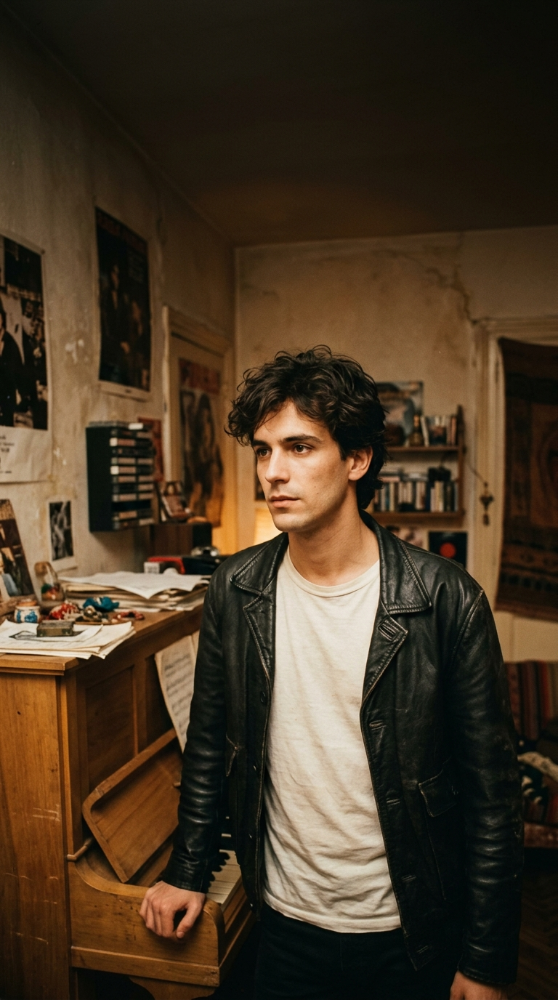
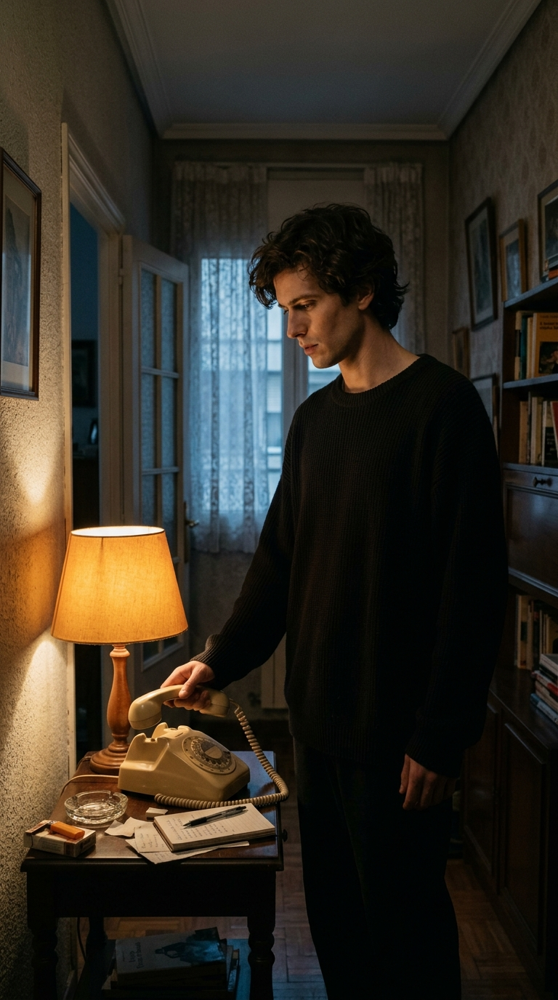
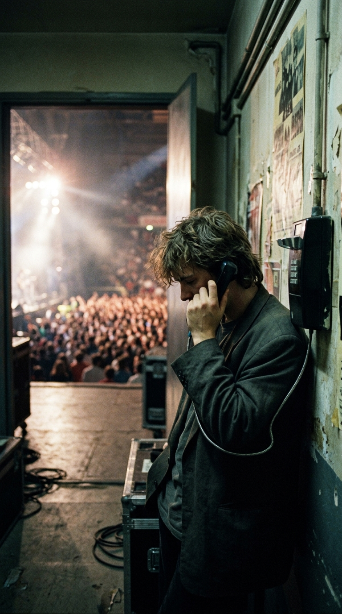
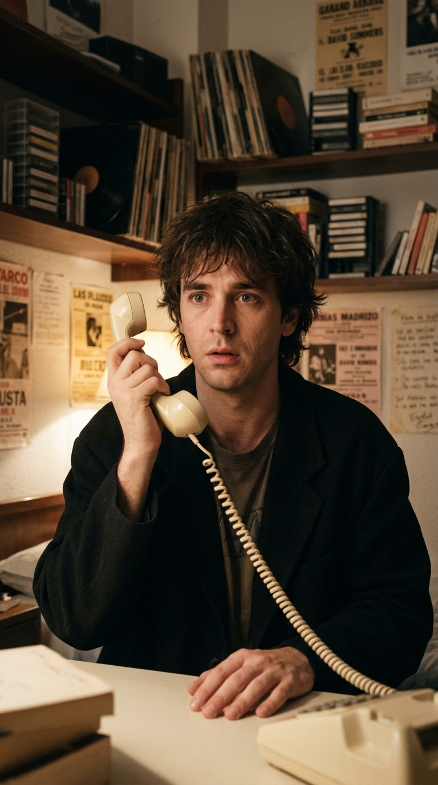
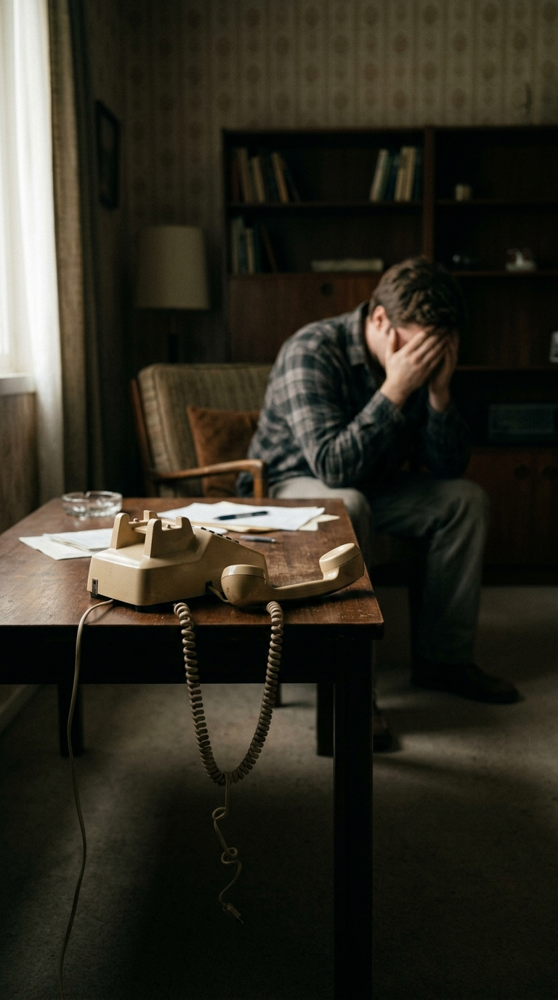
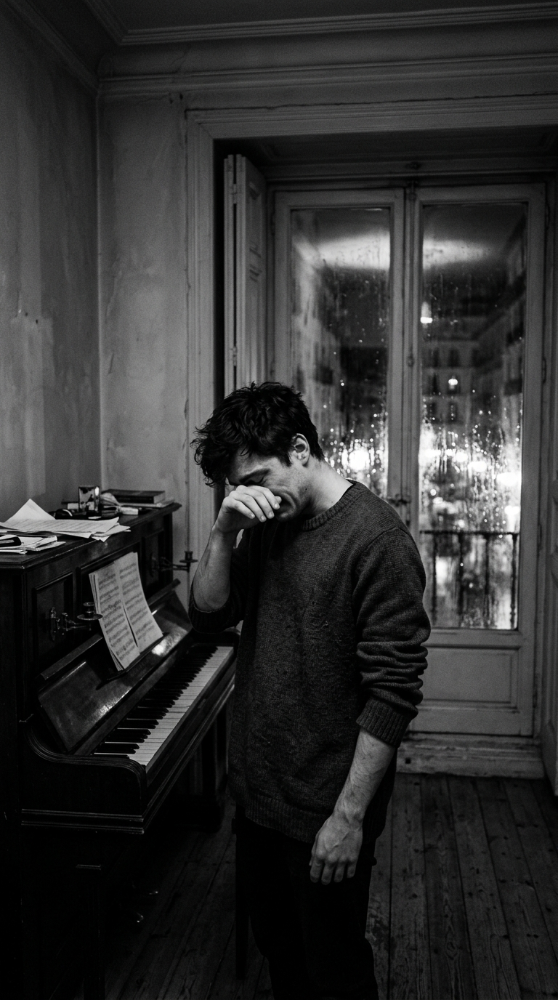
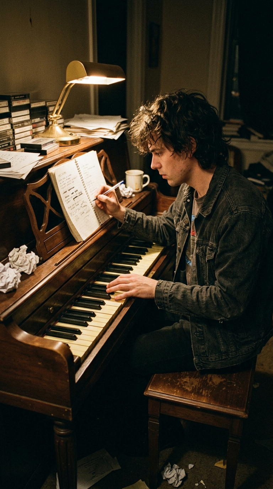
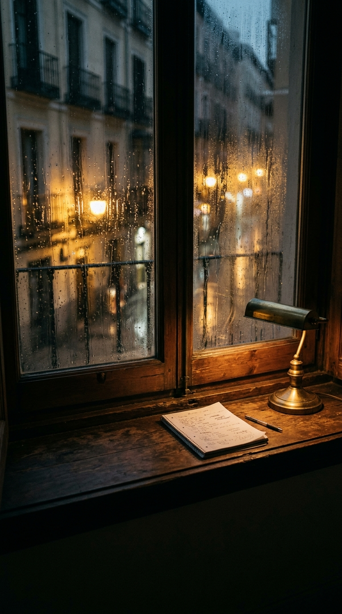

# «David, voy a colgar»: La llamada telefónica que rompió a David Summers y creó «Temblando» en diez minutos

## Prólogo: La llamada que heló la madrugada

En 1987, España vivía rendida a cuatro muchachos madrileños que parecían haber conquistado el mundo sin despeinarse. Llenaban plazas de toros hasta la bandera, paralizaban aeropuertos en México y Colombia, y sus canciones sonaban a todas horas en la radio como una ráfaga inagotable de juventud, insolencia y desenfado. David Summers, con veintitrés años recién cumplidos, era el rostro visible de aquel torbellino. Cualquier mirada exterior habría jurado que el joven cantante lo tenía todo: la fama desmedida, el reconocimiento de la industria y el cariño desbordado de millones de adolescentes.

Sin embargo, el éxito masivo suele cobrar una factura silenciosa en las distancias. Aquella misma primavera, mientras preparaban su tercer álbum de estudio, *Estamos locos... ¿o qué?*, David se encontraba a solas en una habitación en penumbra. El bullicio de los conciertos quedaba lejos. El único sonido que rompía la quietud era el timbre agudo y mecánico de un teléfono fijo. Al descolgar el auricular, esperando escuchar la voz cálida que solía aliviar el cansancio de las giras, se encontró con una muralla de frialdad que cambiaría su vida para siempre.

---

## Acto I: La euforia en la arena y el vacío en el hotel

El ascenso de Hombres G había sido fulgurante. Apenas dos años antes, tras la quiebra de su primera discográfica independiente y meses de incertidumbre donde nadie parecía apostar por ellos, el productor Paco Martín se había jugado su propio patrimonio con el sello Twins para lanzar su primer disco. Temas como *Devuélveme a mi chica*, *Venezia* y *Marta tiene un marcapasos* se convirtieron de inmediato en fenómenos sociológicos. Su segundo trabajo, *La cagaste... Burt Lancaster* (1986), superó el medio millón de copias en cuestión de semanas y dio paso al rodaje de su primera película, *Sufre mamón*, dirigida por el padre de David, el cineasta Manuel Summers.

Pero la otra cara de aquella vorágine eran los kilómetros de carretera, las ausencias prolongadas y las habitaciones de hotel impersonales. Mantener una relación sentimental a los veintitantos años bajo la lupa constante de la prensa y el asedio de miles de admiradoras era una tarea casi imposible. Las sospechas mutuas, las conversaciones apresuradas desde cabinas telefónicas y los silencios incómodos comenzaron a minar la confianza de la pareja.

Aquella noche, la distancia ya no era solo geográfica: era un abismo emocional insalvable.

---

## Acto II: El veredicto de las palabras secas

La conversación comenzó con una discusión tensa, cargada de reproches acumulados y celos cruzados. David intentaba contemporizar, acortar los kilómetros a través del hilo telefónico y rescatar el terreno común. Sin embargo, al otro lado de la línea la decisión ya estaba tomada de antemano.

Con una serenidad que le heló la sangre, su novia le comunicó que no tenía sentido continuar. La relación se había terminado. No era una pausa temporal ni una rabieta de juventud: le confesó abiertamente que estaba saliendo con otra persona y que lo más sensato para ambos era «quedar como amigos».

Para un muchacho de veintitrés años que creía haber blindado su corazón contra la adversidad, aquellas palabras cayeron como un mazazo demoledor. David se negó a aceptar el desenlace. Intentó argumentar, pedir explicaciones y rogar por una última oportunidad en persona. Pero la respuesta que recibió fue un corte quirúrgico, desprovisto de cualquier atisbo de duda:

> *«David... voy a colgar».*

El chasquido seco del auricular apoyándose sobre la horquilla al otro lado de la línea dejó la estancia sumida en un silencio atronador. En aquella época no había mensajes instantáneos ni segundas oportunidades digitales. La línea estaba muerta. La relación había concluido en una fracción de segundo.

---

## Acto III: Diez minutos frente al teclado

El propio David Summers ha recordado en numerosas entrevistas el estado de shock físico en el que quedó tras colgar el teléfono. Las manos le temblaban de forma involuntaria. La garganta se le había cerrado y el orgullo adolescente, herido de muerte, luchaba inútilmente por contener las lágrimas. Se había jurado a sí mismo, con la obstinación de quien no quiere mostrarse vulnerable, que jamás lloraría por un desamor.

Pero la herida era demasiado profunda para guardarla en silencio. A pocos metros descansaba el piano vertical de su habitación. Con el cuerpo aún estremecido y el temblor en los dedos, se sentó frente a las teclas de marfil. No hubo un proceso analítico de composición ni una búsqueda calculada de acordes complejos:

> *«Hay canciones que se piensan, que se construyen y se pulen durante meses. Y hay canciones que se vomitan directamente desde las entrañas. 'Temblando' fue de esas. La escribí en diez minutos exactos, llorando, sin tachar una sola palabra».*

Cada verso que brotaba sobre el papel era la transcripción literal de lo que acababa de experimentar: los ojos cerrados para no ver la realidad, el cielo nublado como reflejo del ánimo, el corazón frenado en seco y esa súplica inútil que resonaba en su cabeza: *«David, mi amor, me dijo: 'Espera, espera'... y yo te esperaba»*. La promesa rota de no derramar una lágrima se convirtió en la confesión más transparente de la música española: *«Y llorando, me había jurado que nunca iba a llorar...»*.

---

## Acto IV: De la herida íntima al himno generacional

Cuando Hombres G entró en los estudios de grabación en 1987 para dar forma a *Estamos locos... ¿o qué?*, *Temblando* destacaba como una anomalía absoluta dentro del repertorio. No había baterías enérgicas, guitarras distorsionadas ni el tono socarrón y gamberro que los había encumbrado. Era una pieza desnuda, sostenida casi exclusivamente por un piano melancólico y la voz quebrada y cercana de Summers, cantada con la respiración pegada al micrófono.

Aunque la discográfica apostó inicialmente por sencillos más rítmicos y festivos como *Una mujer de bandera* o *No, no... no*, el público convirtió a *Temblando* en el corazón emocional del álbum. Cuando la banda comenzó a interpretarla en directo, ocurrió un fenómeno singular: en medio de recitales donde el público saltaba y coreaba a gritos, al sonar los primeros acordes de piano los recintos enteros se sumían en un silencio sobrecogedor antes de estallar en un coro unísono de miles de personas cantando con los ojos cerrados.

La humillación privada de una llamada telefónica nocturna había dejado de pertenecer a David Summers para convertirse en el refugio de cualquiera que hubiera sentido alguna vez el peso insoportable de una despedida no deseada.

---

## Epílogo: Lo que queda cuando la voz tiembla

Casi cuatro décadas después de aquella noche de 1987, *Temblando* sigue siendo el momento culminante y más respetado en los conciertos de Hombres G. Las modas cambiaron, los integrantes maduraron y el tiempo limó las asperezas de la juventud; sin embargo, la canción conserva intacta su capacidad de estremecer.

David Summers ha reconocido con los años que aquella ruptura fue una de las mejores lecciones de su vida. El dolor de una noche de primavera le enseñó que la verdadera fuerza de una canción no reside en la insolencia ni en la euforia juvenil, sino en el coraje de mostrarse roto ante el mundo. Porque hay palabras que quiebran más que cualquier distancia, pero también hay melodías capaces de recoger los pedazos y transformar la herida más íntima en un abrazo colectivo que dura para siempre.

---

### 📚 Fuentes y Archivo Documental

1. **Summers, David.** *Hoy me he levantado dando un salto mortal*. Memorias autobiográficas. Ediciones Aguilar, Madrid, 2017. Testimonio directo sobre la gestación de *Temblando*, la ruptura telefónica de 1987 y el proceso compositivo en diez minutos.
2. **Hombres G — Archivo Histórico.** Discografía oficial: *Estamos locos... ¿o qué?* (Producciones Twins, 1987). Créditos de producción, personal de sesión en Estudios Trak (Madrid) e ingeniería de sonido a cargo de Paco Trinidad.
3. **Entrevistas Hemerográficas de Radio y Televisión.** Declaraciones de David Summers en el programa *La noche en vela* (RNE, 2018) y en entrevista en profundidad con Yordi Rosado (2022) sobre el origen real de la frase *«David, voy a colgar»*.
4. **Archivo de Prensa Musical (1985–1988).** Crónicas de conciertos y repercusión del álbum en diarios *El País*, *ABC* y revistas especializadas de la época (*El Gran Musical*, *Super Pop*), documentando la recepción crítica de la balada.
5. **Martín, Paco.** *Memoria viva del pop español*. Relato testimonial sobre la fundación de Twins y la selección de temas para el tercer disco de la banda.
