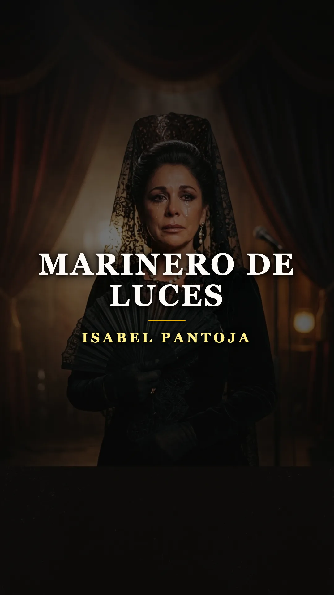
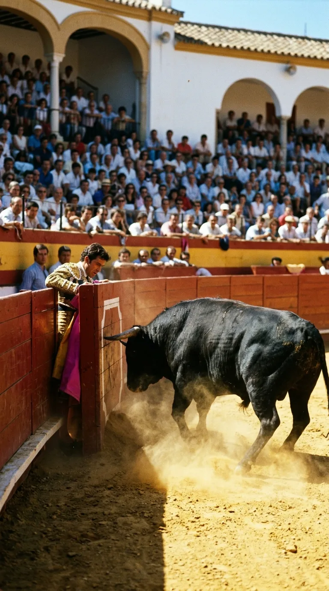
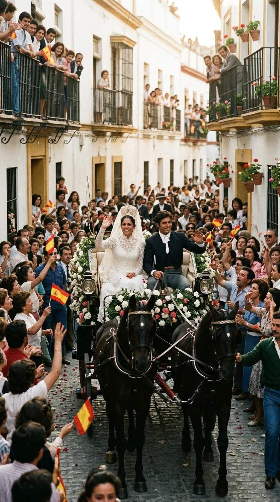
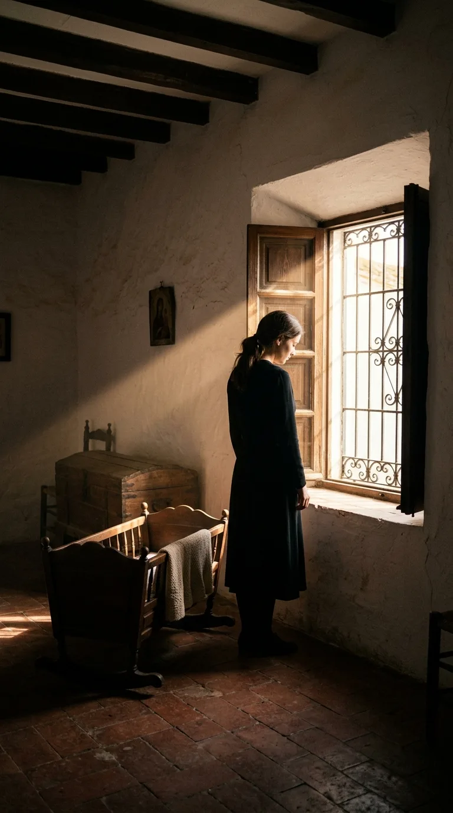
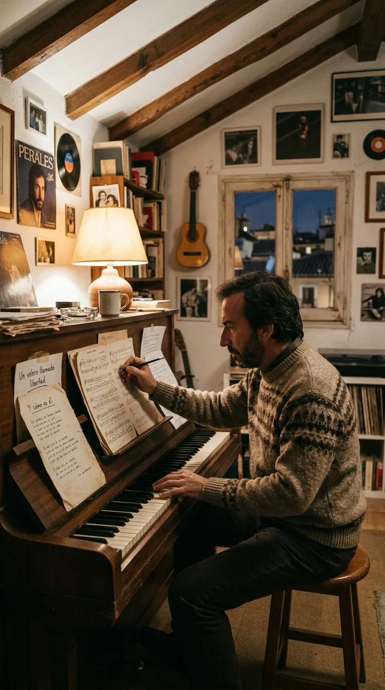
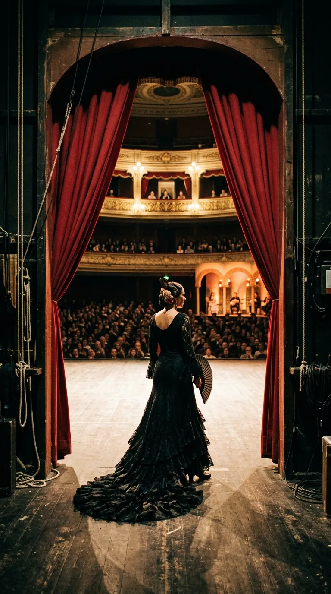
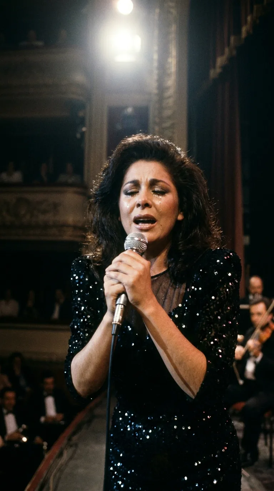

*Isabel Pantoja: El regreso desde el luto más profundo con la obra maestra que conmovió a España.*

### Prólogo: La calima de Pozoblanco y la serenidad en la camilla

La tarde del 26 de septiembre de 1984, la localidad cordobesa de **Pozoblanco** se asfixiaba bajo un sol plomizo de final de verano. Era el festejo de clausura de la feria de Nuestra Señora de las Mercedes. En los carteles figuraban dos jóvenes espadas, Vicente Ruiz «El Soro» y José Cubero «El Yiyo», junto a la máxima figura indiscutida del toreo de la época: **Francisco Rivera «Paquirri»**, con treinta y seis años y en el punto más alto de su madurez física y profesional.

Nadie sospechaba la tragedia. Saltó a la arena el cuarto toro de la corrida, llamado **«Avispado»**, cárdeno, marcado con el número 22 de la ganadería de Sayalero y Bandrés. Durante un quite con el capote ceñido a las tablas del tendido uno, el animal derrotó con violencia y prendió al matador por el muslo derecho. Avispado no soltó la presa de inmediato: suspendió el cuerpo en vilo de la taleguilla durante varios segundos atroces que paralizaron la respiración de la plaza.

Cuando sus hombres lograron zafarlo de las astas y llevarlo en volandas hasta la enfermería, la seda y el oro del traje de torear manaban una hemorragia imparable. El corresponsal de TVE en Córdoba, Antonio Salmoral, encendió su cámara y registró una escena que quedaría grabada para siempre en la retina de millones de españoles. Tendido sobre una modesta camilla de hule, lívido pero con una mirada de desconcertante serenidad, Paquirri clavó sus ojos en el cirujano de la plaza, el doctor **Eliseo Morán**, y pronunció una advertencia de escalofriante lucidez:

> *«Doctor, yo quiero hablar con usted o no me voy a quedar tranquilo. La cornada es fuerte. Tiene al menos dos trayectorias: una para acá y otra para allá. Abra todo lo que tenga que abrir, lo demás está en sus manos. Y tranquilo, doctor»*.

*Pozoblanco, 26 de septiembre de 1984: La angustia en el callejón de la plaza tras el derrote fatal de Avispado en el muslo de Paquirri.*

El pitón de Avispado había reventado la vena safena y la arteria femoral. En una enfermería rural sin banco de transfusión ni instrumental para cirugía vascular mayor, los facultativos taponaron la herida como pudieron para intentar ganar tiempo. Se dispuso una evacuación desesperada en una ambulancia Seat 131, sin equipamiento de cuidados intensivos, rumbo al **Hospital Militar de Córdoba**. Durante el sinuoso trayecto por la carretera comarcal y al coronar las curvas de **Cerro Muriano**, el cuerpo de Paquirri no resistió la pérdida masiva de sangre y entró en shock hipovolémico. Cuando el vehículo frenó ante las puertas del hospital militar a las 21:40 horas, el cirujano de guardia, el doctor Villarta, solo pudo certificar que el torero había ingresado cadáver.

---

### Acto I: La boda del siglo y el sueño que duró diecisiete meses

*Sevilla, 30 de abril de 1983: Isabel Pantoja y Francisco Rivera «Paquirri» en la Basílica del Gran Poder durante la llamada «boda del siglo».*

Para dimensionar la conmoción que estremeció a España aquella noche, es preciso rebobinar apenas año y medio en el almanaque. El **30 de abril de 1983**, Sevilla se echó a la calle para celebrar lo que la prensa bautizó unánimemente como «la boda del siglo». En el altar mayor de la Basílica de Jesús del Gran Poder se entrelazaban los dos grandes mitos de la cultura popular andaluza: el matador de toros más idolatrado y la joven tonadillera llamada a heredar el trono de la copla tras la estela de Juanita Reina, **Isabel Pantoja**.

Aquel enlace encarnaba el triunfo del esfuerzo y la autenticidad. Isabel, nacida en la calle Juan Díaz de Solís del barrio obrero del Tardón en Triana, había cantado desde los siete años en tablaos de Palma de Mallorca y Madrid para sostener a su familia tras la prematura pérdida de su padre, el cantaor Juan Pantoja «Chiquetete». Paquirri, hijo de un mayoral de Zahara de los Atunes, representaba la nobleza serena del héroe del campo bravo.

En febrero de 1984 nació su único hijo en común, Francisco José («Kiko»). La vida sonreía a la pareja con una plenitud luminosa. Sin embargo, apenas siete meses después del bautizo del niño, una llamada telefónica desde el hospital de Córdoba quebró de cuajo la existencia de la cantante. Con apenas veintiocho años, Isabel Pantoja se convertía en una viuda desolada frente a un país que no daba crédito a la desgracia.

---

### Acto II: El silencio sepulcral de Cantora y «La Viuda de España»

*Cantora en penumbra: Catorce meses de clausura, silencio sepulcral y luto riguroso que convirtieron a la tonadillera en «La Viuda de España».*

El entierro en el Cementerio de San Fernando de Sevilla desbordó cualquier previsión: una multitud sobrecogida arropó el coche fúnebre mientras Isabel, sostenida apenas en pie tras un velo de luto riguroso y unas gafas oscuras, parecía consumida por la pena.

Cumplidas las exequias, la tonadillera tomó una determinación tajante: canceló todos sus contratos artísticos, despidió compromisos y se recluyó tras los portones de **Cantora**, la inmensa finca ganadera de Medina Sidonia que su esposo había levantado con el sudor de los ruedos y que ambos proyectaron como su hogar definitivo.

Durante catorce meses ininterrumpidos, Cantora permaneció en penumbra. Isabel vistió estrictamente de negro, renunció al maquillaje, a las joyas y a la música, volcada únicamente en el cuidado de su pequeño huérfano. Los medios de comunicación la bautizaron con un apelativo que condensaba el dolor colectivo: **«La Viuda de España»**. Circulaban rumores de todo tipo sobre su estado anímico, mientras empresarios y discográficas intentaban en vano una entrevista. Su respuesta no admitía dudas: *«No volveré a cantar jamás. La voz se me murió en Pozoblanco con Paco»*.

---

### Acto III: El orfebre secreto y la metáfora del mar

*Madrid, 1985: José Luis Perales transformando el ruedo sangriento en metáfora marina frente a su piano para proteger el dolor de la viuda.*

A comienzos de 1985, en las oficinas de RCA/Ariola se gestaba una certeza: si existía un creador capaz de convencer a Isabel de romper su silencio sin traicionar su duelo, ese era **José Luis Perales**.

El cantautor de Castejón no era un fabricante de canciones comerciales al uso; era un poeta de las pequeñas cosas, dotado de un pudor innato y un respeto reverencial por los sentimientos ajenos. Cuando los directivos le plantearon el reto de componer el álbum de regreso de Pantoja, sintió un vértigo insondable:

> *«Me pareció una responsabilidad desmedida. Toda España tenía la mirada puesta en aquella mujer. Yo tenía claro que jamás escribiría una línea morbosa. Si en las letras metía toros, plazas, sangre o cornadas, aquello habría sido una profanación obscena del dolor»*.

Perales se sentó frente a su piano en su casa de Madrid y concibió una solución de refinada orfebrería poética: **mudar la tragedia del ruedo a la inmensidad del mar**.

El «traje de luces» del torero se transformó líricamente en un **«marinero de luces»**. El albero de la plaza pasó a ser la orilla solitaria (*«con alma de fuego y espalda de arena»*). La partida fatal no fue una cornada desgarradora, sino un viaje sin retorno hacia el horizonte: *«ese barco velero, cargado de sueños, cruzó la bahía...»*. Las metáforas marinas obraron el milagro: le ofrecían a Isabel un manto de protección poética que le permitía desahogar su llanto desgarrado sin tener que pronunciar el horror de Pozoblanco.

Con las diez canciones del disco grabadas en una simple cinta de casete con su voz y una guitarra de palo, Perales viajó hasta Cantora. En la intimidad del salón rústico, tomó la guitarra y le cantó los temas mirándola a los ojos. Isabel escuchó inmóvil y rompió en un llanto incontenible que duró casi una hora. Cuando logró serenarse, miró al compositor con los ojos enrojecidos y sentenció: *«José Luis, estas canciones no las has escrito tú; me las ha mandado Paco desde arriba. Las voy a cantar»*.

---

### Acto IV: La noche del Lope de Vega y el llanto ante la Reina

*Teatro Lope de Vega, 5 de diciembre de 1985: La silueta solemne de Isabel Pantoja en bata de cola negra ante la mirada de la Reina Doña Sofía.*

La noche del **5 de diciembre de 1985**, Madrid se detuvo. En el **Teatro Lope de Vega** de la Gran Vía no quedaba una sola butaca libre. En el palco de honor tomaba asiento la **Reina Doña Sofía**, presidiendo una gala a beneficio de la Asociación Española contra el Cáncer. Televisión Española desplegó sus unidades móviles para retransmitir el acontecimiento en riguroso directo a todo el país.

La orquesta, bajo la batuta del maestro Rafael Ferro —quien había pulido los arreglos entre Madrid y Milán—, dio entrada a los primeros acordes. Se descorrió el telón y apareció en el centro del escenario una figura sobrecogedora: Isabel Pantoja enfundada en una severa bata de cola de terciopelo negro azabache, peineta oscura y mantón del mismo tono. Ni una sola concesión al color.

Tomó el micrófono con pulso trémulo. Al desgranar las primeras estrofas de *«Marinero de Luces»*:

> *«Ese barco velero, cargado de sueños, cruzó la bahía...*  
> *Me dejó aquella tarde agitando el pañuelo,*  
> *sentada en la orilla...»*

La compostura escénica saltó en pedazos. Lágrimas de rímel negro comenzaron a descender por sus mejillas ante el primer plano de las cámaras. La voz de Isabel no impostaba el dolor: se quebraba en un lamento ancestral, visceral y genuino, que traspasó la pantalla para conmover a un país entero. 

*La mayor catarsis de la televisión española: Las lágrimas de rímel negro quebrando la voz en directo durante el estreno de «Marinero de Luces».*

En el palco real, la Reina Doña Sofía aplaudía conmovida con los ojos húmedos. Al apagarse el último acorde, el teatro entero se puso en pie en una ovación atronadora de más de diez minutos. Aquella noche, el luto privado de una mujer se transformó en la mayor catarsis emocional de la historia de la música popular en España. Isabel Pantoja demostró que no había perdido la voz: la había rescatado del abismo para convertir su herida en arte inmortal.

---

### Epílogo: El velero que navega en la eternidad

*Alegoría del velero que partió hacia el horizonte: La memoria viva de un amor inmortalizado en la luz inagotable del mar.*

El lanzamiento discográfico de **«Marinero de Luces»** rompió todos los techos comerciales de la época. Despachó **más de un millón de copias** solo en España, encabezó durante meses las listas de ventas en toda América Latina y situó a Isabel Pantoja en la cima absoluta de la balada dramática en español.

Obras maestras incluidas en el mismo álbum como *«Hoy quiero confesarme»*, *«Era mi vida él»* o la nana protectora *«Mi pequeño del alma»* completaron una producción irrepetible donde cada compás respiraba la memoria del ausente.

Más de cuatro décadas después de aquella aciaga tarde en Pozoblanco, la imagen del velero adentrándose en el horizonte permanece como una de las cumbres líricas de nuestro cancionero. Gracias al pudor poético de José Luis Perales y a la entereza de una mujer que cantó con el corazón descalzo, la partida de Paquirri no quedó confinada al polvo sangriento del ruedo, sino anclada para siempre en la luz infinita del mar.

---

### 📚 Fuentes y Archivo Documental

1. **Hemerografía y Prensa Histórica**:
   - Archivo de *El País*: Ediciones del 27 al 30 de septiembre de 1984 («El torero Francisco Rivera 'Paquirri' muere desangrado tras una cornada en Pozoblanco») y del 6 de diciembre de 1985 («Isabel Pantoja reaparece en el Lope de Vega ante la Reina»).
   - Hemeroteca del diario *ABC* (Madrid y Sevilla, septiembre de 1984 y diciembre de 1985: Crónicas taurinas y cobertura de la reaparición artística).

2. **Registros Audiovisuales y Sanitarios**:
   - Salmoral, Antonio (TVE, 1984): *Grabación documental en la enfermería de la Plaza de Toros de Pozoblanco* (Archivo de RTVE Play).
   - Dr. Eliseo Morán (1984): *Parte facultativo de la enfermería de Pozoblanco sobre la herida por asta de toro de Francisco Rivera «Paquirri»*.
   - Dr. Villarta (1984): *Certificación de defunción e ingreso de urgencias en el Hospital Militar de Córdoba*.
   - Retransmisión íntegra de TVE: *Recital benéfico de Isabel Pantoja en el Teatro Lope de Vega de Madrid* (5 de diciembre de 1985).

3. **Discografía y Testimonios de Autores**:
   - Perales, José Luis: Declaraciones testimoniales en el programa *Lazos de Sangre: Isabel Pantoja* (RTVE, 2018) y entrevistas documentadas sobre el proceso creativo de *Marinero de Luces*.
   - RCA / Ariola (1985): *Créditos técnicos del álbum «Marinero de Luces»* (Letra y música de José Luis Perales, arreglos y dirección musical de Rafael Ferro).
