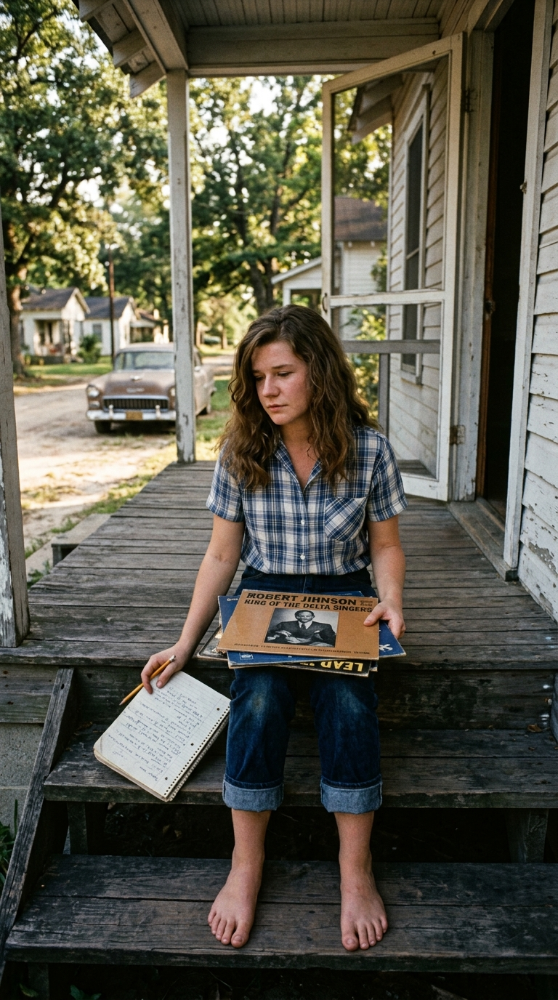
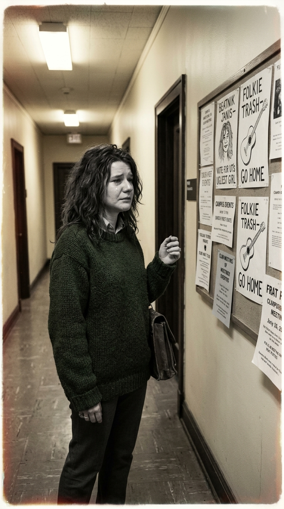
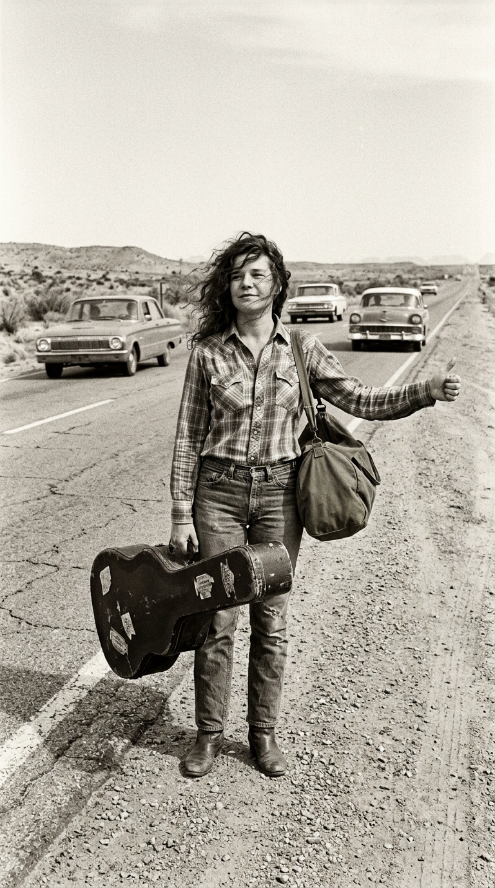
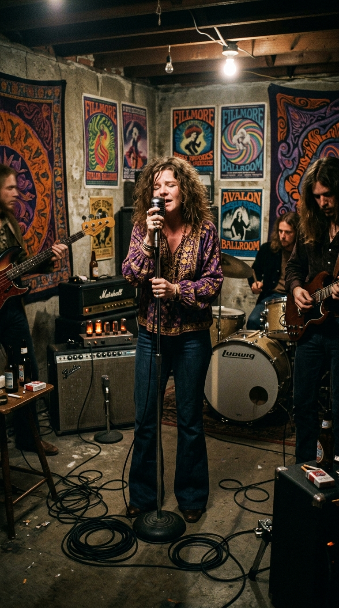
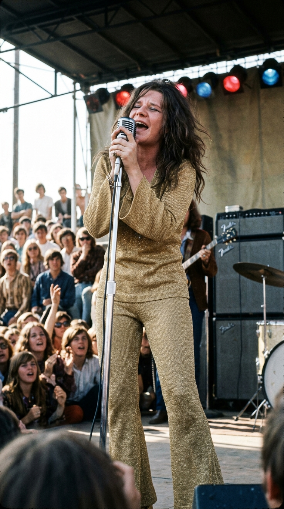
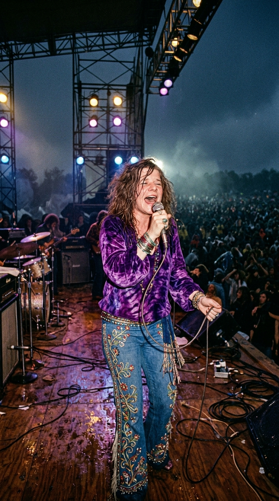
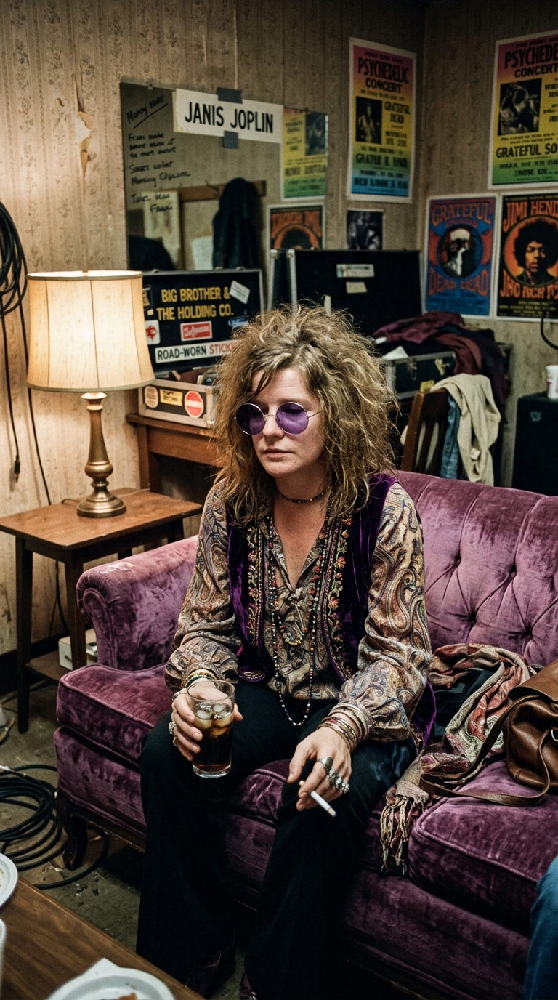
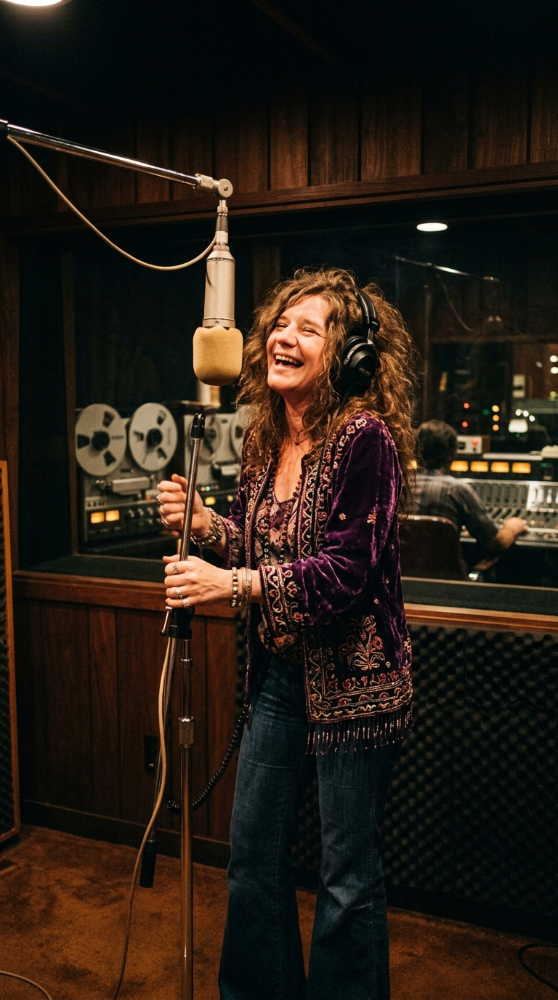

# 🎙️ The Indomitable Comet: Janis Joplin, the Port Arthur Tear, and Nine Flashes of Glory

### *From the student ostracized by campus posters to the untamed force who reinvented the blues with «Piece of My Heart»: four meteoric years that shook history before dissolving her ashes into the Pacific.*

---

**By the Secret Chords Editorial Board**  
*Estimated reading time: 11 minutes*

---

### Prologue: The Raw, Bleeding Throat

Janis Joplin did not use her voice as a mere technical instrument; she sang with the open wounds of an entire existence. When she approached the microphone—clutching it with both hands like someone clinging to the edge of an abyss, bending at the waist while her purple feather boas drifted through the haze of the spotlights—what poured from her throat was never the complacent diction of 1960s pop. It was a subterranean roar, a compound of gravel, liquor, and velvet that invoked the suffering lineage of Bessie Smith and the overflowing impulse of Southern soul.

Her passage across the earth possessed the relentless speed of a meteor. In barely four years—from her sudden emergence before the crowd gathered at the Monterey Pop Festival in 1967 to her silent farewell in a Hollywood motel in October 1970—Janis demolished the unwritten laws dictating how a woman should behave, modulate, and present herself on a rock stage. Stripped of cosmetic artifice, she taught a generation that raw vulnerability and unrequited pain could be transformed into the most noble, emancipatory artistic testimony.

This is the documentary reconstruction of her nine flashes of glory: the nine defining events that shaped the destiny of an unrepeatable legend.

---

### Milestone I (1958): The Stigma of Port Arthur and the Sanctuary of the Blues

To decipher the emotional volcano that lived within Janis, one must first look back at Port Arthur, Texas, in the late 1950s. Hemmed in by the oil refineries of the Gulf of Mexico, the city was an industrial enclave dominated by conservative puritanism, where a young woman’s social horizon was strictly confined to fitting into provincial domesticity, attending Sunday morning church, and internalizing the codes of submissive conformity.

*Port Arthur, late 1950s: Janis Joplin on the family porch with her poetry books and vinyl records, searching for a horizon beyond the asphalt and oil derricks.*

Born on January 19, 1943, into a middle-class family—the daughter of Seth Ward Joplin, a Texaco engineer, and Dorothy Bonita East—Janis quickly understood her status as an outsider in her own land. An initial shyness, exacerbated by a severe case of acne that left permanent marks on her face, kept her apart from the crinoline skirts and heavy makeup of mainstream teenage fashion. Yet her true transgression was moral and intellectual: in a Texas bound by Jim Crow segregation laws, Joplin openly expressed her abhorrence of racism and began frequenting marginalized circles to track down recordings of African American music.

In the vinyl grooves of **Bessie Smith**, **Lead Belly**, and **Big Mama Thornton**, the young woman found her spiritual home. Those voices did not mask adversity; they sang of displacement, profound loneliness, and the raw grit required simply to survive. Shut away in her bedroom, Janis began dissecting those melodies, discovering that when she projected her voice from the very base of her diaphragm, the heavy weight of social rejection dissolved into a cathartic current of pure freedom.

---

### Milestone II (1962): Collegiate Cruelty in Austin and the Campus Stigma

In the summer of 1962, seeking intellectual oxygen, Janis moved to the **University of Texas at Austin** to study Fine Arts. She walked across the campus wearing denim work trousers, loose flannel shirts, sandals or bare feet, carrying her autoharp and folders overflowing with sketches. Her booming, unfiltered laughter and her stubborn refusal to adopt the submissive manners of the era quickly thrust her into the crosshairs of student mockery.

*Autumn 1962, University of Texas at Austin: Janis walks past the student notice boards with firm steps, resisting the quiet hostility of her surroundings.*

That semester, a campus fraternity launched a humiliating stunt: an ironic competition to crown the **«Ugliest Man on Campus»**. In a calculated act of targeted harassment, several students nominated Janis Joplin, plastering flyers and offensive caricatures featuring her face across hallways and official bulletin boards.

Although historical records disprove the myth that Janis formally won the contest—it was an informal prank designed expressly to mortify her—the impact of seeing her photograph exposed to public mockery was devastating. Boardinghouse peers recalled that after crossing the courtyard while fighting back tears, the young woman locked herself in her room for days, consumed by inconsolable grief. That cruelty shattered any remaining hope she had of fitting into traditional academic circles and propelled her permanently toward a nomadic life.

---

### Milestone III (1963): The Thumb on the Highway and the Forging of the Raspy Timbre

In early 1963, determined to sever every tie with Texaco conformity, Janis Joplin packed a modest change of clothes, grabbed her acoustic guitar, and stood on the shoulder of the highway to hitchhike to California alongside her friend Chet Helms.

*1963: By the edge of a desert highway, hair whipping in the wind with her guitar in hand, heading toward San Francisco in search of her own sonic identity.*

That multi-thousand-mile journey across the American Southwest proved to be a baptism by fire. In San Francisco and Venice Beach, Janis survived by performing in bohemian coffeehouses like The Coffee Gallery in North Beach, passing a hat among sailors, beatnik poets, and passersby in exchange for a handful of loose change and a hot meal.

In those crowded, noisy rooms lacking adequate sound systems, Joplin was forced to strain her vocal cords just to cut through the din of the barroom murmur. The combination of continuous vocal strain, unfiltered cigarettes, and an emerging appetite for alcohol fundamentally transformed her register: the sweet folk-soprano modulations she had practiced during her adolescence gradually gave way to that sandy, lacerating grit that would eventually become her unmistakable signature.

---

### Milestone IV (1966): The Electric Collision with Big Brother and the Holding Company

By 1966, the Haight-Ashbury neighborhood was establishing itself as the epicenter of San Francisco's psychedelic explosion. Rehearsing there was **Big Brother and the Holding Company**, a quartet featuring guitarists **James Gurley** and **Sam Andrew**, bassist **Peter Albin**, and drummer **Dave Getz**. The band was experimenting with acid-rock textures and extended improvisations, but they sorely lacked a powerhouse vocalist capable of anchoring their sonic detonations.

Promoter Chet Helms remembered Janis's ferocious intensity and sent his associate Travis Rivers to track her down in Port Arthur, where the singer had temporarily retreated in an effort to restore her failing health. In June 1966, Joplin crossed the threshold of the band’s rehearsal space in San Francisco.

*1966: Amid tangled cables and tube amplifiers, Janis Joplin locks her voice into the swirling psychedelic soundscape of Big Brother.*

The encounter was cataclysmic. Accustomed to the gentle acoustic accompaniment of nylon strings, the sheer physical impact of amplifiers pushed to concert volume shocked her to her core. As she would later recall: *«I had never felt anything like that, all that strength pushing against my back. I just felt I could lean back against that wall of sound and sing with my whole body»*. Janis shed the shackles of traditional folk music, leaping and wailing directly into the microphone, bringing the earthly weight of Delta blues into the electric tides of Californian psychedelia.

---

### Milestone V (June 1967): The Monterey Pop Explosion and Mama Cass’s Stare

Over the weekend of June 16–18, 1967, the **Monterey International Pop Festival** took place—a foundational event for the youth culture of the decade. Before a massive congregation, with the upper echelons of the recording industry watching closely from the wings, legendary acts such as The Who, Otis Redding, The Byrds, and The Jimi Hendrix Experience took the stage.

Big Brother and the Holding Company performed on Saturday afternoon. Due to the hesitation of their legal manager, their initial set was missed by **D.A. Pennebaker**’s documentary film crew. However, the sheer shockwave generated by the band was so absolute that the organizers scheduled a second performance for Sunday afternoon so it could be professionally filmed.

*June 1967: Dressed in a gold lame pantsuit shimmering under the California sun, Janis moves the audience to tears during her blistering rendition of «Ball and Chain».*

Attired in a gold-threaded knit pantsuit that shimmered beneath the California sun, Janis attacked Big Mama Thornton’s **«Ball and Chain»**. With her eyes screwed shut and her boots pounding the wooden stage, she delivered a performance of searing, wrenching drama. From the VIP seating area, Pennebaker’s 16mm lens captured **Cass Elliot** (vocalist for The Mamas & the Papas) staring at the stage with her jaw dropped, whispering in absolute awe: *«Oh, wow... that’s heavy!»*.

Present in the audience, Columbia Records president **Clive Davis** was utterly transfixed by the singer’s magnetic charge. After negotiating a complex settlement nearing two hundred thousand dollars to buy out the group’s contract with Mainstream Records, Columbia secured her exclusive signing. The young woman once mocked in the classrooms of Texas was suddenly emerging as the most vital female revelation in contemporary music.

---

### Milestone VI (1968): «Piece of My Heart» and the Top of the World with Cheap Thrills

August 1968 marked the release of ***Cheap Thrills***, featuring a historic cover illustrated by countercultural cartoonist Robert Crumb. The record became a massive commercial triumph: it shot to number one on the Billboard 200 chart, where it remained for eight consecutive weeks, certifying multi-platinum sales.

The gravitational core of the album was **«Piece of My Heart»**, written by Jerry Ragovoy (under the pseudonym Norman Meade) and Bert Berns. The track had been recorded in 1967 by Erma Franklin as a polished, soulful rhythm and blues tune. Janis, backed by Big Brother’s ferocious distortion, transformed the composition into a volcanic manifesto. From her opening challenge (*«Come on, come on, come on, come on and take it!»*) to the climax of the chorus, her interpretation subverted the traditional love lament:

> *«Take another little piece of my heart now, baby!  
> Break another little bit of my heart now, darling, yeah, yeah, have another little piece of my heart now, baby...  
> You know you got it, if it makes you feel good!»*

Far from projecting defeated submission, Joplin sang from a place of fierce internal resistance: they could shatter her heart and tear away fragments of her soul, but her capacity to give and her fundamental dignity remained untouched. The song climbed into the top twelve of the pop charts and consecrated Janis as the most influential and sought-after female voice on the international scene.

---

### Milestone VII (August 1969): The Crucible of Woodstock and the Paradox of Loneliness

Despite the adoration of the masses, internal fractures within the band and Janis’s deepening isolation demanded a change. After dissolving her original lineup at the end of 1968, she assembled the Kozmic Blues Band, incorporating a horn section to steer her sound toward the Memphis soul tradition.

On August 19, 1969, at around two in the morning, Joplin took the stage at the **Woodstock Festival** before a sea of hundreds of thousands of attendees battling mud and torrential rain. Having waited for hours backstage—battling mounting anxiety with alcohol and substances—she delivered an exhausting performance where her voice pushed against the absolute limits of her endurance.

*Dawn of August 19, 1969: Beneath the rain-soaked scaffolding of Woodstock, Janis projects her voice across an awestruck multitude.*

It was during this period of monumental acclaim that Joplin shared with *Rolling Stone* writer and journalist **David Dalton** the profound observation that summarized the ultimate paradox of her artistic life:

> *«On stage I make love to twenty-five thousand different people each night... then I go home alone to my hotel room»*.

*1968: The emptiness after the ovation; Janis Joplin in the quiet of her dressing room, confronting the silence that no commercial success could ever cure.*

Her communion with the audience was spellbinding, yet fleeting. Once the applause faded, the woman scarred by youthful rejection returned to the silence of anonymous hotel rooms, wrestling with an emotional desolation that worldwide fame could never heal.

---

### Milestone VIII (September 1970): The Mature Plenitude of Pearl at Sunset Sound

By the summer of 1970, Janis appeared to have found a newfound equilibrium and creative fulfillment. Backed by her stellar new ensemble, the **Full Tilt Boogie Band**—comprising young, gifted Canadian instrumentalists—and under the guidance of veteran producer **Paul A. Rothchild** (renowned for his work with The Doors), the artist entered **Sunset Sound** studios in Los Angeles to record what would become her masterwork: ***Pearl***.

*September 1970, Sunset Sound: Janis Joplin lays down the master vocal takes for her definitive mature statement in Los Angeles.*

During those sessions, Joplin unveiled entirely unmapped vocal dimensions: she reined in her constant raspy wail to explore delicate whispers, the warm phrasing of country-soul, and a sophisticated rhythmic maturity. Out of those recordings came her immortal reading of **«Me and Bobby McGee»**, written by Kris Kristofferson and Fred Foster, alongside the a cappella improvisation of **«Mercedes Benz»**, captured on October 1, 1970, which concluded with her characteristic spontaneous burst of laughter into the microphone. Thrilled with her personal life and the breathtaking power of the master tapes, her immediate future promised her ultimate coronation as a complete artist.

---

### Milestone IX (October 4, 1970): Room 105 and the Flight Across the Ocean

On Saturday, October 3, 1970, Janis remained at Sunset Sound reviewing the instrumental tracks for *«Buried Alive in the Blues»*, a song written by Nick Gravenites over which she was scheduled to record her final vocal take on Monday the 5th. After sharing a few drinks with members of her band at Barney’s Beanery in West Hollywood, she drove her psychedelic-painted Porsche back to the **Landmark Motor Hotel** (Room 105) on Franklin Avenue.

In the dead of night, tragedy cut her journey short. Janis had consumed a dose of heroin that, as later forensic investigations revealed, possessed an uncommonly high and lethal purity responsible for several accidental overdose deaths across the city that very weekend. After walking down to the lobby to buy cigarettes from the vending machine and exchanging a few words with the desk clerk, she returned to her room, where she suffered a sudden, fatal respiratory collapse. She was twenty-seven years old.

*The final wake: The Pacific waters off the coast of Marin County, where Janis Joplin’s ashes were scattered to the wind in October 1970.*

Fulfilling her final testamentary wishes—in which she left twenty-five hundred dollars for her close friends to throw a massive farewell party in her honor at The Lion's Share—her remains were cremated at Westwood Village Memorial Park Cemetery. Days later, from a private airplane, her ashes were scattered over the white-capped swells of the Pacific Ocean along the coast of **Marin County**, sealing her earthly voyage on the limitless horizon of California.

---

### Epilogue: The Fire That Never Extinguish

In January 1971, Columbia Records posthumously released the album ***Pearl***. The track *«Buried Alive in the Blues»* was preserved exactly as she had heard it last: as an emotional, vocal-less instrumental. The album rapidly climbed to the top of the international charts, and *«Me and Bobby McGee»* seized the number-one spot, gifting human culture an indelible verse:

> *«Freedom’s just another word for nothing left to lose...»*

Janis Joplin never needed decades of nostalgic reunion tours to build her monument. She lived with the untamed intensity of someone who understood that artistic authenticity admits no compromise. In an era that tried to police her body, her pain, and her unbridled hunger, she proved that unflinching honesty is the supreme act of nobility an artist can offer the world.

---

### 📚 Sources, Periodicals, and Archival Records

* **Definitive Documentary Biography:** Echols, Alice. *Scars of Sweet Paradise: The Life and Times of Janis Joplin*. Metropolitan Books / Henry Holt, New York, 1999.
* **Epistolary and Testimonial Archive:** Joplin, Laura. *Love, Janis* (Intimate correspondence and family memoirs). Villard Books / Random House, New York, 1992.
* **Direct Testimonial Chronicle:** Dalton, David. *Piece of My Heart: A Portrait of Janis Joplin*. Da Capo Press, New York, 1991.
* **Record Industry Memoirs:** Davis, Clive & Willwerth, James. *Clive: Inside the Record Business*. William Morrow & Company, New York, 1975.
* **Audiovisual and Film Archive:** Pennebaker, D.A. *Monterey Pop* (Original documentary footage, 1967). The Criterion Collection, Master Edition.
* **Medical-Forensic Protocol:** County of Los Angeles Medical Examiner-Coroner. *Autopsy Protocol and Toxicology Report: Janis Lyn Joplin, Case File No. 70-9838*, October 1970.
* **Periodical Archives:** *Rolling Stone Magazine*, Commemorative Issue No. 69 (October–November 1970); *The New York Times*, obituary and archival dispatches (October 5–8, 1970).
* **Phonographic Cataloging:** Columbia Records / Sony Music Entertainment master recordings for the albums *Cheap Thrills* (KCS-9700, 1968) and *Pearl* (KC-30322, 1971).