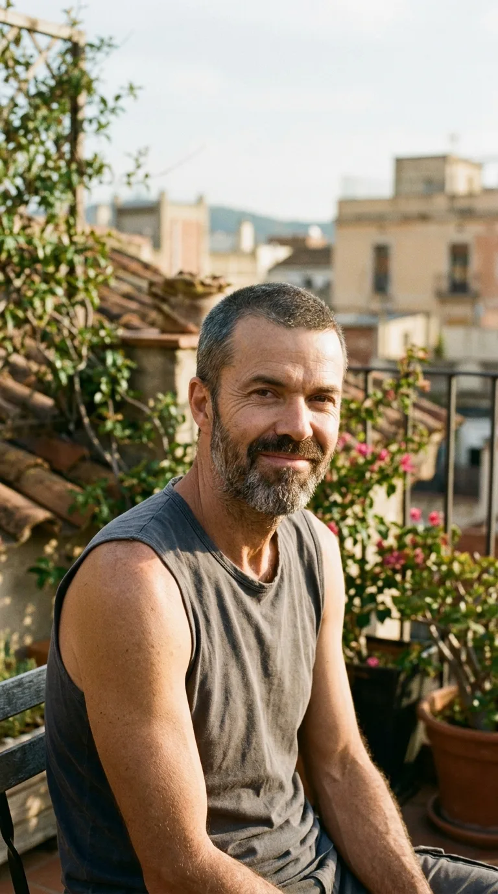
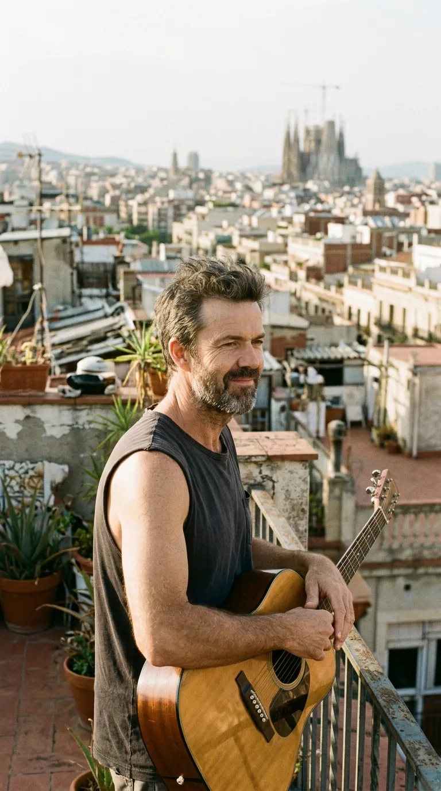
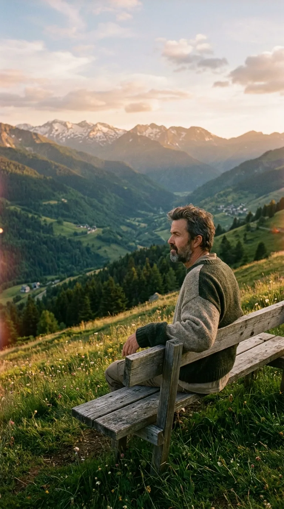
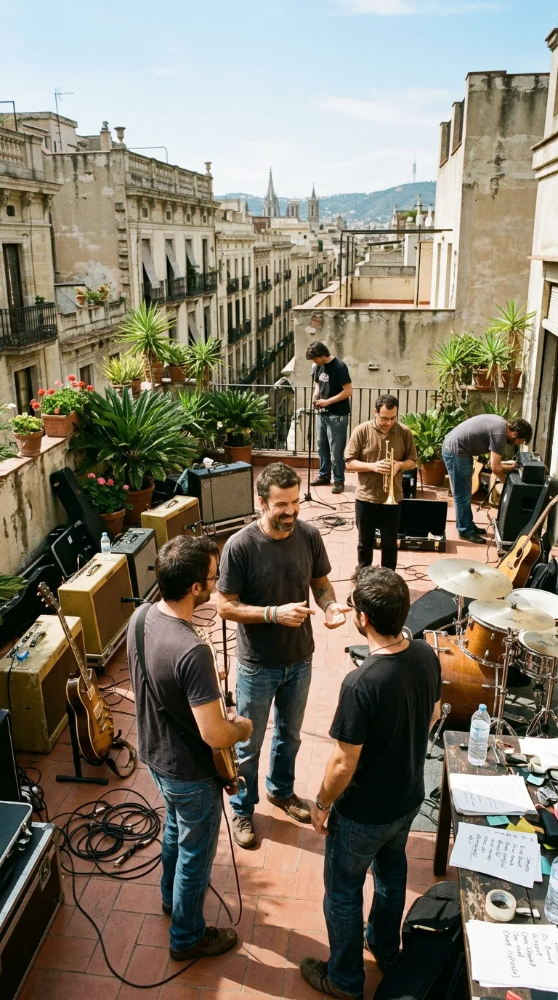
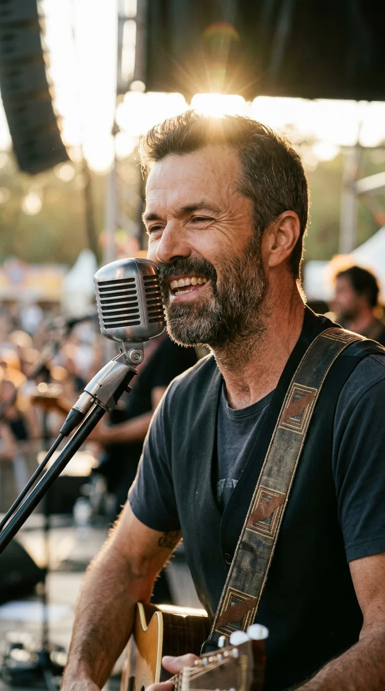
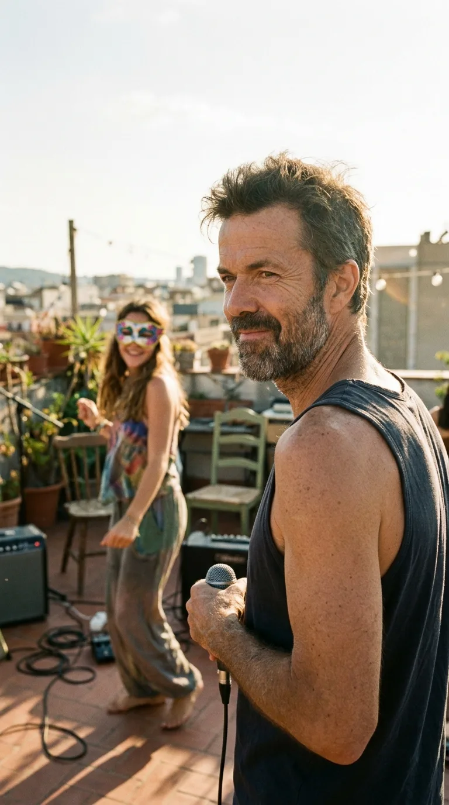
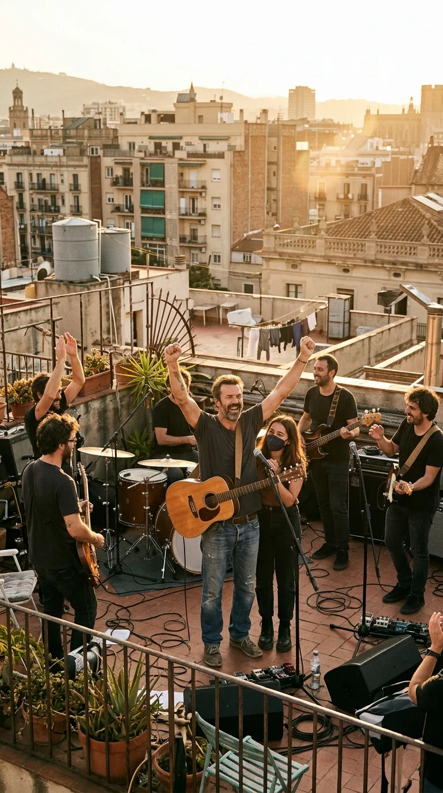
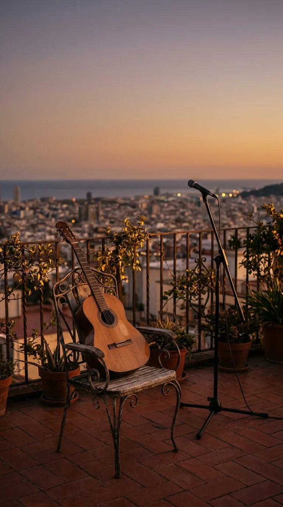

# 🌻 La Lección Suprema de la Gratitud: Pau Donés y el Testamento de «Eso que tú me das»

> *«Eso que tú me das es mucho más de lo que pido. Todo lo que me das es lo que ahora necesito. Así que gracias por estar, por tu amistad y tu compañía... Eres lo mejor que me ha dado la vida».*  
> — **Pau Donés** (1966–2020)

---

*Barcelona, mayo de 2020: Pau Donés en la azotea antes de filmar «Eso que tú me das», con la serenidad y sonrisa luminosa que conmovieron al mundo.*

---

### Prólogo: La dignidad de no esconderse

Hay despedidas que se escriben en el silencio de una habitación cerrada y despedidas que deciden abrir de par en par los balcones para que entre toda la luz del mundo. En la primavera de 2020, cuando el planeta entero permanecía recluido bajo el estupor de la pandemia, un hombre de cincuenta y tres años, con el cuerpo consumido por cinco años de lucha implacable contra el cáncer y pesando apenas cuarenta y cinco kilos, tomó una decisión que desconcertó a la industria y conmovió el corazón de millones de personas: no esconderse.

*La dignidad de no esconderse: Pau Donés junto a la barandilla de la terraza, mirando al futuro con paz y gratitud absoluta.*

Pau Donés Cirera no quería irse de puntillas ni alimentar el morbo del sufrimiento. No deseaba que su último recuerdo fuese el de una cama de hospital ni el luto anticipado de los obituarios. Quería cantar una última vez, sonreír frente a una cámara, mirar a los ojos a quienes lo habían acompañado durante un cuarto de siglo y, sobre todo, dejarle un abrazo infinito en compases de música a Sara, su hija adolescente. Aquel 23 de mayo de 2020, cuando se estrenó el videoclip de *«Eso que tú me das»*, el mundo no asistió a un réquiem lastimero; presenció la mayor lección de elegancia, dignidad y gratitud filial jamás filmada en la música en español.

---

### Acto I: La llamada que detuvo el reloj (2015–2018)

El 1 de septiembre de 2015, un dolor agudo en el vientre llevó a Pau Donés al Hospital Vall d'Hebron de Barcelona para lo que parecía una simple molestia gástrica. El diagnóstico cayó como una losa inapelable: cáncer de colon en estadio IV con metástasis hepática. Los médicos le dieron un pronóstico crudo y desalentador, estimando apenas un veinte por ciento de probabilidades de supervivencia a cinco años. 

La mayoría de las personas se habrían derrumbado en la soledad. Pau Donés, con su espíritu montañero forjado en los Pirineos y su franqueza insobornable, decidió naturalizar la enfermedad. La bautizó con un nombre coloquial —«el cangrejo»— y se propuso arrebatarle cada minuto de felicidad cotidiana. Retomó las giras cuando su cuerpo se lo permitía, ofreció conciertos benéficos para la investigación oncológica y escribió un libro luminoso titulado *50 palos*, donde desmitificaba el miedo a la muerte y reivindicaba el milagro de estar vivo un día más.

*El refugio en la montaña: Pau contemplando los valles verdes de la Val d'Aran, donde encontró serenidad y fuerza espiritual.*

Sin embargo, a finales de 2018, consciente del avance silente de la enfermedad, anunció un parón indefinido de Jarabe de Palo. Hizo las maletas y se mudó a California junto a su hija Sara, que entonces tenía catorce años. Quería recuperar con ella el tiempo arrebatado por dos décadas de giras interminables, llevarla cada mañana al instituto, cocinar juntos y contemplar las puestas de sol en el Pacífico. Aquel año sabático no fue una rendición; fue el acto de amor más consciente de su existencia.

---

### Acto II: El regreso a Barcelona y la canción urgente (2020)

A principios de 2020, el cáncer regresó con una agresividad terminal. Los tratamientos convencionales dejaron de surtir efecto y Pau regresó a España sabiendo que el tiempo se agotaba. Pero en su libreta de notas, escrita entre sesiones de quimioterapia y paseos por el campo, no había versos de rabia ni reproches al destino. Había melodías llenas de ritmo, metales festivos y una lírica transparente como el agua de deshielo.

*Primavera de 2020: La banda de Jarabe de Palo afinando guitarras y metales bajo el sol mediterráneo para registrar la última entrega.*

Pau llamó a los miembros de Jarabe de Palo y al productor Yves Roussel. Les dijo que tenía grabado en maquetas caseras el repertorio de un nuevo álbum, *Tragas o escupes*, y que debían terminarlo de inmediato. Entre esas canciones brillaba con luz propia un tema compuesto con aire de rumba y marcha optimista: *«Eso que tú me das»*. 

La letra no hablaba del dolor de la carne ni de la injusticia de la partida prematura. Era una carta de agradecimiento en estado puro: agradecimiento a los médicos y enfermeras que cuidaron sus días, a los amigos que no huyeron ante el abismo, al público que coreó sus versos desde los días dorados de *«La Flaca»* y *«Depende»*, y, en el centro de todas las estrofas, a Sara, la muchacha que le había dado el motivo más noble para seguir respirando.

---

### Acto III: El ático de Vallcarca y el baile enmascarado

A mediados de mayo de 2020, con la movilidad limitada pero la mirada intacta, Pau Donés convocó a su banda y a un reducido equipo de filmación en una terraza luminosa del barrio de Vallcarca, en Barcelona. Hacía sol y la brisa mediterránea acariciaba los amplificadores. 

Pau apareció vestido con una camiseta sin mangas, mostrando sus brazos extremadamente delgados, el rostro marcado por la enfermedad pero iluminado por una sonrisa tibia y serena. Quería que la cámara lo filmara exactamente como estaba: sin artificios, sin maquillaje pesado que ocultara la huella de la batalla, pero con una vitalidad desarmante en la voz.

*Pura vitalidad: Pau Donés entregando su voz al micrófono con una sonrisa radiante e indestructible.*

En un momento del rodaje, detrás de los músicos, apareció una joven esbelta vestida con ropa casual y un antifaz festivo cubriéndole los ojos. Era Sara Donés. Tenía dieciséis años. Su padre le había pedido que participara en el videoclip para compartir con ella ese último instante musical, pero respetando escrupulosamente su anonimato ante el asedio mediático. Sara bailó con dulzura al compás de la batería, meciéndose al son de la canción mientras Pau, mirándola de reojo con orgullo infinito, cantaba: *«Por todo lo que recibí, estar aquí vale la pena... Gracias por estar, por tu amistad y tu compañía»*.

*El baile protector: Sara Donés a los dieciséis años meciéndose al son de la música con un antifaz para resguardar su intimidad.*

*La mirada de un padre: Pau Donés girándose a mitad de estrofa para contemplar a Sara con infinito agradecimiento y devoción.*

Nadie en aquella terraza pudo contener la emoción. Aquella escena no era la filmación de un producto promocional; era un testamento filmado de amor paterno, una caricia de despedida que quedaría grabada para siempre en la memoria colectiva.

---

### Acto IV: Veinte días para la eternidad

El videoclip de *«Eso que tú me das»* se publicó oficialmente el 23 de mayo de 2020. El impacto fue sísmico. Millones de personas en España y América Latina vieron el video con un nudo en la garganta y una lágrima de asombro. La canción se convirtió en un fenómeno social instantáneo, no por el morbo de la tragedia, sino por la abrumadora lección ética que transmitía: ante el final ineludible, la respuesta no era el lamento, sino la gratitud.

*La celebración de la vida: Pau alzando los brazos con su guitarra junto a su banda y su hija al caer la tarde en Barcelona.*

Pau Donés aún tuvo tiempo de recibir el cariño multitudinario de su gente. Pocos días después, aceptó subir a la montaña de la Val d'Aran con su amigo el periodista Jordi Évole para grabar una última conversación íntima frente a los Pirineos, recogida posteriormente en el célebre documental homónimo. En esa charla, con una cánula nasal y una lucidez conmovedora, Pau resumió la filosofía que había guiado toda su vida: *«Vivir es urgente. Hay que disfrutar del presente, no tener miedo y decir a los que queremos cuánto los queremos»*.

El 9 de junio de 2020, apenas veinte días después del estreno de la canción, Pau Donés se apagó en paz en su casa de Bagergue, rodeado por su familia. Tenía cincuenta y tres años.

---

### Epílogo: El eco de una sonrisa invencible

La partida de Pau Donés dejó un vacío inmenso en la música en español, pero *«Eso que tú me das»* permanece como uno de los monumentos más puros y conmovedores de nuestro patrimonio cultural. No es una canción sobre el cáncer ni sobre la muerte; es un himno luminoso a la generosidad de los afectos, al valor de la amistad cotidiana y al vínculo indestructible entre un padre y su hija.

Cada vez que sus acordes suenan en una radio, en una terraza o en los auriculares de quien atraviesa un momento difícil, la voz rota y dulce de Pau Donés vuelve a recordarnos la verdad más sencilla y olvidada de todas: que mientras estemos aquí, dar las gracias por lo vivido es la forma más hermosa de vencer al olvido.

*El eco de una lección eterna: la guitarra en silencio frente al horizonte mediterráneo, recordándonos que vivir es urgente.*

---

### 💬 Conversación y Memoria

*¿En qué momento de tu vida te ha acompañado la voz de Pau Donés y qué sentiste la primera vez que escuchaste «Eso que tú me das»? Te leemos con emoción en los comentarios.*

---

### 📚 Fuentes y Archivo Documental

* Donés, Pau. *50 palos... y sigo soñando*. Editorial Planeta, Barcelona, 2017.
* Évole, Jordi (Director). *Eso que tú me das*. Documental producido por Atresmedia y Producciones del Barrio, 90 min., España, 2020.
* Jarabe de Palo. *Tragas o escupes*. Tronco Records / Warner Music Spain, 2020.
* Archivo hemerográfico de *El País* y *La Vanguardia*: Crónicas de mayo y junio de 2020 sobre el lanzamiento de «Eso que tú me das» y el fallecimiento de Pau Donés.
* Registros audiovisuales oficiales de Tronco Records: Making of y videoclip de «Eso que tú me das» (Vallcarca, Barcelona, mayo de 2020).
