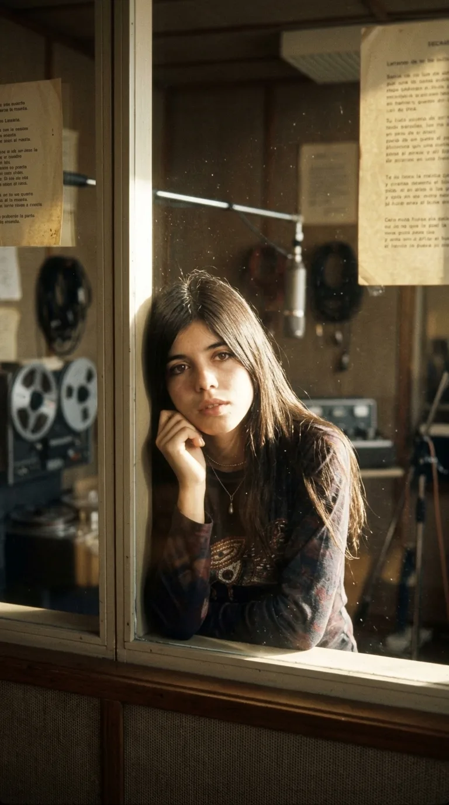
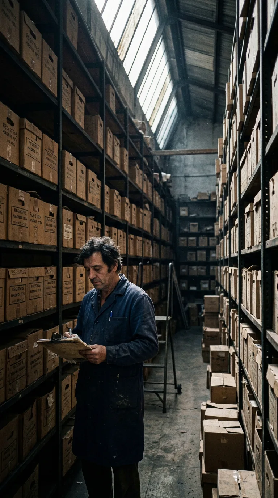
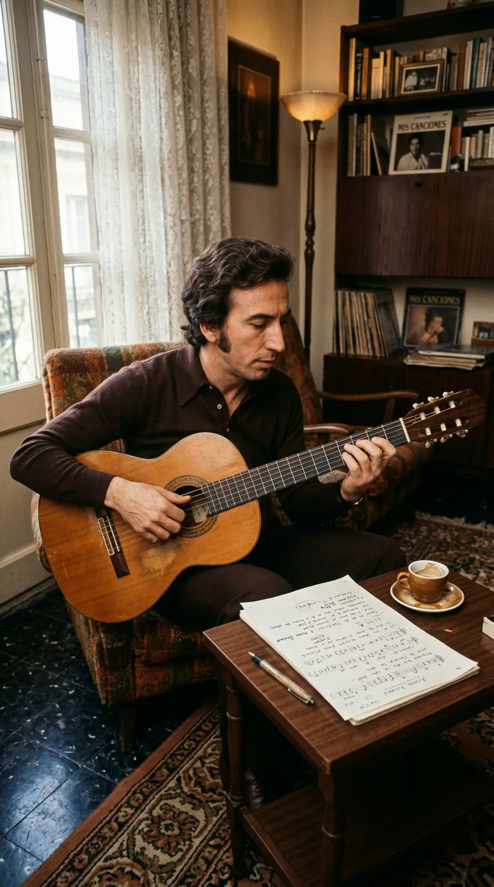
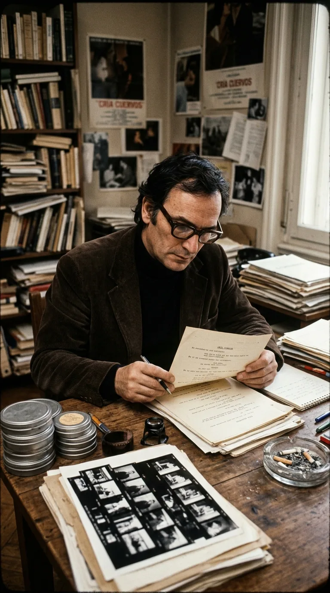
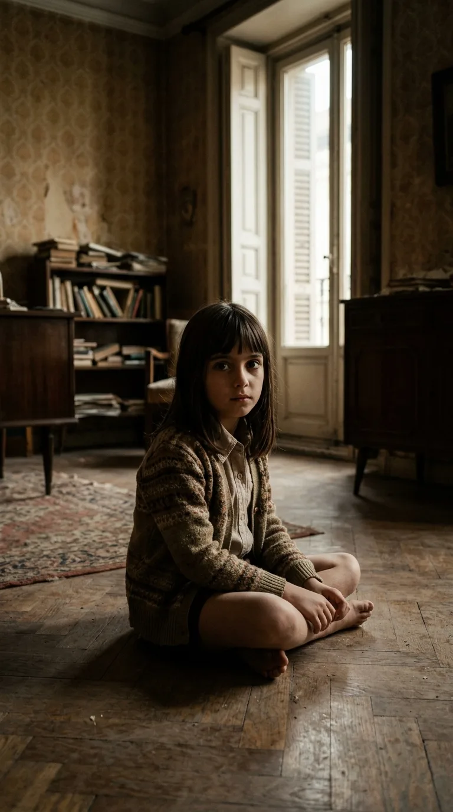
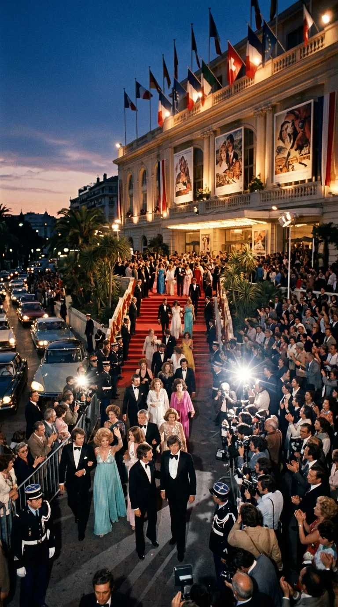
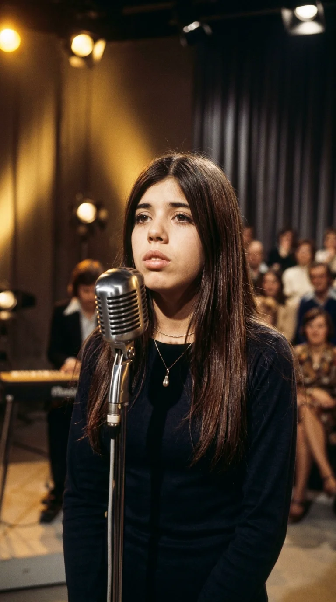

# El Secreto de «Porque te vas»: El Fracaso Olvidado que Conquistó el Mundo

> *«Hoy en mi ventana brilla el sol y el corazón se pone triste contemplando la ciudad, porque te vas...»*  
> — **Jeanette** (Composición de José Luis Perales)

---

*Madrid, 1974: Jeanette antes del fenómeno, con la mirada melancólica y delicada que definió su voz.*

---

### Prólogo: El disco que nadie quiso escuchar

En el invierno de 1974, en los almacenes del sello discográfico Hispavox en Madrid, cientos de copias de un disco de vinilo de siete pulgadas comenzaron a acumular polvo en cajas de cartón sin abrir. El sencillo llevaba por título *«Porque te vas»*, interpretado por una joven anglohispana de veintitrés años llamada Jeanette Anne Dimech, a quien toda España conocía simplemente como Jeanette.

Apenas tres años antes, Jeanette había tocado el cielo con *«Soy rebelde»*, convirtiéndose en un ícono generacional con su voz susurrada y su mirada melancólica. Sin embargo, su nueva entrega parecía destinada al olvido más absoluto. Las emisoras de radio apenas radiaron la canción, las tiendas de música devolvieron los paquetes intactos y los ejecutivos de la discográfica dieron el proyecto por amortizado. Para la industria musical madrileña, *«Porque te vas»* era un fracaso comercial certificado, una pequeña anécdota descartable en el catálogo de aquel año.

Lo que nadie en aquellas oficinas podía imaginar era que aquel modesto trozo de vinilo, rechazado por los programadores de radio y arrinconado en las estanterías de las tiendas, contenía una bomba de relojería emocional que solo necesitaba una chispa para sacudir la cultura de toda Europa.

*Invierno de 1974: Copias descartadas de «Porque te vas» apiladas en el almacén de Hispavox tras el desinterés inicial de las emisoras.*

---

### Acto I: Un delineante de Cuenca y una intérprete a regañadientes

Para comprender el nacimiento de la canción es necesario retroceder a un pequeño piso de Madrid, donde un joven de veintiocho años llamado José Luis Perales compaginaba su trabajo como delineante técnico con una pasión secreta: componer melodías con una guitarra española. Perales todavía no se atrevía a cantar en público; su ilusión era escribir canciones para otros artistas consagrados.

Una tarde de 1974, conmovido por la fragilidad interpretativa de Jeanette, Perales compuso una melodía de estructura engañosa: un ritmo vivo, casi bailable, sostenido por una letra de honda desolación ante la partida del ser amado. La paradoja entre la luminosidad del compás y la tristeza del adiós era precisamente el núcleo de su propuesta.

*Madrid, 1974: Un joven José Luis Perales dando forma al compás de «Porque te vas» con su guitarra española.*

Cuando la maqueta llegó a las manos de Jeanette y del productor estrella de Hispavox, Rafael Trabucchelli, la cantante no mostró entusiasmo inmediato. Acostumbrada a baladas lentas y atmósferas folk acústicas, el arreglo rítmico con metales y teclados le resultaba ajeno a su estilo personal. Aun así, aceptó entrar al estudio de grabación.

Bajo la dirección orquestal de Trabucchelli, la voz quebradiza y aniñada de Jeanette se posó sobre la instrumentación con una inocencia desarmante. El contraste era hipnótico, pero cuando el disco salió al mercado, el público español de 1974 no lo entendió. Las ventas fueron testimoniales. Jeanette se marchó a vivir a Barcelona y el disco quedó archivado como un tropiezo comercial.

*Madrid, 1974: Jeanette frente al micrófono Neumann U47 en los estudios Hispavox, grabando una interpretación intimista.*

---

### Acto II: La obsesión de Carlos Saura y los cuervos de la memoria

Transcurrido más de un año desde el fracaso del disco, en los primeros meses de 1975, el director de cine Carlos Saura se encontraba inmerso en la preparación de uno de los proyectos cinematográficos más audaces de su carrera: *Cría cuervos*. 

Eran los meses finales de la dictadura franquista. España vivía bajo una atmósfera de asfixia contenida, silencios familiares y una transición inevitable que flotaba en el aire. Saura construyó una historia íntima sobre tres niñas huérfanas en un viejo caserón de Madrid, centrándose en Ana, una niña de ocho años interpretada por la prodigiosa actriz Ana Torrent, cuyos ojos negros reflejaban el desconcierto, el dolor y la rebelión interior ante el mundo de los adultos.

*Madrid, 1975: Carlos Saura entre rollos de celuloide y fotografías en su estudio, buscando la canción perfecta para «Cría cuervos».*

Saura buscaba obsesivamente una pieza musical para la película. No quería una partitura clásica solemne ni una canción de protesta evidente. Buscaba una melodía popular que una niña solitaria pudiera escuchar una y otra vez en un tocadiscos portátil para evadirse de la muerte de sus padres y de la disciplina opresiva de su tía.

Fue entonces cuando, hojeando discos de segunda mano o entre grabaciones descartadas en la radio, Saura escuchó por primera vez *«Porque te vas»*. El impacto fue fulminante. El director comprendió al instante lo que los programadores comerciales habían pasado por alto: aquella voz infantil cantando sobre la partida inevitable no era una canción de fiesta; era un lamento sobre la pérdida de la inocencia, un refugio íntimo contra la orfandad y el luto.

*La mirada de la infancia: Ana Torrent en una escena cumbre de «Cría cuervos», donde la música se vuelve refugio contra la orfandad.*

---

### Acto III: El instante de Cannes que lo cambió todo

Saura no se limitó a incluir la canción como música de fondo; la transformó en la columna vertebral de la película. En una de las escenas más memorables de la historia del cine español, Ana Torrent entra en una habitación en penumbra, enciende un tocadiscos Philips de plástico rojo, posa la aguja sobre el surco y comienza a mover el cuerpo con timidez mientras la voz de Jeanette resuena entre las paredes vetustas: *«Todas las promesas de mi amor se irán contigo...»*.

En mayo de 1976, seis meses después de la muerte de Franco, *Cría cuervos* fue seleccionada para competir en la sección oficial del Festival Internacional de Cine de Cannes. La expectación era inmensa. En la sala del Grand Théâtre Lumière, la crítica internacional y el público francés quedaron conmocionados por la crudeza poética de la obra.

Cuando la película concluyó, la ovación fue atronadora. *Cría cuervos* se alzó con el Gran Premio del Jurado de Cannes (ex aequo con *La marquesa de O* de Éric Rohmer). Pero más allá de los premios cinematográficos, ocurrió un fenómeno sociocultural insólito: los espectadores salían de las salas de cine tarareando la melodía de Jeanette. Aquella canción en español se había grabado a fuego en la memoria de los cinéfilos europeos.

*Cannes, mayo de 1976: El Grand Théâtre Lumière se rinde ante «Cría cuervos», disparando el fervor internacional por la canción.*

---

### Acto IV: La conquista de Europa y el fenómeno global

El sello discográfico francés Polydor actuó con rapidez milimétrica. Consiguió la licencia del tema y lanzó el sencillo en Francia a mediados de 1976 con la imagen de Ana Torrent y Jeanette en la portada. 

Lo que sucedió en los meses siguientes superó cualquier previsión de la industria:
* En Francia, el disco vendió más de **un millón de copias** en tiempo récord, manteniéndose en el **número 1 absoluto de las listas de ventas durante semanas consecutivas**.
* La fiebre cruzó las fronteras de inmediato: número 1 en Alemania (donde vendió más de 400.000 copias), número 1 en Austria, Suiza y Bélgica.
* La canción escaló los ránkings en Finlandia, Portugal, Argentina, México, Colombia y llegó hasta Japón, donde se prensaron ediciones especiales.
* El propio mercado español, que dos años antes la había condenado a la indiferencia, tuvo que reeditar el disco apresuradamente ante la demanda popular, alcanzando también los primeros puestos nacionales.

Jeanette, que se encontraba prácticamente retirada de la actividad discográfica, fue reclamada por los principales platós de televisión de París, Múnich y Milán. José Luis Perales, por su parte, vio cómo aquel éxito abría de par en par las puertas para su propia carrera como cantautor, convirtiéndose en uno de los creadores más prolíficos y respetados de habla hispana.

*1976: Jeanette sobre el escenario en plena consagración europea, convertida en un fenómeno que superó el millón de copias.*

---

### Epílogo: La victoria del azar y la memoria

Han pasado más de cincuenta años desde que una cinta magnética casi olvidada estuvo a punto de ser desechada en Madrid. Hoy, *«Porque te vas»* es reconocida como una de las obras cumbres del pop en español, versionada por bandas de rock, orquestas sinfónicas e intérpretes de todo el planeta, desde Manu Chao hasta bandas alternativas en Alemania o Japón.

Su historia nos recuerda una verdad elemental sobre el arte y el destino: el éxito de una canción no siempre depende del cálculo de los despachos ni de las modas pasajeras. A veces, una obra genial necesita encontrar a una mirada sensible que sepa escuchar lo que otros no vieron, rescatando del silencio aquello que estaba destinado a conmover al mundo.

*La ventana de la memoria: el eco de una despedida que el tiempo convirtió en patrimonio indeleble de nuestra cultura.*

---

### 💬 La Pregunta a la Comunidad

¿En qué momento de tu vida escuchaste por primera vez *«Porque te vas»*? ¿La conociste por la radio o a través de la mítica escena de Ana Torrent en el cine? Comparte tu recuerdo en los comentarios.

---

### 📚 Fuentes y Archivo Documental
* **Hemeroteca Diario El País**: Archivo histórico de mayo de 1976 sobre el palmarés del Festival de Cannes y la repercusión de *Cría cuervos*.
* **Archivo RTVE**: Entrevistas históricas a Jeanette (programa *A fondo*, 1977) y testimonios de Carlos Saura sobre la elección de la banda sonora.
* **Biografía de José Luis Perales**: Entrevistas y declaraciones sobre la composición de *«Porque te vas»* y sus primeros años en la industria musical.
* **Archivos discográficos de Hispavox y Polydor (1974-1976)**: Registros de ventas, reediciones y certificaciones de discos de oro en Francia y Alemania.
* **Filmografía de Carlos Saura**: Ficha técnica y análisis crítico de *Cría cuervos* (Elías Querejeta P.C., 1975).
