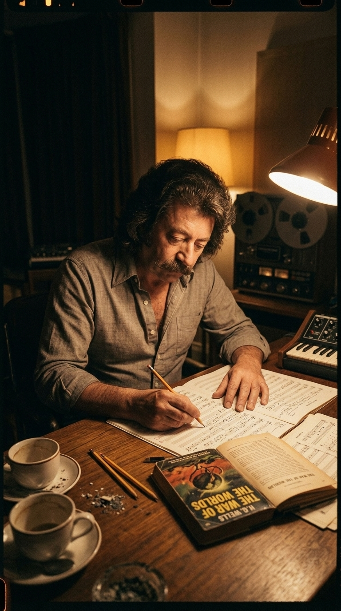
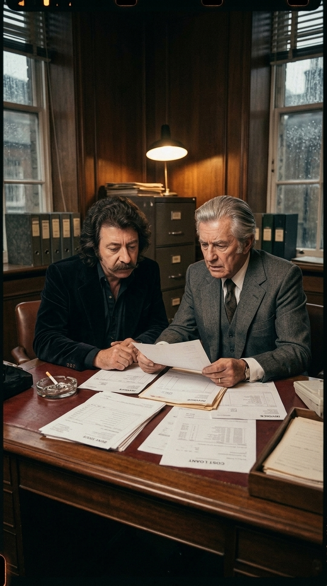
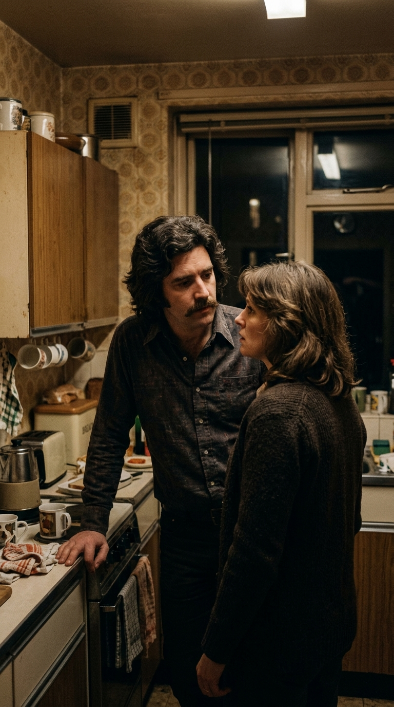
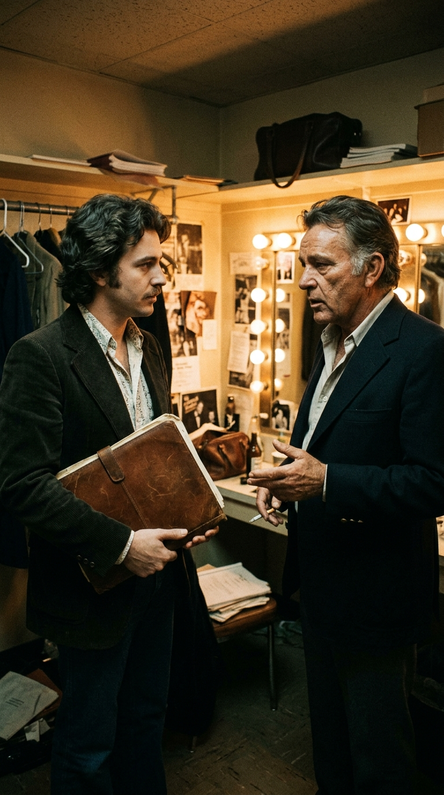
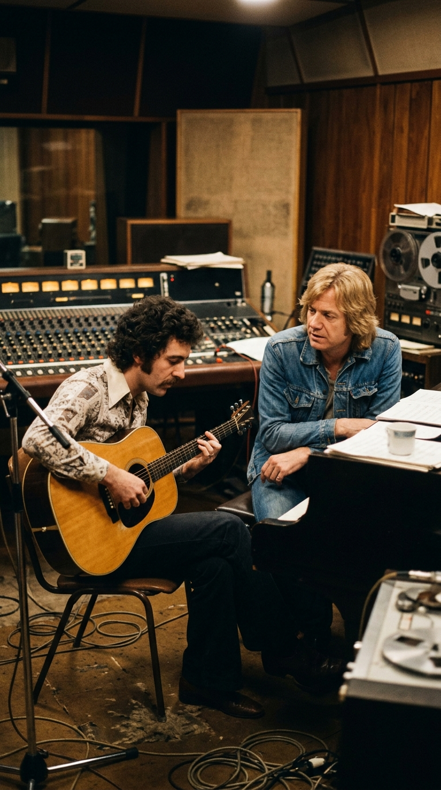
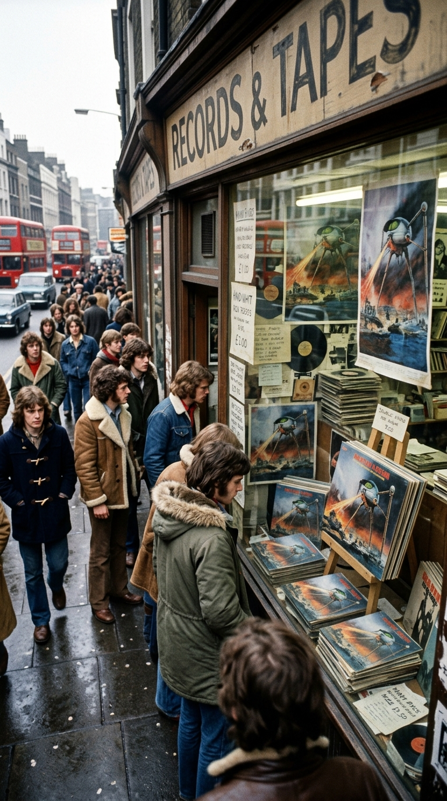
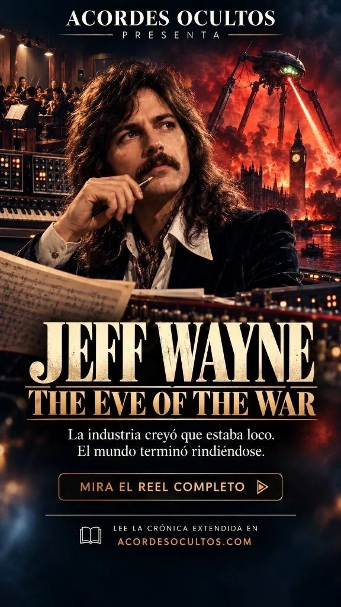
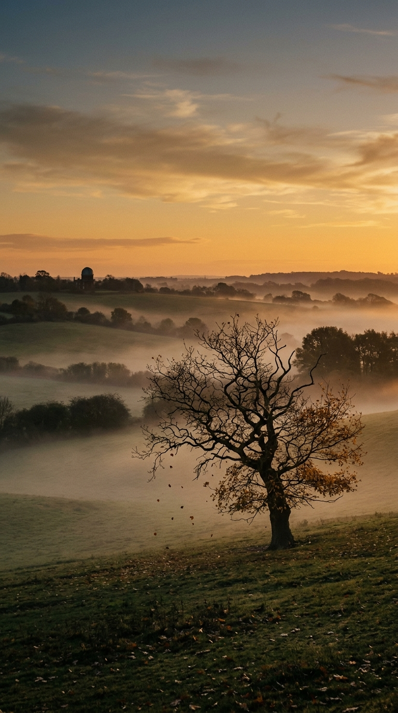

# La apuesta suicida de la invasión marciana: Cómo Jeff Wayne desafió al punk y a la quiebra para crear una obra eterna

### Acordes Ocultos

---

## Prólogo: La ciudad en llamas y la locura a contracorriente

Corría el año 1976 y las calles de Londres no toleraban la nostalgia. La mugre, el desempleo y la furia callejera del movimiento punk habían detonado como una bomba de relojería en los clubes oscuros del Soho. Los imperdibles, las guitarras afiladas a tres acordes y la urgencia cruda de los *Sex Pistols* y *The Clash* proclamaban a gritos que los dinosaurios del rock sinfónico habían muerto. Las compañías discográficas, aterrorizadas por perder la conexión con la juventud, rescindían contratos millonarios y desmantelaban proyectos orquestales.

En medio de semejante huracán cultural, un hombre de treinta y tres años, con el cabello rizado sobre los hombros y un bigote espeso de corte setentero, decidió encerrarse en una pequeña habitación de su casa de Londres con una copia gastada de una novela decimonónica. Se llamaba Jeff Wayne. Se ganaba la vida con enorme éxito componiendo jingles publicitarios —melodías pegadizas para marcas de ginebra, electrodomésticos y juguetes infantiles—, pero en su cabeza retumbaba un estruendo muy distinto: el zumbido alienígena de rayos calóricos arrasando la campiña inglesa.

Wayne quería convertir *La Guerra de los Mundos* de H.G. Wells, publicada en 1898, en una ópera rock orquestal de noventa y cuatro minutos. Para la industria musical de la época, la idea no solo era un anacronismo demencial: era un suicidio financiero garantizado.

---

## Acto I: El pacto familiar y el precipicio de las deudas

La chispa no había surgido de una estrategia de mercadotecnia, sino de un lazo íntimo y afectivo. Su padre, Jerry Wayne —un veterano actor y productor teatral estadounidense radicado en Inglaterra—, le había sugerido que leyera la novela de Wells para encontrar un argumento universal que pudiera trasladarse al lenguaje de la música moderna. Cuando Jeff terminó de devorar el libro, no vio una vieja historia de extraterrestres con tentáculos: vio una parábola desgarradora sobre la fragilidad humana, el colonialismo y el miedo al fin de la civilización.

Jerry Wayne asumió el rol de productor ejecutivo y logró asegurar los derechos literarios directamente con los herederos de Wells. Sin embargo, cuando se presentaron ante las oficinas de CBS Records en Londres con un borrador conceptual, los ejecutivos apenas disimularon su escepticismo. Consideraban que el proyecto era una rareza teatral inofensiva y le asignaron un presupuesto austero de apenas unas pocas miles de libras.

Jeff Wayne, no obstante, no concebía la obra como una modesta maqueta con batería eléctrica y un par de guitarras. Para retratar el colapso del Imperio Británico necesitaba el peso abrumador de una orquesta sinfónica de cuerdas, el choque vanguardista de los sintetizadores Moog y ARP Odyssey, una sección rítmica de rock implacable y tecnología de grabación de vanguardia en 48 pistas en los prestigiosos *Advision Studios*.

En cuestión de meses, los costos de producción pulverizaron el adelanto de la discográfica.

---

## Acto II: «No hay Plan B»

Con las cintas analógicas corriendo y los sueldos de decenas de músicos acumulándose semana tras semana, la discográfica se negó a inyectar un solo centavo adicional. Jeff y su padre se encontraron en una encrucijada irreversible: abandonar el proyecto a medio terminar, asumiendo una pérdida devastadora, o poner en juego todo lo que tenían.

Eligieron la fe ciega en el arte. Hipotecaron su propio patrimonio personal, vaciaron sus ahorros de años en la industria publicitaria y se endeudaron hasta el cuello para mantener las sesiones abiertas. 

Fue en aquellos días de máxima tensión cuando su esposa Geraldine, contemplando las facturas amontonadas sobre la mesa de la cocina y el agotamiento físico de su marido, le formuló la pregunta inevitable que cualquier familia al borde del precipicio se haría:

—*Jeff, ¿cuál es el Plan B si este disco fracasa?*

Wayne la miró fijamente y, con una serenidad desarmante nacida de quien ya no tiene marcha atrás, respondió:

—*No hay Plan B. Nos vamos a la quiebra absoluta.*

---

## Acto III: El Dios de Barítono: El milagro de Richard Burton

Wayne comprendió que la estructura de noventa y cuatro minutos se sostendría o se vendría abajo por un solo elemento: la voz del narrador. La música por sí sola no bastaba para unir la invasión; hacía falta una presencia humana que transmitiera la pesadumbre de un testigo que ha visto el mundo civilizado arder hasta los cimientos. El libreto, escrito minuciosamente por Doreen Wayne y Gary Osborne, fue redactado con un solo nombre en mente: **Richard Burton**.

Burton era una leyenda viviente de la actuación shakesperiana y de Hollywood, un gigante con una de las voces más ricas, graves y magnéticas que jamás se hubieran grabado. Pero conseguirlo parecía un delirio utópico. Wayne, armado únicamente con una carpeta de partituras y una cinta de prueba, viajó hasta California, donde Burton protagonizaba la obra *Equus*.

Temblándole las manos, Wayne logró acceder al camerino del actor en el teatro. Burton, con su mirada acerada y un cigarrillo en la mano, escuchó la propuesta y pidió leer el manuscrito en privado. Pocos días después, para incredulidad de los ejecutivos en Londres, la respuesta fue un rotundo sí.

La sesión de grabación tuvo lugar en los *Wally Heider Studios* de San Francisco. Burton llegó con una disciplina absoluta. Con un vaso en la mano y leyendo las hojas mecanografiadas con una gravedad estremecedora, grabó sus partes en cuestión de horas. Cuando pronunció por el micrófono las primeras palabras inmortales:

> *«No one would have believed in the last years of the nineteenth century that human affairs were being watched from the timeless worlds of space...»*

Un escalofrío recorrió la cabina de control. Los ingenieros y el propio Wayne sabían que tenían entre manos algo que trascendía el tiempo.

---

## Acto IV: La paradoja de Lego y el dolor humano

A pesar de la temática apocalíptica, el corazón palpitante del álbum es una balada de desamor y nostalgia: **«Forever Autumn»**. La historia de su nacimiento encierra una de las ironías más poéticas de la música popular.

En 1969, casi una década antes del disco, Jeff Wayne había compuesto una pequeña pieza musical de treinta segundos para un comercial de televisión de los bloques **Lego** (*«Have you seen the sun come up in the morning...»*). La melodía poseía una tristeza tan tierna y conmovedora que Wayne se negó a dejarla morir en un archivo publicitario. Junto a los letristas Paul Vigrass y Gary Osborne, expandió el tema para transformarlo en el lamento íntimo del Periodista al recordar a su prometida Carrie mientras las hojas de otoño caen sobre una Inglaterra devastada.

Para interpretarla, Wayne convocó a **Justin Hayward**, la inconfundible voz lírica de *The Moody Blues*. La interpretación vocal de Hayward, bañada en guitarras acústicas y violines llorosos, transformó el miedo cósmico en un desgarro íntimo con el que cualquier ser humano podía identificarse. El tema se convirtió en un single monumental, escalando de inmediato al Top 5 del Reino Unido.

A esa cumbre se sumó la participación volcánica de **Phil Lynott**, el carismático líder de *Thin Lizzy*, quien interpretó al párroco Nathaniel en su descenso a la demencia teológica en *«The Spirit of Man»*, contrastando con la desgarradora ternura de Julie Covington. La invasión de H.G. Wells dejaba de ser un relato fantástico de periódicos victorianos para erigirse en un tapiz de dolor, fe rota y redención humana.

---

*Cartel oficial de la crónica: La industria creyó que estaba loco. El mundo terminó rindiéndose.*

## Epílogo: El triunfo contra todos los pronósticos

El 9 de junio de 1978, la obra fue presentada oficialmente bajo la cúpula del Planetario de Londres. Los ejecutivos de CBS, que durante dos años habían temido una catástrofe contable, presenciaron atónitos cómo el público y la crítica quedaban hechizados por la ilustración de portada de Michael Trim y Geoff Taylor: un gigantesco trípode marciano emergiendo de las aguas sobre un cielo cobrizo, disparando su haz de muerte contra el acorazado *Thunder Child*.

Las tiendas de discos de Europa y América no daban abasto. El doble álbum vendió más de **15 millones de copias** en el planeta, permaneció más de **330 semanas en las listas oficiales de ventas británicas** y engendró décadas más tarde masivas giras de arenas que siguen llenándose con varias generaciones de espectadores.

Jeff Wayne no calculó las tendencias del mercado ni se doblegó ante la marea imperante de su época. Demostró que cuando un creador arriesga todo su patrimonio y su vida en una visión sincera, el arte no responde a la comodidad de las modas, sino a la verdad indestructible del espíritu humano.

---

### 📚 Fuentes y Archivo Documental
* Wayne, Jeff. *The Making of Jeff Wayne's Musical Version of The War of the Worlds*. Archivo de producción y entrevistas oficiales de Sony BMG / Ollie Record Productions (1978–2006).
* Wells, H.G. *The War of the Worlds*. William Heinemann, Londres, 1898.
* Hayward, Justin. *Memoirs of a Moody Blue: Notes on Forever Autumn*. Entrevistas retrospectivas de la BBC Radio 2, Londres.
* Bragg, Melvyn. *Rich: The Life of Richard Burton*. Hodder & Stoughton, Londres, 1988 (Documentación sobre las sesiones en San Francisco).
* Registros hemerográficos de *Melody Maker*, *New Musical Express (NME)* y *Billboard Magazine* (junio–noviembre de 1978).
* Catálogo oficial de Official Charts Company (Reino Unido), permanencia histórica en listas de álbumes (1978–1985).
