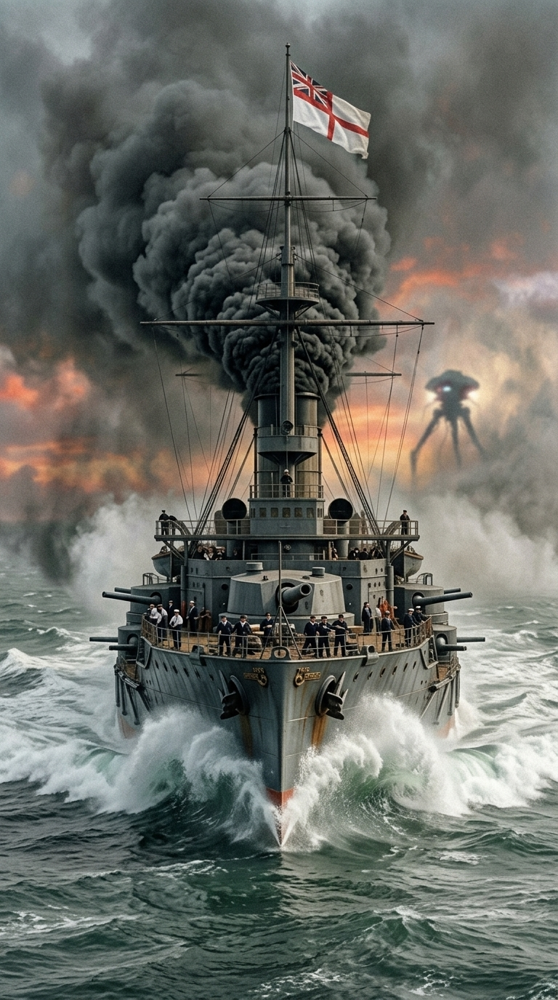
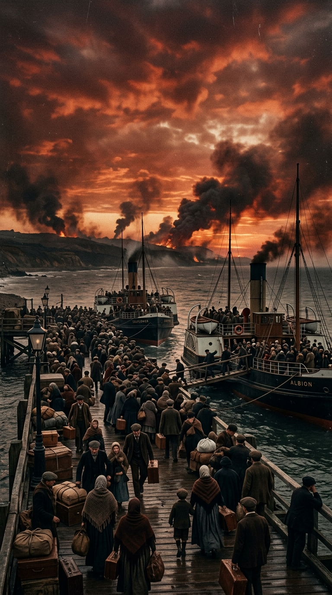
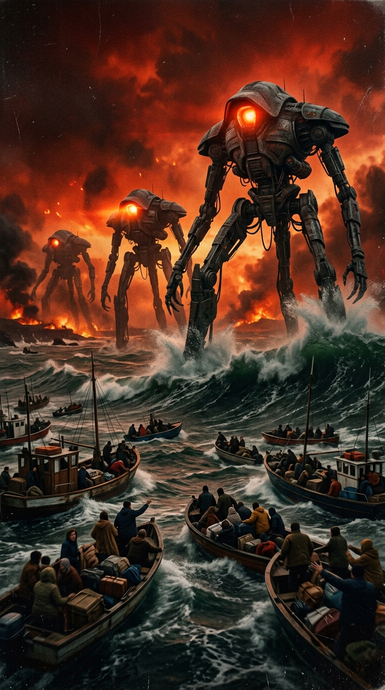
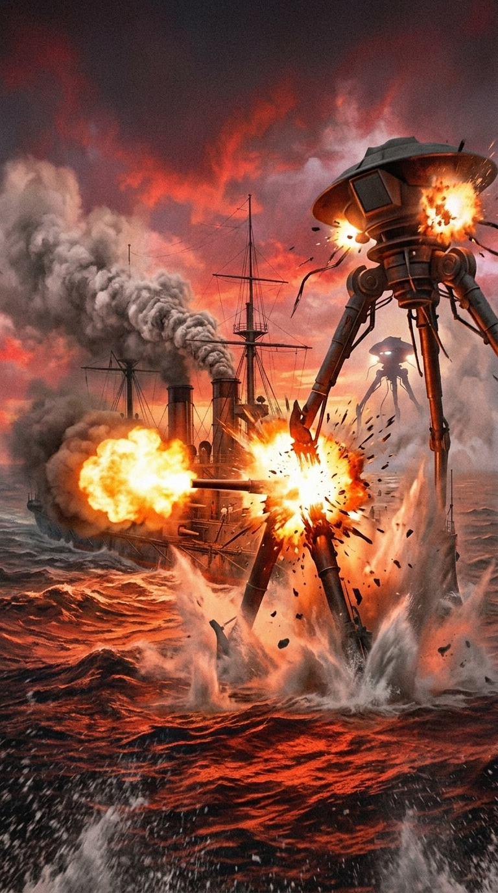
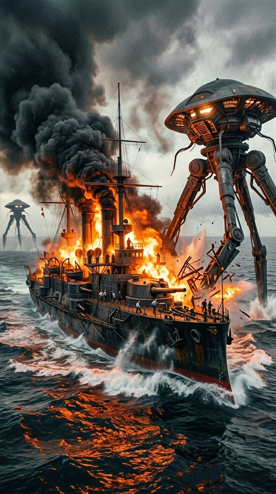
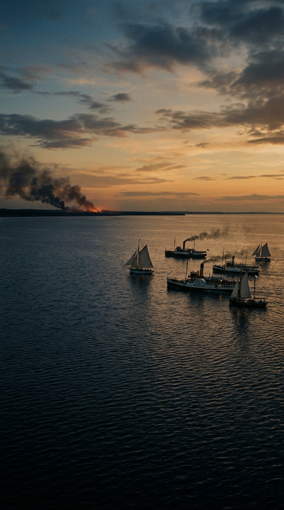
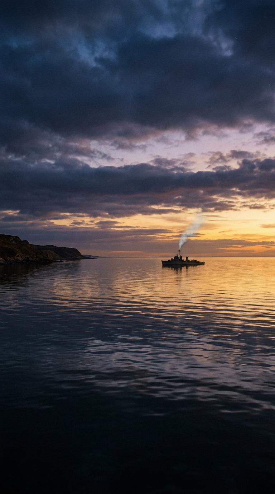

# El gigante de acero que desafió a las estrellas: La epopeya del HMS Thunder Child

### Historia en los Acordes

---

## Prólogo: La costa en llamas y el ocaso de un imperio

Hacia finales del siglo XIX, Gran Bretaña dominaba los mares del mundo. Sus buques de guerra de hierro y vapor eran el símbolo indiscutido del poderío industrial, la cúspide de la ingeniería humana. Sin embargo, nada en los anales del Almirantazgo británico había preparado a la humanidad para lo que descendió de los cielos en el caluroso verano de 1898.

Los cilindros caídos desde Marte no traían embajadores ni exploradores: traían una maquinaria implacable de exterminio. En cuestión de días, las guarniciones del ejército británico fueron barridas por nubes de humo negro sofocante y por el rayo calórico, un haz invisible de energía capaz de fundir el granito y vaporizar la carne humana en una fracción de segundo. Londres, el corazón del imperio más vasto de la Tierra, fue abandonada en una estampida de millones de almas enloquecidas por el pánico.

La tierra ya no pertenecía a los hombres. La única ruta de escape que quedaba era el mar.

---

## Acto I: El éxodo hacia las olas y el adiós a la tierra

A lo largo de la costa de Essex, miles de familias se agolpaban en muelles improvisados, playas de guijarros y orillas fangosas. Pequeñas barcazas de pesca, balandras, veleros y vapores de palas de recreo se abarrotaban hasta el borde del naufragio con hombres, mujeres y niños que habían caminado durante días con sus ropas desgarradas y las pocas pertenencias que pudieron rescatar.

El cielo sobre la bahía se tiñó de un crepúsculo rojizo y cobrizo, saturado por las cenizas de las ciudades incendiadas en el interior. Desde las cubiertas de madera de los barcos de pasajeros, los refugiados contemplaban en silencio cómo la línea de la costa británica se desdibujaba entre cortinas de humo. Nadie sabía si alguna vez volverían a pisar tierra firme. 

La huida parecía consolidarse cuando las aguas abiertas del canal comenzaron a recibirlos. Pero el destino les tenía reservada una última y aterradora emboscada.

---

## Acto II: Los titanes que caminaban sobre el mar

De repente, la línea del horizonte marino se quebró. A través de la bruma costera aparecieron tres siluetas descomunales de metal bruñido, de más de treinta metros de altura: los trípodes de combate marcianos.

Caminaban con una agilidad mecánica aterradora, vadeando las aguas profundas de la bahía como si fueran charcos insignificantes. Sus enormes capuchas de bronce giraban buscando presas, mientras las olas rompían con furia contra sus articulaciones de acero. Habían rodeado el canal para cerrar el paso a la flotilla de refugiados.

Un rayo calórico barrió la superficie del agua a cientos de metros de distancia. El impacto convirtió instantáneamente miles de litros de agua marina en una cortina de vapor hirviente y geysers de espuma verde esmeralda. Las pequeñas embarcaciones civiles comenzaron a zozobrar en medio del oleaje turbulento. Los tripulantes y pasajeros, desarmados e indefensos, comprendieron que la matanza era inminente.

No había salvación posible. O al menos, eso creían los invasores.

---

## Acto III: El rugido del monstruo de vapor

Entre la densa cortina de humo de carbón y vapor blanco surgió una silueta inesperada: un acorazado ariete a vapor de la Marina Real británica. Su nombre oficial en los registros navales era el **HMS Thunder Child**.

Bajo el mando de una tripulación que sabía perfectamente que su tecnología pertenecía a una era obsoleta frente a los invasores celestes, el buque no dio media vuelta ni buscó refugio en alta mar. Con sus calderas forzadas al límite de presión y sus chimeneas negras escupiendo torbellinos de hollín, el *Thunder Child* aceleró a toda máquina en rumbo de colisión directa contra los tres trípodes.

Sobre su mástil flameaba con orgullo la insignia blanca de la Royal Navy. Cuando la distancia se redujo a menos de una milla, sus torretas artilladas abrieron fuego. El estruendo de los cañones de doce pulgadas sacudió el mar. 

Una salva de proyectiles de alto impacto dio de lleno en la rótula articulada del trípode delantero. El gigante de metal se tambaleó con un chirrido ensordecedor de engranajes destrozados, perdió el equilibrio y cayó de costado en las olas con una explosión de fuego, vapor y aceite hirviente. Por primera vez desde que comenzó la pesadilla, los seres humanos veían caer a un dios de hierro.

---

## Acto IV: El sacrificio supremo de proa a popa

La respuesta de los dos trípodes supervivientes fue instantánea y despiadada. Dos haces concentrados del rayo calórico convergieron sobre el *Thunder Child*. En segundos, la superestructura de madera del buque ardió en una pira inmensa; las cubiertas se convirtieron en un infierno de llamas y el calor ablandó las planchas de hierro de la proa.

Cualquier tripulación ordinaria habría abandonado el barco o frenado las máquinas para arrojarse al mar. Los hombres del *Thunder Child* hicieron exactamente lo contrario.

Mortalmente herido, con el timón fijado hacia adelante y las calderas rugiendo en su último estertor, el acorazado actuó como un ariete colosal de miles de toneladas de acero al rojo vivo. Atravesó el agua hirviendo y se estrelló de frente contra la base del segundo trípode marciano, derribándolo en un cataclismo simultáneo de detonaciones y esquirlas de hierro.

La inmensa columna de vapor, humo y fuego que se elevó sobre el canal cubrió por completo la bahía. Cuando el aire comenzó a despejarse, solo quedaban olas embravecidas y manchas de aceite ardiendo sobre las aguas. El *Thunder Child* se había hundido en el abismo, pero se había llevado consigo a dos de los invasores.

---

## Epílogo: La gloria que no calculó victorias

A millas de distancia, impulsados por la brisa del atardecer, los barcos de pasajeros cruzaron el horizonte hacia la seguridad del mar abierto. Los miles de civiles a bordo miraron hacia atrás con lágrimas en los ojos, guardando en su memoria para siempre la imagen de aquel buque que no retrocedió ante la muerte.

En la adaptación musical de Jeff Wayne, con la voz épica y desgarradora de Chris Thompson, «Thunder Child» no es solo una pieza magistral de rock progresivo: es el canto fúnebre y triunfal a la nobleza del espíritu humano. Nos recuerda que la verdadera valentía no radica en la certeza de la victoria ni en la superioridad de las armas, sino en la entrega absoluta de quienes deciden interponer su propia vida para que otros puedan ver el amanecer.

---

### 📚 Fuentes y Archivo Documental
* Wells, H.G. *The War of the Worlds*. Capítulo XVII: «The Thunder Child». William Heinemann, Londres, 1898.
* Wayne, Jeff. *The Musical Version of The War of the Worlds*. Libreto original y notas de producción discográfica (CBS Records / Ollie Record Productions, 1978).
* Thompson, Chris. *Memories of Recording Thunder Child*. Entrevistas de archivo para Planet Rock Radio y BBC Music.
* Burt, R.A. *British Battleships 1889–1904*. Naval Institute Press, Annapolis, 1988 (Detalles técnicos sobre los acorazados de espolón victoriano clase Polyphemus y Conqueror que inspiraron el HMS Thunder Child).
* Catálogo histórico de arte de Michael Trim y Geoff Taylor: bocetos y pinturas originales del acorazado frente a los trípodes marcianos (Londres, 1977–1978).
