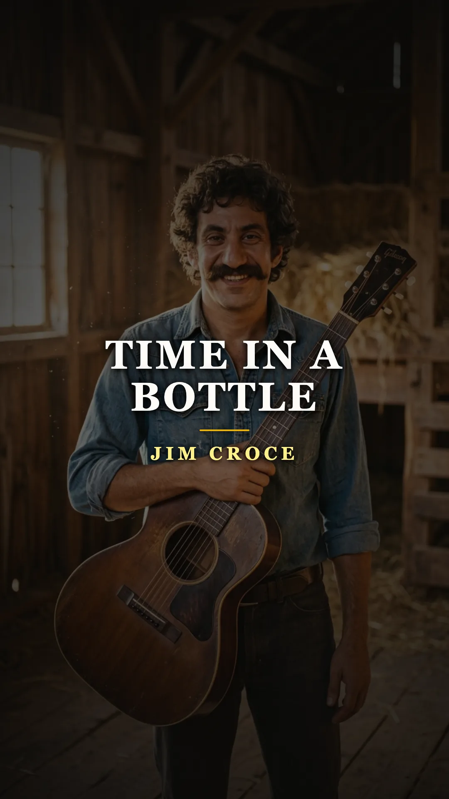
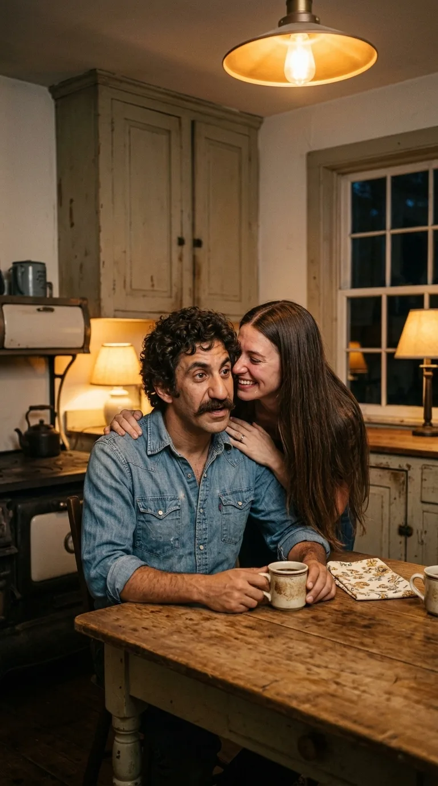
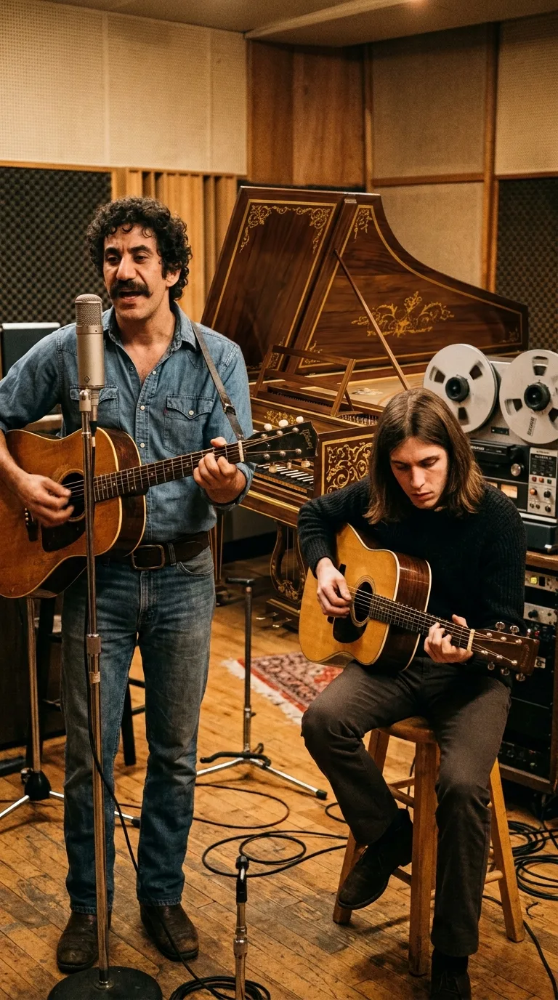
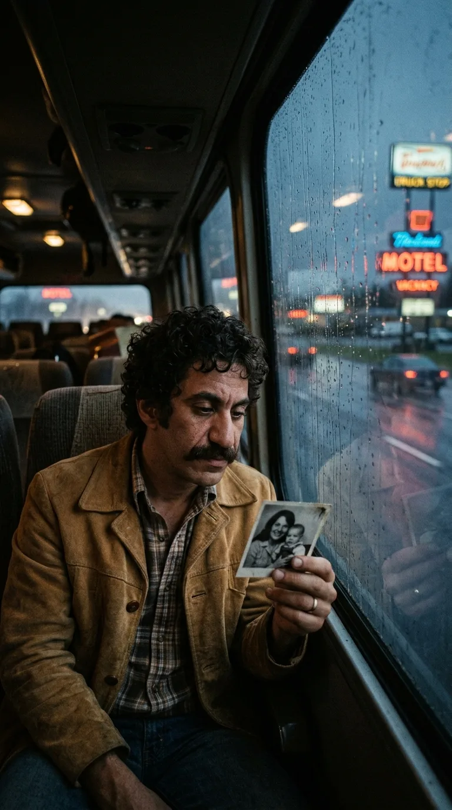
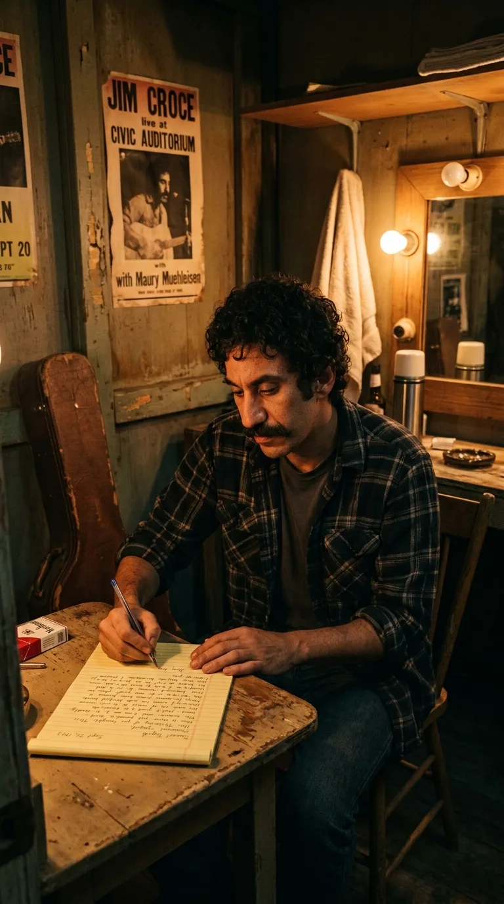
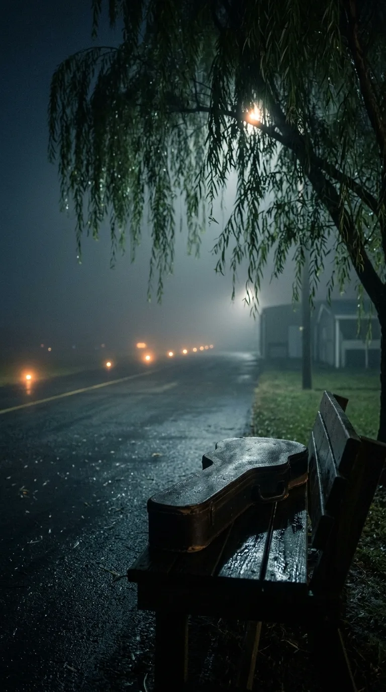
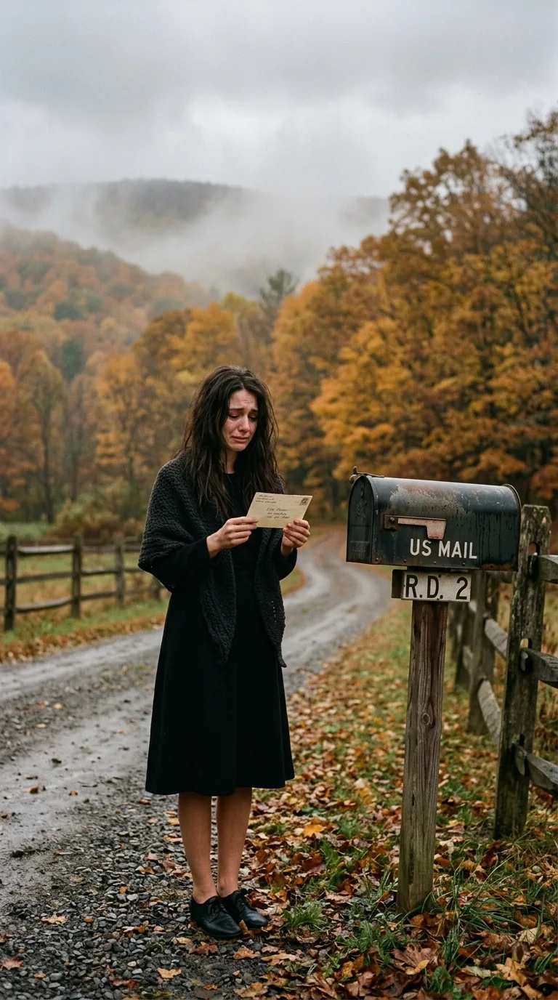

# ⏳ The Secret Behind «Time in a Bottle»: The Letter That Arrived After the Goodbye

> *“If I could save time in a bottle, the first thing that I'd like to do is to save every day 'til eternity passes away, just to spend them with you.”*  
> — **Jim Croce**, *Time in a Bottle*, 1970.

---

*1972: Jim Croce with his acoustic guitar, the Pennsylvania troubadour whose intimate plea on the brevity of days became a universal anthem against oblivion.*

---

### Prologue: The paradox of an impossible wish

Some songs are born from a sudden flash of inspiration, while others seem dictated by a silent premonition. In Jim Croce’s life, his most universal and heartbreaking ballad was both at once: an unvarnished vow of love and a staggering trap set by fate.

By the end of **1970**, James Joseph Croce was a twenty-seven-year-old man with hands calloused by heavy labor and empty pockets. After a decade of playing East Coast college coffeehouses for ten dollars a night and accumulating rejection letters from Manhattan record labels, he had learned to earn his living far from the spotlight. He drove semi-trucks on freezing dawn shifts, unloaded steel beams at construction sites, sold minor ad space for local Pennsylvania radio stations, and repaired tractors on a modest farm in Lyndell, Chester County.

Music had turned into a postponed dream, a vocation nearly stifled by the demands of daily survival. Yet, a single confidence whispered into his ear in the gloom of a rural kitchen would change the course of his story forever.

---

### Act I: The kitchen news and the midnight prayer

It was a glacial December night in 1970. In the humble kitchen of their country home, his wife **Ingrid Jacobson** approached in silence while Jim rested his shoulders after a grueling day on the road. With a mixture of trembling and restrained joy, she whispered news the couple had long awaited: medical tests confirmed she was pregnant. They were going to be parents for the first time.

*December 1970: Ingrid whispers the news of her pregnancy to Jim in the kitchen of their Pennsylvania farmhouse, the seminal moment from which «Time in a Bottle» took root.*

That revelation touched the musician's most vulnerable fibers. Jim did not react with boisterous celebration, but with a spiritual awe so profound it bordered on helplessness. In a precarious setting where money never lasted until the end of the month and work shifts devoured his youth, he understood with painful clarity that the scarcest treasure on earth was neither public recognition nor fortune, but time. Time to watch his child grow; time to grow old beside the woman who had stood by his side through the lean years.

That very midnight, when silence enveloped the farm and snow muffled the fields, Jim sat alone at a rough wooden table. He switched on an incandescent lamp, placed a notebook before him, and lifted down his acoustic guitar. As his fingers slid across the frets, he began constructing a metaphor as simple as it was unattainable: if human beings possessed the power to bottle luminous minutes like vintage wine in a glass jar, he would treasure every second to spend it entirely beside his family.

*The vigil of creation: Jim Croce alone with his guitar and notebook, weaving an intimate prayer to cheat the finiteness of time.*

In less than an hour, the melody and lyrics of **«Time in a Bottle»** were finished. It was not conceived to compete on the charts or to satisfy an A&R executive; it was a private time capsule, a protective prayer born from the intimacy of two souls staring down uncertainty.

---

### Act II: Maury’s virtuosity and The Hit Factory harpsichord

In early 1971, producers and friends **Terry Cashman** and **Tommy West** managed to secure Croce one final recording opportunity at the prestigious **The Hit Factory** studios in New York. Knowing that Jim’s robust, rhythmic style required a melodic counterpoint of refined delicacy, they introduced him to a twenty-one-year-old guitarist from Trenton, New Jersey: **Maury Muehleisen**.

Their artistic affinity was instant. While Jim’s right hand set a steady, working-class folk and country pulse on his Martin guitar, Maury’s fingers floated across the fretboard, weaving cascading arpeggios of crystal clarity.

*The Hit Factory, New York, 1971: Jim Croce and the virtuoso Maury Muehleisen alongside the baroque harpsichord that defined the song's timeless texture.*

When Jim laid out the D-minor chord progression of *«Time in a Bottle»*, producer Tommy West felt the piece possessed a chamber, almost baroque character that demanded a unique acoustic treatment. They dispensed with drums, heavy percussion, and modern electric bass. West sat down at a **harpsichord**, whose plucked strings doubled the high notes of Maury’s guitar. That resonant, melancholic timbre—halfway between Renaissance music and the contemporary ballad—imbued the recording with an ethereal, unmistakable atmosphere.

In the spring of 1972, the album *You Don't Mess Around with Jim* was released on **ABC Records**. Yet the label paid no commercial attention to that delicate lullaby. Commercial radio demanded energetic, lighthearted numbers. The record company heavily promoted the title track and the rhythmic *«Operator (That's Not the Way It Feels)»*. *«Time in a Bottle»* was left buried on track three of the album's side A, relegated to the intimacy of those who listened to the complete work in the solitude of their homes.

---

### Act III: The golden cage of success and road weariness

Jim Croce’s widespread acclaim between the fall of 1972 and the summer of 1973 was meteoric. His second record, *Life and Times*, took the infectious *«Bad, Bad Leroy Brown»* to **number one on the Billboard Hot 100** in July 1973. Overnight, the former truck driver and construction worker became a national celebrity, a regular on prime-time television, easily recognized by his thick mustache, denim shirts, and affable smile.

Yet triumph brought an asphyxiating personal toll. Booking agencies trapped him in a whirlwind of commitments exceeding two hundred and fifty shows a year: endless travel on interstate highways, impersonal hotel rooms, late-night meals, and prop-plane flights between mid-sized cities.

*Fall 1973: Jim Croce gazes at the rain through a window, longing for his wife Ingrid and young son A.J. amid an endless tour.*

His son, **Adrian James (A.J.)**, had been born on September 28, 1971, but Jim could barely spend a few days a month at the family farm. The anguish he had captured in the verses of *«Time in a Bottle»* took on a painfully literal meaning: months passed at ruthless speed, and the music industry machine was robbing him of his son's first steps.

On **September 20, 1973**, Jim Croce and Maury Muehleisen arrived in **Natchitoches**, Louisiana, to perform at the Prather Coliseum of **Northwestern State University**. The concert was a community celebration. Thousands of college students sang along standing up, bidding the duo farewell with a multi-minute ovation.

Walking off stage toward the dressing room, drenched in sweat with aching hands, Jim felt a definitive exhaustion. He looked around, gazed at his guitar case, and realized he had reached his absolute limit. He picked up a motel notepad, pulled out his pen, and sat down to write the most decisive message of his life.

*Natchitoches dressing rooms, September 20, 1973: Jim Croce pours his voluntary resignation from the stage into a letter to consecrate his life to his home.*

---

### Act IV: The resignation letter and the night flight

In that letter addressed to Ingrid, Jim stripped bare his feelings with disarming honesty. He explained that commercial success and mass applause were meaningless if the price was staying away from home. He announced that he had made an irrevocable decision: he would fulfill the remaining contractual obligations of that week and quit musical tours and the recording industry forever.

His determination was to return to the peace of Lyndell, dedicate himself to writing short stories and screenplays, and watch his son A.J. grow without ever being separated from them again. In the final paragraph, he penned lines steeped in devotion:

> *“Remember that I love you. I'm coming home to do what truly belongs to us: to be together, watch the boy grow, and share every day of our lives.”*

Jim folded the pages, slipped them into a white envelope, carefully wrote the address of his Pennsylvania farm, affixed postage, and dropped the letter into the mailbox before heading to the modest Natchitoches regional airport.

*Midnight in Natchitoches: Fog over the tarmac of the rural airfield where fate cut short the journey home for Jim Croce and Maury Muehleisen.*

Waiting on the runway was a chartered twin-engine **Beechcraft E18S** (registration N48PE) hired to fly the crew to their next stop in Sherman, Texas. The night was pitch dark, and a thick fog lowered visibility across the terrain. At **10:45 PM**, during takeoff, the aircraft failed to gain the necessary altitude and collided with a pecan tree at the end of the taxiway.

In a fraction of a second, Jim Croce’s voice was extinguished forever. He was just thirty years old. Alongside him perished Maury Muehleisen, twenty-four, comedian George Stevens, manager Kenneth Cortese, Dennis Rast, and pilot Robert Elliott.

---

### Epilogue: The mailbox on the lane and posthumous acclaim

The news caused national shock. Days after the crash, following painful funeral services held in Pennsylvania before a crowd of fans and peers, a desolate Ingrid Croce returned to the solitude of the farm.

As she walked up the gravel drive blanketed in autumn leaves, she noticed the metal flag of the rural mailbox was up. She approached slowly, opened the door, and found a white envelope bearing a Louisiana postmark.

*Fall 1973: Ingrid Croce holds Jim's posthumous letter through tears, received days after the burial with the promise never to leave again.*

It was the letter Jim had written and mailed hours before boarding the plane. As she read her husband's promise swearing he was coming back never to leave again, tears blurred the ink. Jim had made the decision to save his life and his home, but fate had closed the door minutes before he could cross the threshold.

Meanwhile, a spontaneous radio phenomenon swept across the country. Weeks prior to the accident, the ABC television network had broadcast the dramatic telefilm *She Lives!*, whose soundtrack featured *«Time in a Bottle»*. Following the singer's death, thousands of listeners unaware of that hidden song on his first LP began mass-calling stations to request "Croce's song about saving time."

Overwhelmed by public demand, the record label released the track as an official single in early November 1973. On **December 29, 1973**, *«Time in a Bottle»* climbed to **number one on the Billboard Hot 100**, where it remained for two consecutive weeks. It became the third posthumous single to top the U.S. charts in history, joining the milestones of Otis Redding with *(Sittin' On) The Dock of the Bay* and Janis Joplin with *Me and Bobby McGee*.

*The indestructible legacy: The metaphor of time preserved in a luminous bottle, the acoustic guitar, and the eternal memory of Jim Croce.*

Jim Croce couldn't save time in a bottle to prolong his physical presence on earth, but he left popular culture an immortal work of art that defies oblivion. Every time Maury’s arpeggios ring out and the harpsichord makes way for Jim's noble voice, the clock stops in that December 1970 kitchen, where love was infinite before eternity began.

---

### 💬 A Question for Our Community

*«Time in a Bottle»* reminds us that our greatest human treasure is not possessions or fleeting victories, but the moments shared with those we love.

**What memory or moment from your life would you wish to save forever in a glass bottle so that time could never wash it away?**

*We read your thoughts in the comments of our weekly publication.*

---

### 📚 Sources and Archival Records

1. **Croce, Ingrid** (1996). *Time in a Bottle: The Jim Croce Story*. Running Press, Philadelphia. Official memoirs by his widow detailing family life in Lyndell, the midnight composition of the song, and receiving the posthumous letter after the funeral.
2. **Croce, Ingrid & Rock, Jimmy** (2012). *I Got a Name: The Jim Croce Story*. Da Capo Press, Boston. Comprehensive documentary biography detailing the creative partnership with Maury Muehleisen, the grueling 1973 tours, and the artist's private correspondence.
3. **Cashman, Terry & West, Tommy** (1972, 2004). *Production notes and recording sessions for «You Don't Mess Around with Jim» at The Hit Factory (New York)*. ABC/Dunhill Records (LP ABCX-756) / BMG Heritage. Documentation of the harpsichord arrangement and Martin acoustic guitars.
4. **National Transportation Safety Board (NTSB)** (Adopted 1974). *Aircraft Accident Report: Beechcraft E18S, N48PE, Natchitoches Municipal Airport, Louisiana, September 20, 1973*. NTSB File No. 3-3240, Washington D.C. Expert investigative report on the aviation accident.
5. **Billboard Magazine** (Issues of December 29, 1973 and January 5, 1974). *Hot 100 Charts: Jim Croce's Posthumous Number-One Records*, sales analysis and chart longevity.
6. **Rolling Stone Magazine** (October 25, 1973, Issue 146). *Jim Croce: 1943–1973*. Obituary coverage and critical tribute following the Natchitoches tragedy.