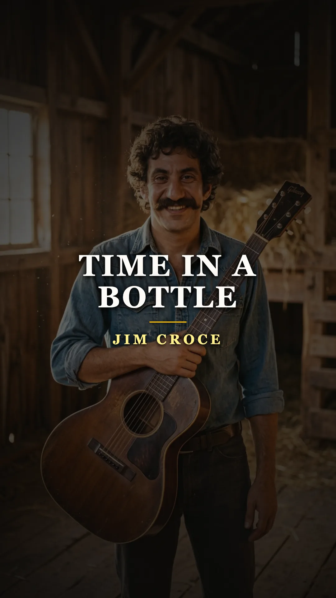
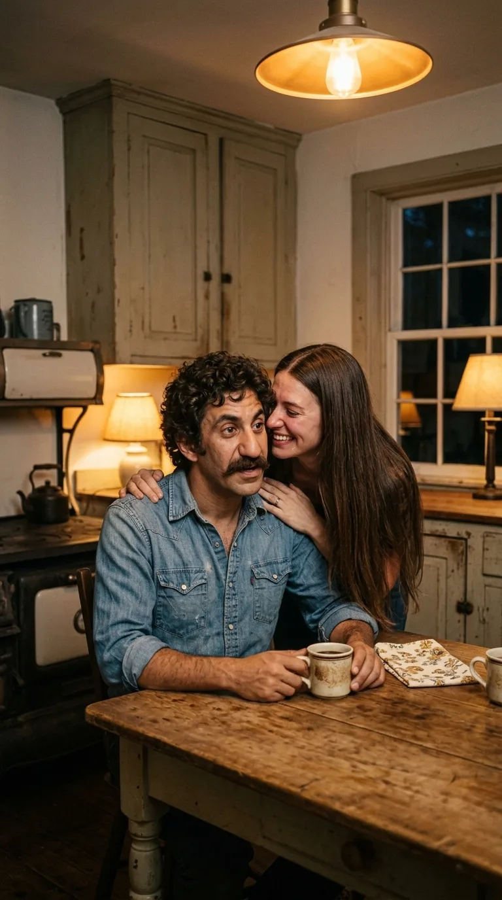
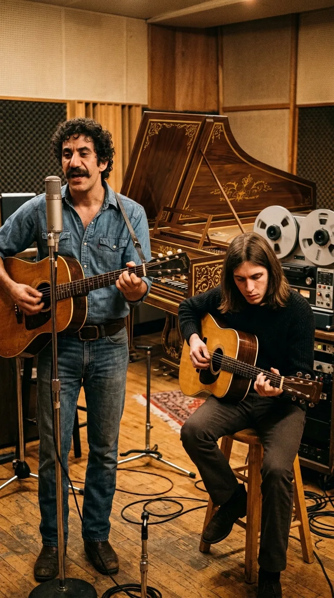
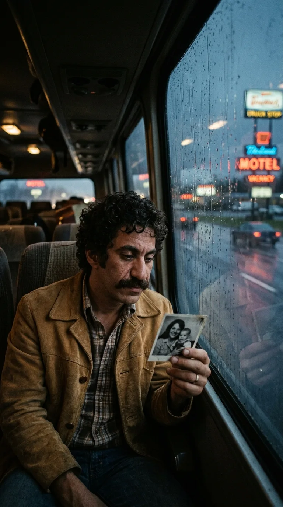
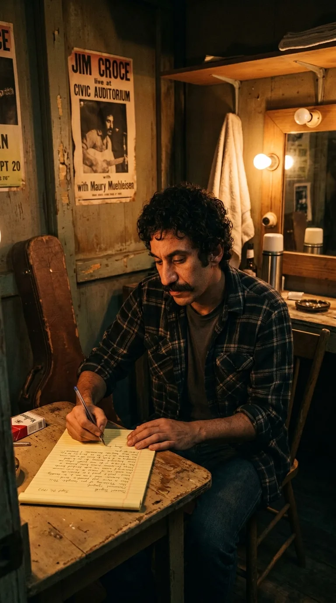
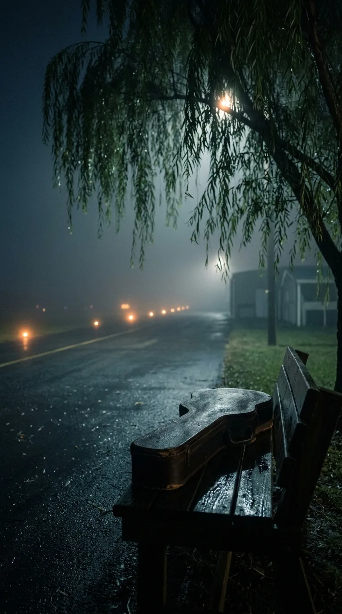
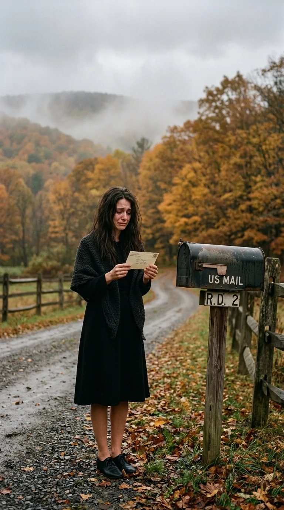

# ⏳ El Secreto de «Time in a Bottle»: La Carta que Llegó Después del Adiós

> *«Si pudiera guardar el tiempo en una botella, lo primero que querría hacer sería salvar cada día hasta que la eternidad se acabe, solo para pasarlos contigo».*  
> — **Jim Croce**, *Time in a Bottle*, 1970.

---

*1972: Jim Croce con su guitarra acústica, el trovador de Pensilvania cuya plegaria íntima sobre la brevedad de los días se convirtió en un himno universal contra el olvido.*

---

### Prólogo: La paradoja de un deseo imposible

Hay canciones que nacen de un destello fortuito de inspiración y otras que parecen dictadas por una premonición silenciosa. En la vida de Jim Croce, su balada más universal y desgarradora fue ambas cosas a la vez: un juramento de amor desprovisto de artificios y una sobrecogedora trampa del destino.

A finales de **1970**, James Joseph Croce era un hombre de veintisiete años con las manos encallecidas por el trabajo pesado y los bolsillos vacíos. Tras una década de recorrer cafés universitarios de la Costa Este por diez dólares la noche y acumular cartas de rechazo de las oficinas discográficas de Manhattan, había aprendido a ganarse el pan lejos de los focos. Conducía camiones de gran tonelaje en madrugadas de helada, descargaba vigas de acero en obras de construcción, vendía publicidad menor para emisoras locales de Pensilvania y reparaba tractores en una modesta granja de Lyndell, en el condado de Chester.

La música se había transformado en un sueño postergado, una vocación casi sofocada por las urgencias del sustento diario. Sin embargo, una sola confidencia murmurada al oído en la penumbra de una cocina rural cambió para siempre el rumbo de su historia.

---

### Acto I: La noticia en la cocina y la plegaria nocturna

Era una noche glacial de diciembre de 1970. En la humilde cocina de su casa de campo, su esposa **Ingrid Jacobson** se acercó en silencio mientras Jim descansaba los hombros tras una jornada demoledora en la carretera. Con una mezcla de temblor y júbilo contenido, le susurró una noticia que el matrimonio aguardaba con anhelo: las pruebas médicas confirmaban que estaba embarazada. Iban a ser padres por primera vez.

*Diciembre de 1970: Ingrid le susurra a Jim la noticia de su embarazo en la cocina de su granja de Pensilvania, el instante seminal donde brotó la semilla de «Time in a Bottle».*

Aquella revelación conmovió las fibras más íntimas del músico. Jim no reaccionó con una celebración estruendosa, sino con un sobrecogimiento espiritual tan hondo que rozaba el desamparo. En un entorno precario, donde el dinero nunca alcanzaba para terminar el mes y las jornadas laborales devoraban la juventud, comprendió con dolorosa nitidez que el tesoro más escaso sobre la tierra no era el reconocimiento público ni la fortuna, sino el tiempo. El tiempo para ver crecer a su hijo; el tiempo para envejecer junto a la mujer que había permanecido a su lado en los años de miseria.

Esa misma medianoche, cuando el silencio envolvía la granja y la nieve amortiguaba los ruidos de los campos, Jim se sentó a solas ante una mesa de madera tosca. Encendió una lámpara incandescente, colocó un cuaderno de notas frente a sí y descolgó su guitarra acústica. Con los dedos deslizándose sobre los trastes, comenzó a construir una metáfora tan sencilla como inalcanzable: si los seres humanos tuvieran el poder de embotellar los minutos luminosos como quien conserva vino añejo en un frasco de vidrio, él atesoraría cada segundo para gastarlo íntegramente al lado de su familia.

*La vigilia de la creación: Jim Croce a solas con su guitarra y su cuaderno de notas, hilvanando una plegaria íntima para burlar la finitud del tiempo.*

En menos de una hora, la melodía y el texto de **«Time in a Bottle»** quedaron concluidos. No fue concebida para competir en los listados de éxitos ni para satisfacer a un director artístico; era una cápsula de tiempo privada, una plegaria protectora nacida en la intimidad de dos seres que miraban de frente a la incertidumbre.

---

### Acto II: El virtuosismo de Maury y el clavecín de The Hit Factory

A comienzos de 1971, los productores y amigos **Terry Cashman** y **Tommy West** consiguieron abrirle a Croce una última oportunidad de grabación en los prestigiosos estudios **The Hit Factory** de Nueva York. Conscientes de que el estilo rítmico y robusto de Jim requería un contrapunto melódico de refinada delicadeza, le presentaron a un joven guitarrista de apenas veintiún años oriundo de Trenton, Nueva Jersey: **Maury Muehleisen**.

La afinidad artística entre ambos fue instantánea. Mientras la mano derecha de Jim marcaba un pulso firme, arraigado en el folk y el country de raíz obrera sobre su guitarra Martin, los dedos de Maury flotaban por el mástil tejiendo arpegios en cascada, de una transparencia cristalina.

*The Hit Factory, Nueva York, 1971: Jim Croce y el virtuoso Maury Muehleisen junto al clavecín barroco que definió la textura atemporal de la canción.*

Cuando Jim expuso la rueda de acordes en re menor de *«Time in a Bottle»*, el productor Tommy West consideró que la pieza poseía un carácter camerístico y casi barroco que exigía un tratamiento acústico singular. Prescindieron de la batería, de la percusión pesada y de los bajos eléctricos modernos. West se sentó frente a un **clavecín** (*harpsichord*), cuyas cuerdas pulsadas doblaron las notas agudas de la guitarra de Maury. Aquel timbre resonante y melancólico, a medio camino entre la música renacentista y la balada contemporánea, dotó a la grabación de una atmósfera etérea e inconfundible.

En la primavera de 1972 se publicó el álbum *You Don't Mess Around with Jim* bajo el sello **ABC Records**. Sin embargo, la compañía no prestó atención comercial a aquella delicada canción de cuna. La radio comercial reclamaba números enérgicos y desenfadados. La disquera promocionó con fuerza la pista titular y la rítmica *«Operator (That's Not the Way It Feels)»*. *«Time in a Bottle»* quedó archivada en el surco tres del lado A del disco, relegada a la intimidad de quienes escuchaban la obra completa en la soledad de sus hogares.

---

### Acto III: La jaula dorada del éxito y el cansancio de la carretera

La consagración popular de Jim Croce entre el otoño de 1972 y el verano de 1973 fue fulgurante. Su segundo trabajo discográfico, *Life and Times*, llevó la contagiosa *«Bad, Bad Leroy Brown»* al **número uno del Billboard Hot 100** en julio de 1973. De la noche a la mañana, el antiguo camionero y operario de construcción se convirtió en una celebridad nacional habitual en los programas televisivos de máxima audiencia, fácilmente identificable por su espeso bigote, sus camisas vaqueras y su sonrisa afable.

Sin embargo, el triunfo trajo consigo un peaje personal asfixiante. Las agencias de contratación lo atraparon en una vorágine de compromisos que superaba los doscientos cincuenta conciertos al año: traslados interminables por carreteras interestatales, habitaciones de hotel impersonales, cenas a deshora y vuelos en avionetas de hélice entre ciudades medianas.

*Otoño de 1973: Jim Croce contempla la lluvia a través de la ventanilla, añorando a su esposa Ingrid y a su pequeño hijo A.J. en medio de una gira interminable.*

Su hijo, **Adrian James (A.J.)**, había nacido el 28 de septiembre de 1971, pero Jim apenas podía pasar unos pocos días al mes en la granja familiar. La angustia que había plasmado en los versos de *«Time in a Bottle»* cobraba un sentido dolorosamente literal: los meses pasaban a una velocidad despiadada y la maquinaria de la industria musical le arrebataba los primeros pasos de su hijo.

El **20 de septiembre de 1973**, Jim Croce y Maury Muehleisen llegaron a **Natchitoches**, Luisiana, para ofrecer una actuación en el auditorio Prather Coliseum de la **Northwestern State University**. El recital fue una fiesta comunitaria. Miles de estudiantes universitarios cantaron sus temas de pie, despidiendo al dúo con una ovación de varios minutos.

Al descender del escenario y cruzar hacia el camerino, bañado en sudor y con las manos doloridas, Jim experimentó un agotamiento definitivo. Miró a su alrededor, contempló el estuche de su guitarra y comprendió que había llegado al límite de sus fuerzas. Tomó una libreta de notas con membrete del motel, sacó su pluma y se sentó a redactar el mensaje más decisivo de su vida.

*Camerinos de Natchitoches, 20 de septiembre de 1973: Jim Croce plasma en una carta su renuncia voluntaria a los escenarios para consagrar su vida a su hogar.*

---

### Acto IV: La carta de renuncia y el vuelo en la noche

En aquella misiva dirigida a Ingrid, Jim desnudó sus sentimientos con una honestidad desarmante. Le explicaba que el éxito comercial y los aplausos multitudinarios carecían de sentido si el precio era permanecer lejos de su hogar. Le anunció que había tomado una decisión irrevocable: cumpliría los compromisos contractuales pendientes de esa semana y abandonaría para siempre las giras musicales y la industria del disco.

Su determinación era volver a la tranquilidad de Lyndell, dedicarse a escribir relatos cortos y guiones cinematográficos, y ver crecer a su hijo A.J. sin volver a separarse de ellos. En el párrafo final, escribió unas líneas impregnadas de devoción:

> *«Recuerda que te amo. Voy a volver a casa para hacer lo que verdaderamente nos pertenece: estar juntos, ver crecer al niño y compartir cada día de nuestras vidas»*.

Jim dobló las cuartillas, las introdujo en un sobre blanco, escribió con letra cuidada la dirección de su granja de Pensilvania, adhirió el franqueo postal y depositó la carta en el buzón antes de dirigirse hacia el modesto aeropuerto regional de Natchitoches.

*Medianoche en Natchitoches: La niebla sobre el asfalto del aeródromo rural donde el destino truncó el regreso a casa de Jim Croce y Maury Muehleisen.*

En la pista aguardaba un bimotor chárter **Beechcraft E18S** (matrícula N48PE) contratado para trasladar al equipo a su siguiente escala en Sherman, Texas. La noche era oscura y cerrada, y una niebla espesa reducía la visibilidad sobre el terreno. A las **22:45 horas**, durante la maniobra de despegue, la aeronave no logró alcanzar la altitud necesaria y colisionó contra un nogal pacanero (*pecan tree*) situado al final de la pista de carreteo.

En una fracción de segundo, la voz de Jim Croce se extinguió para siempre. Tenía apenas treinta años de edad. Junto a él fallecieron Maury Muehleisen, de veinticuatro años, el humorista George Stevens, su mánager Kenneth Cortese, Dennis Rast y el piloto Robert Elliott.

---

### Epílogo: El buzón en el camino y la consagración póstuma

La noticia causó una conmoción nacional. Días después del siniestro, tras las dolorosas honras fúnebres celebradas en Pensilvania ante una multitud de seguidores y colegas, una desolada Ingrid Croce regresó a la soledad de la granja.

Al avanzar por el camino de grava cubierto de hojas otoñales, observó que la bandera metálica del buzón rural estaba levantada. Se aproximó lentamente, abrió la compuerta y encontró un sobre blanco con el matasellos de Luisiana.

*Otoño de 1973: Ingrid Croce sostiene entre lágrimas la carta póstuma de Jim, recibida días después del entierro con la promesa de no volver a partir.*

Era la carta que Jim había redactado y despachado horas antes de subir a la avioneta. Al leer la promesa de su marido jurándole que regresaba para no marcharse nunca más, las lágrimas velaron la tinta. Jim había tomado la decisión de salvar su vida y su hogar, pero el destino había cerrado la puerta minutos antes de que pudiera cruzar el umbral.

Entretanto, un fenómeno radiofónico espontáneo se propagaba por todo el país. Semanas antes del accidente, la cadena televisiva ABC había emitido el telefilme dramático *She Lives!*, en cuya banda sonora destacaba *«Time in a Bottle»*. Tras la muerte del cantante, miles de oyentes que desconocían aquella canción escondida en su primer LP comenzaron a telefonear en masa a las emisoras para solicitar «la canción de Croce sobre guardar el tiempo».

Desbordada por la demanda popular, la compañía discográfica publicó la pieza como sencillo oficial a comienzos de noviembre de 1973. El **29 de diciembre de 1973**, *«Time in a Bottle»* escaló hasta el **puesto número uno del Billboard Hot 100**, donde permaneció durante dos semanas consecutivas. Se convirtió en el tercer sencillo póstumo en liderar las listas estadounidenses en toda la historia, uniéndose a los hitos de Otis Redding con *(Sittin' On) The Dock of the Bay* y Janis Joplin con *Me and Bobby McGee*.

*El legado indestructible: La metáfora del tiempo preservado en una botella luminosa, la guitarra acústica y la memoria eterna de Jim Croce.*

Jim Croce no pudo guardar el tiempo en una botella para prolongar su presencia física en la tierra, pero legó a la cultura popular una obra de arte inmortal que desafía al olvido. Cada vez que resuenan los arpegios de Maury y el clavecín abre paso a la voz noble de Jim, el reloj se detiene en aquella cocina de diciembre de 1970, donde el amor fue infinito antes de que la eternidad comenzara.

---

### 💬 La Pregunta para Nuestra Comunidad

*«Time in a Bottle»* nos recuerda que el mayor tesoro humano no son las posesiones ni las victorias efímeras, sino los instantes compartidos con quienes amamos.

**¿Qué recuerdo o momento de tu vida desearías guardar para siempre en una botella de cristal para que el tiempo jamás pudiera borrarlo?**

*Te leemos en los comentarios de nuestra publicación semanal.*

---

### 📚 Fuentes y Archivo Documental

1. **Croce, Ingrid** (1996). *Time in a Bottle: The Jim Croce Story*. Running Press, Filadelfia. Memorias oficiales de su viuda sobre la vida familiar en Lyndell, la composición nocturna de la canción y la recepción de la carta póstuma tras el sepelio.
2. **Croce, Ingrid & Rock, Jimmy** (2012). *I Got a Name: The Jim Croce Story*. Da Capo Press, Boston. Biografía documental exhaustiva que detalla la relación creativa con Maury Muehleisen, las giras extenuantes de 1973 y la correspondencia privada del artista.
3. **Cashman, Terry & West, Tommy** (1972, 2004). *Notas de producción y sesiones de grabación de «You Don't Mess Around with Jim» en The Hit Factory (Nueva York)*. ABC/Dunhill Records (LP ABCX-756) / BMG Heritage. Documentación del arreglo de clavecín y las guitarras acústicas Martin.
4. **National Transportation Safety Board (NTSB)** (Adoptado en 1974). *Aircraft Accident Report: Beechcraft E18S, N48PE, Natchitoches Municipal Airport, Louisiana, September 20, 1973*. NTSB File No. 3-3240, Washington D.C. Informe pericial del siniestro aéreo.
5. **Billboard Magazine** (Ediciones del 29 de diciembre de 1973 y 5 de enero de 1974). *Hot 100 Charts: Jim Croce's Posthumous Number-One Records*, análisis de ventas y permanencia en la cima discográfica.
6. **Rolling Stone Magazine** (25 de octubre de 1973, Issue 146). *Jim Croce: 1943–1973*. Cobertura necrológica y homenaje crítico tras la tragedia de Natchitoches.
