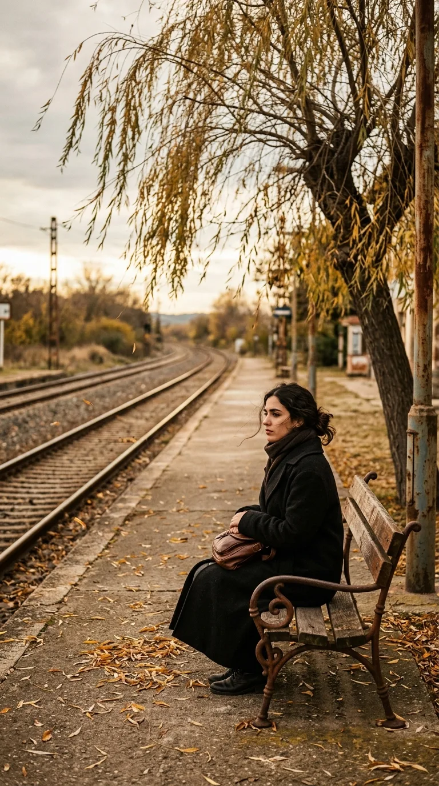
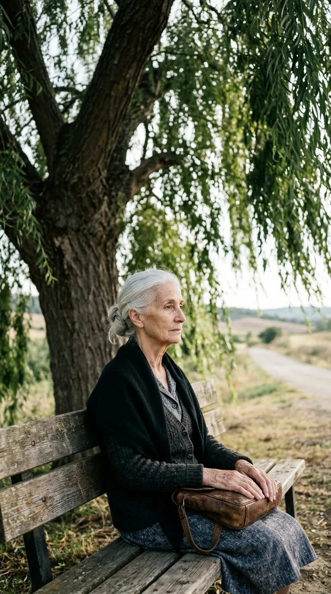
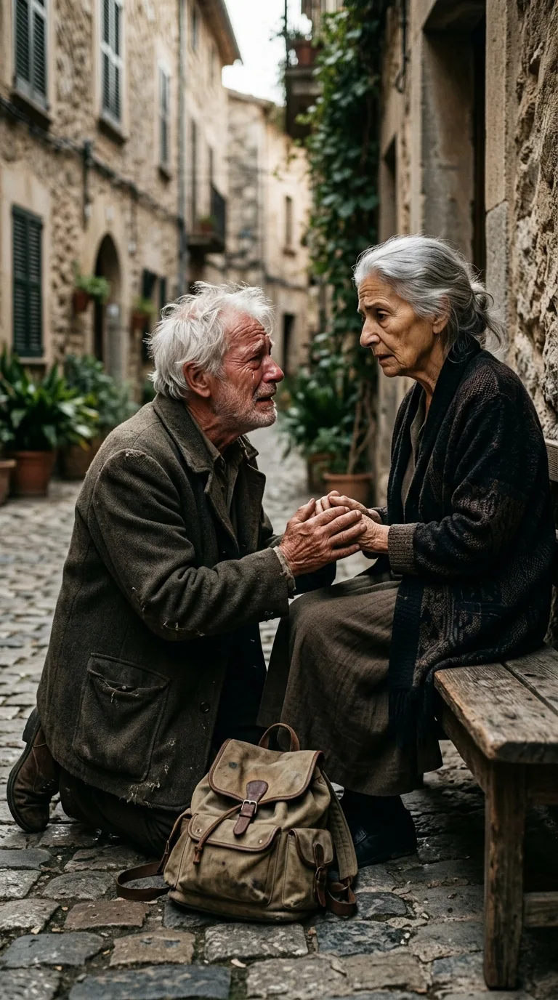
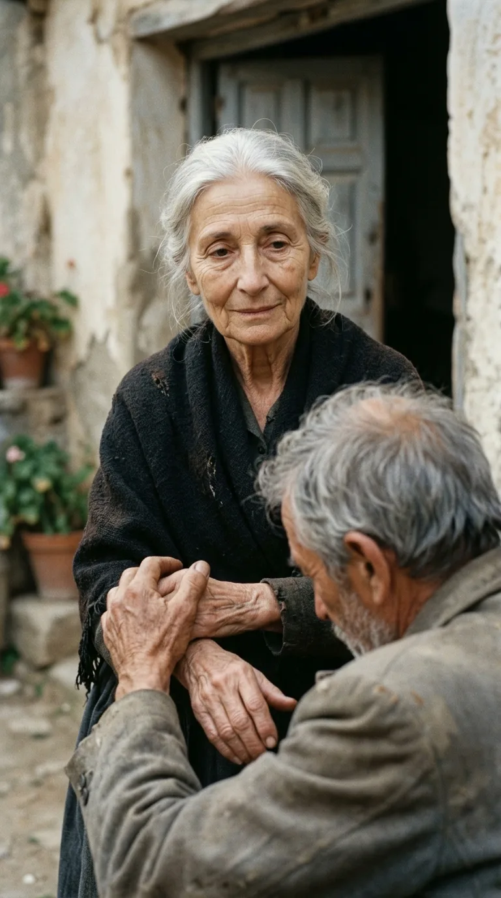

# La Espera Infinita: La Tragedia Humana Detrás de «Penélope» de Joan Manuel Serrat

> *«Penélope, con su bolso de piel marrón y sus zapatos de tacón y su vestido de domingo... Penélope se sienta en un banco en el andén y espera que llegue el primer tren meneando el abanico».*  
> — **Joan Manuel Serrat** (Música de Augusto Algueró)

---

### Prólogo: El andén donde el tiempo se detuvo

Hay canciones que cuentan una anécdota y hay canciones que construyen un monumento a la desolación del alma humana. En 1969, Joan Manuel Serrat, acompañado por la insuperable orquestación de Augusto Algueró, dio vida a *«Penélope»*, una de las piezas más estremecedoras jamás compuestas en la lengua española. 

Aunque el título evoca de inmediato el mito homérico de la *Odisea* —aquella reina de Ítaca que tejía y destejía de noche esperando el regreso de Ulises de la guerra de Troya—, Serrat no situó su historia en palacios griegos ni en batallas mitológicas. La trasladó a la tierra áspera y gris de la España de provincias de mediados del siglo XX: un andén solitario de estación de tren, un banco de pino carcomido por la lluvia y una muchacha vestida con sus mejores galas que decidió convertir la espera en el único sentido de su existencia.

Detrás de su melodía envolvente y su compás melancólico se esconde una tragedia demoledora sobre la locura del amor, el paso implacable de los años y la más cruel de todas las paradojas humanas: cuando la obsesión por el recuerdo es tan violenta que termina devorando a la propia realidad.

---

### Acto I: La promesa de primavera y el humo del tren

La historia comienza en una luminosa tarde de primavera en una pequeña estación ferroviaria. Entre las nubes de vapor de las locomotoras de carbón y el trajín de los viajeros, dos amantes jóvenes se funden en una despedida angustiosa. Ella es Penélope: una muchacha hermosa, ingenua y enamorada, ataviada con su vestido de domingo, sus zapatos de tacón y un bolso de piel marrón entre las manos.

Él es un muchacho con los ojos llenos de horizontes lejanos que debe partir en busca de porvenir o empujado por el destino. Antes de subir al vagón, la abraza contra su pecho, le besa las mejillas encendidas y le hace una promesa solemne que quedará grabada a fuego entre las traviesas de la vía:  
*«Volveré por ti antes de que las hojas del sauce caigan al suelo. Espérame aquí»*.

El silbato retumba en las colinas, las ruedas de hierro rechinan contra los rieles y el convoy se aleja lentamente hasta convertirse en una línea diminuta en el horizonte. En ese preciso segundo, el tiempo deja de correr para Penélope. El reloj del andén y los latidos de su pecho se sincronizan en una única y ciega certeza: él va a regresar.

---

### Acto II: El sauce crece y el pueblo murmura

Pasan los meses. Las hojas verdes de la primavera se vuelven doradas en otoño y caen sobre el suelo empedrado, pero el viajero no aparece. Llega el invierno con sus escarchas cortantes y Penélope permanece allí, sentada en el mismo banco de madera, desafiando el frío con su abrigo y su abanico de domingo.

Pasan los años, y luego las décadas. Las locomotoras de vapor son reemplazadas por trenes de gasóleo, la pintura de la estación se desconcha y el sauce que vio la despedida se convierte en un árbol anciano de ramas desmadejadas. En el pueblo cercano, la compasión inicial de los vecinos se transforma en burla y luego en resignación. Los niños señalan el andén desde lejos, los tenderos comentan con pesar que *«a Penélope se le paró el reloj una tarde de mayo»* y la gente comienza a llamarla simplemente *la loca de la estación*.

A ella no le importan los murmullos ni la vejez que avanza como una sombra sobre su cuerpo. El pelo negro azabache de su juventud se va poblando de hilos plateados; las arrugas surcan sus párpados y sus manos se vuelven temblorosas. Pero cada vez que suena la campana anunciando la llegada del primer tren de la mañana, Penélope se endereza en el banco, se ajusta el vestido descolorido y busca con ojos ansiosos entre la humareda la silueta del muchacho que le juró volver.

---

### Acto III: El viajero marchito y el milagro tardío

Una tarde húmeda y polvorienta, muchos años después de aquella promesa juvenil, un tren cansado frena en la solitaria estación. Las puertas de los vagones se abren y desciende un grupo disperso de pasajeros. Entre ellos, arrastrando una maleta de cuero cuarteada, baja un hombre viejo, encorvado por los desengaños de la vida, con el cabello blanco como la nieve y el rostro cuarteado por el cansancio de mil caminos.

El viajero se detiene en el andén. Mira a su alrededor buscando la estación de su juventud y, de pronto, sus ojos cansados se clavan en el banco de pino bajo el sauce. 

Allí está ella. Aunque el tiempo ha marchitado su piel y apagado la fuerza de su cuerpo, conserva en el regazo el mismo bolso de piel marrón y lleva puestos los mismos zapatos desgastados de aquella primavera remota. El hombre siente que el corazón se le desborda en el pecho. Las lágrimas le nublan la vista; ha tardado una vida entera, ha soportado derrotas, guerras y miserias, pero ha cumplido su promesa: ha regresado por ella.

Con las piernas temblorosas, da unos pasos hacia el banco, se arrodilla a sus pies, le toma las manos frías entre las suyas y pronuncia su nombre con la voz entrecortada:  
*«Penélope... soy yo. He vuelto por ti. Mírame, tu amor ha regresado»*.

---

### Acto IV: La sentencia helada: «Tú no eres quien yo espero»

Es en este instante donde la poesía de Serrat alcanza una de las cumbres más desgarradoras de la literatura cantada. 

Penélope no rompe en llanto de júbilo ni se arroja en sus brazos. Levanta la vista con una lentitud glacial y clava sus ojos apagados en aquel anciano que le habla de amor. Lo observa de arriba a abajo: mira su pelo canoso, sus manos temblorosas, su piel rugosa y sus ojos marchitos por los inviernos.

Para Penélope, el amor no era una persona de carne y hueso sometida a las leyes biológicas del tiempo; el amor era una fotografía detenida en una tarde de sol. Ella no esperaba a un anciano quebrado por los años; esperaba al muchacho vigoroso de sonrisa limpia que la besó antes de subir al vagón. 

Con una serenidad aterradora, retira suavemente sus manos de las del viejo, sonríe con una frialdad desarmante y pronuncia las palabras que destrozan para siempre el corazón del caminante:  
*«No, señor... usted no es quien yo espero»*.

El hombre se queda petrificado en el suelo, destruido por la certeza de que su regreso llega demasiado tarde. El tiempo no solo le robó la juventud: la devoción ciega de Penélope convirtió su ausencia en una prisión donde él mismo ha dejado de existir.

---

### Epílogo: El bolso marrón y la vía vacía

El anciano toma su maleta maltrecha y se aleja arrastrando los pies hacia la salida del pueblo, desterrado para siempre de su propio pasado. Detrás de él, en el banco de pino, Penélope vuelve a acomodar su abanico, aprieta el bolso de piel marrón contra el pecho y clava nuevamente la mirada en la lejanía de las vías vacías, esperando al muchacho que jamás vendrá.

*«Penélope»* nos enfrenta a una verdad incómoda y universal sobre el dolor humano: a veces el mayor peligro del amor no es el olvido, sino aferrarse a una fantasía de juventud hasta que la realidad se vuelve irreconocible. La fidelidad absoluta, cuando se niega a aceptar el paso del tiempo, deja de ser un refugio de esperanza para convertirse en la más solitaria de las condenas.

---

### 💬 La Pregunta a la Comunidad

¿Qué sentiste la primera vez que escuchaste el desenlace de *«Penélope»*? ¿Crees que su tragedia fue el paso del tiempo o la incapacidad de aceptar que las personas que amamos también envejecen? Te leemos en los comentarios.

---

### 📚 Fuentes y Archivo Documental
* **Serrat, Joan Manuel**: Discografía oficial, álbum *La paloma / Penélope* (Zafiro / Novola, 1969).
* **Algueró, Augusto**: Partituras orquestales y arreglos originales de *Penélope* (SGAE, 1969).
* **Festival Internacional da Canção de Río de Janeiro (1969)**: Archivos del certamen en el Maracanãzinho, acta de premios a Mejor Letra y Mejor Interpretación.
* **García Gil, Luis**: *Serrat, cantautor a la carta: Canción a canción* (Editorial Milenio, 2010). Análisis lírico e histórico de la obra serratiana.
* **Hemeroteca La Vanguardia y Diario Madrid (1968-1969)**: Crónicas sobre el regreso de Serrat a la escena musical tras la controversia de Eurovisión.
