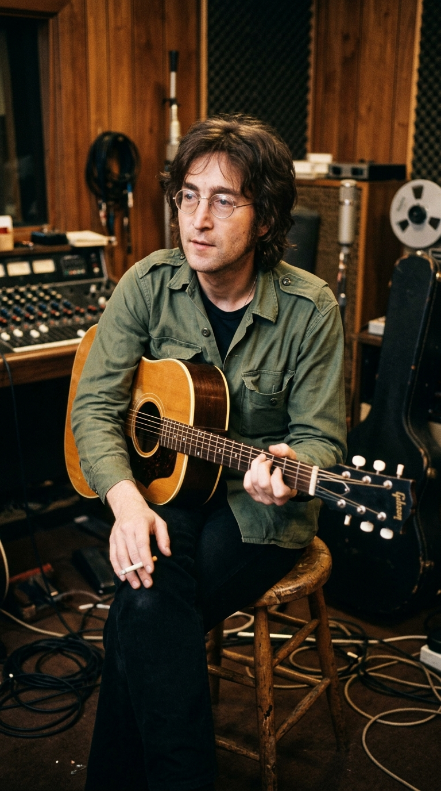
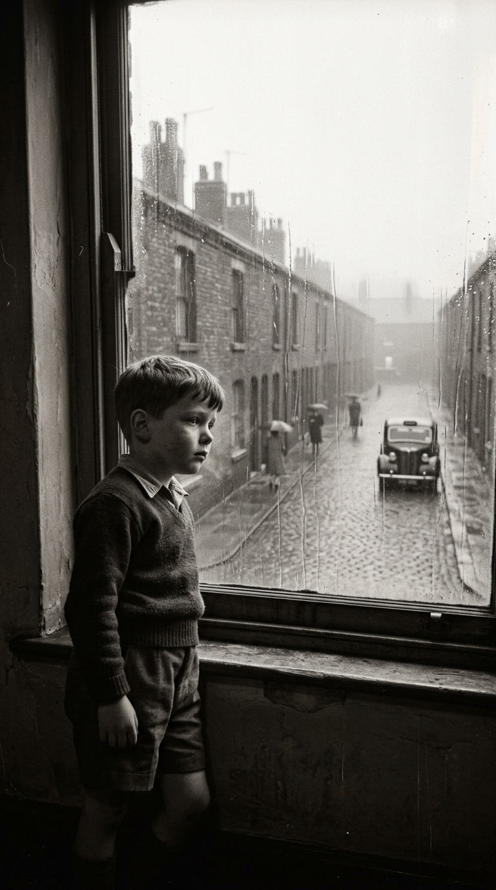
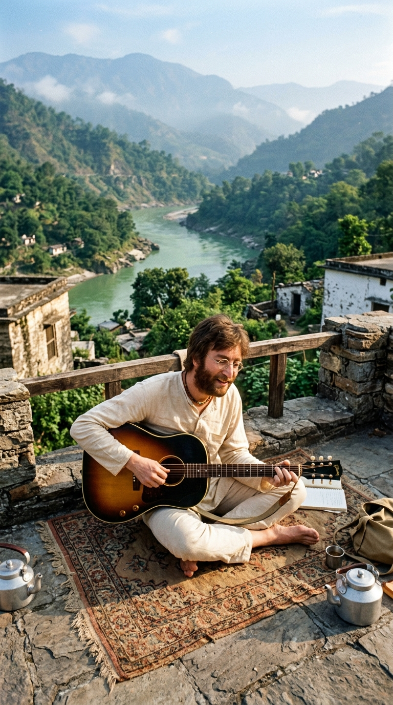
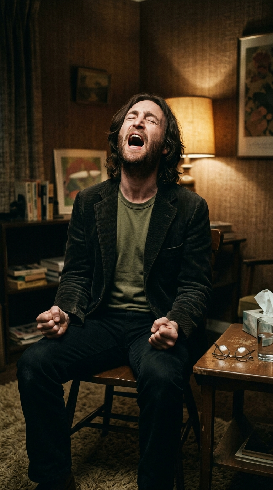
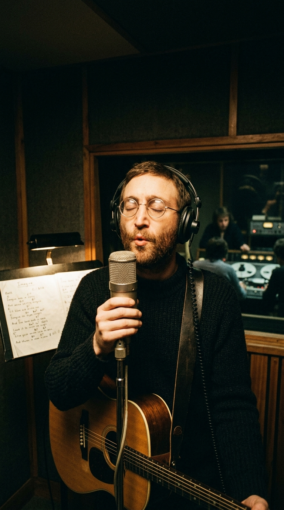
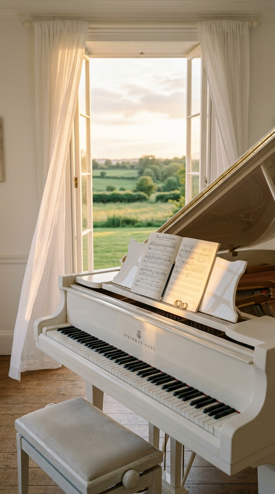

# The Vulnerable Confession Behind the Piano: The Truth Behind John Lennon's «Jealous Guy»

**By the Secret Chords Editorial Staff**

---

### Prologue: The Idol Who Knelt Before His Own Shadow

In May 1971, the stately walls of Tittenhurst Park—the high-ceilinged Berkshire estate with sprawling gardens where John Lennon and Yoko Ono lived—held a heavy silence, thick with unspoken reproach and shame. The outside world still saw Lennon as the demigod of pacifism, the charismatic figure dressed in white demanding that the world's governments give peace a chance. Yet behind closed doors, once the cameras shut off and the echo of applause faded, the man who sang of universal brotherhood was fighting a merciless war against his own demons.

Lennon was terrified. A runaway bout of jealousy and insecurity had once again nearly shattered his fragile life with the woman he regarded as his spiritual anchor. Seated at the white piano in the dim light of his studio, the musician reached for no theoretical excuses and no philosophical alibis. He rested his fingers on the keys and let pour out a confession so raw it bordered on humiliation:

> *“I was dreaming of the past / And my heart was beating fast / I began to lose control... I didn't mean to hurt you / I'm sorry that I made you cry / Oh no, I didn't want to hurt you / I'm just a jealous guy.”*

This was no comfortable love song and no exercise in pop vanity. It was an instrument of surrender—the searing testimony of a mass idol dismantling his own ego to ask forgiveness on his knees.

---

### Act I: The Broken Boy of Liverpool and the Fear of the Abyss

To understand the poisoned root of “Jealous Guy,” one must descend to the source of John Lennon's emotional fracture. Behind the biting swagger, caustic wit, and youthful aggression with which he conquered Hamburg and the cellars of Merseybeat beat a childhood wound of abandonment that never closed.

Left behind by his father, Alfred, when he was barely four years old, and removed from his mother Julia's home to be raised under the strict discipline of his Aunt Mimi, Lennon grew up with the visceral conviction that everything he loved was fated to vanish. Tragedy sealed that fear in July 1958: just as seventeen-year-old John was beginning to rebuild a close, conspiratorial bond with his mother, Julia was struck and killed by an off-duty policeman yards from Mimi's house.

That brutal blow forged a defensive and often violent masculinity. Lennon himself admitted it with stark candor years later in his landmark 1980 interview with David Sheff for *Playboy* magazine:

> *“I used to be cruel to my woman, and physically—any woman. I was a hitter. I couldn't express myself and I hit. I fought men and I hit women. That is why I am always on about peace, you see. It is the most violent people who go for love and peace.”*

When Yoko Ono entered his life in the late 1960s, Lennon projected onto her all of his pent-up devotion—and, with equal force, his entire terror of emptiness. Love turned into a suffocating trench: he insisted she stay by his side everywhere, forbidding her to leave even to use the bathroom during the tense recording sessions at Twickenham and Abbey Road. If Yoko spoke with someone else or glanced away, panic at the thought of abandonment detonated an uncontrollable, possessive fury inside Lennon.

---

### Act II: From Rishikesh to Abbey Road — The Birth of «Child of Nature»

Curiously, the celestial melody of “Jealous Guy” was not born in the middle of a domestic storm, but in one of the most spiritual enclaves on earth: the hills of Rishikesh, India, in the spring of 1968.

There, along the banks of the sacred Ganges River, The Beatles were tucked away at Maharishi Mahesh Yogi's ashram, meditating for hours and writing compulsively on acoustic guitars. One afternoon, the Maharishi delivered a lecture on humanity's harmony with the laws of the cosmos and the beauty of Mother Nature. The talk struck a deep chord with two of the songwriters: Paul McCartney and John Lennon.

McCartney channeled the inspiration into a rustic pastoral he titled *“Mother Nature's Son.”* Lennon, for his part, wrote a mystical prayer called *“Child of Nature”*:

> *“On the road to Rishikesh / I was dreaming more or less / And the way I walk along / Was in the face of nature's song...”*

In May 1968, at George Harrison's bungalow in Kinfauns (Esher), The Beatles taped a luminous acoustic demo of the song. The melody already carried the wistful cadence, hypnotic sway, and major-and-minor chord turns that would move the world three years later. Yet when the quartet entered Abbey Road to record the legendary *White Album*, McCartney brought forward and recorded *“Mother Nature's Son”* solo.

Recognizing that both songs sprang from the same lyrical premise and competed on the same melodic ground, Lennon's competitive pride kept him from pushing his own track. Feeling eclipsed, he tucked the tape into a drawer and shelved the song for years, unwilling to be cast as second fiddle to his lifelong partner.

---

### Act III: The Primal Scream and the Stripping Away of the Hero

Between 1969 and 1970, the universe of The Beatles disintegrated in a bitter legal and public war. Stripped of the band's protective shield and battered by the media trial blaming Yoko Ono for the breakup, Lennon hit emotional rock bottom. It was then that the couple turned to *Primal Scream* therapy with American psychologist Arthur Janov, first in London and then in Los Angeles.

Janov's treatment sought to strip away every intellectual defense and compel patients to relive—amid tears, screams, and convulsions on the floor—the primal agony of childhood abandonment. For Lennon, the experience was a shattering earthquake: for the first time in his life, the rebellious Beatle had to look squarely at the orphaned boy begging for affection and the violent young man who had hurt the people who loved him.

That psychological reckoning bore fruit in the brutal candor of his first official solo album, *John Lennon/Plastic Ono Band* (1970), with raw outcries like *“Mother”* and *“God.”* Yet one intimate debt remained unpaid. Still missing was the song that would look Yoko Ono straight in the eye and own the guilt of his jealousy, his obsessive watchfulness, and the tears shed behind bedroom doors.

---

### Act IV: The Ascot Session and the Whistle of Redemption

In May 1971, during the sessions for the *Imagine* album at his newly built home studio in Ascot, Berkshire, Lennon remembered the lovely melody that had been sleeping on the Kinfauns tapes since 1968. He took the harmonic framework of *“Child of Nature,”* stripped away the spiritual verses about India, and poured into it the rawest, most contrite poetry of his career. “Jealous Guy” was officially born.

The recording gathered an extraordinary ensemble: Nicky Hopkins at the piano delivering arpeggios of sublime elegance, Klaus Voormann on bass, Alan White on drums, and Joey Molland and Tom Evans (of Badfinger) reinforcing the acoustic guitars with delicate strumming. Floating over that bed of sound, Lennon's voice—warm, close, nearly whispered into the ear—carried a fragility that raised goosebumps.

When the instrumental bridge arrived, Lennon bypassed soaring guitar solos and grand gestures. He stepped close to the Neumann microphone, closed his eyes, and whistled the melody with startling spontaneity. That whistle was no technical showpiece: it was the unguarded breath of a man emptying himself out, unable to add another word to the weight of his remorse.

---

### Epilogue: The Hymn of Forgiveness That Outlived the Gunshots

On December 8, 1980, four gunshots outside the Dakota building in Manhattan silenced John Lennon's voice forever. The world fell into stunned grief. Two months later, in February 1981, the British band Roxy Music was touring Germany. Shaken by the assassination, their suave frontman Bryan Ferry chose to add “Jealous Guy” to the live set as a heartfelt tribute to the fallen master.

The audience's response was so overwhelming that Roxy Music went straight into the studio to record it. Released as a single in March 1981, Ferry's rendition shot straight to number one on the British and international charts, holding the summit for weeks. It became Roxy Music's sole UK number-one single—yet beyond any commercial milestone, it marked the definitive consecration of “Jealous Guy” as a shared heirloom of human vulnerability.

Today, more than half a century after it was written, “Jealous Guy” stands as an enduring lesson. In a world where pride and constant self-justification so often govern human relationships, Lennon's masterpiece reminds us that real courage lies not in hiding our cracks, but in finding the strength to hold them up to the daylight and ask forgiveness before it is too late.

---

### 📚 Sources and Archival Records

* **Lennon, John & Sheff, David (1981)**. *The Playboy Interviews with John Lennon and Yoko Ono*. Playboy Press / Ballantine Books.
* **Janov, Arthur (1970)**. *The Primal Scream: Primal Therapy, the Cure for Neurosis*. G.P. Putnam's Sons.
* **Norman, Philip (2008)**. *John Lennon: The Life*. Ecco / HarperCollins.
* **Lewisohn, Mark (1988)**. *The Complete Beatles Recording Sessions*. Hamlyn / EMI Books.
* **Badman, Keith (2001)**. *The Beatles Diary Volume 2: After the Break-Up 1970–2001*. Omnibus Press.
* **Womack, Kenneth (2014)**. *The Beatles Encyclopedia: Everything Fab Four*. Greenwood Press.
* **BBC / Rolling Stone Magazine Newspaper Archives (1971–1981)**: Release reviews of *Imagine* and coverage of Roxy Music's recorded tribute.
