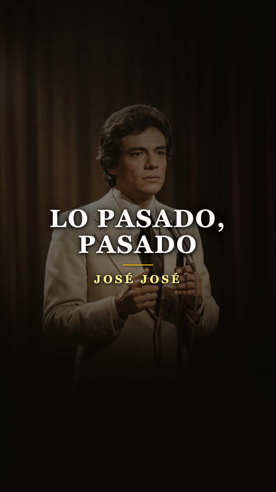
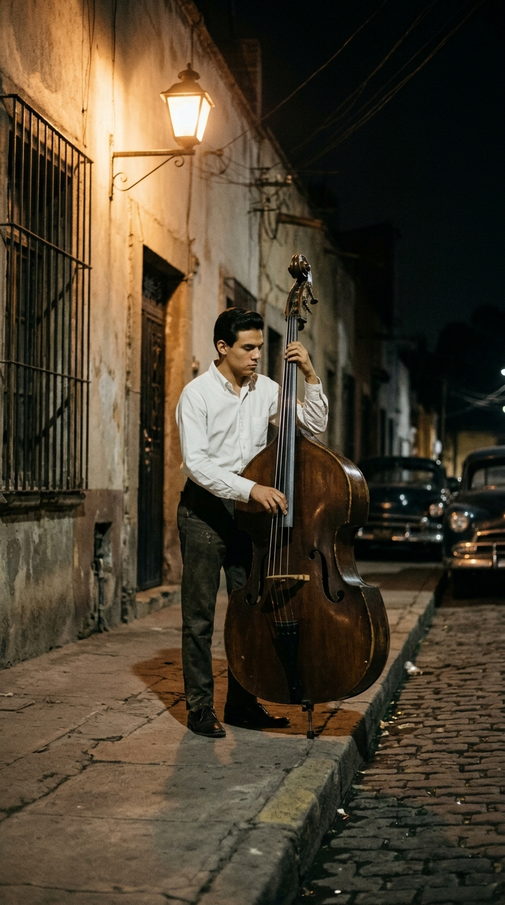
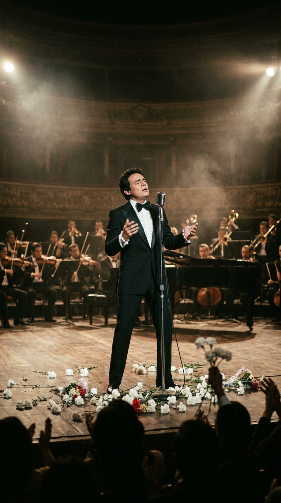
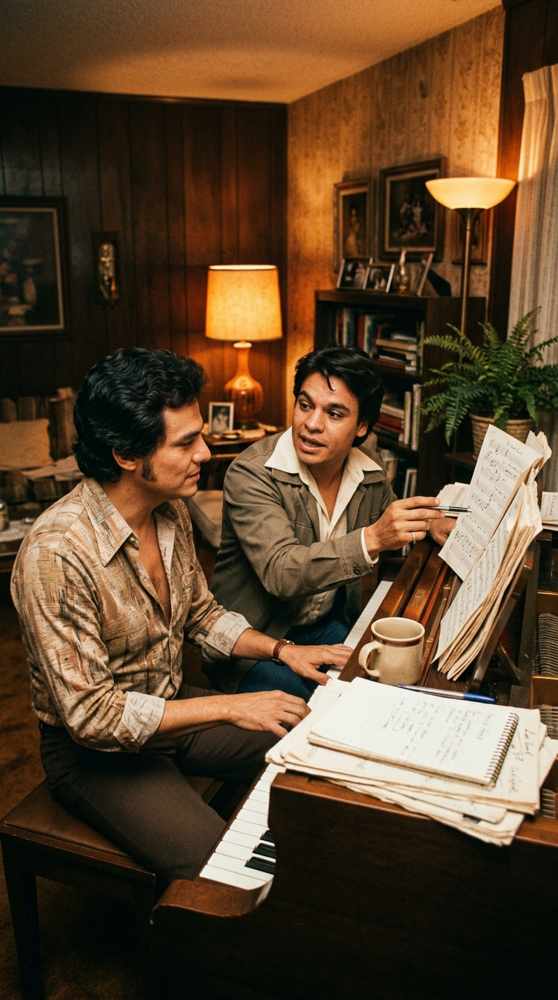
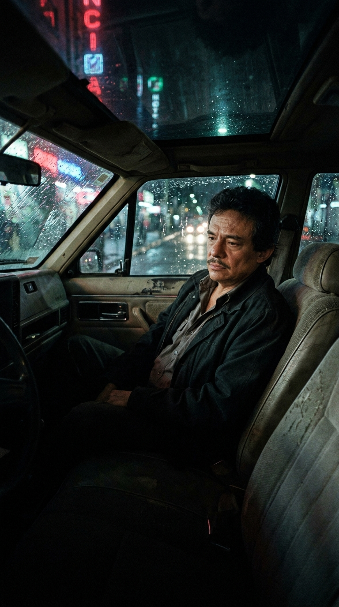
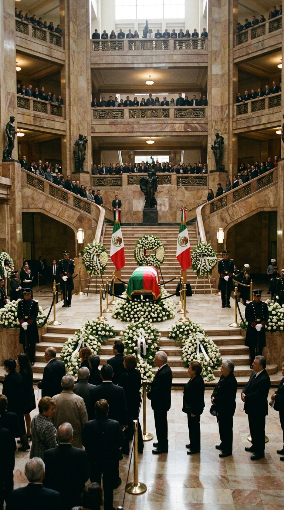

# Tuvo la voz más perfecta de un continente, pero su mayor batalla fue sobrevivir a su propia fragilidad

**Por el equipo editorial de Acordes Ocultos**

---

> *«Ya lo pasado, pasado, no me interesa... Si antes sufrí y lloré, todo quedó en el ayer... Pido un aplauso para el amor que a mí ha llegado.»*

El 15 de marzo de 1970, el Teatro Ferrocarrilero de la Ciudad de México tembló como pocas veces en su historia. Sobre el escenario, un muchacho enjuto de veintidós años, enfundado en un esmoquin que parecía quedarle ligeramente holgado, sostenía un micrófono con timidez casi sacerdotal. Cuando la orquesta de Chucho Ferrer desató las trompetas fúnebres de *«El Triste»*, el joven abrió los pulmones y desgranó un torrente vocal de una pureza tan sobrehumana que gigantes consagrados de la música latina como Marco Antonio Muñiz, Angélica María y Alberto Vázquez se pusieron de pie de un salto, arrojando flores y claveles a la tarima mientras las lágrimas corrían entre el público.

Aquel joven se llamaba José Rómulo Sosa Ortiz. Cuando el jurado del II Festival de la Canción Latina decidió por oscuros tejemanejes diplomáticos otorgarle un inverosímil tercer lugar, el teatro estuvo a punto de venirse abajo por el clamor indignado de los asistentes. México no necesitó la ratificación de ningún comité: esa noche nació para la eternidad **José José, «El Príncipe de la Canción»**.

Sin embargo, detrás del milagro de la voz más prodigiosa que haya conocido la lengua castellana, se escondía la tragedia de un hombre infinitamente vulnerable. La vida de José José no fue una marcha triunfal hacia la gloria, sino una desgarradora lucha de cinco décadas entre el don sagrado de su garganta y la devastación de sus propios demonios interiores.

---

## Acto I: La colonia Clavería y el contrabajo a escondidas (1948–1969)

José Rómulo no eligió la música; la música era el aire que se respiraba en su hogar de la colonia Clavería, en la alcaldía Azcapotzalco. Hijo del tenor operístico José Sosa Esquivel y de la concertista de piano Margarita Ortiz, el niño creció rodeado de partituras de Verdi y Puccini. Pero aquel hogar distaba de ser un remanso armónico: su padre era un hombre severo y atormentado por un alcoholismo destructivo que le prohibía tajantemente al pequeño cantar cualquier género de música popular en casa, bajo la amenaza de severos castigos.

Cuando el padre finalmente abandonó a la familia a mediados de los sesenta, la precariedad económica golpeó con fuerza. Con apenas quince años, José se vio en la obligación de sostener a su madre y a su hermano menor. De día trabajaba en una imprenta; de noche, empuñaba un pesado contrabajo y recorría las calles de la capital ofreciendo serenatas bajo los balcones o tocando en pequeños clubes nocturnos con el trío de jazz y bossa nova *Los PEG*. 

Fue en esos rincones bohemios donde su fraseo único comenzó a forjarse: una técnica basada en la respiración diafragmática que aprendió observando a los cantantes de ópera, combinada con la delicadeza íntima del jazz y una emotividad desgarradora que nacía de su propia orfandad afectiva. En 1969, bajo el seudónimo artístico de José José (uniendo su propio nombre al de su padre recién fallecido), grabó *«La nave del olvido»*, conquistando el primer impacto radial de su vida.

---

## Acto II: La tarde de los claveles y la consagración del Príncipe (1970–1977)

La explosión definitiva de marzo de 1970 en el Festival de la Canción Latina no fue un mero trampolín discográfico; fue un bautismo de fuego que lo catapultó al estrellato continental. Aunque el primer lugar fue asignado a la cantante italiana Claudia Mori y el segundo a la venezolana Mirtha Pérez, el veredicto popular fue unánime. Las tiendas de discos en México, Centroamérica y Sudamérica agotaron en cuestión de días cada copia disponible de *«El Triste»*, compuesta por el maestro Roberto Cantoral.

A lo largo de toda la década de 1970, José José encadenó un éxito tras otro con una regularidad apabullante: *«Gavilán o paloma»*, *«Amar y querer»*, *«Volcán»*, *«Si me dejas ahora»*. La crítica especializada no daba crédito a sus registros: era capaz de sostener notas agudas durante compases enteros sin perder un ápice de afinación ni de calidez tímbrica, exhibiendo un control respiratorio que rozaba lo inverosímil.

Pero mientras su figura pública alcanzaba la categoría de semidiós romántico, su intimidad comenzaba a agrietarse. La presión del estrellato, el asedio de la prensa, los contratos leoninos y su propia timidez patológica lo empujaron a buscar refugio en el mismo abismo que había consumido a su padre: el alcohol.

---

## Acto III: El pacto de hermandad con Juan Gabriel y la cima de «Secretos» (1978–1985)

En 1978, José José atravesaba una dura encrucijada personal tras su tormentoso divorcio de Kiki Herrera Calles y el inicio de su relación con Anel Noreña. Deseoso de dar un giro a su vida y celebrar una nueva oportunidad en el amor, coincidió en una íntima velada bohemia en Ciudad Juárez con su gran amigo y admirador, **Juan Gabriel**.

Alberto Aguilera Valadez, conmovido por la nobleza y las heridas de José, se sentó al piano y le mostró un tema que acababa de componer expresamente para él. No era una balada de despecho ni de llanto, sino una declaración luminosa de renacimiento y perdón: **«Lo Pasado, Pasado»**.

Cuando José José grabó la canción en los estudios de Ariola en 1978, la convirtió en un fenómeno sociocultural. En cada concierto en vivo, el cantante detenía la música por unos segundos para exclamar con una sonrisa radiante: *«¡Pido un aplauso para el amor!»*, y miles de personas batían palmas al compás del estribillo, transformando el recital en una catarsis colectiva de redención.

Cinco años más tarde, en 1983, José José tocaría el techo absoluto de la industria musical hispanohablante. Viajó a Madrid para ponerse en manos del legendario compositor español **Manuel Alejandro**. El resultado fue el álbum **«Secretos»**, una obra maestra milimétrica que vendió más de cuatro millones de copias en sus primeras semanas y superó con los años los **once millones de discos vendidos a nivel mundial**, convirtiéndose en el álbum más vendido en la historia de la música de México. 

En la cúspide de su gloria, llenó cuatro noches consecutivas el Madison Square Garden y el Radio City Music Hall de Nueva York, mientras en las barriadas de toda América Latina su música musicalizaba los romances, las bodas y los duelos de millones de seres humanos.

---

## Acto IV: El taxi abandonado, la pérdida de la voz y el rescate fraterno (1990–2019)

Sin embargo, el éxito desmesurado trajo consigo la factura más amarga. En los primeros años de la década de 1990, tras la dolorosa separación de Anel y la pérdida de casi toda su fortuna por fraudes y malos manejos financieros, José José colapsó física y emocionalmente.

Alejado de los reflectores, el hombre que había vendido millones de discos llegó a vivir durante meses dentro de un automóvil destartalado en las calles de la colonia San Rafael y la Glorieta de Insurgentes, acompañado únicamente por otros enfermos alcohólicos que no sabían que aquel vagabundo de mirada triste era el mayor cantante de la historia del país.

Enterados de su situación crítica, un grupo de amigos leales encabezados por el periodista **Ricardo Rocha** y la productora **Tina Galindo** organizaron un operativo de rescate de urgencia. Lo convencieron de subir a un avión y lo internaron en la clínica de rehabilitación Hazelden en Minnesota en 1993. José José logró recuperar la sobriedad, conoció a Sara Salazar —quien sería su compañera durante las últimas décadas de su vida— y en 1995 regresó triunfalmente a los escenarios con el disco *«Mujeriego»*.

Pero el cuerpo tiene memoria implacable. Las décadas de excesos, sumadas a una severa afección de reflujo gastroesofágico y una neuropatía causada por la bacteria de Lyme, comenzaron a devorar sus cuerdas vocales. A partir de la década de 2000, presenciar a José José en vivo se convirtió en un sobrecogedor acto de devoción mutua: el artista se plantaba en el escenario con el hilo de voz que le quedaba, apretando el puño contra el pecho para forzar el diafragma, mientras el público, entre lágrimas de emoción y respeto reverencial, cantaba por él las notas altas que sus cuerdas ya no alcanzaban.

El 28 de septiembre de 2019, a los setenta y un años, su corazón se apagó definitivamente en Miami. Cuando sus cenizas llegaron a la Ciudad de México, el país entero se detuvo: el cortejo fúnebre fue recibido por una marea de miles de personas que abarrotaron el Palacio de Bellas Artes, el Parque de la China en Clavería y el Panteón Francés, entonando al unísono sus baladas bajo el cielo encapotado de la capital.

---

## Epílogo: La catedral que jamás caerá

La grandeza de José José no residió únicamente en la perfección técnica de su emisión vocal, sino en la transparencia desarmante de su humanidad. Nunca pretendió ser un héroe inalcanzable ni una estrella blindada; se mostró siempre como lo que era: un hombre herido, generoso hasta la ingenuidad, que cantó al desamor y a la redención con la autoridad moral de quien conoció el fondo del abismo.

Hoy, cuando el silencio cubre el escenario y los claveles blancos reposan en la memoria, su lección perdura invicta: los templos de piedra pueden derrumbarse, pero la voz de quien cantó desde las cenizas de su propio dolor para abrazar la tristeza ajena se queda a vivir para siempre en el alma de un continente.

---

## 💬 Comunidad y Memoria

Cada familia, cada calle y cada corazón en América Latina guarda una historia íntima ligada a José José. ¿Cuál de sus canciones te ha acompañado en los momentos más trascendentales de tu vida? Te leemos en los comentarios.

---

### 📚 Fuentes y Archivo Documental

1. **Sosa, José José (2008)**. *Ésta es mi vida*. Memorias autobiográficas oficiales. Random House Mondadori / Grijalbo, México.
2. **Cantoral, Roberto (1970–1995)**. Archivos de testimonios y correspondencia de la Sociedad de Autores y Compositores de México (SACM) sobre el II Festival de la Canción Latina.
3. **Pérez Botija, Rafael & Alejandro, Manuel (1977–1984)**. Cuadernos de producción, arreglos orquestales y registros de sesiones discográficas de Ariola Eurodisc.
4. **Hemeroteca Nacional de México (UNAM)**. Cobertura de prensa de los diarios *El Universal*, *Excélsior* y revista *Proceso* (1970–2019): crónicas del Festival OTI, récord de ventas de *Secretos* y honores de Estado en el Palacio de Bellas Artes.
5. **Fonoteca Nacional de México**. Registro sonoro patrimonial y discografía canónica de José Rómulo Sosa Ortiz (1965–2019).
