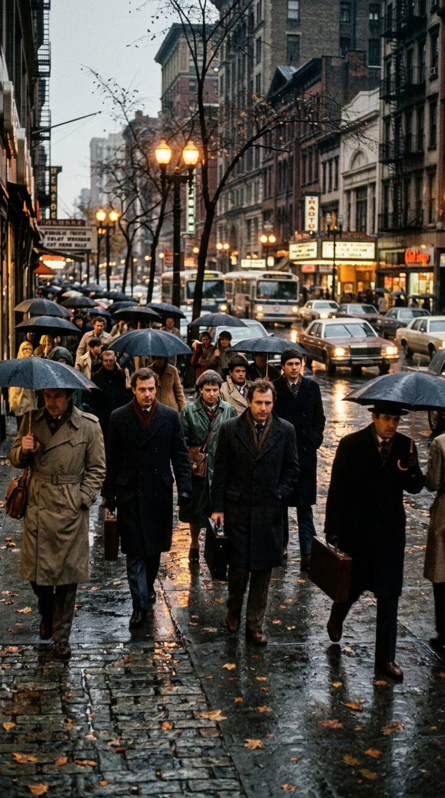
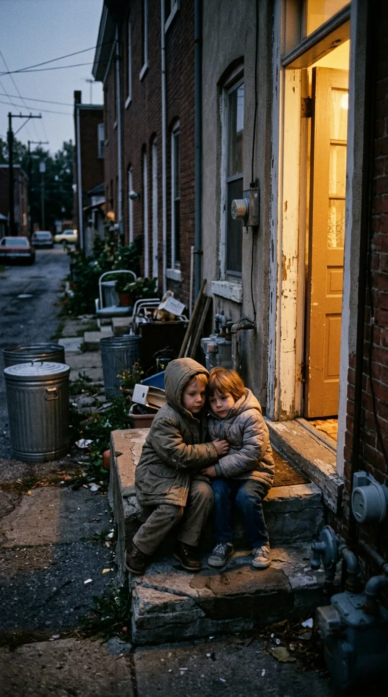

# La pregunta que desafió al silencio

### Por Historia en los Acordes

Hay preguntas que no buscan formular un reproche dogmático ni exigir cuentas a la eternidad; son el lamento desarmado de un corazón humano que contempla el dolor del mundo y se niega a normalizar la indiferencia. En 1982, mientras las tensiones geopolíticas de la Guerra Fría y los ecos de conflictos lejanos llenaban las pantallas de televisión de rostros crispados, una balada melancólica cruzó el Atlántico para instalarse en el pecho de millones de oyentes. Su título era una sola palabra abierta de par en par: *«Dime»*.

En esta obra cumbre del repertorio de José Luis Perales, la música deja de ser un simple adorno lírico para convertirse en un espejo de la fragilidad colectiva. A través de una serie de preguntas desnudas, la voz narrativa interroga directamente a la conciencia humana y a la divinidad: ¿por qué los hombres perdieron la costumbre de sonreír? ¿Por qué los niños crecen entre sombras de abandono, los ancianos se apagan en esquinas silenciosas y las manos se empeñan en empuñar armas en lugar de ofrecer cobijo?

---

### Acto I: Los rostros que la prisa borró

La primera parte de la historia transcurre en el bullicio implacable de las grandes ciudades contemporáneas. Entre la masa anónima que desciende a los andenes o cruza avenidas bajo un cielo plomizo, la cámara poética detiene su marcha ante los detalles que nadie quiere ver: miradas esquivas, pasos presurosos y semblantes endurecidos por la fatiga y el desencanto.

> *«Dime, ¿por qué la gente no sonríe?  
> ¿Por qué las armas en las manos?  
> ¿Por qué los hombres malheridos?  
> Dime...»*

La canción no habla de batallas abstractas ni de tratados internacionales. Habla de la violencia silenciosa de cada día: la del mendigo que extiende la mano en la acera mientras los transeúntes apartan la vista; la del anciano que pasa horas enteras sentado en un banco de madera de una plaza otoñal, viendo caer las hojas sin que nadie pronuncie su nombre; la de los niños que aprendieron demasiado temprano a temer la noche. 

En cada estrofa, el arpegio de guitarra y la sutileza de los teclados construyen un espacio de intimidad donde el dolor ajeno deja de ser ajeno. No hay estridencias ni sermones morales: hay un llanto contenido que busca comprender en qué momento el mundo decidió olvidar la ternura.

---

### Acto II: La súplica en medio de la tormenta

Conforme la melodía avanza, la canción se eleva hacia un plano más hondo. La pregunta deja de dirigirse a la sociedad y se convierte en una interpelación espiritual y trascendente: *«Dímelo, Dios, quiero saber...»*.

No es un desafío soberbio, sino la plegaria desesperada de quien se siente impotente ante la herida abierta de la humanidad. El narrador ve las bombas, las armas y el desamparo, y siente que el silencio del universo pesa como una losa de plomo. Sin embargo, en medio de esa oscuridad agobiante, la melodía introduce un giro armónico fundamental: el reconocimiento de que la esperanza no se ha extinguido por completo.

Incluso en la noche más fría, en una pequeña habitación iluminada por una vela o en un rincón apartado de un hospital, siempre hay alguien que junta las manos en silencio, alguien que cuida a un enfermo, alguien que todavía cree que la verdad y el amor son posibles. La pregunta *«Dime»* no desemboca en el nihilismo, sino en la necesidad urgente de despertar la compasión dormida de los hombres.

---

### Acto III: El despertar de la empatía

La fuerza poética de la canción radica en su desenlace moral. Cuando las preguntas se agotan y las notas del piano se van apagando lentamente, el oyente comprende que la respuesta no va a descender escrita en el cielo. La respuesta está en la mirada del vecino, en el plato compartido, en la mano tendida al desamparado.

Perales concibió *«Dime»* como una plegaria que Hispavox decidió incluir de manera especial en las ediciones latinoamericanas de su álbum *Entre el agua y el fuego* (1982). En una época en que gran parte del continente sufría la represión, la censura y la zozobra económica, aquellas palabras resonaron con la fuerza de un himno clandestino de solidaridad y resistencia moral. Millones de familias la cantaron en salas de estar y viajes por carretera no como una simple balada comercial, sino como un pacto íntimo de decencia y memoria.

---

### Epílogo: El valor de volver a mirar

A más de cuatro décadas de su publicación, *«Dime»* conserva una vigencia estremecedora. Vivimos en un mundo saturado de pantallas veloces y ruidos ensordecedores, donde es cada vez más fácil ignorar la soledad del que camina a nuestro lado.

Volver a escuchar esta melodía es detener el reloj por unos minutos y aceptar la interpelación más difícil y necesaria de todas: si el mundo está herido, ¿qué estamos haciendo nosotros para devolverle la sonrisa a quien la ha perdido?

---

### 📚 Fuentes y Archivo Documental

* **Perales, José Luis**: *Cancionero completo y testimonios sobre la composición social*. Archivo discográfico Hispavox (1982).
* **Edición discográfica**: *Entre el agua y el fuego* (Hispavox / EMI Music, 1982). Notas de producción de Rafael Trabucchelli y Danilo Vaona.
* **Hemeroteca musical de los años 80**: Artículos y entrevistas en *Revista Triunfo*, *El País* y prensa latinoamericana sobre la acogida de *«Dime»* en giras internacionales.
* **Análisis lírico-musicológico**: Colección *Grandes Compositores de la Canción Melódica Española*, SGAE, 1998.
