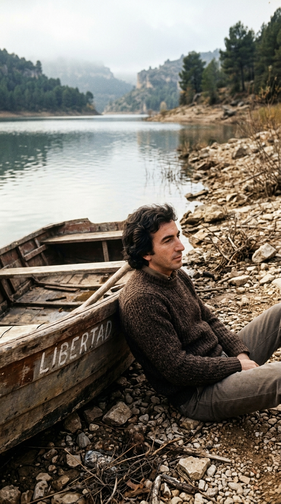
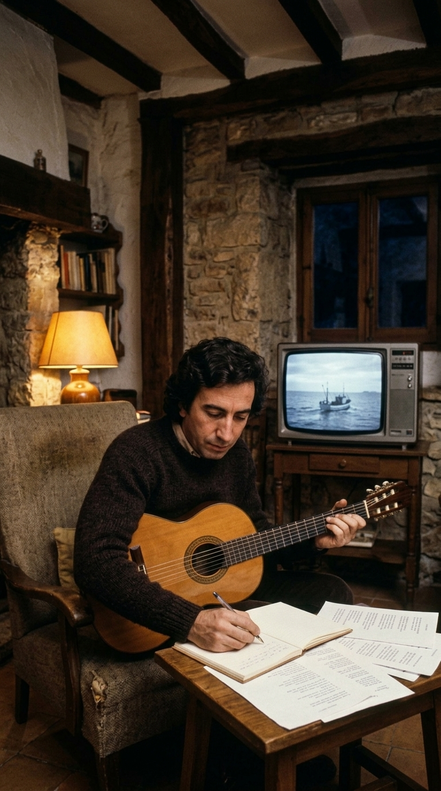
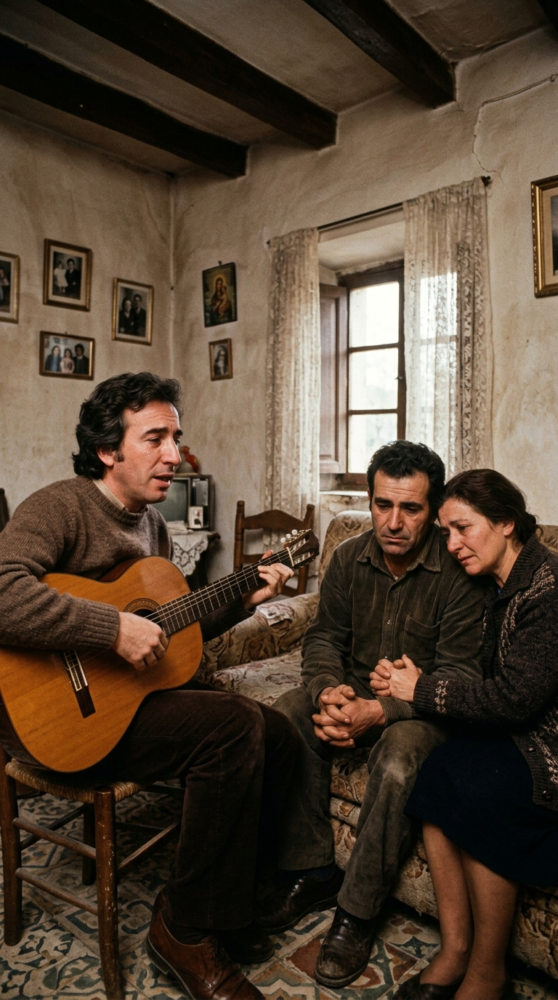

# ⛵ El Secreto del Velero: El Mito del Niño Ahogado y la Verdadera Herida de José Luis Perales

### *Durante cuatro décadas, millones de personas creyeron que su estribillo más luminoso ocultaba el luto por un hijo muerto en las aguas. Esta es la historia de una leyenda urbana masiva, un pequeño bote en Cuenca y la desgarradora tragedia que inspiró la canción que nadie recuerda.*

---

## Prólogo: El Mito que Cruzó Dos Continentes

Hay canciones que se escapan de las manos de quien las escribe para convertirse en fábulas populares. A veces, la imaginación colectiva necesita dotar de una tristeza desmesurada a las melodías más radiantes. Durante más de cuarenta años, a lo largo y ancho de España y Latinoamérica, ha circulado de boca en boca una de las leyendas más persistentes de la música hispana: que «Un velero llamado Libertad», grabada en 1979 por José Luis Perales, fue el llanto desconsolado de un padre tras la muerte de su propio hijo ahogado en un pantano.

El relato apócrifo, repetido en tertulias de sobremesa, emisoras de radio locales y foros de internet, describía una escena estremecedora: un niño travieso que se aleja en una barca y perece bajo las aguas, transformando los versos *«Y se marchó, y a su barco le llamó Libertad»* en una metáfora del alma infantil volando hacia el cielo.

La canción, convertida además en fenómeno viral en las redes sociales de una nueva generación, parecía arrastrar una maldición poética. Pero la verdad histórica, cuando se despoja del mito, revela un contraste humano todavía más conmovedor: el velero no era un símbolo de muerte, sino el anhelo de evasión de un hombre sencillo de campo. Y sin embargo, la tragedia del niño ahogado **sí ocurrió en la vida real**, pero quedó atrapada en otra melodía que casi nadie recuerda.

---

## Acto I: Un Obrero de Castejón Frente al Vértigo del Éxito

Para entender la génesis de la canción es imprescindible situarse en la Castilla profunda de finales de los años setenta. José Luis Perales (nacido en Castejón del Heraldo, Cuenca, en 1945) nunca quiso ser una estrella de los escenarios. Formado como delineante y técnico de radio en Sevilla, su vocación primordial era el taller, la tierra y la composición en la sombra. Había regalado himnos descomunales a otros artistas —como el inolvidable *«¿Por qué te vas?»* a Jeanette— y su ambición se limitaba a cultivar su huerto y escribir baladas con su guitarra española mientras otros ponían la voz y la fama.

Fue el productor Rafael Trabucchelli quien, fascinado por la calidez y la intimidad de sus maquetas caseras, lo empujó casi por la fuerza a cantar. Cuando su rostro y su voz suave comenzaron a liderar las listas de ventas de Hispavox, Perales experimentó una sensación de ahogo. La vorágine de la televisión, las giras agotadoras y la pérdida de la soledad rural lo abrumaban.

En busca de oxígeno, el compositor solía refugiarse en su casa de campo cerca del embalse de Buendía y Entrepeñas, entre Guadalajara y Cuenca. Allí, alejado del bullicio de la industria, el músico compró un pequeño bote con motor y vela al que bautizó, sin pretensiones ni pompa, con una sola palabra pintada en el casco: **Libertad**.

---

## Acto II: Una Película en la Madrugada y el Regreso Imprevisto

Una noche de otoño de 1978, fatigado tras una jornada de promoción, Perales se sentó frente al televisor de su hogar. En la pantalla emitían una película extranjera que atrapó su atención: la historia de un joven agobiado por las imposiciones sociales que decide romper con todas las ataduras, construir un barco rudimentario y lanzarse al mar abierto en busca de un destino sin horarios ni fronteras.

En el metraje original, el protagonista se marchaba para siempre, perdiéndose en el horizonte en una soledad implacable. Aquel desenlace dejó a Perales un regusto amargo. Para un hombre como él, profundamente apegado a la familia, a los amigos de infancia y a las raíces de su pueblo, la soledad absoluta no era libertad, sino condena.

Tomó su guitarra y empezó a rasguear los primeros acordes en la tonalidad cálida que caracterizaría el tema:

> *«Ayer se fue... tomó sus cosas y se puso a navegar;  
> una camisa y un pantalón vaquero,  
> y una canción... ¿dónde irá? ¿dónde irá?...»*

Perales concibió al marinero como un alter ego de cualquier ser humano fatigado de la rutina que necesita zarpar para encontrarse a sí mismo. Pero a diferencia del filme, Perales decidió intervenir el destino de su personaje con un giro profundamente compasivo y esperanzador: tras descubrir las gaviotas en el cielo y la inmensidad del mar, el navegante comprende que el verdadero valor del viaje es el regreso a quienes lo esperan.

> *«Y regresó... y una mañana gris al puerto llegó;  
> y les trajo en su equipaje un pedazo de luna,  
> y una canción de amor...»*

El tema se grabó en los legendarios estudios de Hispavox en Madrid bajo la dirección orquestal de Danilo Vaona y se publicó en el álbum *Tiempo de otoño* (1979). En cuestión de semanas, se convirtió en un himno intergeneracional en España y América Latina.

---

## Acto III: La Tragedia Oculta: «Pequeño Marinero»

¿De dónde nació entonces la leyenda siniestra del niño ahogado que persiguió a Perales durante décadas? La respuesta no radica en la imaginación caprichosa de los oyentes, sino en un suceso real y devastador que el cantautor vivió muy de cerca.

A mediados de los años setenta, un matrimonio muy cercano a la familia de Perales sufrió la pérdida más atroz que puede concebir el corazón humano: su pequeño hijo, de corta edad, falleció ahogado en un trágico accidente en un embalse de la comarca. La familia quedó sumida en un abismo de dolor inconsolable. Destrozados, los padres acudieron a su amigo José Luis, el poeta que sabía poner palabras al alma, y le hicieron una súplica entre lágrimas: querían que le escribiera una canción que sirviera de plegaria y memoria viva para el hijo que las aguas se habían llevado.

Perales, estremecido por la responsabilidad y el desgarro, se encerró con su guitarra. Compuso una balada sobrecogedora y dolorosa titulada **«Pequeño marinero»**, incluida en su discografía (*A mis amigos*, 1977 / reediciones de la época):

> *«Duérmete mi pequeño marinero,  
> que el agua del pantano se ha dormido ya...»*

Era una pieza íntima, una nana fúnebre nacida de las lágrimas auténticas de unos padres en duelo. Sin embargo, «Pequeño marinero» no tuvo la difusión masiva en radio ni las ventas millonarias de los grandes singles de la compañía discográfica.

---

## Acto IV: La Confusión Colectiva y la Desmitificación

Con el correr de los años ocurrió un fenómeno propio del folclore oral: el público conoció la existencia de una tragedia acuática en el entorno de Perales, pero el éxito abrumador de *«Un velero llamado Libertad»* opacó por completo a la modesta *«Pequeño marinero»*. La mente popular unió las piezas de manera errónea: si Perales cantaba sobre un barco que *«se marchó»*, el protagonista debía ser aquel niño muerto.

Durante décadas, periodistas y admiradores le preguntaron al cantautor conquense por el dolor de haber perdido a un hijo en el agua. Con su habitual serenidad y paciencia campesina, Perales desmintió una y otra vez la fábula:

> *«Se ha dicho mil veces que la escribí para un niño que se ahogó, o incluso que se me había muerto un hijo. Afortunadamente, mis hijos Pablo y María están sanos y vivos. La canción fue simplemente el sueño de un joven que quería escapar de la rutina en un barco como el mío, y que al final vuelve a casa porque comprende que la soledad total no es hermosa. La verdadera canción para el niño que se ahogó fue otra, se llamó ‘Pequeño marinero’, y esa sí fue una herida real de unos amigos.»*

La aclaración no restó un solo ápice de magia a la composición; al contrario, reveló la profunda empatía humana de un artista que supo acompañar el luto de una familia en el silencio de un tema íntimo, mientras regalaba al mundo un himno a la esperanza y al regreso.

---

## Epílogo: El Puerto al que Siempre se Vuelve

Hoy en día, cuando el estribillo de *«Un velero llamado Libertad»* vuelve a resonar en millones de hogares y teléfonos inteligentes, la melodía adquiere una hondura distinta. Nos habla del impulso universal de soltar las amarras y alejarse de las jaulas cotidianas, pero también de la sabiduría de reconocer cuál es el verdadero puerto seguro.

José Luis Perales se despidió de los escenarios con la misma humildad con la que llegó: regresando a su pueblo, a sus olivos y al rumor sereno del agua dulce. Porque al final de todas las travesías, la libertad más hermosa nunca fue la fuga solitaria, sino saber que siempre hay alguien esperando con los brazos abiertos en la orilla.

---

### 💬 Conversación en la Comunidad
¿Conocías la verdadera historia detrás del mito de «Un velero llamado Libertad» o creías la leyenda del niño ahogado? ¿Qué emoción despierta en ti esta canción cuando la escuchas hoy? Te leemos con el corazón en los comentarios.

---

### 📚 Fuentes y Archivo Documental
* **Perales, José Luis**: Entrevistas de archivo en Televisión Española (RTVE, programa *A fondo*, 1980; *Imprescindibles: José Luis Perales, la música que habla*, RTVE Play, 2021).
* **Declaraciones hemerográficas oficiales**: Archivo de *El País*, *ABC* y *El Correo* (Secciones de Cultura, recopilación de declaraciones sobre el mito de «Un velero llamado Libertad» y el origen de «Pequeño marinero»).
* **Hispavox / Warner Music Spain**: Notas de producción discográfica del álbum *Tiempo de otoño* (1979, referencia Hispavox S 90.170) y *A mis amigos* (1977).
* **Nautik Magazine & Radio Imagina**: Archivos de investigación musicológica sobre el cancionero de José Luis Perales y el análisis lírico de la navegación en la balada hispana.
