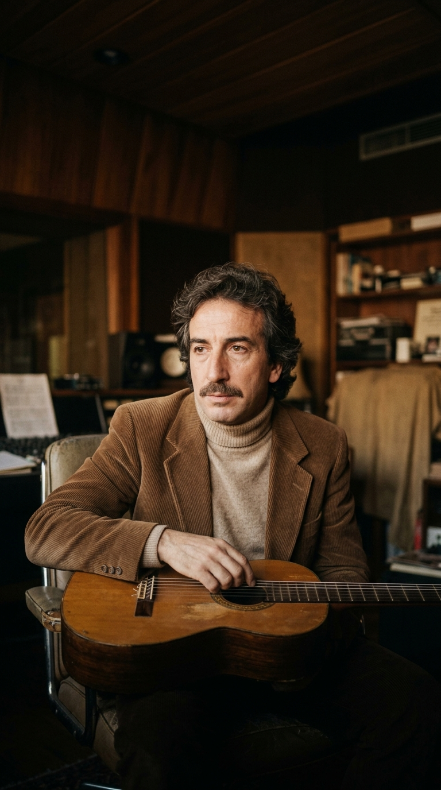
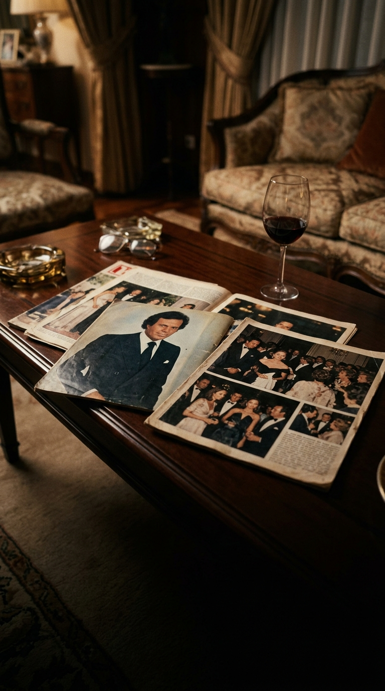
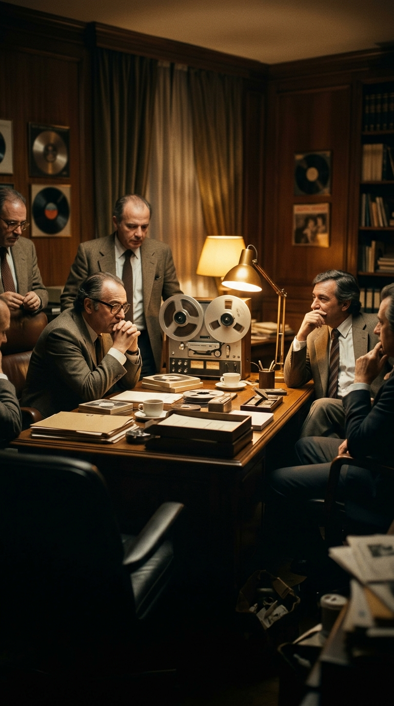
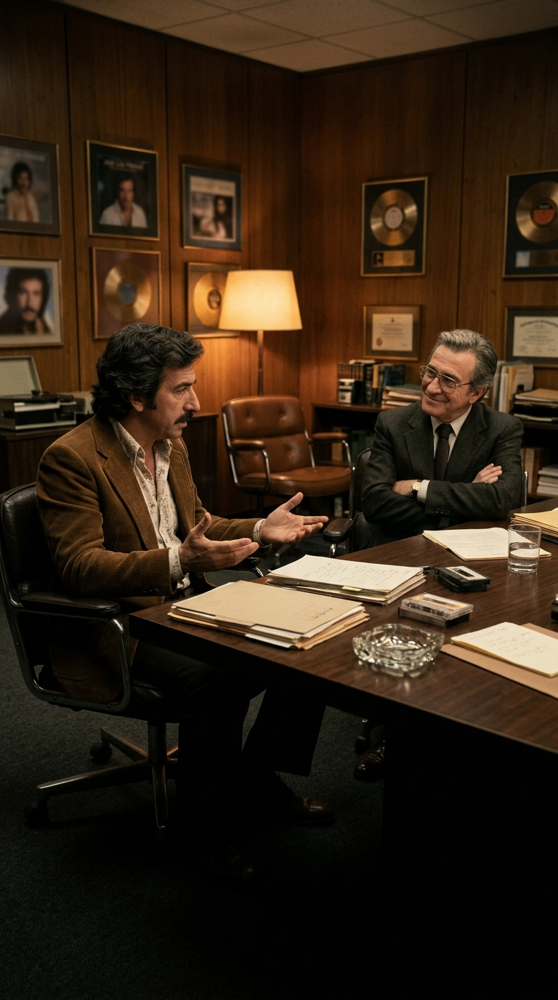
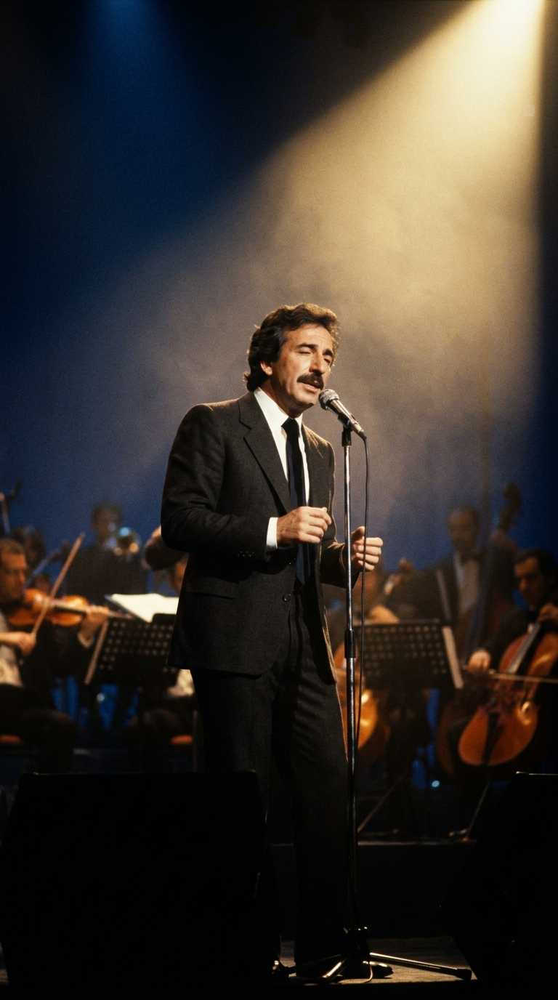

# La balada que le prohibieron regalar a Julio Iglesias: José Luis Perales y el dilema detrás de «¿Y cómo es él?»

**Por el equipo editorial de Acordes Ocultos**

Pocas canciones en la historia de la música hispana cargan con un malentendido popular tan arraigado y conmovedor como *«¿Y cómo es él?»*. Durante más de cuatro décadas, millones de personas han cantado sus versos con el convencimiento íntimo de que se trataba de las palabras de un padre celoso y resignado despidiendo a su hija el día de su boda o viendo marcharse a la joven de sus brazos con su primer amor. La memoria colectiva consagró la escena: la ternura paternal despidiendo a una hija con un paraguas en la mano.

Sin embargo, la realidad cronológica desmorona el mito de un plumazo. Cuando la canción fue publicada en 1982 como sencillo principal del álbum *Entre el agua y el fuego*, María, la hija menor de José Luis Perales, apenas tenía tres años de edad. Mal podía un padre cantar sobre bodas, vestidos grises y amantes desconocidos a una pequeña niña que apenas daba sus primeros pasos en los parques de Madrid.

La verdad histórica detrás de la melodía es infinitamente más fascinante, compleja y humana. No nació en la alcoba de una hija, sino en el vórtice mediático de una de las rupturas sentimentales más comentadas de la España de la Transición. Fue concebida como un encargo a medida para sanar el orgullo herido de Julio Iglesias tras el divorcio de Isabel Preysler. Y, paradójicamente, su autor original batalló con todas sus fuerzas en los despachos discográficos para no tener que cantarla jamás.

---

### Acto I: El mito de la hija y el terremoto de la crónica social

A comienzos de los años ochenta, España experimentaba una profunda transformación cultural y social. La prensa del corazón vivía una era dorada, y ninguna pareja acaparaba tantas portadas, suspiros y especulaciones como la formada por el cantante Julio Iglesias e Isabel Preysler. Su matrimonio, celebrado en 1971, había sido el cuento de hadas oficial de la España de la época; pero el desgaste de las giras internacionales, la soledad y las desavenencias derivaron en una separación formal en 1978.

Poco después del divorcio, el impacto social se multiplicó cuando Isabel Preysler anunció su matrimonio con Carlos Falcó y Fernández de Córdova, marqués de Griñón. Aquel enlace aristocrático situó a Julio Iglesias —instalado ya en su mansión de Miami y construyendo su imperio internacional— en una posición emocionalmente vulnerable frente a la opinión pública.

A pesar de su imagen pública de seductor inquebrantable, Julio experimentaba en privado la quemadura del abandono y la curiosidad inevitable por aquel aristócrata culto y refinado que había ocupado su lugar en el palacio de su expareja. Fue entonces cuando su entorno artístico más cercano, encabezado por el célebre productor y arreglista Ramón Arcusa (mitad del legendario Dúo Dinámico), decidió buscar una canción que pusiera palabras a ese duelo silencioso.

Y en la España de 1981, si alguien poseía el don casi milagroso de transformar la timidez y el desamor cotidiano en versos universales, ese era un ingeniero técnico de Castejón reconvertido en artesano de melodías: José Luis Perales.

---

### Acto II: El encargo en la penumbra de Castejón

Para 1981, Perales ya era el compositor más cotizado y respetado de habla hispana. De su pluma habían brotado himnos monumentales como *«Soy rebelde»* y *«Por qué te vas»* para Jeanette, composiciones clave para Mocedades, Paloma San Basilio y Miguel Bosé, además de sus propios éxitos como cantautor (*«Un velero llamado Libertad»* o *«Celos de mi guitarra»*).

Ramón Arcusa se puso en contacto con Perales para plantearle el reto: necesitaba un tema de desamor maduro, sobrio y aristocrático, expresamente diseñado para la voz de terciopelo de Julio Iglesias. Perales aceptó el encargo con profesionalismo y se retiró a su refugio campestre en la provincia de Cuenca.

Sentado ante el piano y con su guitarra clásica entre las manos, Perales hizo un ejercicio de empatía psicológica brutal: se despojó de su propia identidad y se metió en el pellejo de Julio Iglesias. «Pensé en lo que Julio podría sentir al enterarse de que Isabel se casaba con el marqués de Griñón. Imaginé a un hombre herido pero caballero, que no recurre al insulto arrabalero, sino a la elegancia del que pregunta con el corazón roto quién es ese que le ha robado todo», confesaría Perales años después en diversas entrevistas.

Así nacieron las preguntas más inquisitivas y punzantes de la balada hispana:  
*«¿Y cómo es él? ¿En qué lugar se enamoró de ti? ¿De dónde es? ¿A qué dedica el tiempo libre? Pregúntale, ¿por qué ha robado un trozo de mi vida? Es un ladrón, que me ha robado todo...»*

Pero el verdadero toque de genialidad lírica de Perales no residía en el reclamo, sino en el desenlace de la escena. Lejos del machismo herido o el resentimiento vulgar, el protagonista ayuda a la mujer a arreglarse, le recuerda que se le hace tarde para su cita y le ofrece un gesto de ternura doméstica desgarradora:  
*«Y llévate el paraguas por si llueve... él te estará esperando para amarte, y yo estaré celoso de perderte...»*.

---

### Acto III: El motín en la discográfica Hispavox

Concluida la composición, Perales grabó una maqueta casera con su voz acompañada únicamente por una guitarra acústica para enviársela a Julio Iglesias y a su equipo en Miami. Sin embargo, antes de despachar la cinta, debía cumplir con el trámite protocolario de presentarle sus nuevos temas a su propia casa discográfica: Hispavox, en Madrid.

En el despacho del director artístico Rafael Trabucchelli, la cinta de bobina abierta comenzó a girar. Cuando sonaron los acordes y la voz tímida, quebrada y casi susurrada de Perales entonó la primera estrofa (*«Mirándote a los ojos juraría, que tienes algo nuevo que contarme...»*), la atmósfera de la oficina cambió por completo. Los ejecutivos se miraron atónitos: no estaban escuchando una canción convencional de despecho; estaban presenciando el nacimiento de un clásico monumental.

Al terminar la reproducción, Perales sonrió y les explicó que el tema estaba destinado a Julio Iglesias. La reacción de la discográfica fue fulminante:  
—*«¿A Julio? Ni hablar. Esta canción no se la das a Julio ni a nadie. La cantas tú o se queda guardada en un cajón bajo llave»*.

Aquella orden cayó como un balde de agua fría sobre el cantautor. Perales se negó en rotundo. Había dos razones de enorme peso que le impedían verse cantando esa letra. En primer lugar, sentía que su estilo no encajaba con el de un galán despechado. Pero sobre todo, pesaba una cuestión moral y familiar: José Luis llevaba un matrimonio sumamente feliz, sereno y estable con su esposa, Manuela Vargas.

«Yo me resistí todo lo que pude», relató el músico con humor y honestidad. «Le dije a la compañía que la gente iba a pensar que Manuela me estaba dejando por otro hombre, que me era infiel, que se marchaba de casa con un amante. A Manuela tampoco le hacía ninguna gracia la idea». 

Pero Hispavox no cedió ni un milímetro. La compañía utilizó su derecho contractual y condicionó el lanzamiento del próximo álbum de Perales a la inclusión obligatoria de *«¿Y cómo es él?»*.

---

### Acto IV: La coronación involuntaria y la bendición de Julio

Bajo la producción magistral de Rafael Trabucchelli, la grabación definitiva respetó la esencia íntima de la maqueta: la guitarra española de Perales abriendo el camino en soledad, sostenida por un colchón orquestal de cuerdas de infinita melancolía que estalla en el coro.

Cuando el tema salió a la luz en la primavera de 1982, el impacto fue descomunal. La canción alcanzó de inmediato el número uno en las listas de éxitos de España, México, Argentina, Colombia y todo el continente americano. La interpretación de Perales —desprovista de la impostación del galán tradicional y cargada de una vulnerabilidad tímida, frágil y honesta— conectó con el corazón de millones de personas que vieron en ese adiós caballeroso la cumbre de la madurez sentimental.

Aquel éxito apoteósico convirtió a *«¿Y cómo es él?»* en la carta de presentación obligada de José Luis Perales por el resto de sus días. ¿Y qué opinó Julio Iglesias cuando escuchó la canción en la radio convertida en un fenómeno planetario? Con su habitual picardía y elegancia, Julio felicitó a su colega y le confesó entre risas que aquella joya le habría sentado a la perfección a su repertorio, pero que Perales la había bordado con un alma irrepetible.

---

### Epílogo: El paraguas que venció al rencor

Con el paso de los años, *«¿Y cómo es él?»* acumuló decenas de versiones memorables —entre ellas, una arrolladora lectura en salsa de Marc Anthony que conquistó a una nueva generación en 2010—. Y sin embargo, la versión original de José Luis Perales conserva un poder hipnótico que no envejece.

Tal vez el mito de la hija nació porque el público general no podía concebir que tanta ternura y delicadeza estuvieran dirigidas a una mujer que te está abandonando por otro hombre. En una sociedad acostumbrada a que el despecho se exprese mediante la ira, el insulto o la venganza, José Luis Perales nos legó una de las mayores lecciones de amor que la música en español recuerde: que la verdadera nobleza no consiste en retener a nadie por la fuerza, sino en tener la generosidad de desearle que no pase frío y ofrecerle un paraguas para que no se moje en su camino hacia otra vida.

---

### 📚 Fuentes y Archivo Documental

* **Perales, José Luis.** Entrevistas autobiográficas y declaraciones en programas de televisión (*Cadena SER*, *RTVE*, *El Hormiguero*, *La Sexta*, 1982–2022).
* **Arcusa, Ramón.** *Soy un truhán, soy un señor (o casi)* (Planeta, 2020). Memorias profesionales sobre las producciones para Julio Iglesias.
* **Hemeroteca de Diario El País y ABC.** Crónicas culturales y listas musicales oficiales de la Sociedad General de Autores y Editores (SGAE, 1982–1983).
* **Revista ¡Hola! y Semana.** Archivos hemerográficos de la crónica social española sobre el matrimonio y divorcio de Julio Iglesias e Isabel Preysler (1978–1981).
* **Hispavox Records.** Notas de producción discográfica del álbum *Entre el agua y el fuego* (Hispavox, Madrid, 1982).
