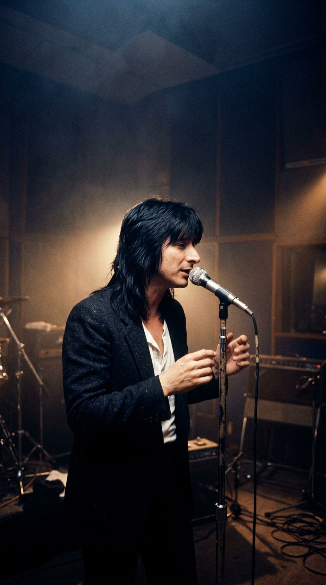
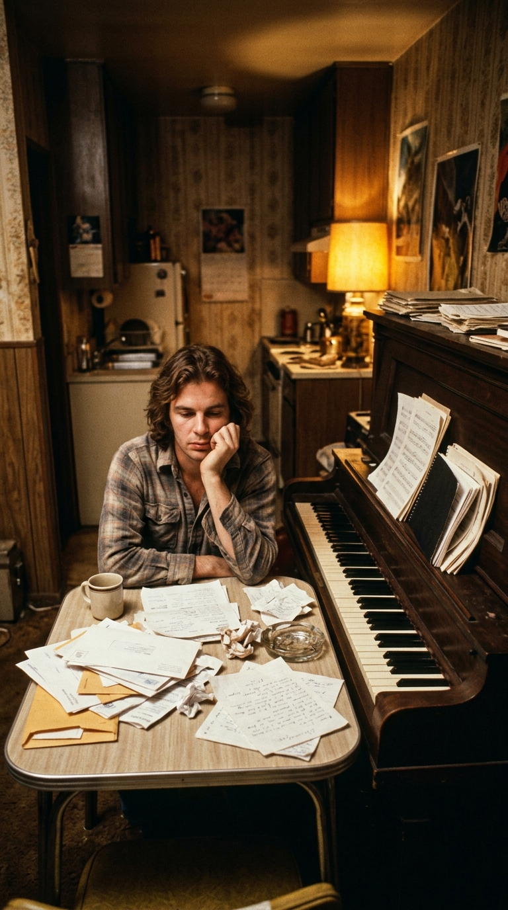
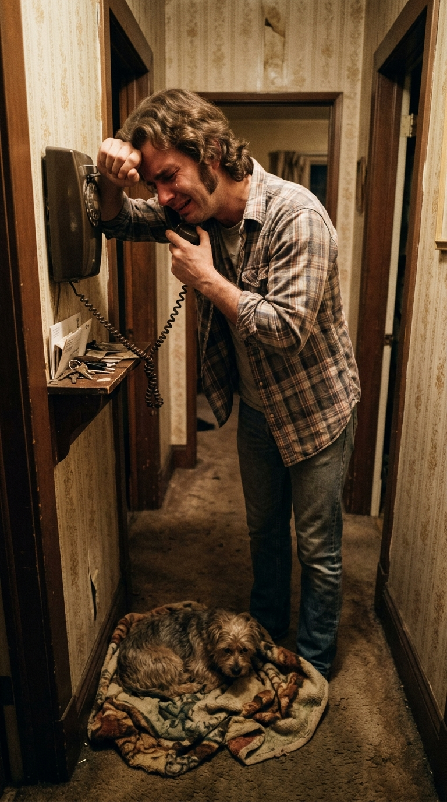
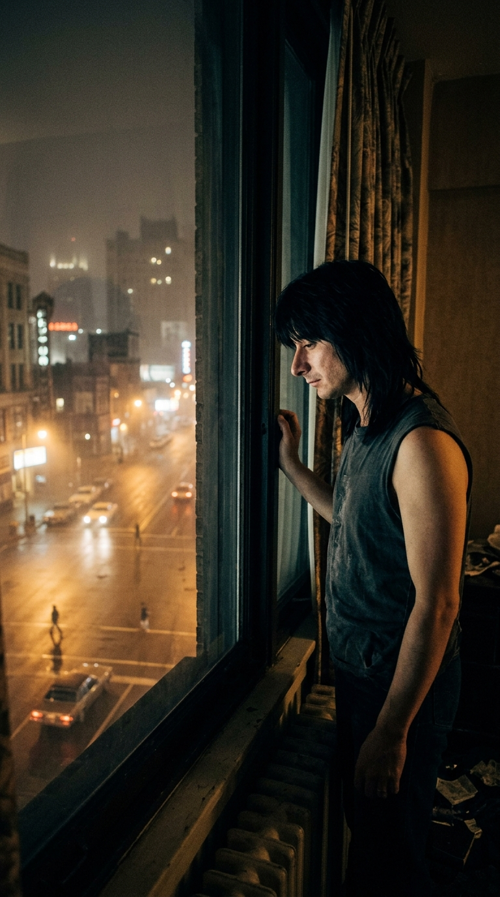
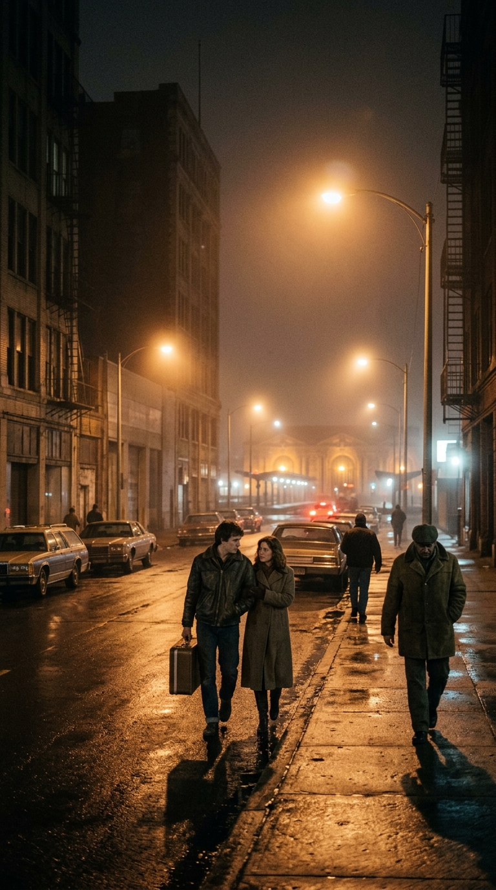
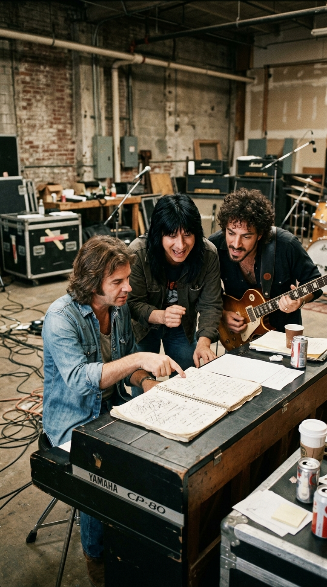
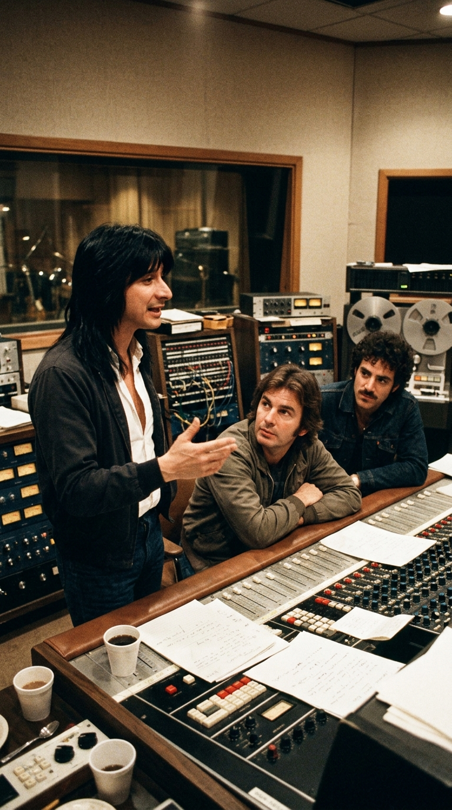
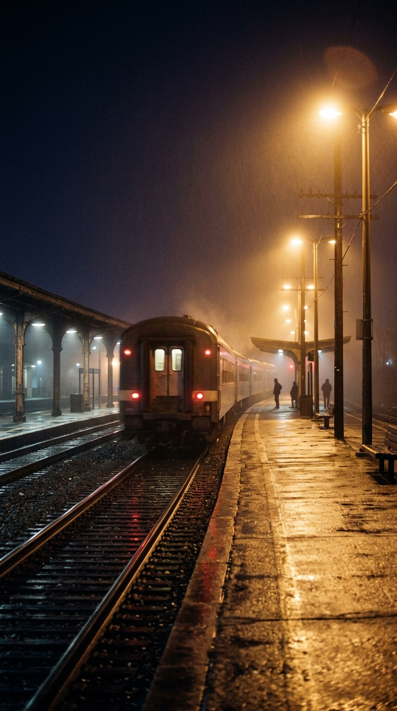

# The Four Words from a Father That Immortalized Journey: The True Story Behind «Don't Stop Believin'»

> *«Strangers waiting, up and down the boulevard, their shadows searching in the night... Streetlights, people, living just to find emotion. Don't stop believing, hold on to that feelin'.»*
> — **Journey** (Steve Perry, Jonathan Cain, Neal Schon), *«Don't Stop Believin'»* (1981).

---

### Prologue: The Call from an Apartment on Sunset Boulevard

In the late 1970s, long before they sold out stadiums across the globe, **Jonathan Cain** was just another musician among thousands of young hopefuls scraping by in Los Angeles, chasing an elusive break that never seemed to materialize. Born in Chicago in 1950—where at age eight he survived the devastating fire at *Our Lady of the Angels* Catholic school, a tragedy that claimed the lives of ninety-two schoolmates and three nuns—Cain had traveled to California with his piano and a suitcase full of songs, only to find the music industry slamming door after door in his face.

He lived in a tiny apartment near Sunset Boulevard, buried under past-due notices and with barely enough spare change for a meal. The breaking point arrived the day his dog, a small terrier named *Toto* who served as his sole companion in that unforgiving city, was struck by an automobile. At the veterinary clinic, he was told the surgery would cost nine hundred dollars—an impossible sum for his empty pockets.

Crushed by powerlessness, Jonathan picked up the receiver and called his father, **Leonard Cain**, back in Chicago. With a voice broken by tears, he confessed his defeat:

> *«Dad, I think this dream is over. I don't even have the money to save my dog. Should I pack up my things, come back to Chicago, and find a normal job?»*.

On the other end of the line, his father—a man of unshakable faith who had kept his family anchored after the 1958 school tragedy—immediately wired the money to save the animal's life, answering with a firmness wrapped in profound tenderness:

> *«Don't you ever come home defeated, son. Stay the course. Don't stop believin'»*.

When he hung up the phone, Jonathan picked up a pen, opened the worn spiral notebook where he kept stray ideas, and wrote those exact words from his father across the top of a blank page: ***Don't stop believin'***.

---

### Milestone II: Steve Perry’s Insomnia in the Detroit Fog

In 1980, Jonathan Cain’s destiny took an unexpected turn. During a tour where his band *The Babys* was opening for **Journey**, founding keyboardist Gregg Rolie decided to retire from the road. Guitarist **Neal Schon** and vocalist **Steve Perry** invited Cain to take over the keyboard position.

A few months earlier, during the grueling summer 1980 tour for the album *Departure*, Journey had stayed at the Pontchartrain Hotel in **Detroit, Michigan**. That night, riding the residual adrenaline of the concert, **Steve Perry** found sleep completely out of reach. The only child of Portuguese immigrants from the Azores, raised on a dairy farm in Hanford in California’s Central Valley, Perry knew intimately the heavy ache of nostalgia and displacement.

In the darkness of his room, the singer got out of bed and walked over to the large window overlooking the avenues of Detroit and the riverbanks facing Windsor, Canada (what his California mind poetically dubbed *«South Detroit»*). As he would recount years later in interviews with *Rolling Stone* and *Classic Rock*:

> *«I was completely wide awake in my Detroit hotel room, staring out the window at one or two in the morning. Everything was pitch black except for the amber glow of the streetlights. Suddenly, I’d see human figures stepping out of the shadows, crossing through the circle of light under a streetlight, and then vanishing right back into the night. I thought: Where is all this humanity going at this hour? What are they searching for out there in the dark?»*.

From that silent nocturnal vigil, Perry’s mind birthed the lines *«Strangers waitin', up and down the boulevard, their shadows searchin' in the night / Streetlights, people...»* and the image of two lonely characters—a small-town girl and a city boy—catching «a midnight train going anywhere» in the hope of starting anew.

---

### Milestone III: The Oakland Warehouse and the Spiral Notebook

In early 1981, Journey gathered in a cold rehearsal warehouse in **Oakland, California**, to hash out the repertoire for their seventh studio album, *Escape*. It was Jonathan Cain’s very first writing session as an official band member, and his nerves were fraying.

While Steve Perry sang him the melody of those strangers moving under the Detroit streetlights, and Neal Schon hunted for a guitar pattern that sounded like the steel wheels of a locomotive barreling through the night, they hit a creative wall: they had the characters' story, but they lacked the emotional core to give the journey its purpose.

That was when Jonathan Cain opened up his Yamaha CP-80 electric piano music stand and laid out that same old spiral notebook he had carried with him from his destitute days on Sunset Boulevard. He flipped past the dog-eared pages until he found the entry he had scribbled after talking to his father, and said to Perry and Schon: *«What do you think about calling it "Don't Stop Believin'"?»*.

Hearing the backstory behind those words sent a shiver through Steve Perry. During that exact period in 1981, the singer's mother, **Mary Quaresma Perry**—the woman who had raised him and taught him to love music as a boy—was battling the failing health that would cast a shadow over Perry’s most painful private years. That paternal advice to never surrender resonated in the souls of all three musicians like a sacred vow.

---

### Milestone IV: The Golden Rule in the Studio: «First, You Have to Cross the Night»

In the spring of 1981, the band entered **Studio C at Fantasy Studios** in Berkeley, California, under the guidance of British co-producer and engineer **Mike Stone** (celebrated for his prior work with Queen).

From the very first tracking session, Steve Perry and Jonathan Cain made a structural decision that defied every commercial rule of contemporary radio: **they forbade the chorus and the title of the song from appearing anywhere in the first three minutes**.

In a market where record executives demanded a hook before the fifty-second mark, *«Don't Stop Believin'»* pushes forward for three minutes and eight seconds through verses, bridges, and guitar interludes without uttering its title even once. The human reasoning behind Perry's choice was indisputable: in real life, faith does not arrive at the start of the road; a person must first weather the loneliness, fear, and uncertainty of the night before the light finally breaks through.

When the time came to lay down the definitive vocal track, Steve Perry stepped up to the Neumann microphone inside the wooden tracking room at Fantasy Studios and **sang the lead vocals almost from start to finish in a single continuous take**, hitting those soaring, passionate high notes in the final stretch that seemed to embrace every listener who had ever come close to giving up.

---

### Epilogue: The Midnight Train That Never Stopped

Released in October 1981 as the second single from *Escape* (an album that sold over ten million copies in the United States alone), *«Don't Stop Believin'»* peaked at number nine on the *Billboard Hot 100*. Yet what no one could have suspected in that autumn of 1981 was that the song was destined to live countless lives across the decades that followed.

In June 2007, when creator David Chase chose it to score the legendary final scene of the television landmark ***The Sopranos***, an entire new generation discovered the magic of those opening piano chords. Two years later, its cover in the pilot episode of ***Glee*** (2009) thrust it back onto global charts. With the advent of the digital era, it became the most-downloaded 20th-century track in history, earning an **18× Platinum** certification from the RIAA in 2024, and hailed by *Forbes* magazine as «the greatest song of all time» in terms of commercial impact and cultural resonance.

Yet far above the sold-out stadiums, films, and historic chart records, the true miracle of *«Don't Stop Believin'»* still resides back in that tiny Los Angeles apartment in the late seventies: in the voice of a father who refused to let his son abandon his calling, gifting the world four words capable of striking a match in the deepest night.

---

### 💬 Secret Chords Community
Who was that person in your life who told you *«don't stop believing»* right when you were ready to surrender? Tell us your story in the comments, and share this chronicle with the person who always believed in you.

---

### 📚 Sources and Archival Records
1. **Cain, Jonathan (2018).** *Don't Stop Believin': The Man, the Music, and the Miracle*. Zondervan Publishing, Grand Rapids. (Jonathan Cain’s official autobiography documenting firsthand his dog’s accident in Los Angeles, the phone call to his father Leonard Cain in Chicago, the spiral notebook, and the 1981 sessions in Oakland and Berkeley).
2. **Daniels, Neil (2011).** *Don't Stop Believin': The Untold Story of Journey*. Omnibus Press, London. (Biographical and musicological chronicle regarding Jonathan Cain joining Journey in 1980, Steve Perry's insomnia at the Pontchartrain Hotel in Detroit, and the production of *Escape* with Mike Stone).
3. **Steve Perry Interviews in *Rolling Stone* and *Classic Rock* (Archival Record, 2009–2018).** Direct testimonies from Steve Perry concerning the nocturnal sight of pedestrians under Detroit streetlights and the song's structurally delayed chorus.
4. **Fantasy Studios Session Archives (Berkeley, California, April–May 1981).** Technical credits and recording notes for the album *Escape* (Columbia Records TC 37408), produced by Mike Stone and Kevin Elson.
5. **Library of Congress — National Recording Registry (2022) & RIAA Gold & Platinum Database (2024).** Official induction of *«Don't Stop Believin'»* into the United States National Recording Registry and its historic 18× Platinum certification.