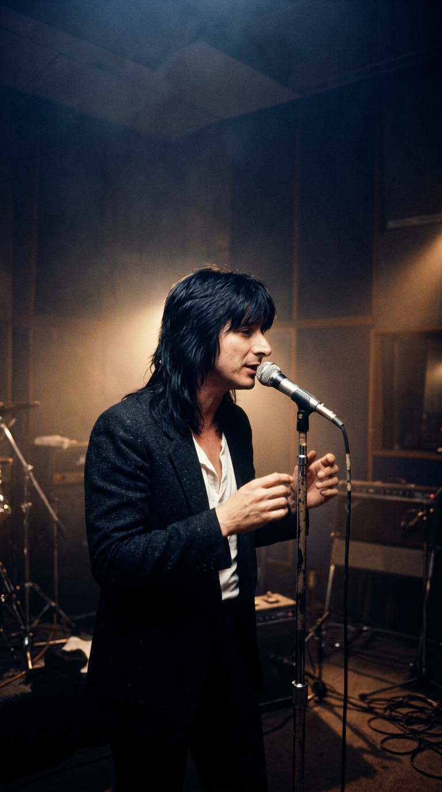
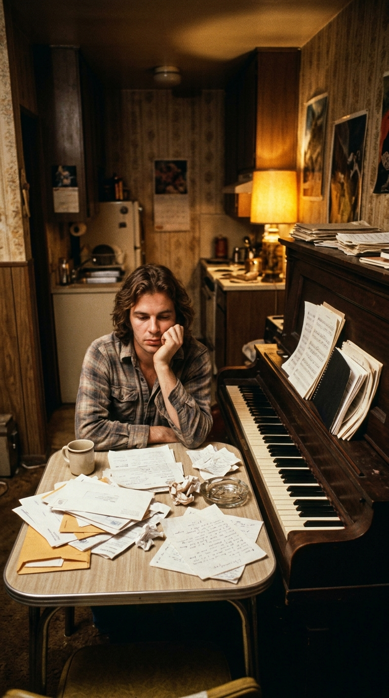
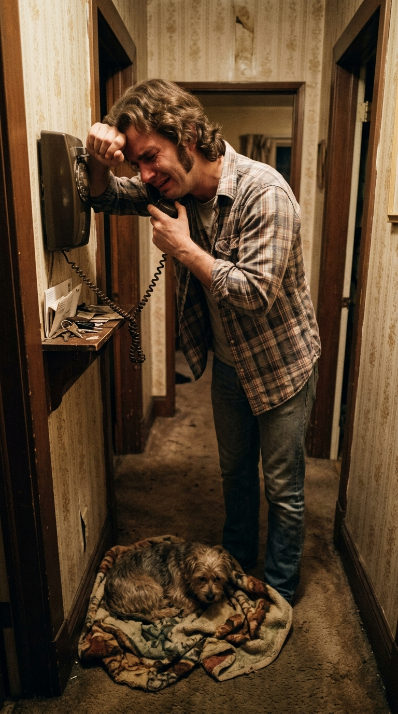
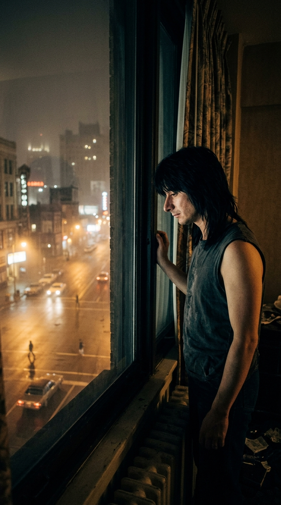
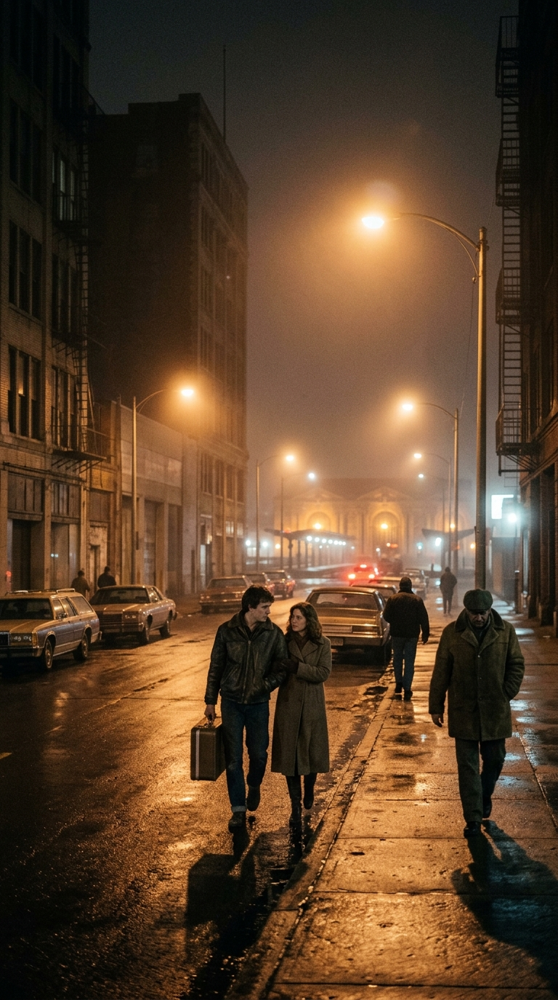
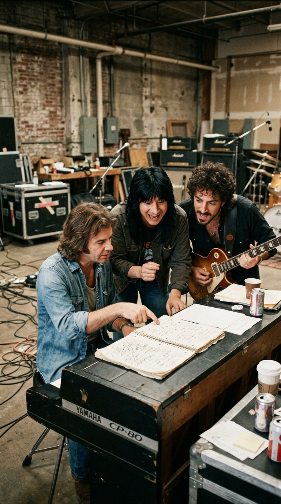
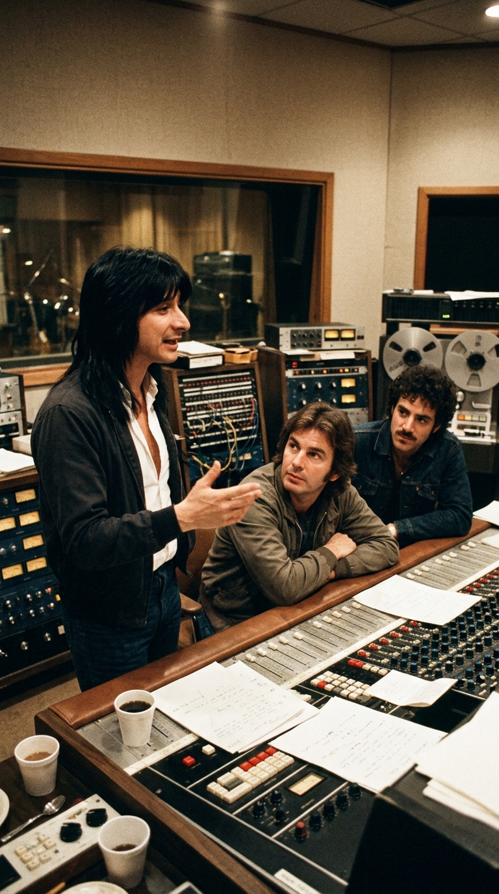
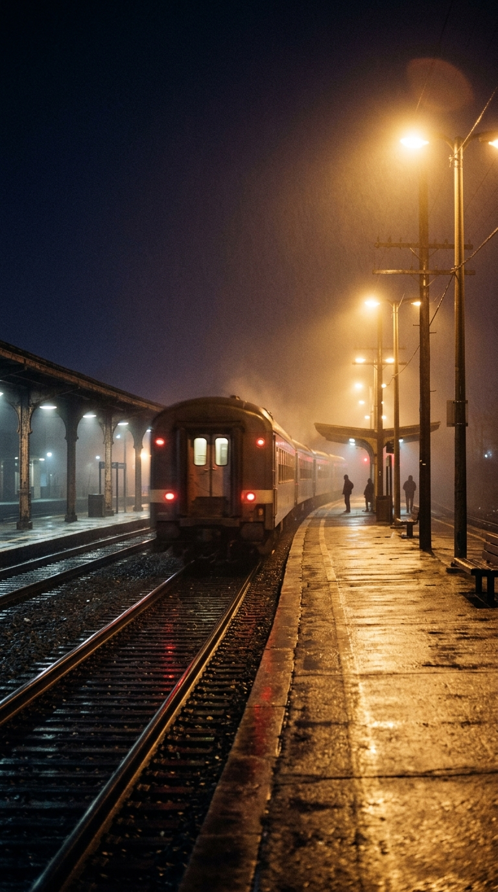

# Las cuatro palabras de un padre que inmortalizaron a Journey: la historia real detrás de «Don't Stop Believin'»

> *«Extraños esperando arriba y abajo del bulevar, sus sombras buscando en la noche… Farolas, gente, viviendo solo para encontrar emoción. No dejes de creer, aférrate a ese sentimiento».*
> — **Journey** (Steve Perry, Jonathan Cain, Neal Schon), *«Don't Stop Believin'»* (1981).

---

### I. La llamada desde un apartamento en Sunset Boulevard

A finales de la década de 1970, mucho antes de llenar estadios por todo el planeta, **Jonathan Cain** era un músico más entre los miles de jóvenes que malvivían en Los Ángeles persiguiendo una oportunidad que nunca terminaba de llegar. Nacido en Chicago en 1950 —donde a los ocho años había sobrevivido al devastador incendio de la escuela católica *Our Lady of the Angels*, en el que perecieron noventa y dos compañeros y tres religiosas—, Cain había viajado a California con su piano y una maleta llena de canciones, pero la industria discográfica le cerraba una puerta tras otra.

Vivía en un diminuto apartamento cerca de Sunset Boulevard, rodeado de recibos vencidos y con apenas unos dólares para comer. La gota que colmó su resistencia llegó el día en que su perro, un pequeño terrier llamado *Toto* que era su única compañía en aquella ciudad implacable, fue atropellado por un automóvil. En la clínica veterinaria le informaron que la cirugía costaba novecientos dólares, una cifra imposible para su bolsillo.

Derrumbado por la impotencia, Jonathan descolgó el teléfono y llamó a su padre, **Leonard Cain**, en Chicago. Con la voz rota por el llanto, le confesó su derrota:

> *«Papá, creo que este sueño se acabó. No tengo dinero ni para salvar a mi perro. ¿Debería empacar mis cosas, volver a Chicago y buscar un trabajo normal?»*.

Al otro lado de la línea, su padre —un hombre de fe inquebrantable que había sostenido a su familia tras la tragedia escolar de 1958— le transfirió de inmediato el dinero para salvar la vida del animal y le respondió con una firmeza llena de ternura:

> *«No vuelvas a casa derrotado, hijo. Mantén el rumbo. No dejes de creer ("Don't stop believin'")»*.

Cuando colgó el auricular, Jonathan tomó un bolígrafo, abrió el viejo cuaderno de espiral donde guardaba ideas sueltas y escribió en la parte superior de una página en blanco aquellas palabras exactas de su padre: ***Don't stop believin'***.

---

### II. El insomnio de Steve Perry en la niebla de Detroit

En 1980, el destino de Jonathan Cain dio un vuelco inesperado. Durante una gira donde su grupo *The Babys* abría los conciertos de **Journey**, el tecladista y miembro fundador Gregg Rolie decidió retirarse de la carretera. El guitarrista **Neal Schon** y el vocalista **Steve Perry** invitaron a Cain a ocupar el puesto en los teclados.

Pocos meses antes, durante la agotadora gira del álbum *Departure* en el verano de 1980, Journey se había hospedado en el hotel Pontchartrain de **Detroit, Michigan**. Aquella noche, tras la adrenalina del concierto, **Steve Perry** no lograba conciliar el sueño. Hijo único de inmigrantes portugueses de las islas Azores y criado en una granja lechera de Hanford, en el valle central de California, Perry conocía muy bien el peso de la nostalgia y el desarraigo.

En la oscuridad de su habitación, el cantante se levantó de la cama y se asomó al gran ventanal que daba hacia las avenidas de Detroit y las riberas del río que mira hacia Windsor, Canadá (lo que en su mente californiana llamó poéticamente *«South Detroit»*). Como relataría años después en entrevistas con *Rolling Stone* y *Classic Rock*:

> *«Estaba completamente desvelado en mi cuarto de hotel en Detroit, mirando por la ventana a la una o dos de la mañana. Todo estaba oscuro, salvo por el resplandor de las farolas. De pronto veía figuras humanas que salían de las sombras, cruzaban el círculo de luz de una farola y volvían a perderse en la noche. Pensé: ¿adónde va toda esa gente a esta hora? ¿Qué están buscando en medio de la oscuridad?»*.

De aquella vigilia silenciosa nacieron en la mente de Perry los versos *«Strangers waitin', up and down the boulevard, their shadows searchin' in the night / Streetlights, people...»* y la imagen de dos jóvenes solitarios —una chica de pueblo pequeño y un chico de ciudad— que toman «el tren de medianoche hacia cualquier lugar» (*midnight train going anywhere*) con la esperanza de empezar de nuevo.

---

### III. El almacén de Oakland y el cuaderno de espiral

A comienzos de 1981, Journey se reunió en un frío almacén de ensayos en **Oakland, California**, para componer el repertorio de su séptimo álbum de estudio, *Escape*. Era la primera sesión de composición de Jonathan Cain como miembro oficial de la banda, y los nervios lo dominaban.

Mientras Steve Perry le cantaba la melodía de aquellos extraños bajo las farolas de Detroit y Neal Schon buscaba un patrón de guitarra que sonara como las ruedas de acero de una locomotora avanzando en la noche, se toparon con un dilema: tenían la historia de los personajes, pero les faltaba el corazón emocional que le diera propósito al viaje.

Fue entonces cuando Jonathan Cain abrió sobre el atril de su piano eléctrico Yamaha CP-80 aquel viejo cuaderno de espiral que había traído desde sus años de penuria en Sunset Boulevard. Pasó las hojas ajadas hasta encontrar el apunte que había escrito tras hablar con su padre y les dijo a Perry y a Schon: *«¿Qué les parece si la llamamos "Don't Stop Believin'"?»*.

Al escuchar la historia detrás de esas palabras, Steve Perry sintió un escalofrío. En ese mismo periodo de 1981, la madre del cantante, **Mary Quaresma Perry** —la mujer que lo había criado y que le había enseñado a amar la música desde niño—, atravesaba ya el quebranto de salud que marcaría los años más dolorosos de la vida privada de Perry. Aquel consejo paterno de no rendirse resonó en el alma de los tres músicos como una promesa sagrada.

---

### IV. La regla de oro en el estudio: «Primero hay que cruzar la noche»

En la primavera de 1981, la banda entró al **Estudio C de Fantasy Studios**, en Berkeley, California, bajo la dirección del coproductor e ingeniero británico **Mike Stone** (célebre por sus trabajos previos con Queen).

Desde el primer ensayo de grabación, Steve Perry y Jonathan Cain tomaron una decisión estructural que desafiaba todas las leyes comerciales de la radio de la época: **prohibieron que el estribillo y el título de la canción sonaran en los primeros tres minutos**.

En un mercado donde los ejecutivos discográficos exigían que el coro apareciera antes de los cincuenta segundos, *«Don't Stop Believin'»* avanza durante tres minutos y ocho segundos a través de estrofas, puentes e interludios de guitarra sin pronunciar una sola vez su título. La razón humana que esgrimió Perry era incontestable: en la vida real, la fe no aparece al comienzo del camino; uno tiene que atravesar primero la soledad, el miedo y la incertidumbre de la noche antes de que estalle la luz.

Cuando llegó el momento de registrar la pista vocal definitiva, Steve Perry se colocó frente al micrófono Neumann en la sala de madera de Fantasy Studios y **cantó la canción casi de principio a fin en una sola toma continua**, alcanzando en el tramo final esos agudos limpios y apasionados que parecían abrazar a cada oyente que alguna vez estuvo a punto de darse por vencido.

---

### V. Epílogo: El tren de medianoche que nunca se detuvo

Lanzada en octubre de 1981 como segundo sencillo del álbum *Escape* (que vendió más de diez millones de copias solo en Estados Unidos), *«Don't Stop Believin'»* alcanzó el puesto número nueve del *Billboard Hot 100*. Pero lo que nadie sospechaba en aquel otoño de 1981 era que la canción estaba destinada a vivir múltiples vidas a lo largo de las décadas siguientes.

En junio de 2007, cuando el creador David Chase la eligió para acompañar la célebre escena final de la serie ***Los Soprano***, una nueva generación entera descubrió la magia de aquel piano inicial. Dos años después, su versión en el episodio piloto de ***Glee*** (2009) la devolvió a las listas mundiales, y con la llegada de la era digital se convirtió en la pista del siglo XX más descargada de toda la historia y fue certificada por la RIAA con **18 discos de platino** en 2024, siendo proclamada por la revista *Forbes* como «la canción más grande de todos los tiempos» en términos de impacto comercial y vigencia cultural.

Sin embargo, por encima de los estadios llenos, las películas y los récords históricos, el verdadero milagro de *«Don't Stop Believin'»* sigue habitando en aquel pequeño apartamento de Los Ángeles a finales de los años setenta: en la voz de un padre que no permitió que su hijo renunciara a su vocación y le regaló al mundo cuatro palabras capaces de encender una luz en la noche más larga.

---

### 💬 Comunidad Acordes Ocultos
¿Quién fue esa persona en tu vida que te dijo *«no dejes de creer»* justo cuando estabas a punto de rendirte? Cuéntanos tu historia en los comentarios y comparte esta crónica con quien siempre creyó en ti.

---

### 📚 Fuentes y Archivo Documental
1. **Cain, Jonathan (2018).** *Don't Stop Believin': The Man, the Music, and the Miracle*. Zondervan Publishing, Grand Rapids. (Autobiografía oficial de Jonathan Cain donde documenta en primera persona el accidente de su perro en Los Ángeles, la llamada telefónica a su padre Leonard Cain en Chicago, el cuaderno de espiral y las sesiones en Oakland y Berkeley en 1981).
2. **Daniels, Neil (2011).** *Don't Stop Believin': The Untold Story of Journey*. Omnibus Press, Londres. (Crónica biográfica y musicológica sobre el ingreso de Jonathan Cain a Journey en 1980, el insomnio de Steve Perry en el hotel Pontchartrain de Detroit y la producción de *Escape* con Mike Stone).
3. **Entrevista a Steve Perry en *Rolling Stone* y *Classic Rock* (Archivo Documental, 2009–2018).** Testimonios directos de Steve Perry sobre la visión nocturna de los peatones bajo las farolas de Detroit y la estructura sin estribillo inicial de la canción.
4. **Archivos de Sesión de Fantasy Studios (Berkeley, California, abril–mayo de 1981).** Créditos técnicos y notas de grabación del álbum *Escape* (Columbia Records TC 37408), producido por Mike Stone y Kevin Elson.
5. **Library of Congress — National Recording Registry (2022) & RIAA Gold & Platinum Database (2024).** Incorporación oficial de *«Don't Stop Believin'»* al Registro Nacional de Grabaciones de Estados Unidos y certificación histórica de 18× Platino.
