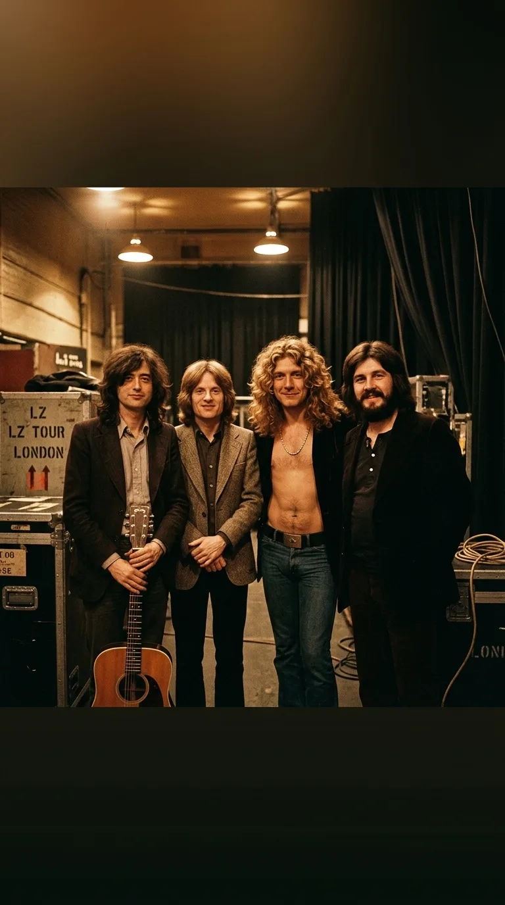
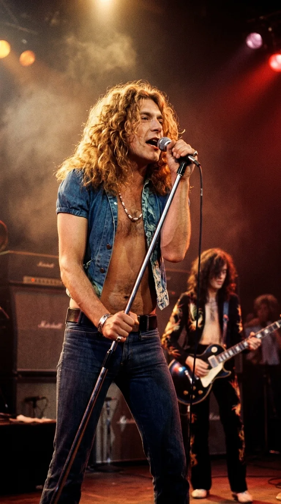
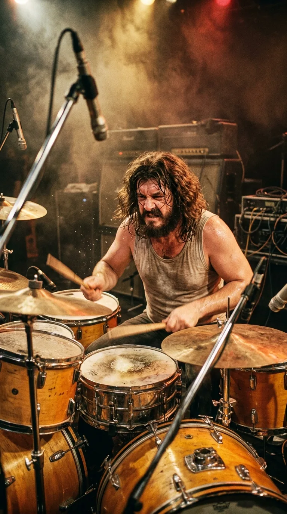
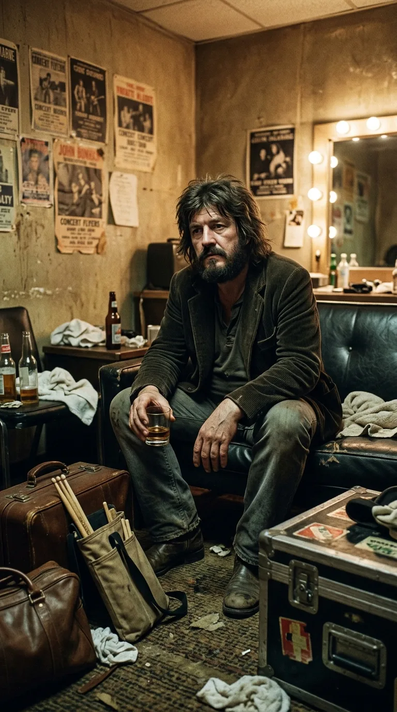
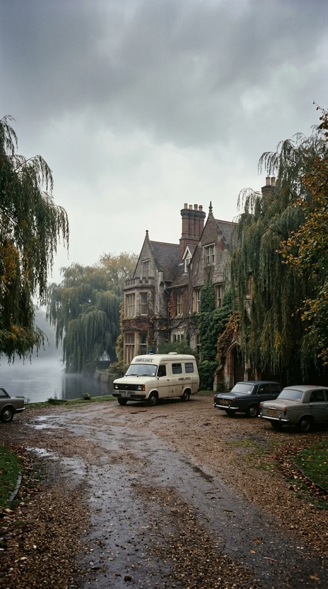
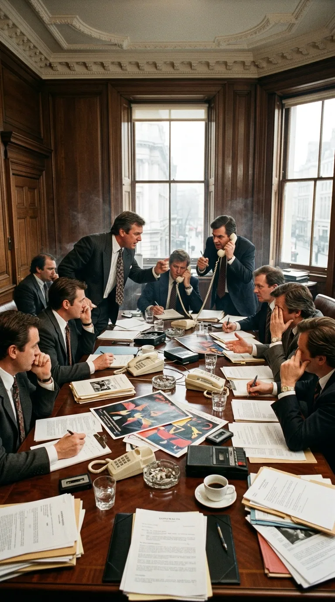
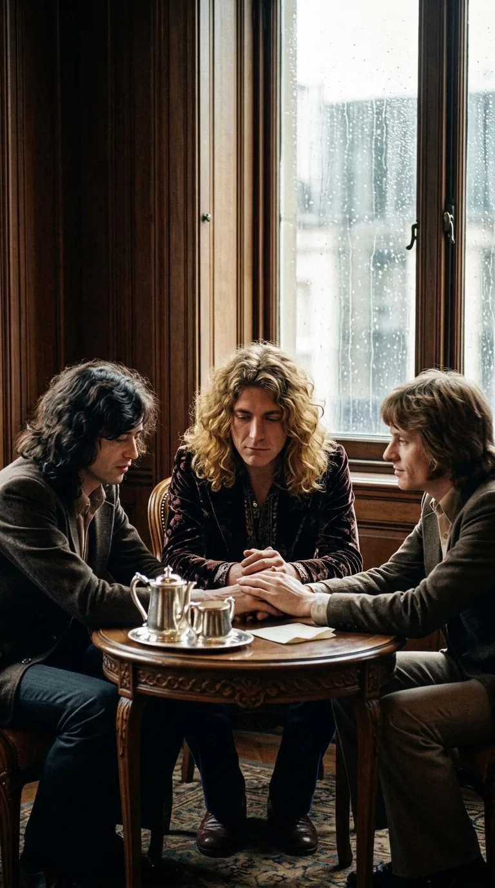
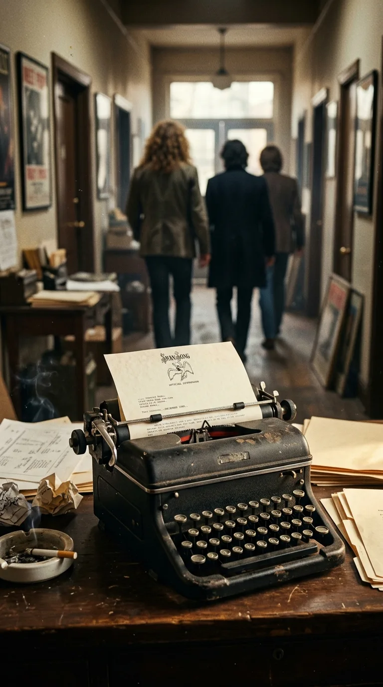

# ⚡ El Pacto Sagrado del Silencio: La Muerte de Bonzo y el Fin de Led Zeppelin

> *«Deseamos que se sepa que la pérdida de nuestro querido amigo y el profundo respeto que sentimos por su familia nos han llevado a decidir que no podemos continuar como éramos».*  
> — **Declaración oficial de Led Zeppelin**, 4 de diciembre de 1980

---

*1975: Jimmy Page, Robert Plant, John Paul Jones y John Bonham en la cúspide de su leyenda sonora.*

---

### Prólogo: El peso del trono vacío

En el otoño de 1980, no existía en el planeta una fuerza musical más colosal que Led Zeppelin. Habían llenado estadios monumentales de costa a costa, desafiado las leyes de la industria discográfica y construido una leyenda cimentada en el exceso, la mística y una potencia sonora que redefinió para siempre el rock. Tras años difíciles marcados por tragedias familiares, exilios fiscales y cancelaciones forzosas, la banda británica se disponía a embarcarse en su gira más ambiciosa por los Estados Unidos: diecinueve fechas con entradas agotadas en cuestión de horas y un montaje descomunal que prometía devolverlos al trono absoluto del rock mundial.

*Knebworth, 1979: Led Zeppelin dominando el escenario frente a una multitud multitudinaria, en el cénit de su potencia escénica.*

Sin embargo, el destino no entiende de contratos millonarios ni de calendarios de gira. En la madrugada del 25 de septiembre de 1980, en una habitación silenciosa de una mansión de Berkshire, el motor rítmico que sostenía aquel imperio dejó de latir. Y cuando la industria del entretenimiento esperó el movimiento habitual de los gigantes —reemplazar la pieza caída y seguir rodando la maquinaria del dinero—, Robert Plant, Jimmy Page y John Paul Jones hicieron algo que desconcertó al mundo: decidieron que la hermandad valía más que cualquier legado de oro, y apagaron los amplificadores para siempre.

---

### Acto I: El trueno de Worcestershire

Para entender por qué Led Zeppelin no podía sobrevivir sin John Bonham, hay que comprender qué era Bonzo dentro de aquel engranaje irrepetible. Nacido en Redditch en 1948, Bonham no tocaba la batería como un metrónomo; la azotaba como un herrero medieval forjando hierro candente, pero con un sentido del swing, la síncopa y la dinámica que ningún baterista de su generación poseía. Su bombo Ludwig de veintiséis pulgadas no marcaba el compás: empujaba el aire con la violencia de una detonación subterránea.

*El trueno rítmico: John «Bonzo» Bonham azotando la caja y el bombo Ludwig con una potencia y swing inimitables.*

En composiciones colosales como *«Kashmir»*, Bonham demostró su maestría insuperable. Mientras la guitarra de Jimmy Page y las cuerdas de John Paul Jones ascendían en un hipnótico ciclo rítmico de tres por cuatro, Bonzo anclaba la base con un patrón demoledor de cuatro por cuatro, creando una tensión gravitatoria que transportaba al oyente al corazón de una caravana en el desierto. Robert Plant diría años más tarde que *«Kashmir»* era la cima de su obra porque capturaba la esencia de cuatro espíritus independientes fundidos en una sola respiración.

Pero detrás de la ferocidad del escenario, Bonham cargaba con una vulnerabilidad íntima devastadora. Odiaba estar lejos de su granja de The Old Hyde, de su esposa Pat y de sus dos hijos pequeños, Jason y Zoë. El terror cerval al aislamiento de las giras, sumado a una ansiedad galopante antes de salir a tocar frente a cien mil personas, lo llevó a refugiarse en un consumo destructivo de alcohol que con los años se volvió ingobernable.

*1980: La vulnerabilidad oculta: Bonzo en la penumbra del camerino, batallando en silencio contra la ansiedad de las giras.*

---

### Acto II: La última madrugada en Clewer (Septiembre de 1980)

El 24 de septiembre de 1980, Led Zeppelin se concentró en los Bray Studios de Berkshire para iniciar los ensayos generales previos al viaje a Norteamérica. En el trayecto hacia el estudio, Bonham se detuvo en un bar y bebió cuatro vodkas cuádruples con jamón como desayuno improvisado. La ansiedad por la gira que se avecinaba le atenazaba el estómago. Continuó bebiendo de manera compulsiva durante la sesión de trabajo.

Al caer la noche, el grupo se trasladó a The Old Mill House, la residencia de Jimmy Page en Clewer, cerca de Windsor. La reunión continuó entre conversaciones y notas de ensayo hasta pasada la medianoche, cuando Bonzo cayó profundamente dormido en un sofá. Uno de los asistentes de la banda lo ayudó a subir a la habitación de invitados y lo acostó de costado en la cama.

*Clewer, Windsor, septiembre de 1980: The Old Mill House envuelta en la bruma tras la trágica partida de John Bonham.*

Al día siguiente, 25 de septiembre, poco antes de las dos de la tarde, John Paul Jones y el tour manager Benji LeFevre subieron a la habitación para despertarlo y retomar los ensayos. LeFevre se acercó a la cama y comprobó que no respondía; al tomarle el pulso, descubrió que estaba helado. Los médicos certificaron que John Bonham había fallecido durante la noche por asfixia accidental por broncoaspiración provocada por una intoxicación alcohólica extrema. Tenía apenas treinta y dos años.

---

### Acto III: La tentación del trono y el pacto en el Savoy

La noticia sacudió al planeta como un terremoto. La prensa británica y los tabloides sensacionalistas se abalanzaron sobre la tragedia, pero en los despachos de los promotores y de Swan Song Records comenzó a circular una pregunta inevitable: ¿quién sustituiría a Bonzo?

Las presiones financieras eran feroces. Había decenas de millones de dólares en juego, compromisos contractuales ineludibles y contratos televisivos. En las redacciones y mentideros del rock comenzaron a barajarse nombres de primerísimo nivel: Cozy Powell, Carmine Appice, Aynsley Dunbar o Barriemore Barlow. Otras bandas legendarias de la época habían reemplazado a sus miembros caídos sin pestañear para mantener la maquinaria en marcha.

*Londres, finales de 1980: La industria y los promotores discutiendo la sustitución de Bonzo para salvar la multimillonaria gira.*

A finales de noviembre de 1980, Robert Plant, Jimmy Page y John Paul Jones se reunieron en una suite privada del Hotel Savoy de Londres junto a su mánager Peter Grant. No hubo discusiones contractuales ni cuentas sobre la mesa. Plant fue tajante: tras perder a su hijo Karac en 1977 y ahora a su hermano más leal, no tenía fuerzas ni deseo alguno de cantar si al girarse no veía a Bonzo sonriendo tras los platillos. Page y Jones coincidieron de inmediato. Led Zeppelin no era una marca corporativa; era la alquimia irrepetible de cuatro almas. Quitar a uno significaba profanar la verdad de lo que habían creado.

*Hotel Savoy, noviembre de 1980: El pacto de hermandad: Plant, Page y Jones deciden por unanimidad que Led Zeppelin no puede continuar sin Bonzo.*

El 4 de diciembre de 1980 emitieron un comunicado de prensa de apenas dos frases que selló el final definitivo de la banda más grande del mundo: *«Deseamos que se sepa que la pérdida de nuestro querido amigo y el profundo respeto que sentimos por su familia nos han llevado a decidir que no podemos continuar como éramos»*.

---

### Acto IV: La lección de lealtad sobre los millones

En una industria donde el éxito suele devorarlo todo y las marcas corporativas continúan girando con formaciones fantasma que poco tienen que ver con los fundadores, la decisión de Led Zeppelin se erige como una de las cumbres morales más nobles de la historia de la cultura popular. 

Rechazaron giras de reunión millonarias durante décadas, negándose a resucitar el nombre a menos que se tratara de causas benéficas puntuales (como Live Aid en 1985 o el mítico concierto de homenaje a Ahmet Ertegun en el O2 Arena de Londres en 2007, donde el único capaz de sentarse en la batería fue Jason Bonham, el propio hijo de Bonzo).

*4 de diciembre de 1980: La máquina redactando el histórico comunicado oficial de despedida en papel de Swan Song.*

---

### Epílogo: El trueno que no se extingue

Cada vez que el riff hipnótico de *«Kashmir»* comienza a golpear el pecho con la fuerza de un titán, no escuchamos únicamente una obra maestra del rock; escuchamos el corazón indestructible de un hombre que amaba a los suyos por encima de la fama, y a tres hermanos que prefirieron renunciar a su imperio antes que traicionar su memoria.

El legado de Led Zeppelin no se mide únicamente en los cientos de millones de discos vendidos ni en los récords de taquilla que jamás fueron superados. Se mide en la dignidad de saber cuándo una historia es tan sagrada que merece cerrarse con el silencio reverente que solo se concede a los reyes.

*El silencio de los reyes: la batería Ludwig en calma sobre las tablas, testimonio de una hermandad que el dinero jamás pudo comprar.*

---

### 💬 Conversación y Memoria

*¿En qué momento de tu vida descubriste el sonido de Led Zeppelin y qué sentiste al saber que prefirieron disolver la banda antes que sustituir a John Bonham? Te leemos en los comentarios.*

---

### 📚 Fuentes y Archivo Documental

* Davis, Stephen. *Hammer of the Gods: The Led Zeppelin Saga*. William Morrow & Co., Nueva York, 1985.
* Welch, Chris. *John Bonham: A Thunder of Drums*. Backbeat Books, San Francisco, 2001.
* Lewis, Dave. *Led Zeppelin: The Complete Guide to Their Music*. Omnibus Press, Londres, 2004.
* Archivo hemerográfico de *Melody Maker* y *New Musical Express (NME)*: Comunicados oficiales de disolución y crónicas de octubre a diciembre de 1980.
* Registro forense oficial de la Corte de Windsor (East Berkshire Coroner's Court), autopsia y veredicto del 27 de octubre de 1980 sobre el fallecimiento de John Bonham.
