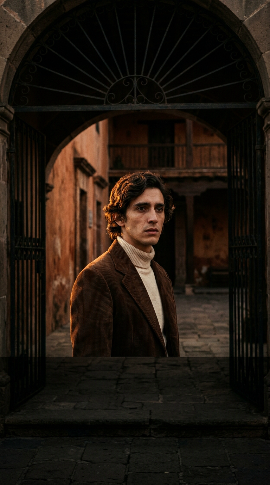
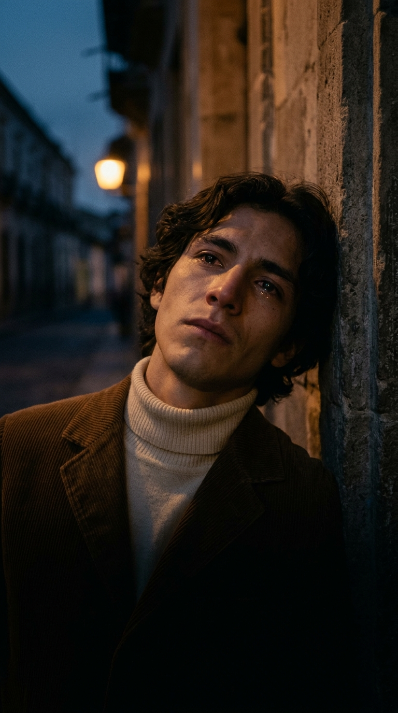

# La tarde que el amor se marchó en otros brazos

**Por el equipo editorial de Acordes Ocultos · Serie «Historia en los Acordes»**

---

> *«Fui a esperar a la salida de la escuela a la mujer que yo más quería... / La vi salir sonriente y feliz, pero del brazo de otro amor. / Otro le cargaba los libros, otro le decía al oído palabras de amor... / Y yo, escondido tras de una esquina, sentí luto en mi alma, pensando en mi suerte, pero sin llorar».*

Hay desengaños que no necesitan de cartas trágicas ni de despedidas en estaciones de tren para quebrar una vida en dos; les basta la luz dorada de un atardecer cualquiera y la rutina implacable de una acera de colegio. Cuando en **1974** el sello venezolano **Discomoda** prensó en vinilo de cuarenta y cinco revoluciones el tema ***«Luto en mi alma»***, interpretado por la agrupación **Los Terrícolas**, miles de jóvenes a lo largo y ancho de América Latina reconocieron al instante una escena grabada a fuego en su propia memoria sentimental: el instante brutal en que el primer amor se desvanece delante de los ojos sin que medie una sola palabra de aviso.

En poco más de cuatro minutos sostenidos por el pulso arrastrado del órgano Farfisa, las guitarras con trémolo y el dramatismo vocal inconfundible de **Néstor Daniel**, la composición de **Manny Delgado** transformó una anécdota cotidiana de juventud en una tragedia íntima de dimensiones universales. Aquel muchacho que esperaba con el corazón en la garganta a la salida de clases no solo descubría la infidelidad; aprendía, de golpe y en silencio, la amarga lección de la dignidad humana.

*(Nota editorial: En nuestra línea **«Historia en los Acordes»**, las imágenes que acompañan esta entrega recrean cinematográficamente a los personajes ficticios que habitan dentro de la letra compuesta por Manny Delgado en 1974, distinguiéndolos rigurosamente de la biografía de los integrantes de la agrupación venezolana).*

---

## Prólogo: Caracas, 1974 y el rugido sentimental de Discomoda

Para entender el impacto volcánico que provocó *«Luto en mi alma»* en las radios de Caracas, Ciudad de México, Bogotá, Lima y Buenos Aires a mediados de los setenta, es indispensable viajar a los talleres sonoros donde se gestó la leyenda. Oriundos de **Morón**, en el estado Carabobo, los hermanos Hoyer —Johnny, Néstor Daniel, Ángel David y Lenny Beatríz— habían comenzado a tocar a finales de los sesenta bajo el influjo directo de los grupos de garaje y la balada romántica naciente. Sin embargo, su consagración definitiva no llegaría hasta toparse con dos figuras clave: el compositor y productor **Manny Delgado** y los míticos estudios de **Discomoda**, capitaneados por César Roldán.

En una década dominada comercialmente por el auge de la salsa neoyorquina y las grandes orquestaciones europeas, Los Terrícolas construyeron un lenguaje sonoro propio, austero y profundamente visceral. Manny Delgado entendió como pocos que el público popular no buscaba virtuosismo estéril ni complejidades barrocas, sino la verdad cruda de los sentimientos cotidianos. Sus arreglos colocaron en primer plano la voz de Néstor Daniel: un timbre quebrado, quejumbroso y magnético, capaz de oscilar entre el recitado íntimo casi susurrado y el lamento desgarrado a garganta abierta.

*«Luto en mi alma»* no tardó en convertirse en la cima emocional de su producción de 1974. Mientras otros artistas de la época cantaban al romance idílico o a la nostalgia abstracta, Delgado y Los Terrícolas llevaron a los tocadiscos una escena que olía a uniforme escolar, a libros atados con correas de cuero y al frío repentino de una esquina en sombra.

---

## Acto I: La campana de las cinco y la ilusión ingenua

La historia narrada por la canción comienza con la pureza intacta de la fe juvenil. El protagonista acude a la salida del colegio con la puntualidad religiosa de quien ha contado las horas durante todo el día. No hay sospechas en su mente ni nubarrones en el horizonte; solo la expectación luminosa de contemplar, un día más, el rostro de la mujer que da sentido a sus desvelos.

> *«Esperaba verla salir de clases con la ilusión de cada tarde...»*

En los colegios de la América Latina de 1974, la salida de las clases de la tarde era un acontecimiento social cargado de códigos compartidos. La campana liberaba un río de risas, carteras al hombro y uniformes que rompían la disciplina del aula. En medio de esa marea dorada por el sol poniente, el muchacho busca únicamente unos ojos conocidos, aguardando esa sonrisa cómplice que tantas veces le prometió lealtad en las bancas de la plaza.

Pero la belleza de la juventud tiene también una contracara despiadada: la facilidad con que el viento cambia de rumbo y las promesas se desvanecen antes de secarse la tinta de los cuadernos.

---

## Acto II: La revelación en la acera y las palabras al oído

El quiebre de la trama se produce con la lentitud congelada de una pesadilla. Ella cruza el umbral del portón de hierro, pero no viene sola. Camina al lado de otro estudiante; un joven que sostiene con calculada cortesía su fardo de libros bajo el brazo y camina marcando el paso con ella.

> *«Otro le cargaba los libros, otro le decía al oído palabras de amor...»*

El detalle de los libros prestados o cargados no es un adorno lírico menor: en los años setenta, permitir que otro muchacho llevara los textos escolares a la salida del colegio equivalía a una declaración pública de cortejo aceptado. Era el lenguaje visible de la entrega. Y para rematar el desengaño, el pretendiente se inclina hacia su oído para susurrarle algo en voz baja, provocando en la muchacha una risa fresca, cómplice e indiscutible.

El narrador, que ha retrocedido hacia el zaguán de una esquina para no ser visto, contempla la escena a escasos metros. En ese segundo preciso, el mundo entero pierde su gravedad. No hay margen para la duda ni lugar para el malentendido: aquellas palabras al oído solían ser suyas; esa risa tímida le pertenecía apenas el día anterior.

---

## Acto III: El funeral sin lágrimas

Es en este instante crucial donde *«Luto en mi alma»* se separa de los lugares comunes del melodrama y alcanza su grandeza poética y humana. Frente a la traición consumada, el instinto ordinario pediría el escándalo: el grito herido, el reclamo público o el llanto descontrolado que busca la lástima ajena. 

Sin embargo, el protagonista elige la resistencia moral más difícil: la contención.

> *«Y yo, escondido tras de una esquina, / sentí luto en mi alma, / pensando en mi suerte, / pero sin llorar...»*

Esa frase —*«pero sin llorar»*— constituye el corazón palpitante de toda la obra. El luto no es una prenda exterior de tela negra que se exhibe para recibir condolencias; es un duelo íntimo, silencioso y vertical que se lleva por dentro. Apretando la mandíbula contra la pared de piedra, el muchacho traga el veneno de la desilusión sin permitir que una sola gota ruede por su mejilla. Prefiere que su corazón arda por dentro antes que regalarle a los traidores la satisfacción de verlo derribado.

La pareja pasa a su lado rozando la sombra donde él se oculta, sin llegar a mirarlo ni imaginar el peso del silencio que dejan a sus espaldas. Caminan hacia el final de la calle mientras el crepúsculo apaga los adoquines, sellando el final irrevocable de una etapa de la vida.

---

## Epílogo: El testamento de una memoria compartida

Más de medio siglo después de su grabación en los estudios caraqueños de Discomoda, *«Luto en mi alma»* continúa habitando en la memoria afectiva de millones de personas que crecieron con los casetes y los vinilos de Los Terrícolas. La voz de Néstor Daniel sigue erizando la piel porque no finge la pena: canta desde el lugar exacto donde duele el orgullo cuando el amor de juventud se quiebra para siempre.

Todos hemos sido alguna vez ese muchacho apoyado en la pared de una esquina solitaria, viendo partir la felicidad en brazos ajenos. Y todos aprendimos, con esta balada de fondo, que las heridas más hondas del alma son aquellas que se entierran de pie, con la cabeza en alto y en absoluto silencio.

---

### 💬 Conversación con la comunidad

¿Recuerdas en qué momento de tu vida o en casa de quién escuchaste por primera vez *«Luto en mi alma»*? ¿Qué imagen te devuelve la memoria cuando la voz de Néstor Daniel canta ese duelo silencioso? Te leemos con el corazón en los comentarios.

---

### 📚 Fuentes y Archivo Documental

1. **Archivos Fonográficos de Discomoda (Caracas, Venezuela)**: Fichas técnicas de prensaje del LP *Los Terrícolas: Luto en mi alma* (Referencia DCM-1974), grabaciones maestras bajo la producción de César Roldán y Manny Delgado.
2. **Delgado, Manny**: *Crónicas de la balada y la música popular venezolana* (Hemeroteca Nacional de Venezuela, compilación de entrevistas sobre composición y arreglos para la agrupación Los Terrícolas, 1973-1978).
3. **Pérez, José Vicente**: *Historia del pop y la balada romántica en Venezuela (1965-1980)*, Editorial Arte, Caracas, 1992.
4. **Catálogos y cancioneros de la revista Radiolandia y Noti-Discos**: Registros hemerográficos de difusión radial de baladas en México y el Caribe (1974-1976).
5. **Entrevistas de archivo a Néstor Daniel Hoyer**: Testimonios sobre el estilo interpretativo y la grabación vocal en los estudios de Discomoda en Caracas (Archivo de la Radiodifusión Venezolana).
